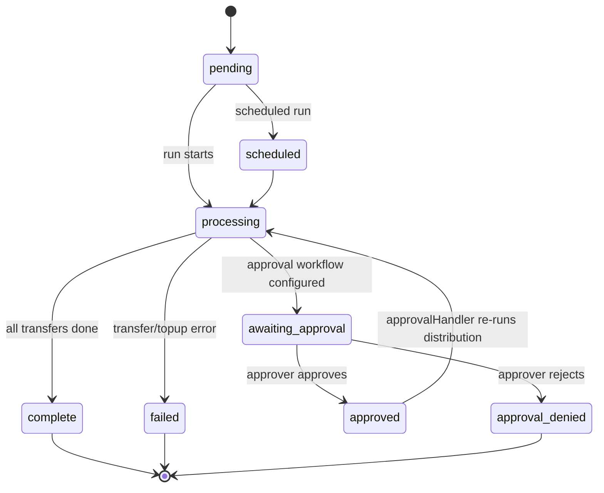
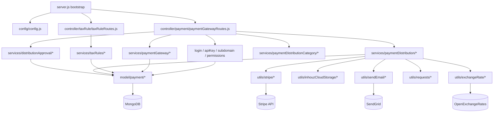

# payment_gateway_ms

## 1. Summary

The payment gateway and payment-distribution service of the Inhouz ERP. It owns Stripe gateway
credentials per company, payment tax rules, payout distribution accounts and the scheduled
distribution run that transfers money from a company's Stripe balance to connected accounts, plus
the approval workflow, audit log, metrics and document files that surround a distribution. It also
exposes a self-service "request portal" where a payout recipient logs in to onboard a Stripe
connected account. Source: `apps/payment_gateway_ms` — a separate git repository, not the control
repo.

## 2. Stack and commands

- Runtime: Node.js, CommonJS, Express 4. `server.js:1-11`
- Package: `name` is `micro_service_template` and `description` is `The base of all simple erp
  microservices` — the service was cloned from the shared template and the metadata was never
  changed. `package.json:2-3`
- Scripts: `start` = `node server.js`; `test` = `echo "Error: no test specified" && exit 1`.
  `package.json:7-9`
- Port: from `PORT` env var, read at listen time. `server.js:106`
- Start command: `npm start` (equivalently `node server.js`). `package.json:8`
- Container: image `inhouz/payment_gateway_ms`, 1 replica, service
  `payment-gateway-ms-cluster-ip-service` on port 5057. `k8s/payment-gateway-ms-deployment.yml:6,17`,
  `k8s/payment-gateway-ms-cluster-ip-service.yml:4,10`
- Healthcheck: a separate `healthcheck.js` makes an HTTP request to the `PORT` value.
  `healthcheck.js:1,6`

## 3. Entry points

| Entry point | Where | How started |
|---|---|---|
| Cluster master | `server.js:44-61` | `node server.js` in the container; forks one worker per CPU in production, one worker otherwise |
| Express HTTP server | `server.js:63-108` | inside each forked worker; `app.listen(process.env.PORT)` at `server.js:106` |
| Mongo connect and reconnect loop | `server.js:78-95`, `server.js:111-123` | on worker start, and a 5 s `setTimeout` retry on `disconnected` at `server.js:88` |
| Payment gateway + distribution routes | `controller/payment/paymentGatewayRoutes.js:54-102` | mounted by `require(...)(app)` at `server.js:76` |
| Tax rule routes | `controller/taxRule/taxRuleRoutes.js:10-16` | mounted by `require(...)(app)` at `server.js:77` |
| Model registration (29 `require`s) | `server.js:13-42` | on worker start, before routes |
| Graceful shutdown | `server.js:96-104` | `SIGINT`, `SIGTERM`, `uncaughtException` close the mongoose connection |

There is no cron job in this service. The one `setTimeout` is the Mongo reconnect timer
(`server.js:88`), not a scheduled task; the scheduled distribution run is triggered over HTTP by
`payment_validation_scheduler_ms` and `inhouz_pay_scheduler_ms`.

## 4. Module inventory

| Module | `file:line` | Owns | Public API | Kind |
|---|---|---|---|---|
| `server.js` | `server.js:1` | bootstrap, cluster, middleware stack, mongo lifecycle | — | effectful |
| `config/config.js` | `config/config.js:18` | cached config object; secrets read from `/mnt/secrets` files with env fallback | `module.exports()` returns config | effectful (filesystem + env) |
| `readSecret` | `config/config.js:5` | reads a secret file, falls back to an env var | `readSecret(name, envFallback)` | effectful |
| `paymentGatewayRoutes` | `controller/payment/paymentGatewayRoutes.js:54` | 47 payment/distribution routes and their middleware chains | `(app) => void` | effectful (registers routes) |
| `taxRuleRoutes` | `controller/taxRule/taxRuleRoutes.js:10` | 5 tax-rule routes | `(app) => void` | effectful |
| `createGateway` | `services/paymentGateway/createGateway.js` | validates and stores Stripe live/test keys for a company | `(req,res)` | effectful (Mongo + validation) |
| `editGateway` | `services/paymentGateway/editGateway.js` | edits an existing gateway | `(req,res)` | effectful |
| `deleteGateway` | `services/paymentGateway/deleteGateway.js` | deletes a gateway | `(req,res)` | effectful |
| `getGateways` / `getGateway` | `services/paymentGateway/getGateways.js`, `getGateway.js` | list and read a gateway | `(req,res)` | effectful (reads Mongo) |
| `createDistributionAccount` | `services/paymentDistribution/createDistributionAccount.js` | creates a Stripe connected account and posts the account to the company webhook | `(req,res)` | effectful (Mongo + Stripe + network) |
| `distributionAccountSanityCheck` | `services/paymentDistribution/distributionAccountSanityCheck.js` | re-checks a connected account against Stripe and the company webhook | `(req,res)` | effectful |
| `createOnboardingLink` | `services/paymentDistribution/createOnboardingLink.js` | Stripe account-link onboarding | `(req,res)` | effectful |
| `createConnectAccountDashboardLink` | `services/paymentDistribution/createConnectAccountDashboardLink.js:53,92,134` | Stripe Express dashboard link for a subscription | `(req,res)` | effectful |
| `requestPortalLogin` / `Logout` / `getPortalUser` | `services/paymentDistribution/requestPortal*.js`, `getPortalUser.js` | session for the recipient self-service portal | `(req,res)` | effectful |
| `distributionAccountRequestPassword` | `services/paymentDistribution/distributionAccountRequestPassword.js` | issues portal password/access | `(req,res)` | effectful |
| `runDistribution` | `services/paymentDistribution/runDistribution.js:31` | the money movement: reads Stripe balance, top-ups, transfers, emails, audit log | `(req,res)` | effectful (Stripe + Mongo + SMTP + webhook); holds distribution state |
| `approvalHandler` | `services/paymentDistribution/approvalHandler.js:85-256` | approves or rejects a queued distribution | `(req,res)` | effectful |
| `updateGlobalWorkflow` | `services/distributionApproval/updateGlobalWorkflow.js:9` | writes the approval workflow config | `(req,res)` | effectful |
| `getApprovalWorkflow` | `services/distributionApproval/getApprovalWorkflow.js:6` | reads the workflow | `(req,res)` | effectful |
| `getApprovalRequests` / `getApprovalRequest` / `getApprovalBreakdown` | `services/distributionApproval/*.js:25-36` | approval queue reads and per-approver breakdown | `(req,res)` | effectful |
| `getPaymentDistributions` / `getPaymentDistribution` | `services/paymentDistribution/getPaymentDistribution*.js` | distribution reads | `(req,res)` | effectful |
| `getDistributionTopups`, `getDistributionPayments`, `getPendingDistributionPayments` | `services/paymentDistribution/*.js` | top-up and payout reads | `(req,res)` | effectful |
| `uploadPaymentDistributionFiles` / `getPaymentDistributionFiles` / `getPaymentDistributionFile` | `services/paymentDistribution/*.js` | supporting documents in object storage | `(req,res)` | effectful (GCS/Azure/S3) |
| `createPaymentDistributionCategory` and 5 siblings | `services/paymentDistributionCategory/*.js` | category CRUD and name availability | `(req,res)` | effectful |
| `createTaxRule`, `editTaxRule`, `deleteTaxRule`, `getTaxRule`, `getTaxRules` | `services/taxRules/*.js` | tax-rule CRUD | `(req,res)` | effectful |
| `isLoggedIn` | `middlewares/login/checkLogin.js:27,108` | decrypts the session cookie, loads session and company | middleware | effectful |
| `subscriptionCheckLogin` | `middlewares/login/subscriptionCheckLogin.js:23` | subscription-scoped session check | middleware | effectful |
| `apiKeyValidation` | `middlewares/apiKey/apiKeyValidation.js:8` | decrypts `X-SE-API-KEY` / `X-CE-API-KEY`, validates query key, sets `req.user` | middleware | effectful (crypto + Mongo) |
| `clientEncryptedLogin` / `serverEncryptedLogin` | `middlewares/login/*.js` | decrypts the encrypted payload before login | middleware | effectful |
| permission guards | `middlewares/permissions/isPaymentDistributionDeveloper.js` etc. | role checks for distribution actions | middleware | reactive (reads `req.user`) |
| `subdomainCheck` | `middlewares/subdomain/singleSubdomainValidation.js` | tenant subdomain check | middleware | reactive |

The `utils/` tree (28 modules: `stripe/`, `exchangeRate/`, `email/`, `paymentDistribution/`,
`staticFile/`, `cryptography/`, `sanitizer/`, …) is effectful by nature — Stripe, HTTP, object
storage, SMTP, crypto — and is the implementation detail behind the services above.

## 5. Side effects

| Effect | Where |
|---|---|
| MongoDB connect | `server.js:111-123` (`mongoose.connect(config.mongoUrl, { maxPoolSize: 1 })`) |
| Mongo reads/writes | every `services/*` and `middlewares/*` module; e.g. `services/paymentDistribution/approvalHandler.js:85,124,149,193,256` |
| Stripe API — connected accounts, account links, dashboard links, balance, transfers, top-ups, reversals | `utils/stripe/createStripeConnectedAccount.js`, `createStripeTransfer.js`, `createStripeTopup.js`, `getStripeAccountBalance.js`, `reverseStripeTransfer.js`, `createStripeConnectAccountDashboardUrl.js`, `createStipeAccountLink.js`, `getStripeConnectAccount.js`, `deleteStripeConnectedAccount.js` |
| Outbound HTTP to the company webhook on account create/validate | `services/paymentDistribution/createDistributionAccount.js:348`, `services/paymentDistribution/distributionAccountSanityCheck.js:360` |
| Outbound HTTP to the company webhook after a distribution run | `services/paymentDistribution/runDistribution.js:1403` |
| OpenExchangeRates rates | `utils/exchangeRate/getExchangeRate.js:37` |
| Generic HTTP client | `utils/requests/getRequest.js:4`, `postRequest.js:4`, `deleteRequest.js:4` |
| Email via SendGrid | `utils/sendEmail/sendEmail.js`, `utils/sendEmail/sendEmailByPermission.js`; key at `config/config.js:25` |
| Object storage (AWS S3, Azure Blob, GCS, Vimeo) | `utils/inhouzCloudStorage/aws/awsS3*.js:1`, `utils/staticFile/bulkFileUpload.js:3` |
| Secret files | `config/config.js:5-15` reads `/mnt/secrets/<name>` |
| Clock | `new Date().getTime()` in `middlewares/apiKey/apiKeyValidation.js:33`, `services/paymentDistribution/runDistribution.js:52` |
| Logging | `console.log`/`console.error` throughout; e.g. `server.js:51,83`, `middlewares/apiKey/apiKeyValidation.js:144` |
| Crypto | `cryptr`/`node-rsa` at `config/config.js:1,46`, `middlewares/apiKey/apiKeyValidation.js:2` |

## 6. State and state transitions

`paymentDistribution.status` is the distribution state machine. Values and default are declared in
`model/payment/paymentDistribution.js:52-57`.

| From | To | Trigger | Guard |
|---|---|---|---|
| `pending` / `scheduled` | `processing` | `POST /distribution/distribute/run` or `/serverrun` | authenticated or api-key caller (`controller/payment/paymentGatewayRoutes.js:78-79`) |
| `processing` | `awaiting approval` | `runDistribution` hits an approval workflow | workflow configured for the company |
| `awaiting approval` | `approved` / `approval denied` | `POST /distribution/approval/approvalhandler` | logged-in approver; status enum in `model/payment/paymentDistributionApprovalQueue.js:50-56` |
| `processing` | `complete` | all transfers succeed | — |
| `processing` | `failed` | Stripe or internal error | error branch in `runDistribution` |

Approval queue rows move `pending` → `approved` | `rejected` | `closed`
(`model/payment/paymentDistributionApprovalQueue.js:50-56`).

## 7. Data

Collection names come from env vars, so the collection name is a deployment value read by
`config/config.js` and passed as the third `mongoose.model()` argument. Model file paths are from
`apps/payment_gateway_ms`.

| Env var | Collection (k8s value) | Model | Key fields | Validation |
|---|---|---|---|---|
| `PAYMENT_GATEWAY_MODEL` | `paymentGateways` (`k8s/payment-gateway-ms-deployment.yml:274-275`) | `model/payment/paymentGateway.js:5` | `name`, `companyId` (required), `gatewayType` enum `['stripe']`, `developmentWebhookUrl`/`testWebhookUrl`/`productionWebhookUrl` (`:50-52`) | `name` and `companyId` required; `gatewayType` enum; `strict: true` |
| `PAYMENT_TAX_RULE_MODEL` | `paymentTaxRules` | `model/payment/paymentTaxRules.js:5` | tax rule fields | see model file |
| `PAYMENT_DISTRIBUTION_MODEL` | `paymentDistributions` (`k8s/...:286-287`) | `model/payment/paymentDistribution.js:5` | `status` enum (8 values, `:52-57`) | `status` enum |
| `DISTRIBUTION_PAYMENT_MODEL` | `distributionPayments` | `model/payment/distributionPayment.js:5` | `accountType` enum `['subscription account','individual']` (`:12-13`), `email` lowercased | `accountType` required and enumerated |
| `PAYMENT_DISTRIBUTION_ACCOUNT_MODEL` | `paymentDistributionAccounts` | `model/payment/paymentDistributionAccount.js:6` | `accountType` enum `['subscription account','individual']`, `email`, `name`, `assetOwnerCompanyId` required (`:7-25`) | `validator.isEmail` on `email`; enum on `accountType` |
| `PAYMENT_DISTRIBUTION_ACCOUNT_REQUEST_MODEL` | `paymentDistributionAccountRequests` | `model/payment/paymentDistributionAccountRequest.js:6` | portal onboarding request | see model file |
| `PAYMENT_DISTRIBUTION_APPROVAL_QUEUE_MODEL` | `paymentDistributionApprovalQueue` | `model/payment/paymentDistributionApprovalQueue.js:6` | `paymentDistributionId`, `distributionName`, `companyId`, `approverEmail` (email-validated), `senderEmail` (email-validated), `status` enum (`:50-56`) | required strings; `validator.isEmail`; enum |
| `PAYMENT_DISTRIBUTION_APPROVAL_WORKFLOW_MODEL` | `paymentDistributionApprovalWorkflow` | `model/payment/paymentDistributionApprovalWorkflow.js:6` | per-company approver workflow | see model file |
| `PAYMENT_DISTRIBUTION_AUDIT_LOG_MODEL` | `paymentDistributionAuditLogs` | `model/payment/paymentDistributionAuditLog.js:5` | run audit entries | see model file |
| `PAYMENT_DISTRIBUTION_METRICS_MODEL` | `paymentDistributionMetrics` | `model/payment/paymentDistributionMetrics.js:5` | run metrics | see model file |
| `PAYMENT_DISTRIBUTION_APPROVAL_METRICS_MODEL` | `paymentDistributionApprovalMetrics` | `model/payment/paymentDistributionApprovalMetrics.js:5` | approval timing metrics | see model file |
| `PAYMENT_DISTRIBUTION_CATEGORY_MODEL` | `paymentDistributionCategories` | `model/payment/paymentDistributionCategory.js:5` | category name, company | see model file |
| `DISTRIBUTION_ACCOUNT_TOPUP_QUEUE_MODEL` | `distributionAccountTopupQueue` | `model/payment/distributionAccountTopupQueue.js:5` | pending top-ups | see model file |
| `PENDING_DISTRIBUTION_PAYMENT_MODEL` | `pendingDistributionPayments` | `model/payment/pendingDistributionPayment.js:5` | payouts deferred by approval | see model file |
| `EXCHANGE_RATE_CACHE_MODEL` | `exchangeRateCache` | `model/payment/exchangeRateCache.js:20` | rate per currency pair | cached from OpenExchangeRates |
| `PAYMENT_CHARGE_MODEL` | `paymentCharges` (`k8s/...:200-201`) | — | charge records | model not registered in this service's `server.js:13-42` |
| `INHOUZ_CLOUD_STORAGE_FILE_MODEL` | `inhouzCloudStorageFiles` | `model/inhouzCloudStorage/inhouzCloudStorageFiles.js:5` | stored file metadata | see model file |
| `FILE_STORAGE_SERVICE_MODEL` | `fileStorageServices` | `model/fileStorageService/fileStorageServices.js:5` | storage provider config | see model file |
| `INHOUZ_SUBSCRIPTIONS_MODEL` | `inhouzSubscriptions` | `model/inhouzSubscription/inhouzSubscription.js:5` | subscription (shared tenant entity) | see model file |
| `COMPANY_MODEL` | `company` | `model/company/company.js:5` | company record | see model file |
| `SESSION_MODEL` | `sessions` | `model/session/session.js:5` | login session | see model file |
| `SUBSCRIPTION_SESSION_MODEL` | `subscriptionSessions` | `model/session/subscriptionSession.js:6` | subscription-portal session | see model file |
| `USER_MODEL`, `USER_ROLES_MODEL`, `ROLE_MODEL`, `PERMISSION_MODEL` | — | `model/user/*.js`, `model/rolesAndPermissions/*.js` | users, roles, permissions | see model files |
| `SUBSCRIBER_MODEL`, `SUBSCRIPTION_MODEL`, `SUBSCRIPTION_SERVICE_MODEL` | — | `model/subscription/*.js` | subscriber entities | see model files |
| `SYSTEM_USER_MODEL` | `systemUsers` | `model/system/systemUser.js:6` | internal service user | see model file |
| `QUERY_KEY_TRACKER_MODEL` | `queryKeyTracker` | `model/queryTracker/queryKeyTracker.js:5` | API query-key validation | see model file |

Shared collections — the coupling a reader cannot infer here: `company`, `inhouzSubscriptions`,
`users`/`roles`/`permissions`, `sessions`, `subscriptionSessions`, `subscribers`, `subscriptions`
and `queryKeyTracker` are owned by the identity/subscription services and read here through the
same database. `paymentDistributions` and `paymentDistributionApprovalQueue` are the records
`scheduled_task_function_parser_ms` inspects when it triggers a scheduled run.

## 8. Public interfaces

All routes are under `/api/paymentgateway`. Middleware chains are shown as they appear in the route
table; the full list with each handler is `controller/payment/paymentGatewayRoutes.js:55-101` and
`controller/taxRule/taxRuleRoutes.js:11-15`.

Gateway CRUD (`controller/payment/paymentGatewayRoutes.js:55-59`), all `isLoggedIn` +
`subdomainCheck` + a payment-distribution permission:

- `POST /gateway/creategateway`, `POST /gateway/editgateway` — body carries the Stripe keys;
  `createGateway.js:165,193` rejects keys that do not start with `sk_live` / `sk_test`.
- `POST /gateway/deletegateway` (admin), `POST /gateway/getgateways`, `POST /gateway/getgateway`.

Distribution accounts and portal (`:60-79`):

- `POST /distribution/createdistributionaccountrequest`, `deletedistributionaccountrequest`
- `POST /distribution/requestportal/passwordrequest`, `portallogin`, `portallogout`, `getportaluser`
- `POST /distribution/createaccount`, `createonboardinglink`, `validateaccount`
- `POST /distribution/deletesubscriptionaccount` (subscription session),
  `deletepaymentaccount` (logged in)

Distribution reads (`:71-85`, `:92`): `inhouz/getdistributionaccounts`,
`subscription/getdistributionaccounts`, `.../getdistributionaccount`,
`inhouz/getdistributionaccountrequests`, `inhouz/getdistributionaccountrequest`,
`subscription/getdashboardlink`, `getpaymentdistributions`, `getpaymentdistributionTopups`,
`getpaymentdistribution`, `inhouz|subscription|customerportal/getdistributionpayouts`,
`inhouz/getpendingpayouts`.

Distribution run (`:78-79`):

- `POST /distribution/distribute/run` — `apiKeyValidation`, `clientEncryptedLogin`,
  `serverEncryptedLogin`, `isLoggedIn`.
- `POST /distribution/distribute/serverrun` — **no middleware**; handler `runDistribution` only.
  Request body: `{ encryptedPayload, serverEncrypted, files[] }`
  (`services/paymentDistribution/runDistribution.js:37-45`).

Approval (`:86-91`): `POST /approval/updateworkflow` (admin), `POST /approval/approvalhandler`,
`GET /approval/getglobalworkflow` (admin), `POST /approval/getapprovalrequests`,
`POST /approval/getapprovalrequest`, `POST /approval/getapprovalbreakdown`.

Files and categories (`:93-101`): `POST /distribution/fileupload`,
`getpaymentdistributionfiles`, `getpaymentdistributionfile`, and
`POST /distribution/category/{create,edit,delete,getcategory,getcategories,checknameavailability}`.

Tax rules (`controller/taxRule/taxRuleRoutes.js:11-15`, `isLoggedIn` + `subdomainCheck` +
`isPaymentAdmin`): `POST /taxrule/createtaxrule`, `POST /taxrule/edittaxrule`,
`DELETE /taxrule/deletetaxrule/:taxRuleId`, `GET /taxrule/gettaxrule/:taxRuleId`,
`POST /taxrule/gettaxrules`.

Response shape is the service convention: `{ error: { message } }` with `400`/`401`/`500`
(`middlewares/apiKey/apiKeyValidation.js:38-42,79-83`), otherwise the service-specific body.

## 9. Configuration

Secret-backed keys (read from `/mnt/secrets/<name>`, falling back to the env var,
`config/config.js:5-15,25-29,46-50,81-84,100-108`): `SENDGRID_API_KEY`, `SESSION_SECRET`,
`MONGO_URL`, `CLIENT_SECRET_KEY`, `OPEN_EXCHANGE_RATES_API_KEY`, `GCS_PROJECT_ID`,
`GCS_PRIVATE_KEY_ID`, `GCS_PRIVATE_KEY`, `GCS_CLIENT_EMAIL`, `GCS_CLIENT_ID`,
`GCS_CLIENT_X509_CERT_URL`.

Plain env keys: `SECRETS_PATH`, `PORT`, `NODE_ENV`, `COOKIE_DOMAIN`, `INHOUZ_BASE_URL`,
`INHOUZ_FROM_EMAIL`, `INHOUZ_APP_MS_URL`, `PAYMENT_GATEWAY_MS_URL`, `SMPL_EMAIL`,
`INHOUZ_PAYMENT_FILES_BUCKET_NAME`, `OPEN_EXCHANGE_RATES_BASE_URL`, and one `*_MODEL` key per
collection listed in section 7 plus `FLEX_FORM_FILE_MODEL`, `FLEX_MODULE_MODEL`,
`FLEX_COLLECTION_MODEL`, `FORM_MODEL`, `DATA_RULE_EXECUTION_RESULT_MODEL`,
`SESSION_VALIDATOR_MODEL`, `AUTH_LOG_MODEL`.

k8s also injects (deployment `:28-90` and beyond) `STRIPE_API_KEY`, `CLOUDFLARE_ZONE_ID`,
`CLOUDFLARE_AUTH_EMAIL`, `CLOUDFLARE_AUTH_KEY`, `REDIS_HOST`, `REDIS_PASSWORD`, `S3_ACCESS_KEY_ID`
and the remaining S3/Azure keys. Several of them are template leftovers: `CLOUDFLARE_*` and
`REDIS_*` are not read anywhere in this repository's `config/config.js`.

`COOKIE_NAME` is set in k8s but `config/config.js` only reads `COOKIE_DOMAIN`
(`config/config.js:51`). Cookie names are literals in code: `x-java` and
`sessionExpirationTimestamp` (`middlewares/login/checkLogin.js:131,139`), and `inhouz_pdarp` for the
portal (`services/paymentDistribution/requestPortalLogout.js:3`). See section 14.

## 10. Dependencies

Direct, from `package.json:11-48`, each with why it is present:

- `express`, `body-parser`, `cookie-parser`, `cors`, `helmet`, `hpp` — HTTP server and hardening
  (`server.js:2-9,64-75`).
- `mongoose` — MongoDB ODM, all models (`server.js:3,111`).
- `dotenv` — loads `.env` in development (`server.js:1`).
- `stripe` — connected accounts, transfers, top-ups, dashboard links (`utils/stripe/*`).
- `node-fetch` — outbound webhook and OpenExchangeRates calls (`services/paymentDistribution/runDistribution.js:16,1403`).
- `@sendgrid/mail` — payment notices and receipts (`utils/sendEmail/*`).
- `@google-cloud/storage`, `@azure/storage-blob`, `aws-sdk` — the three cloud storage backends
  (`utils/inhouzCloudStorage/*`).
- `cryptr`, `node-rsa`, `crypto-js` — cookie and API-key encryption (`middlewares/apiKey/apiKeyValidation.js:2`, `config/config.js:1,46`).
- `bcryptjs` — password hashing (`utils/user/*`).
- `connect-mongo`, `express-session` — session storage.
- `lodash`, `moment`, `moment-timezone` — collection helpers and distribution scheduling dates
  (`services/paymentDistribution/runDistribution.js:8,11,13`).
- `sanitizer` — request sanitisation (`services/paymentDistribution/runDistribution.js:3`).
- `validator` — email validation in schemas (`model/payment/paymentDistributionAccount.js:3`).
- `shortid` — generated ids; `object-sizeof` — upload size checks (`utils/staticFile/*.js:3`);
  `request-ip` — client IP.
- `@azure/storage-blob` is present but Azure is only reached through `utils/inhouzCloudStorage`.

## 11. Testing

There is no test suite. `package.json:8` defines `test` as
`echo "Error: no test specified" && exit 1`, and no `test/`, `__tests__/`, `.spec.js` or
`.test.js` files exist. Nothing is covered. Verification is manual: start with `npm start` against a
Mongo instance and exercise the routes, or drive a distribution run in Stripe test mode.

## 12. Known issues and risks

- **Unauthenticated money movement.** `POST /api/paymentgateway/distribution/distribute/serverrun`
  is registered with no middleware (`controller/payment/paymentGatewayRoutes.js:79`), while the
  sibling `run` route has a five-middleware chain (`:78`). The handler still decrypts
  `encryptedPayload` (`services/paymentDistribution/runDistribution.js:38-60`), so the encryption
  is the only gate.
- **The encryption secret is also the session secret.** `SESSION_SECRET` encrypts cookies and API
  key payloads (`config/config.js:28`, `middlewares/apiKey/apiKeyValidation.js:21`), so leaking one
  key compromises both.
- **Self-call to its own service address.** The brief lists `payment-gateway-ms-cluster-ip-service:5057`
  as an outgoing internal target; within this repository the service is only reached from outside,
  so an outbound call to itself is likely in the webhook configuration stored per company.
- **Template leftovers.** `package.json:2-3` still says `micro_service_template`; k8s injects
  `CLOUDFLARE_*`, `REDIS_*`, `GCS_*`, `S3_*` and 100+ `*_MODEL` keys (`k8s/payment-gateway-ms-deployment.yml`),
  many unused here.
- **Cluster fork on `uncaughtException`.** `server.js:99` treats an uncaught exception as a shutdown
  signal and closes Mongo, which in a forked worker takes the worker down mid-request.
- **No tests** (`package.json:8`). A change to `runDistribution.js` (1 400+ lines) has no
  regression net.
- **Single Mongo pool connection.** `maxPoolSize: 1` (`server.js:119`) serialises all queries per
  worker.
- **Credentials in source.** None found. `services/paymentGateway/createGateway.js:165,193` and
  `editGateway.js:175,203` only compare the *prefix* of a submitted key (`sk_live` / `sk_test`);
  no key value is embedded.

## 13. Module map

## 14. Open questions

- Whether `COOKIE_NAME` is expected by the cookie middleware. k8s sets it
  (`k8s/payment-gateway-ms-deployment.yml`) but `config/config.js:51` only reads `COOKIE_DOMAIN`.
  Not resolved here.
- The payout accounting rules inside `runDistribution.js` (1 400+ lines, ~40 Stripe/email/audit
  branches) were not read line by line; only the head (lines 1-60) and the webhook call at `:1403`
  were verified. The fee, top-up and zero-decimal handling need a dedicated read before anyone
  changes that file.
- `paymentCharges` is wired in k8s (`:200-201`) but no model for it is required in
  `server.js:13-42`; the collection may be written by another service.
- The brief lists `payment_gateway_ms` among its own callers. The only plausible path is a webhook
  URL stored per company in `paymentGateways` (`model/payment/paymentGateway.js:50-52`) pointing
  back at this service; the stored values were not inspected.
- The remaining 100+ `*_MODEL` env vars in the deployment are not all read by `config/config.js`
  (49 are). Which of the extra ones are dead is not determined.

Skipped: `utils/` was surveyed by directory and by targeted greps for the I/O calls, not read file
by file (28 modules, mostly Stripe/storage/email boilerplate). `build_ga.sh`, `build_ga_prod.sh`,
`deploy.sh`, `kus/`, `Dockerfile` and `service-account.json.enc` were not read: build and deploy
wrappers, and an encrypted service-account blob (not opened, and no key material is recorded here).
