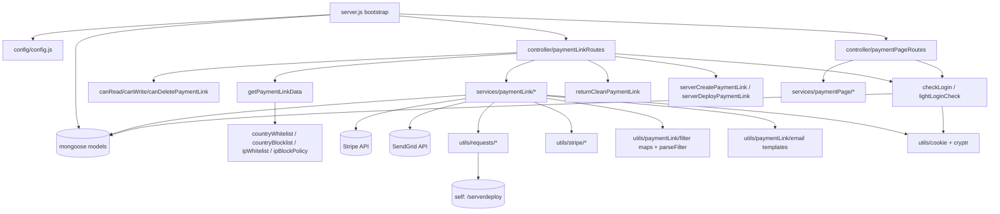

# payment_link_ms

## 1. Summary

Owns payment links for the Inhouz platform: creation, editing, deletion, slug generation,
deployment into a separate `deployedPaymentLinks` collection, password and questionnaire access
gates, Stripe Identity document verification, split-payment records, single-use marking, and the
payment-page design templates those links render with. It also serves the unauthenticated
`getlinkdata` call that a hosted payment page makes to fetch a link, apply country and IP
restriction policies, and receive a stripped, non-sensitive copy. This file documents the separate
git repository `apps/payment_link_ms` (repo id `payment_link_ms`, path
`/workspaces/kilo_inhouz_ai/apps/payment_link_ms`), read from that checkout, not the control repo.

## 2. Stack and commands

- Runtime: Node.js. `package.json` has no `engines` field (`package.json:1-37`).
- Entry module: `"main": "server.js"` — `package.json:5`
- Start: `npm start` → `node server.js` — `package.json:8`
- Test: `npm test` → prints "Error: no test specified" and exits 1 — `package.json:7`
- HTTP port: `process.env.PORT` — `server.js:99`; ClusterIP 5059 — `k8s/payment-link-ms-cluster-ip-service.yml:10-11`
- Image `inhouz/payment_link_ms`, replicas 1 — `k8s/payment-link-ms-deployment.yml:6,17`
- Package name is the template default `micro_service_template`, description "The base of all
  simple erp microservices" (`package.json:2-4`). The repository is not renamed after its template.
- Health probe: `healthcheck.js` calls `GET /healthz` — `healthcheck.js:7`. No such route is
  registered (see §12).

## 3. Entry points

| Entry point | `file:line` | How it starts |
|---|---|---|
| Cluster master | `server.js:37-54` | forks `os.cpus().length` workers when `NODE_ENV=production`, else 1 (`server.js:38-41`); re-forks on worker exit (`server.js:43-54`) |
| Worker / express app | `server.js:55-102` | CORS, body parser 20 MB, hpp, helmet, cookie parser (`server.js:57-68`) |
| Model registration | `server.js:13-35` | 23 `require("./model/...")` calls; `model/payment/paymentLinkSubscribers` is commented out at `server.js:31` |
| Mongo connect | `server.js:71-73`, `server.js:104-116` | `connectMongo()`, retried 5s after disconnect (`server.js:78-85`) |
| HTTP listener | `server.js:99` | `app.listen(process.env.PORT)` |
| Payment link routes | `server.js:69` → `controller/payment/paymentLinkRoutes.js:45-81` | `require(...)(app)` |
| Payment page design routes | `server.js:70` → `controller/payment/paymentPageRoutes.js:9-16` | `require(...)(app)` |
| Shutdown hooks | `server.js:89-97` | `SIGINT`, `SIGTERM`, `uncaughtException` close mongoose |
| Health probe binary | `healthcheck.js:1-23` | run by the container health check |

No cron, no worker loop, no queue consumer, no websocket handler. The only `setTimeout` is the
Mongo reconnect delay (`server.js:81`). The brief listed it as a timer; it is a retry.

## 4. Module inventory

Paths are from the `apps/payment_link_ms` repository. The repository has 114 files under
`model/`, `services/`, `middlewares/` and `utils/`; the table covers every routed module and every
middleware, and groups the pure filter/template utilities.

| Module | `file:line` | Owns | Public API | Kind |
|---|---|---|---|---|
| `server.js` bootstrap | `server.js:1-116` | process, cluster, express, DB lifecycle | none | effectful |
| `config()` | `config/config.js:18-88` | secret loading, model-name config, domain defaults, permission names | returns config object | effectful (filesystem, env) + cached state |
| `readSecret()` | `config/config.js:5-15` | reads `SECRETS_PATH/<name>`, falls back to env | `(name, envFallback) => string` | effectful |
| `paymentLinkRoutes` | `controller/payment/paymentLinkRoutes.js:45-81` | registers 25 active link routes | `(app) => void` | effectful |
| `paymentPageRoutes` | `controller/payment/paymentPageRoutes.js:9-16` | registers 6 design routes | `(app) => void` | effectful |
| `checkLogin` | `middlewares/login/checkLogin.js:9` | decrypt cookie, load session, refresh CSRF, load company | express middleware | effectful (DB, crypto, clock) |
| `lightLoginCheck` | `middlewares/login/lightLoginCheck.js:9` | session check without the full company load | express middleware | effectful (DB) |
| `checkPortalLogin` | `middlewares/login/checkPortalLogin.js:6` | portal-scoped login | express middleware | effectful — not mounted (all uses commented, `paymentLinkRoutes.js:37,75-79`) |
| `moduleAccessCheck` | `middlewares/module/moduleAccessCheck.js:7` | flex-module gate | express middleware | effectful (DB) — not mounted |
| `canReadPaymentLink` | `middlewares/permissions/canReadPaymentLink.js:3` | requires `paymentAdmin` or `readPaymentLink`; failure returns 200 with `error.message` | express middleware | reactive (reads `req.user`) |
| `canWritePaymentLink` | `middlewares/permissions/canWritePaymentLink.js:3` | requires `paymentAdmin` or `writePaymentLink` | express middleware | reactive |
| `canDeletePaymentLink` | `middlewares/permissions/canDeletePaymentLink.js:3` | requires `paymentAdmin` or `deletePaymentLink` | express middleware | reactive |
| `isPaymentAdmin` | `middlewares/permissions/isPaymentAdmin.js:3` | `paymentAdmin` gate | express middleware | reactive |
| `singleSubdomainValidation` | `middlewares/subdomain/singleSubdomainValidation.js` | subdomain match | express middleware | reactive — present but not mounted on any route |
| `getPaymentLinkData` | `middlewares/paymentLink/getPaymentLinkData.js:14` | loads link by slug, checks expiration, single-use, password and questionnaire cookies, builds restriction policy map | express middleware | effectful (DB, clock, cookie state) |
| `countryWhitelist` | `middlewares/restrictionPolicy/countryWhitelist.js:1` | geo allow list | express middleware | effectful (reads request IP/geo) |
| `countryBlocklist` | `middlewares/restrictionPolicy/countryBlocklist.js:1` | geo deny list | express middleware | effectful |
| `ipWhitelist` | `middlewares/restrictionPolicy/ipWhitelist.js:1` | IP allow list | express middleware | effectful |
| `ipBlockPolicy` | `middlewares/restrictionPolicy/ipBlockPolicy.js:1` | IP deny list | express middleware | effectful |
| `returnCleanPaymentLink` | `middlewares/paymentLink/returnCleanPaymentLink.js:5` | strips sensitive fields before response | express middleware | pure (transformation) — wrapped as middleware |
| `serverCreatePaymentLink` | `middlewares/paymentLink/serverCreatePaymentLink.js:12` | server-to-server auth for link creation | express middleware | effectful (crypto, DB) |
| `serverDeployPaymentLink` | `middlewares/paymentLink/serverDeployPaymentLink.js:9` | server-to-server auth for deploy | express middleware | effectful |
| `createPaymentLink` | `services/paymentLink/createPaymentLink.js:12` | create; calls back into `serverdeploy` after create (`:379-380`) | `(req,res)` | effectful (DB, HTTP, Stripe) |
| `serverDeletePaymentLinks` | `services/paymentLink/serverDeletePaymentLinks.js:9` | bulk delete, server auth only | `(req,res)` | effectful (DB) |
| `deletePaymentLink` | `services/paymentLink/deletePaymentLink.js:6` | single delete | `(req,res)` | effectful (DB) |
| `editPaymentLink` | `services/paymentLink/editPaymentLink.js:10` | edit | `(req,res)` | effectful (DB) |
| `generateRandomSlug` | `services/paymentLink/generateRandomSlug.js:8` | slug from `shortid` alphabet | `(req,res)` | effectful (randomness) |
| `paymentLinkSlugAvailabilityCheck` | `services/paymentLink/paymentLinkSlugAvailabilityCheck.js:6` | slug uniqueness | `(req,res)` | effectful (DB) |
| `fieldAvailabilityCheck` | `services/paymentLink/fieldAvailabilityCheck.js:6` | generic field uniqueness | `(req,res)` | effectful (DB) |
| `getPaymentLink` | `services/paymentLink/getPaymentLink.js:6` | one link | `(req,res)` | effectful (DB) |
| `getPaymentLinks` | `services/paymentLink/getPaymentLinks.js:10` | paged list | `(req,res)` | effectful (DB) |
| `deployPaymentLink` | `services/paymentLink/deployPaymentLink.js:9` | copies link into `deployedPaymentLinks`, flips `deployed`/`latestDeployed` | `(req,res)` | effectful (DB) |
| `requestPasswordChange` | `services/paymentLink/requestPasswordChange.js:11` | password change request, email | `(req,res)` | effectful (DB, email) |
| `paymentLinkPasswordAuth` | `services/paymentLink/paymentLinkPasswordAuth.js:10` | password unlock, sets cookie | `(req,res)` | effectful (DB, cookie) |
| `questionnaireAuth` | `services/paymentLink/questionnaireAuth.js:10` | answers access questions, sets cookie | `(req,res)` | effectful (DB, cookie) |
| `requestUserPassword` | `services/paymentLink/requestUserPassword.js:13` | emails a temporary password to a payer | `(req,res)` | effectful (DB, email, randomness) |
| `initStripeIdVerification` | `services/paymentLink/initStripeIdVerification.js:11` | creates a Stripe Identity verification session (`:136`) | `(req,res)` | effectful (Stripe, DB, email) |
| `reqisterIdentityVerification` | `services/paymentLink/reqisterIdentityVerification.js:14` | registers a document-verification record, reads report (`:143,230`) | `(req,res)` | effectful (Stripe, DB) |
| `identityVerificationStatusCheck` | `services/paymentLink/identityVerificationStatusCheck.js:13` | polls Stripe session/report, updates status | `(req,res)` | effectful (Stripe, DB) |
| `documentVerificationCodeLogin` | `services/paymentLink/documentVerificationCodeLogin.js:10` | code-based login after verification | `(req,res)` | effectful (DB, cookie) |
| `splitPaymentRecordPayment` | `services/paymentLink/splitPaymentRecordPayment.js:9` | records a split instalment | `(req,res)` | effectful (DB) |
| `markPaymentLinkAsUsed` | `services/paymentLink/markPaymentLinkAsUsed.js:8` | sets `isUsed` | `(req,res)` | effectful (DB) |
| `setPaymentLinkActiveStatus` | `services/paymentLink/setPaymentLinkActiveStatus.js:8` | toggles `active` | `(req,res)` | effectful (DB) |
| `getPaymentLinkMetaData` | `services/paymentLink/getPaymentLinkMetaData.js:8` | public metadata for a slug | `(req,res)` | effectful (DB) |
| `createPaymentPageDesign` and 5 siblings | `services/paymentPage/*.js:6-10` | CRUD plus default design lookup | `(req,res)` | effectful (DB) |
| Unrouted subscriber services | `services/paymentLink/getPaymentLinkSubscribers.js:12`, `getPaymentLinkSubscriber.js:9`, `editPaymentLinkSubscriber.js:9`, `cancelPaymentLinkSubscriptions.js:9`, `getPaymentLinkPaymentMethods.js:8`, `changePaymentLinkPaymentMethod.js:14`, `getPaymentSubscriberQuery.js:13` | subscription management | `(req,res)` | effectful — every route is commented out |
| `parseFilter` | `utils/filter/parseFilter.js` | request filter to Mongo query via map, regex list, type map | `(filter, filterMap, nonRegexList, typeMap) => query` | pure |
| `stripSensitivePaymentLinkData` | `utils/paymentLink/stripSensitivePaymentLinkData.js` | removes password and internal fields | `(link) => link` | pure |
| `noAuthStripPaymentLink` | `utils/paymentLink/noAuthStripPaymentLink.js` | strips for unauthenticated callers | `(link) => link` | pure |
| `paymentLinkValidation` | `utils/paymentLink/paymentLinkValidation.js` | field rules | validation function | pure |
| `getDefaultPaymentLinkStyle` | `utils/paymentLink/getDefaultPaymentLinkStyle.js` | default design tokens | `() => style` | pure |
| `paymentLinkFilterMap` / `paymentLinkNonRegexMap` / `paymentLinkTypeMap` | `utils/paymentLink/*.js` | filter tables | objects/arrays | pure |
| Page-design filter tables | `utils/paymentPageDesign/filter/*.js` | filter tables | objects/arrays | pure |
| Subscriber filter tables | `utils/paymentLink/paymentLinkSubscribers/*.js` | filter tables | objects/arrays | pure |
| Email templates | `utils/paymentLink/email/*.js` | verification success/failure, temp password, password notice | `(data) => html` | pure |
| `sendEmail` | `utils/sendEmail/sendEmail.js:4` | SendGrid send (`:6`) | `(args)` | effectful (network) |
| `getRequest` / `postRequest` / `deleteRequest` | `utils/requests/getRequest.js:1`, `postRequest.js`, `deleteRequest.js` | `node-fetch` HTTP wrappers | `(url, ...) => response` | effectful (network) |
| `encryptDecrypt` | `utils/cryptography/encryptDecrypt.js` | AES helpers | `(data, encrypt)` | pure |
| `recursiveSanitizer` | `utils/sanitizer/recursiveSanitizer.js` | deep sanitise | `{ recursiveSanitizer }` | pure |
| `validateQueryKey` | `utils/query/validateQueryKey.js` | validates tracked query key | `(key) => bool` | pure |
| `cleanEncryptedCookie` | `utils/cookie/cleanEncryptedCookie.js` | clears encrypted cookies | `(res)` | effectful (sets cookies) |
| Stripe helpers | `utils/stripe/*.js` | customers, payment methods, attach/detach, setup intents, marketplace payment intents | `(data, connectAccountId)` | effectful (network) |
| `createPaymentMethod` / `getPaymentMethodSummary` | `utils/paymentMethod/*.js` | persist a method; build label | effectful / pure | mixed rows noted in place |

## 5. Side effects

| Effect | Where | `file:line` |
|---|---|---|
| MongoDB connect | `server.js` | `server.js:104-116` |
| MongoDB reads/writes | across services and middlewares | e.g. `middlewares/paymentLink/getPaymentLinkData.js:69,107,246,263`, `services/paymentLink/deployPaymentLink.js:9` |
| Filesystem: secrets | `readSecret` | `config/config.js:5-15` |
| Env read | `config()` | `config/config.js:21-85` |
| Outbound HTTP: self, `/api/paymentlink/serverdeploy` | create flow | `services/paymentLink/createPaymentLink.js:379-380` |
| Outbound HTTP: Stripe API | identity, payment methods, marketplace charges | `services/paymentLink/initStripeIdVerification.js:136`, `services/paymentLink/identityVerificationStatusCheck.js:81,146`, `utils/stripe/marketplaceTransaction.js:23,41` |
| Outbound HTTP: SendGrid | email | `utils/sendEmail/sendEmail.js:4-6` |
| Outbound HTTP: generic | `node-fetch` wrappers | `utils/requests/getRequest.js:1`, `utils/requests/postRequest.js:1`, `utils/requests/deleteRequest.js:1` |
| Cookies written | password, questionnaire, identity verification unlock | `utils/cookie/cleanEncryptedCookie.js`, `services/paymentLink/paymentLinkPasswordAuth.js:10`, `questionnaireAuth.js:10` |
| Crypto: `cryptr`, `node-rsa` | session/CSRF and client key pair | `middlewares/login/checkLogin.js:3`, `config/config.js:47-59` |
| Randomness | `shortid` slugs and temp passwords | `services/paymentLink/generateRandomSlug.js:8`, `requestUserPassword.js:13` |
| Clock | expiration and identity trust window | `middlewares/paymentLink/getPaymentLinkData.js` (expiration branch), `config/config.js:72` |
| Logging | `console.log` connection and worker events | `server.js:44-53,76,79,87,100` |

## 6. State and state transitions

Payment link (`model/payment/paymentLink.js:376-392`):

| State | Represented by | Transition | Trigger | Guard |
|---|---|---|---|---|
| draft / active | `active: true` (`:376-379`) | active → inactive | `POST /api/paymentlink/setactivestatus` (`services/paymentLink/setPaymentLinkActiveStatus.js:8`) | `isLoggedIn`, route has no permission middleware (`paymentLinkRoutes.js:69`) |
| undeployed | `deployed: false` (`:388-391`) | undeployed → deployed | `POST /api/paymentlink/deploy` (`services/paymentLink/deployPaymentLink.js:9`) | `isLoggedIn` + `canWritePaymentLink`; a copy is written to `deployedPaymentLinks` |
| unused | `isUsed: false` (`:380-383`) | unused → used | `POST /api/paymentlink/markpaymentlinkasused` (`services/paymentLink/markPaymentLinkAsUsed.js:8`) | none beyond sanitisation; single-use links are enforced on read by `isSingleUse` (`getPaymentLinkData.js`) |
| unexpired | `hasExpiration` / `expirationTimestamp` (`:122-126`) | unexpired → expired | clock passes `expirationTimestamp` | checked at read time in `getPaymentLinkData` |
| locked | `encryptedPassword`, `setPasswordRestriction` (`:131-143`) | locked → unlocked | `POST /passwordlogin` sets a password cookie | password match; the read path checks `req.parsedCookie['passwordAuth']` (`getPaymentLinkData.js:306`) |
| questionnaire-locked | `setQuestionnaireRestriction`, `accessQuestions` (`:157-171`) | locked → unlocked | `POST /questionnaireauth` | answers match; read path checks `req.parsedCookie['questionnaireAuth']` (`getPaymentLinkData.js:332`) |
| identity-unverified | `requestDocumentIdentityVerification` (`:192-199`) | unverified → verified | Stripe Identity session created and report retrieved (`initStripeIdVerification.js:136`, `identityVerificationStatusCheck.js:146`) | `failedIdentityVerificationStatusList` (`config/config.js:72`) |

Payment link subscriber (`model/payment/paymentLinkSubscribers.js:64-72`):

| From | To | Trigger |
|---|---|---|
| `active` | `paused` | subscriber edit / cancel flow (routes commented out) |
| `active` | `inRenewal` | renewal window |
| any | `cancelled` | `cancelPaymentLinkSubscriptions` (`services/paymentLink/cancelPaymentLinkSubscriptions.js:9`) |

The subscriber state machine is code-complete but unreachable over HTTP: every subscriber route
is commented out (`controller/payment/paymentLinkRoutes.js:73-80`).

## 7. Data

MongoDB via mongoose. Models are registered with the env value as the collection in most cases
(`mongoose.model(config.xModel, schema, config.xModel)`).

| Model | `file:line` | Env / collection | Key fields and validation | Shared with |
|---|---|---|---|---|
| PaymentLink | `model/payment/paymentLink.js:5-413` | `PAYMENT_LINK_MODEL` → `paymentLinks` | `paymentLinkType` required, enum `one-time, recurring, adjustable, fixed-schedule, fundraiser, split-payment, flex-schedule` (`:81-86`); `name`, `slug`, `companyId`, `defaultCurrency`; `active` default true, `isUsed` default false, `latestDeployed` false, `deployed` false; `metadata` free-form | `inhouz_pay_ms` renders the deployed copies; `function_parser_ms` reads by slug |
| DeployedPaymentLink | `model/payment/deployedPaymentLink.js:5-403` | `DEPLOYED_PAYMENT_LINK_MODEL` → `deployedPaymentLinks` | same public fields as the link (name, slug, payoutAccountId, projectId, metadata, currency, tax flags, webhook URLs, `paymentLinkType`) | `inhouz_pay_ms` reads; this service writes on deploy |
| PaymentLinkSubscriber | `model/payment/paymentLinkSubscribers.js:6-94` | `PAYMENT_LINK_SUBSCRIBER_MODEL` → `paymentLinkSubscribers` | `email`, `paymentLinkId`, `productId`, `companyId`, `assetOwnerCompanyId`; `status` enum `active, paused, inRenewal, cancelled` (`:64-67`); `environment` enum `development, test, production` (`:59-62`); `active` default; index on 8 fields (`:87-88`); `strict: false` | `subscription_ms` and `inhouz_pay_ms` for billing state |
| InhouzPayment | `model/payment/inhouzPayment.js:5-273` | `INHOUZ_PAYMENT_MODEL` → `inhouzPayments` | payment ledger written by the pay flow | `inhouz_pay_ms` writes the same collection |
| InhouzSubscription | `model/inhouzSubscription/inhouzSubscription.js:5-214` | `INHOUZ_SUBSCRIPTIONS_MODEL` | subscription records used by the cancelled subscription code | `subscription_ms` |
| InhouzPayMrrTracker | `model/payment/inhouzPayMrrTracker.js:5-83` | `INHOUZ_PAY_MRR_TRACKER_MODEL` → `inhouzPayMrrTracker` | MRR snapshots | `inhouz_pay_ms`, metrics services |
| PaymentMethod | `model/payment/paymentMethod.js:5-96` | `PAYMENT_METHOD_MODEL` → `paymentMethods` | same shape as the one owned by `payment_ms`: `paymentPlatform` enum, `companyId`, `stripePaymentMethodId`, `linkedPaymentLinks` | `payment_ms` owns writes; this service reads on `changepaymentmethod` (route commented) |
| PayoutAccount | `model/payment/payoutAccount.js:5-68` | `PAYOUT_ACCOUNT_MODEL` → `payoutAccounts` | `companyId`, `subMerchantAccountId`, `currency`, `defaultAccount`, `archived` | `payment_ms` owns writes |
| PaymentTaxRules | `model/payment/paymentTaxRules.js:5-59` | `PAYMENT_TAX_RULE_MODEL` | tax rules applied at checkout | `inhouz_pay_ms` |
| PaymentGateway | `model/payment/paymentGateway.js:5-61` | `PAYMENT_GATEWAY_MODEL` | gateway config rows | `inhouz_pay_ms` |
| PaymentCategory | `model/commerce/paymentCategory.js:5-41` | `PAYMENT_CATEGORY_MODEL` | link category | `app_builder_ms` |
| PaymentProduct | `model/commerce/paymentProduct.js:5-131` | `PAYMENT_PRODUCT_MODEL` | products attached to a link | `inhouz_pay_ms` |
| PaymentPageDesign | `model/paymentPage/paymentPageDesign.js:5` | `PAYMENT_PAGE_DESIGN_MODEL` | design tokens per link | read by the pay page |
| DocumentIdentityVerification | `model/identity/documentIdentityVerification.js:6` | `DOCUMENT_IDENTITY_VERIFICATION_MODEL` | `email`, `module`, `documentType`, `identityPlatformKey`, `identityReportKey`, `identityPlatform`, `fingerprint`, `expirationHours`, `expirationTimestamp`, `inhouzAccessKey`, `environment`, `status` | read by `inhouz_sign_ms` |
| QueryKeyTracker | `model/queryTracker/queryKeyTracker.js:5-23` | `QUERY_KEY_TRACKER_MODEL` | tracked query keys per link | metrics services |
| SequenceTracker | `model/sequence/sequenceTracker.js:5-16` | `SEQUENCE_TRACKER_MODEL` | invoice number sequences | `inhouz_pay_ms` |
| StaticBase64File | `model/staticFiles/staticBase64File.js:5-20` | `STATIC_BASE64_FILE_MODEL` | inline media for page designs | page renderer |
| InhouzProject | `model/inhouzProject/inhouzProject.js:5-103` | `INHOUZ_PROJECT_MODEL` → `inhouzProjects` | project a link belongs to (`getPaymentLinkData.js:263`) | `app_builder_ms` |
| Session / User / UserRoles / Role / Permission / Company | `model/session/session.js:5-28`, `model/user/user.js:6-138`, `model/user/useRoles.js:6-51`, `model/rolesAndPermissions/*.js:6-89`, `model/company/company.js:5-108` | `SESSION_MODEL`, `USER_MODEL`, `USER_ROLES_MODEL`, `ROLE_MODEL`, `PERMISSION_MODEL`, `COMPANY_MODEL` | identity and permission documents read by the login middleware | `authentication_ms` writes all six; this service only reads |

Coupling notes: the service reads and writes three collections another service owns
(`paymentMethods`, `payoutAccounts` via `payment_ms`; `inhouzPayments` via `inhouz_pay_ms`), and
reads identity collections it does not own. Those cross-service collection contracts are the main
schema risk.

## 8. Public interfaces

Base path `/api/paymentlink`. Failure from a permission middleware is `res.send({ error: { message:
"Not Authorized." } })` with HTTP 200 (`middlewares/permissions/canReadPaymentLink.js:17-19`), so
callers must inspect the body, not the status.

Active routes (25 on the link controller, 6 on the design controller):

| Method | Path | Middleware chain | Handler |
|---|---|---|---|
| POST | `/api/paymentlink/create` | `isLoggedIn`, `canWritePaymentLink` | `controller/payment/paymentLinkRoutes.js:46` |
| POST | `/api/paymentlink/servercreatepaymentlink` | `serverCreatePaymentLink` (server auth, no user session) | `:47` |
| POST | `/api/paymentlink/edit` | `isLoggedIn`, `canWritePaymentLink` | `:48` |
| DELETE | `/api/paymentlink/delete/:paymentLinkId` | `isLoggedIn`, `canDeletePaymentLink` | `:49` |
| POST | `/api/paymentlink/serverdeletepaymentlinks` | `serverDeletePaymentLinks` (no auth middleware; the handler does its own check) | `:50` |
| POST | `/api/paymentlink/generateslug` | none | `:51` |
| POST | `/api/paymentlink/slugavailabilitycheck` | `isLoggedIn` | `:52` |
| POST | `/api/paymentlink/fieldavailabilitycheck` | `isLoggedIn` | `:53` |
| GET | `/api/paymentlink/getpaymentlink/:paymentLinkId` | `isLoggedIn`, `canReadPaymentLink` | `:54` |
| POST | `/api/paymentlink/getpaymentlinks` | `isLoggedIn`, `canReadPaymentLink` | `:55` |
| POST | `/api/paymentlink/requestpasswordchange` | `isLoggedIn`, `canWritePaymentLink` | `:56` |
| POST | `/api/paymentlink/passwordlogin` | none (public unlock) | `:57` |
| POST | `/api/paymentlink/deploy` | `isLoggedIn`, `canWritePaymentLink` | `:58` |
| POST | `/api/paymentlink/serverdeploy` | `serverDeployPaymentLink` | `:59` |
| POST | `/api/paymentlink/questionnaireauth` | none (public unlock) | `:60` |
| POST | `/api/paymentlink/requestuserpassword` | none | `:61` |
| POST | `/api/paymentlink/getlinkdata` | `getPaymentLinkData`, `countryWhitelist`, `countryBlocklist`, `ipWhitelist`, `ipBlockPolicy`, `returnCleanPaymentLink` | `:62` |
| POST | `/api/paymentlink/getdocumentverificationclientsecret` | none | `:63` |
| POST | `/api/paymentlink/registerdocumentverification` | none | `:64` |
| POST | `/api/paymentlink/documentverificationstatuscheck` | none | `:65` |
| POST | `/api/paymentlink/documentverificationlogin` | none | `:66` |
| POST | `/api/paymentlink/recordsplitpayment` | none | `:67` |
| POST | `/api/paymentlink/markpaymentlinkasused` | none | `:68` |
| POST | `/api/paymentlink/setactivestatus` | none | `:69` |
| POST | `/api/paymentlink/getpaymentlinkmetadata` | none | `:70` |
| POST | `/api/paymentlink/design/create` | `isLoggedIn` | `controller/payment/paymentPageRoutes.js:10` |
| POST | `/api/paymentlink/design/edit` | `isLoggedIn` | `:11` |
| POST | `/api/paymentlink/design/delete` | `isLoggedIn` | `:12` |
| POST | `/api/paymentlink/design/getdesign` | `isLoggedIn` | `:13` |
| POST | `/api/paymentlink/design/getdesigns` | `isLoggedIn` | `:14` |
| GET | `/api/paymentlink/design/getdefaultdesign` | `isLoggedIn` | `:15` |

Request and response shapes verified from source:

- `POST /getlinkdata`: body carries `slug` and `subDomain` (`middlewares/paymentLink/getPaymentLinkData.js:49`); `slug` must be a non-empty string (`:55-61`). Responses: 400 on a bad slug, 404 when the link is missing (`:80`), 402 for a paid/paywalled state (`:96`), 400 for a locked link (`:178,189,209`), and the stripped link via `res.send(cleanPaymentLink)`.
- `POST /getpaymentlinkmetadata`: public metadata by slug (`services/paymentLink/getPaymentLinkMetaData.js:8`).
- `POST /create` and `/edit`: filter and validation via `utils/paymentLink/paymentLinkValidation.js`; after create the handler calls its own `/serverdeploy` (`services/paymentLink/createPaymentLink.js:379-380`).
- Design routes: create/edit/delete/getdesign take the design document; `getdesigns` is a paged list; `getdefaultdesign` takes no body.

Outbound contract: `POST {PAYMENT_LINK_MS_URL}/api/paymentlink/serverdeploy` from
`createPaymentLink.js:379-380`.

No events, topics, or CLI commands.

## 9. Configuration

Names only, no values.

Secrets read from files under `SECRETS_PATH` (default `/mnt/secrets`) with env fallback
(`config/config.js:5-15`): `sendgridapikey`/`SENDGRID_API_KEY`, `sessionsecret`/`SESSION_SECRET`,
`mongourl`/`MONGO_URL`, `clientpublickey`/`CLIENT_PUBLIC_KEY`, `clientsecretkey`/`CLIENT_SECRET_KEY`,
`stripeapikey`/`STRIPE_API_KEY`, `teststripeapikey`/`TEST_STRIPE_API_KEY`.

Env vars read in code: `INHOUZ_DOMAIN`, `INHOUZ_API_DOMAIN`, `INHOUZ_APP_DOMAIN`,
`FLEX_FORM_FILE_MODEL`, `FLEX_MODULE_MODEL`, `FLEX_COLLECTION_MODEL`, `FORM_MODEL`, `SMPL_EMAIL`,
`DATA_RULE_EXECUTION_RESULT_MODEL`, `USER_MODEL`, `COMPANY_MODEL`, `ROLE_MODEL`,
`PERMISSION_MODEL`, `USER_ROLES_MODEL`, `SESSION_MODEL`, `SESSION_VALIDATOR_MODEL`,
`AUTH_LOG_MODEL`, `PAYMENT_PAGE_DESIGN_MODEL`, `COOKIE_DOMAIN`, `PAYMENT_GATEWAY_MODEL`,
`PAYMENT_TAX_RULE_MODEL`, `PAYMENT_LINK_MODEL`, `PAYOUT_ACCOUNT_MODEL`,
`DEPLOYED_PAYMENT_LINK_MODEL`, `STATIC_BASE64_FILE_MODEL`, `PAYMENT_CATEGORY_MODEL`,
`DOCUMENT_IDENTITY_VERIFICATION_MODEL`, `INHOUZ_SUBSCRIPTIONS_MODEL`, `PAYMENT_METHOD_MODEL`,
`INHOUZ_PAYMENT_MODEL`, `QUERY_KEY_TRACKER_MODEL`, `PAYMENT_LINK_SUBSCRIBER_MODEL`,
`PAYMENT_PRODUCT_MODEL`, `SEQUENCE_TRACKER_MODEL`, `PAYMENT_LINK_MS_URL`,
`INHOUZ_PAY_MRR_TRACKER_MODEL`, `INHOUZ_PROJECT_MODEL`, `PORT`, `NODE_ENV`
(`config/config.js:21-85`, `server.js:38,99`, `middlewares/login/checkLogin.js:131`).

Set in the k8s deployment but never read by this code: `AB_TESTS_MODEL`, `ADMIN_DEVELOPER_PERMISSION`,
`API_DEVELOPER_PERMISSION`, `APP_ACCESS_PASSWORD_MODEL`, `APP_BUILDER_EXTERNAL_ACCESS_MODEL`,
`APP_BUILDER_SOCKET_TRACKER_MODEL`, `APP_BUILD_MODEL`, `APP_BUILD_REPORT_MODEL`,
`APP_DEPLOYMENT_QUEUE_LOG_MODEL`, `APP_DEPLOYMENT_QUEUE_MODEL`, `APP_ELEMENT_MODEL`,
`APP_ELEMENT_UPDATE_QUEUE_MODEL`, `APP_FOLDER_MODEL`, `APP_PAGE_MODEL`, `APP_UPDATE_QUEUE_MODEL`,
`CHURN_TRACKER_MODEL`, `CLOUDFLARE_API_URL`, `CLOUDFLARE_AUTH_EMAIL`, `CLOUDFLARE_AUTH_KEY`,
`CLOUDFLARE_ZONE_ID`, `CONTACTS_MODEL`, `COOKIE_NAME`, `CUSTOMERS_MODEL`, `CUSTOM_DOMAIN_LOG_MODEL`,
`CUSTOM_DOMAIN_TERMINATION_QUEUE_MODEL`, `EXCHANGE_RATE_CACHE_MODEL`,
`EXTERNAL_USER_EDITOR_ACCESS_LOG_MODEL`, `FLEX_API_MODEL`, `FUNCTION_MODEL`,
`FUNCTION_VERSION_TRACKER_MODEL`, `INHOUZ_APP_MODEL`, `INHOUZ_PAYMENT_METHOD_TRACKER_MODEL`,
`INHOUZ_PAYMENT_METRICS_MODEL`, `INHOUZ_PAYMENT_TAX_MODEL`, `INHOUZ_PAY_CONVERSION_TRACKER_MODEL`,
`INHOUZ_PAY_SESSION_DURATION_LOG_MODEL`, `INHOUZ_PAY_UNIQUE_VISITOR_TRACKER_MODEL`,
`INHOUZ_PAY_VISIT_METRICS_MODEL`, `INHOUZ_FROM_EMAIL`, `IP_ADDRESS_LOCATION_MODEL`,
`IP_LOCATION_FINDER_URL`, `METRICS_CACHE_MODEL`, `OPEN_EXCHANGE_RATES_API_KEY`,
`OPEN_EXCHANGE_RATES_BASE_URL`, `OPERATION_TRACKER_MODEL`, `PAGE_UPDATE_QUEUE_MODEL`,
`PERSONALIZED_APP_BUILDER_SETTINGS_MODEL`, `PAYMENT_CHARGE_MODEL`, `PAYMENT_INTENT_MODEL`,
`PAYMENT_MS_URL`, `REDIS_HOST`, `REDIS_PASSWORD`, `REDIS_PORT`, `SUBSCRIBER_*`,
`SUBSCRIPTION_*`, `VERSION_TRACKER_MODEL`. These come from the shared deployment template; this
service reads none of them.

Hardcoded config: permission names `admin`, `paymentAdmin`, `writePaymentLink`,
`readPaymentLink`, `deletePaymentLink` (`config/config.js:42-46`); domain defaults
`inhouz.io`, `inhouzapi.io`, `inhouzapp.io` (`config/config.js:21-23`); `shortid` alphabet
(`config/config.js:73-74`); `failedIdentityVerificationStatusList` (`config/config.js:72`);
`billableIdentityStatus` (`config/config.js:76`); CORS regex `/inhouz.localhost/`
(`server.js:59`).

## 10. Dependencies

From `package.json:12-36`, direct only.

| Package | Why |
|---|---|
| `express` | HTTP app and routing |
| `mongoose` | MongoDB models and queries |
| `body-parser` | 20 MB JSON bodies (`server.js:65`) |
| `cookie-parser` | signed cookies for session and unlock state (`server.js:68`) |
| `cors` | browser access for hosted payment pages |
| `helmet`, `hpp` | security headers, parameter pollution guard (`server.js:66-67`) |
| `dotenv` | local `.env` loading (`server.js:1`) |
| `stripe` | Identity verification sessions and reports, marketplace payment intents, customers, payment methods (`utils/stripe/*`, `services/paymentLink/initStripeIdVerification.js:136`) |
| `@sendgrid/mail` | verification and password emails (`utils/sendEmail/sendEmail.js:6`) |
| `node-fetch` | server-to-server deploy call and `utils/requests/*` |
| `cryptr` | cookie payload encryption (`middlewares/login/checkLogin.js:3`) |
| `node-rsa` | client key pair for server-to-server auth (`config/config.js:47-59`) |
| `shortid` | slugs, temporary passwords |
| `moment` | expiration and trust-window dates |
| `lodash` | collection helpers in login middlewares |
| `validator` | identity and subscriber field validation |
| `sanitizer` | request sanitisation |
| `crypto-js` | `utils/cryptography/encryptDecrypt.js` |
| `bcryptjs` | hashing (declared; no call site in `services/`, `middlewares/`, `utils/`, `config/`, `server.js`) |
| `request-ip` | client IP for restriction policies (declared; no call site found in the grepped directories) |
| `connect-mongo`, `express-session` | declared; no session middleware is mounted (`server.js:57-68`) |

## 11. Testing

No tests. `npm test` is the npm stub that exits 1 (`package.json:7`). No test directory, runner or
fixtures exist. Nothing is covered.

Manual verification needs: a reachable MongoDB (`MONGO_URL`), the same `SESSION_SECRET` as
`authentication_ms` so a session cookie decrypts, Stripe test keys, and a seeded payment link with
a known slug for the public `getlinkdata` path.

## 12. Known issues and risks

1. **Eight subscriber routes are commented out** (`controller/payment/paymentLinkRoutes.js:73-80`),
   while the handlers and the subscriber model stay in the tree
   (`services/paymentLink/cancelPaymentLinkSubscriptions.js:9`,
   `services/paymentLink/getPaymentLinkSubscribers.js:12`). Subscription management appears
   available but is unreachable over HTTP.
2. **Subscriber model not registered at boot.** `require("./model/payment/paymentLinkSubscribers")`
   is commented out (`server.js:31`), so only code paths that import the model directly get a
   model. Any handler relying on the global registration fails.
3. **Nine public write routes with no auth middleware**: `generateslug`, `passwordlogin`,
   `questionnaireauth`, `requestuserpassword`, `getdocumentverificationclientsecret`,
   `registerdocumentverification`, `documentverificationstatuscheck`,
   `documentverificationlogin`, `recordsplitpayment`, plus `markpaymentlinkasused` and
   `setactivestatus` (`controller/payment/paymentLinkRoutes.js:51,57,60,61,63-69`).
   `setactivestatus` and `markpaymentlinkasused` change stored state with no session or token
   check in the route table.
4. **Permission failures return HTTP 200** with an error body
   (`middlewares/permissions/canReadPaymentLink.js:17-19`), so clients that branch on status treat
   a denial as success.
5. **Slug reachable unauthenticated allows enumeration**: `POST /api/paymentlink/generateslug`
   has no auth (`controller/payment/paymentLinkRoutes.js:51`) and `getlinkdata` is public by design.
6. **Health check cannot pass.** `healthcheck.js` probes `/healthz` (`healthcheck.js:7`); no such
   route is registered (`server.js:69-70` mounts only the two route modules).
7. **CORS pinned to localhost.** `/inhouz.localhost/` (`server.js:59`) matches no production host.
8. **Self-call inside a request.** `createPaymentLink` calls `POST {PAYMENT_LINK_MS_URL}/.../serverdeploy`
   (`services/paymentLink/createPaymentLink.js:379-380`), so creation depends on the service
   reaching itself through the cluster and on `PAYMENT_LINK_MS_URL` being correct. A missing or
   wrong value leaves the link created but undeployed.
9. **One secret, two purposes.** `SESSION_SECRET` is both the cookie-parser secret
   (`server.js:68`) and the `Cryptr` key (`middlewares/login/checkLogin.js:3`).
10. **Callback passed to `mongoose.connect` under mongoose 7** (`server.js:104-116`) — the callback
    signature was removed; the connection is not awaited or handled.
11. **Worker count vs replica count.** One worker per CPU in production (`server.js:38-41`) inside
    one replica (`k8s/payment-link-ms-deployment.yml:6`), each with `maxPoolSize: 1`
    (`server.js:112`).
12. **Template name left in `package.json`** (`package.json:2`) and no `engines` field, so the
    Node version is unpinned while `mongoose ^7` and `stripe ^10` need modern Node.
13. **Encrypted credential artifact.** The repository carries `service-account.json.enc` at its
    root, matching `payment_ms`. Encrypted, but a credential artifact in a source tree.

## 13. Module map

Call direction: route → auth or restriction middleware → service → model or util → external system.
`getPaymentLinkData` is the only middleware that reads a payment link and then hands it to four
restriction policies before the response is stripped.

## 14. Open questions

- Which callers use this service? The brief names `function_parser_ms`, `inhouz_pay_ms`,
  `inhouz_sign_ms`, `payment_link_ms` (self), `scheduled_task_function_parser_ms`. That call graph
  cannot be confirmed from this repository; only the self-call at
  `services/paymentLink/createPaymentLink.js:379` is proven here.
- The brief states outgoing HTTP to `payment-link-ms-cluster-ip-service:5059` at
  `k8s/payment-link-ms-deployment.yml:301`. That is the service's own ClusterIP and the line is an
  env entry, not an HTTP call site. Treated as a self-reference via `PAYMENT_LINK_MS_URL`
  (`config/config.js:83`).
- Whether the commented-out subscriber routes are superseded by another service, or are simply
  disabled, is not stated anywhere in the repository.
- 64 of the 98 model registrations listed by the extraction pass were not opened. The registrations
  in `services/paymentLink/changePaymentLinkPaymentMethod.js` and
  `cancelPaymentLinkSubscriptions.js` exist but belong to routes that are disabled.
- Request and response bodies for the create, edit, password, questionnaire and identity routes
  were not read field by field. Section 8 lists only shapes verified from source.
- `kus/` kustomize overlays and `deploy.sh` were not read; k8s facts come from `k8s/*.yml`.
- Whether the deployed clusters mount `CLIENT_PUBLIC_KEY`/`CLIENT_SECRET_KEY` as files under
  `SECRETS_PATH` or as env values could not be checked without the cluster; both paths exist in
  code (`config/config.js:5-15,47-59`).
