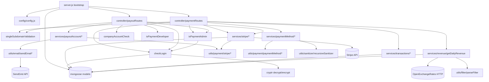

# payment_ms

## 1. Summary

Stores and serves company payment instruments and payout accounts for the Inhouz platform. It
creates Stripe payment methods and Stripe Connect payout accounts, sets a default payment method
per company, lists and deletes stored methods, exposes payment intents and payment charges held in
MongoDB, and computes daily revenue with currency conversion. This file documents the separate git
repository `apps/payment_ms` (repo id `payment_ms`, path `/workspaces/kilo_inhouz_ai/apps/payment_ms`),
read from that checkout, not from the control repo.

## 2. Stack and commands

- Runtime: Node.js, `"node": ">=12.0.0 <17.5.0"` — `apps/payment_ms/package.json:7`
- Entry module: `"main": "server.js"` — `package.json:5`
- Start: `npm start` → `node server.js` — `package.json:10-11`
- Test: `npm test` → prints "Error: no test specified" and exits 1 — `package.json:10`
- HTTP port: `process.env.PORT`, read at boot — `server.js:89-91`
- ClusterIP port: 5014 — `k8s/payment-ms-cluster-ip-service.yml:10-11`
- Image: `inhouz/payment_ms`, replicas 1 — `k8s/payment-ms-deployment.yml:6,17`
- Health probe: `healthcheck.js` calls `GET /healthz` on `process.env.PORT || 8080`
  — `healthcheck.js:4-7`. No `/healthz` route exists in the service (see §12).
- Container/CI helpers present: `Dockerfile`, `docker-compose.yml`, `build_ga.sh`,
  `build_ga_prod.sh`, `deploy.sh`, `kus/` (kustomize base/dev/prod).

## 3. Entry points

| Entry point | `file:line` | How it starts |
|---|---|---|
| Cluster master | `server.js:26-43` | `node server.js`; forks `os.cpus().length` workers in production, 1 otherwise (`server.js:27-30`), and re-forks on worker exit (`server.js:32-43`) |
| Worker / HTTP app | `server.js:44-92` | cluster child; mounts CORS, body parser, hpp, helmet, cookie parser (`server.js:45-56`) |
| Mongo connection | `server.js:62-63`, `server.js:94-105` | `connectMongo()` when readyState is not 1 or 2; retried 5s after a disconnect (`server.js:68-75`) |
| HTTP listener | `server.js:89` | `app.listen(process.env.PORT)` |
| Payment routes | `server.js:58` → `controller/paymentRoutes.js:17-30` | `require("./controller/paymentRoutes")(app)` |
| Payout account routes | `server.js:59` → `controller/payoutRoutes.js:15-24` | `require("./controller/payoutRoutes")(app)` |
| Shutdown hooks | `server.js:79-87` | `SIGINT`, `SIGTERM`, `uncaughtException` close the mongoose connection |
| Health probe binary | `healthcheck.js:1-23` | run by the container health check; single `http.request` then `process.exit` |

There is no cron job and no queue consumer. The only `setTimeout` is the 5s Mongo reconnect delay
(`server.js:71`), not a scheduled task. The brief labelled it a timer; it is a retry.

## 4. Module inventory

All paths are from the `apps/payment_ms` repository.

| Module | `file:line` | Owns | Public API | Kind |
|---|---|---|---|---|
| `server.js` bootstrap | `server.js:1-106` | process, cluster, express wiring, DB lifecycle | none (side-effect module) | effectful |
| `config()` | `config/config.js:19-72` | reads secrets from files then env, memoises in `cachedConfig` | returns config object | effectful (filesystem, env) + process-cached state |
| `readSecret()` | `config/config.js:5-15` | reads `/mnt/secrets/<name>`, falls back to env | `(name, envFallback) => string` | effectful |
| `paymentRoutes` | `controller/paymentRoutes.js:17-30` | registers 10 active payment routes | `(app) => void` | effectful (registers handlers) |
| `payoutRoutes` | `controller/payoutRoutes.js:15-24` | registers 8 payout account routes | `(app) => void` | effectful |
| `checkLogin` | `middlewares/login/checkLogin.js:9` | decrypts session + CSRF cookie, loads session, refreshes CSRF, loads company | express middleware | effectful (DB, crypto, clock) |
| `singleSubdomainValidation` | `middlewares/subdomain/singleSubdomainValidation.js:1` | compares request subdomain to `req.user.subDomain` | express middleware | effectful (reads request state) |
| `isPaymentAdmin` | `middlewares/permissions/isPaymentAdmin.js:3` | role gate, `paymentAdmin` | express middleware | reactive (reads `req.user`) |
| `isPaymentDeveloper` | `middlewares/permissions/isPaymentDeveloper.js:3` | role gate, `paymentDeveloper` | express middleware | reactive |
| `companyAccountCheck` | `middlewares/company/companyAccountCheck.js:1` | company scope gate | express middleware | reactive |
| `moduleAccessCheck` | `middlewares/module/moduleAccessCheck.js:7` | flex-module permission gate | express middleware | effectful (DB) — not mounted on any route |
| `createStripePaymentMethod` | `services/stripe/createStripePaymentMethod.js:13` | POST addpaymentmethod | `(req,res)` | effectful (Stripe, DB) |
| `createSubscriptionStripePaymentMethod` | `services/stripe/createSubscriptionStripePaymentMethod.js:14` | POST addsubscriptionpaymentmethod | `(req,res)` | effectful (Stripe, DB) |
| `editPaymentMethod` | `services/paymentMethod/editPaymentMethod.js:6` | POST editpaymentmethod | `(req,res)` | effectful (DB) |
| `getPaymentMethods` | `services/paymentMethod/getPaymentMethods.js:5` | POST getpaymentmethods | `(req,res)` | effectful (DB) |
| `getPaymentMethod` | `services/paymentMethod/getPaymentMethod.js:5` | GET getpaymentmethod/:id | `(req,res)` | effectful (DB) |
| `deletePaymentMethod` | `services/paymentMethod/deletePaymentMethod.js:7` | DELETE deletepaymentmethod/:id | `(req,res)` | effectful (DB) |
| `setPrimaryPaymentMethod` | `services/paymentMethod/setPrimaryPaymentMethod.js:6` | POST setaccountprimary | `(req,res)` | effectful (DB) |
| `createPayoutAccount` | `services/payoutAccount/createPayoutAccount.js:10` | POST create, Stripe connected account + company link | `(req,res)` | effectful (Stripe, DB, email) |
| `editPayoutAccount` | `services/payoutAccount/editPayoutAccount.js:6` | POST edit | `(req,res)` | effectful (DB) |
| `deletePayoutAccount` | `services/payoutAccount/deletePayoutAccount.js:9` | DELETE delete/:id | `(req,res)` | effectful (DB, Stripe, email) |
| `getPayoutAccount` | `services/payoutAccount/getPayoutAccount.js:5` | GET get/:id | `(req,res)` | effectful (DB) |
| `getPayoutAccounts` | `services/payoutAccount/getPayoutAccounts.js:5` | POST getaccounts | `(req,res)` | effectful (DB) |
| `payoutAccountSanityCheck` | `services/payoutAccount/payoutAccountSanityCheck.js:9` | POST sanitycheck | `(req,res)` | effectful (DB) |
| `createStripeLink` | `services/stripe/createStripeLink.js:7` | POST stripe/createaccountlink | `(req,res)` | effectful (Stripe, DB) |
| `createConnectAccountDashboardLink` | `services/stripe/createConnectAccountDashboardLink.js:7` | POST stripe/getconnectaccountdashboardurl | `(req,res)` | effectful (Stripe, DB) |
| `getDailyRevenue` | `services/revenue/getDailyRevenue.js:13` | POST revenue/getdailyrevenue | `(req,res)` | effectful (DB, HTTP, clock) |
| `getPaymentIntents` | `services/transactions/getPaymentIntents.js:12` | POST getpaymentintents | `(req,res)` | effectful (DB) |
| `getPaymentCharges` | `services/transactions/getPaymentCharges.js:12` | POST getpaymentcharges | `(req,res)` | effectful (DB) |
| `getClientToken` (braintree) | `services/braintreePayment/client/getClientToken.js:4` | Braintree client token | `(req,res)` | effectful (network) — route commented out |
| `clientTransaction` (braintree) | `services/braintreePayment/client/clientTransaction.js:7` | Braintree sale | `(req,res)` | effectful (network, DB) — route commented out |
| `createPaymentMethod` (braintree) | `services/braintreePayment/paymentMethod/createPaymentMethod.js:8` | Braintree vaulted method | `(req,res)` | effectful — no route |
| `getPaymentMethods` util | `utils/payment/paymentMethod/getPaymentMethods.js:9` | paged query over payment methods collection | `(query, user) => result` | effectful (DB) |
| `getPayoutAccounts` util | `utils/payment/payoutAccount/getPayoutAccounts.js:9` | paged query over payout accounts | `(query, user) => result` | effectful (DB) |
| `getPaymentMethodSummary` | `utils/payment/paymentMethod/getPaymentMethodSummary.js:1` | builds display summary from a method document | `(method) => string` | pure |
| `parseFilter` | `utils/filter/parseFilter.js:1` | turns a request filter into a Mongo query using a map, regex list, type map | `(filter, filterMap, nonRegexList, typeMap) => query` | pure |
| Filter maps | `utils/payment/*/filter/*.js:1` | allowed field, regex and cast tables for payment methods, payout accounts, intents, charges, revenue | module-level objects/arrays | pure |
| `recursiveSanitizer` | `utils/sanitizer/recursiveSanitizer.js:19` | deep-sanitises request payloads | `{ recursiveSanitizer }` | pure |
| `encryptDecrypt` | `utils/cryptography/encryptDecrypt.js:3` | AES helpers over `crypto-js` | `(data, encrypt) => string` | pure (deterministic) |
| `getUser` | `utils/user/getUser.js:5` | loads user, roles and permissions | `(userId) => user` | effectful (DB) |
| `createEditByObject` | `utils/user/createEditByObject.js:1` | builds created/updated audit fields | `(user, deployDate) => fields` | pure |
| `sendEmail` | `utils/email/sendEmail/sendEmail.js:4` | SendGrid send | `(to, from, subject, text, html)` | effectful (network) |
| `sendEmailByPermission` | `utils/email/sendEmail/sendEmailByPermission.js:6` | resolves users by permission, then sends | `(permissionName, subject, html, companyId)` | effectful (DB, network) |
| `newPayoutAccount` / `deletePayoutAccount` templates | `utils/email/templates/newPayoutAccount.js:3`, `utils/email/templates/deletePayoutAccount.js:3` | HTML bodies | `(account, user) => html` | pure |
| Stripe helpers | `utils/payment/stripe/*.js:4` | connected account, account link, customer, setup intent, detach, dashboard URL, delete | `(data) => Stripe object` | effectful (network) |
| Braintree helpers | `utils/payment/braintree/getBraintreeInstance.js:4`, `utils/payment/braintree/braintreeTransaction.js:5` | gateway singleton, sale | `() => gateway`, `(nonce, amount, deviceData)` | effectful (network) |

## 5. Side effects

| Effect | Where | `file:line` |
|---|---|---|
| MongoDB connect (pool max 1) | `server.js` | `server.js:95-105` |
| MongoDB reads/writes | every `mongoose.model(...)` in `services/`, `utils/`, `middlewares/` | e.g. `middlewares/login/checkLogin.js:24-25`, `services/revenue/getDailyRevenue.js:117` |
| Filesystem: secret files | `readSecret` | `config/config.js:5-15` |
| Env read | `config()` | `config/config.js:22-69` |
| Outbound HTTP: OpenExchangeRates `latest.json` | `getDailyRevenue` | `services/revenue/getDailyRevenue.js:77` |
| Outbound HTTP: Stripe API | `utils/payment/stripe/*.js`, `services/stripe/*.js` | `utils/payment/stripe/createStripeConnectedAccount.js:4` |
| Outbound HTTP: Braintree gateway | `utils/payment/braintree/*` | `utils/payment/braintree/braintreeTransaction.js:5` |
| Outbound HTTP: SendGrid | `sendEmail` | `utils/email/sendEmail/sendEmail.js:4` |
| Clock (`moment`) | revenue window validation, login CSRF refresh | `services/revenue/getDailyRevenue.js:42,52`, `middlewares/login/checkLogin.js:4` |
| Randomness / ids | `shortid` in subscription payment method creation | `services/stripe/createSubscriptionStripePaymentMethod.js:10` |
| Crypto | `cryptr` session/CSRF decrypt-encrypt; `node-rsa` key load; `crypto-js` | `middlewares/login/checkLogin.js:20-22,126`, `config/config.js:62-67`, `utils/cryptography/encryptDecrypt.js:3` |
| Logging | `console.log` on connection state and worker exit | `server.js:33-42,66,69,77,90`, `services/revenue/getDailyRevenue.js:122` |
| Worker processes | cluster fork | `server.js:26-43` |

## 6. State and state transitions

No explicit state machine. The service stores booleans and counts whose combinations act as states.

Payment method, per company:

| From | To | Trigger | Guard |
|---|---|---|---|
| not stored | stored `paymentMethod` | `POST /api/payment/stripe/addpaymentmethod` | logged in, subdomain match, `paymentAdmin`; Stripe create succeeds (`services/stripe/createStripePaymentMethod.js:13`) |
| secondary | primary | `POST /api/payment/setaccountprimary` | method belongs to the caller's company (`services/paymentMethod/setPrimaryPaymentMethod.js:6`) |
| stored | deleted | `DELETE /api/payment/deletepaymentmethod/:id` | caller owns the method, else 403 (`services/paymentMethod/deletePaymentMethod.js:52`) |
| expiring | expiry-notified | expiry notice job (outside this service) increments `expirationNoticeCount` (`model/payment/paymentMethod.js:74-77`) | none in this repo |

Payout account:

| From | To | Trigger | Guard |
|---|---|---|---|
| none | active | `POST /api/payoutaccount/create` | logged in, company account, subdomain, `paymentAdmin`; Stripe connected account created (`services/payoutAccount/createPayoutAccount.js:10`) |
| active | default | `POST /api/payoutaccount/edit` with `defaultAccount` | same auth chain (`services/payoutAccount/editPayoutAccount.js:6`) |
| active | archived | `DELETE /api/payoutaccount/delete/:id` sets `archived` (`model/payment/payoutAccount.js:54-57`) | `paymentAdmin` (`controller/payoutRoutes.js:18`) |
| none / active | onboarding | `POST /api/payoutaccount/stripe/createaccountlink` | account exists for company (`services/stripe/createStripeLink.js:7`) |

## 7. Data

MongoDB via mongoose. Collection names come from env values; most models pass the env value
explicitly as the collection (`mongoose.model(name, schema, name)`).

| Model | `file:line` | Env / collection | Key fields and validation | Shared with |
|---|---|---|---|---|
| PaymentMethod | `model/payment/paymentMethod.js:5-100` | `PAYMENT_METHOD_MODEL` → `paymentMethods` | `paymentMethodName` required, `companyId` required, `paymentPlatform` required enum `braintree|stripe`, `createdDate` required Number, `isInhouzPaymentMethod` default false, `forPaymentLink` default false, `expirationNoticeCount` default 0; compound index over 11 fields (`:91-98`), `strict: true` | `payment_link_ms` reads `linkedPaymentLinks`, subscription services read `linkedSubscriptionServices` (field names at `:38-39`) |
| PayoutAccount | `model/payment/payoutAccount.js:5-68` | `PAYOUT_ACCOUNT_MODEL` → `payoutAccounts` | `companyId`, `payoutAccountName`, `country`, `currency`, `subMerchantAccountId`, `createdById`, `updatedById` required; `createdDate`/`updatedDate` required Number; `defaultAccount` default false; `archived` default false; `strict: true` | payout consumers outside this repo |
| PaymentCharge | `model/payment/paymentCharge.js:5-114` | `PAYMENT_CHARGE_MODEL` → `paymentCharges` | charges ledger; queried by `getPaymentCharges` (`services/transactions/getPaymentCharges.js:89`) | written by the charge-creating service, read here |
| PaymentIntent | `model/payment/paymentIntent.js:5-84` | `PAYMENT_INTENT_MODEL` → `paymentIntents` | intent ledger; aggregation source for revenue (`services/revenue/getDailyRevenue.js:116-137`) | written by schedulers |
| ExchangeRateCache | `model/payment/exchangeRateCache.js:5-20` | `EXCHANGE_RATE_CACHE_MODEL` → `exchangeRateCache` | cached `rates` per base currency (`services/revenue/getDailyRevenue.js:63,93`) | revenue readers |
| Session | `model/session/session.js:5-28` | `SESSION_MODEL` → `session` | session document keyed from the decrypted cookie (`middlewares/login/checkLogin.js:25`) | `authentication_ms` writes it; this service reads and updates `lastActivity`/CSRF |
| User | `model/user/user.js:6-107` | `USER_MODEL` → `User` | no explicit collection argument at `:107`, so mongoose derives the collection from the model name | shared with `authentication_ms` and every service that resolves a user |
| UserRoles | `model/user/useRoles.js:6-51` | `USER_ROLES_MODEL` → `userRoles` | role assignment join rows | `authentication_ms` |
| Role | `model/rolesAndPermissions/roles.js:6-87` | `ROLE_MODEL` → `roles` | `validator` used for field validation (`:3`) | `authentication_ms` |
| Permission | `model/rolesAndPermissions/permissions.js:6-89` | `PERMISSION_MODEL` → `permissions` | `validator` used for field validation (`:3`) | `authentication_ms` |
| Company | `model/company/company.js:5-108` | `COMPANY_MODEL` → `company` | no explicit collection argument at `:108`; payout account create writes the company (`services/payoutAccount/createPayoutAccount.js:89`) | `authentication_ms`, `app_builder_ms` |

Coupling note: this service mounts ten models it never writes directly through a route
(`User`, `Role`, `Permission`, `UserRoles`, `Company`, `Session`) because it validates sessions and
permissions against the shared database. That shared-database coupling is invisible from the API
surface and is the main integration risk when a model changes in `authentication_ms`.

## 8. Public interfaces

Base path `/api`. All bodies pass through `recursiveSanitizer` before use
(e.g. `services/paymentMethod/getPaymentMethods.js:7`). Responses are `res.send`/`res.json`; error
bodies seen include `{ message: "Failed subdomain validation" }`
(`middlewares/subdomain/singleSubdomainValidation.js:17`).

| Method | Path | Auth chain | Handler |
|---|---|---|---|
| POST | `/api/payment/stripe/addpaymentmethod` | `checkLogin`, `subdomainCheck`, `isPaymentAdmin` | `controller/paymentRoutes.js:20` |
| POST | `/api/payment/stripe/addsubscriptionpaymentmethod` | none | `controller/paymentRoutes.js:21` |
| POST | `/api/payment/stripe/editpaymentmethod` | `checkLogin`, `subdomainCheck`, `isPaymentAdmin` | `controller/paymentRoutes.js:22` |
| POST | `/api/payment/getpaymentmethods` | `checkLogin`, `subdomainCheck`, `isPaymentAdmin` | `controller/paymentRoutes.js:23` |
| GET | `/api/payment/getpaymentmethod/:paymentMethodId` | `checkLogin`, `subdomainCheck`, `isPaymentAdmin` | `controller/paymentRoutes.js:24` |
| DELETE | `/api/payment/deletepaymentmethod/:paymentMethodId` | `checkLogin`, `subdomainCheck`, `isPaymentAdmin` | `controller/paymentRoutes.js:25` |
| POST | `/api/payment/revenue/getdailyrevenue` | `checkLogin`, `isPaymentAdmin` (no subdomain check) | `controller/paymentRoutes.js:26` |
| POST | `/api/payment/setaccountprimary` | `checkLogin`, `subdomainCheck`, `isPaymentAdmin` | `controller/paymentRoutes.js:27` |
| POST | `/api/payment/getpaymentintents` | `checkLogin`, `subdomainCheck`, `isPaymentAdmin` | `controller/paymentRoutes.js:28` |
| POST | `/api/payment/getpaymentcharges` | `checkLogin`, `subdomainCheck`, `isPaymentAdmin` | `controller/paymentRoutes.js:29` |
| POST | `/api/payoutaccount/create` | `checkLogin`, `companyAccountCheck`, `subdomainCheck`, `isPaymentAdmin` | `controller/payoutRoutes.js:16` |
| POST | `/api/payoutaccount/edit` | `checkLogin`, `companyAccountCheck`, `subdomainCheck`, `isPaymentAdmin` | `controller/payoutRoutes.js:17` |
| DELETE | `/api/payoutaccount/delete/:payoutAccountId` | `checkLogin`, `subdomainCheck`, `isPaymentAdmin` | `controller/payoutRoutes.js:18` |
| GET | `/api/payoutaccount/get/:payoutAccountId` | `checkLogin`, `subdomainCheck`, `isPaymentAdmin` | `controller/payoutRoutes.js:19` |
| POST | `/api/payoutaccount/getaccounts` | `checkLogin`, `subdomainCheck`, `isPaymentDeveloper` | `controller/payoutRoutes.js:20` |
| POST | `/api/payoutaccount/sanitycheck` | none | `controller/payoutRoutes.js:21` |
| POST | `/api/payoutaccount/stripe/createaccountlink` | `checkLogin`, `companyAccountCheck`, `subdomainCheck`, `isPaymentAdmin` | `controller/payoutRoutes.js:22` |
| POST | `/api/payoutaccount/stripe/getconnectaccountdashboardurl` | `checkLogin`, `companyAccountCheck`, `subdomainCheck`, `isPaymentAdmin` | `controller/payoutRoutes.js:23` |

Request shapes verified:

- `POST /api/payment/revenue/getdailyrevenue`: body `{ startDate, endDate, currency }`, defaults
  `0`, `0`, `"USD"`; requires `req.user.companyId` to be a valid ObjectId
  (`services/revenue/getDailyRevenue.js:17-25`). Query is scoped to `assetOwnerCompanyId`
  (`:37`), windowed on `markedAsProcessedTimestamp` (`:47,57`), and each intent is converted from
  its own currency using `rates[currency]` (`:137-160`).
- `GET|DELETE /api/payment/*/:paymentMethodId` and `GET|DELETE /api/payoutaccount/*/:id`: path
  parameter, sanitised at `services/paymentMethod/getPaymentMethod.js:7` and
  `services/payoutAccount/getPayoutAccount.js:7`.
- List endpoints take an arbitrary filter object, mapped to a Mongo query by `parseFilter` against
  the per-domain filter maps (`utils/filter/parseFilter.js:1`,
  `utils/payment/paymentMethod/filter/filterMap.js:1`).
- `POST /api/payoutaccount/sanitycheck`: no `req.user` use; handler entry
  `services/payoutAccount/payoutAccountSanityCheck.js:9`.

No events, topics, or CLI commands. The only inter-service interface is HTTP inbound.

## 9. Configuration

Names only, no values.

Secrets read from files under `SECRETS_PATH` (default `/mnt/secrets`) with env fallback
(`config/config.js:5-15`): `sendgridapikey`/`SENDGRID_API_KEY`, `stripeapikey`/`STRIPE_API_KEY`,
`teststripeapikey`/`TEST_STRIPE_API_KEY`, `sessionsecret`/`SESSION_SECRET`,
`mongourl`/`MONGO_URL`, `clientsecretkey`/`CLIENT_SECRET_KEY`,
`openexchangeratesapikey`/`OPEN_EXCHANGE_RATES_API_KEY`.

Other env vars read in code: `APP_NAME`, `APP_URL`, `FLEX_FORM_FILE_MODEL`,
`FLEX_MODULE_MODEL`, `FLEX_COLLECTION_MODEL`, `FORM_MODEL`, `INHOUZ_FROM_EMAIL`, `SMPL_EMAIL`,
`DATA_RULE_EXECUTION_RESULT_MODEL`, `USER_MODEL`, `COMPANY_MODEL`, `ROLE_MODEL`,
`PERMISSION_MODEL`, `USER_ROLES_MODEL`, `SESSION_MODEL`, `SESSION_VALIDATOR_MODEL`,
`AUTH_LOG_MODEL`, `COOKIE_DOMAIN`, `BRAINTREE_MERCHANT_ID`, `BRAINTREE_PUBLIC_KEY`,
`BRAINTREE_PRIVATE_KEY`, `PAYMENT_CHARGE_MODEL`, `PAYOUT_ACCOUNT_MODEL`, `PAYMENT_METHOD_MODEL`,
`PAYMENT_INTENT_MODEL`, `OPEN_EXCHANGE_RATES_BASE_URL`, `EXCHANGE_RATE_CACHE_MODEL`,
`SUBSCRIPTION_SERVICE_MODEL`, `PORT`, `NODE_ENV` (`config/config.js:22-69`, `server.js:27,89`,
`middlewares/login/checkLogin.js:131`).

Set in k8s but not read by this code: `COOKIE_NAME`, `CHURN_TRACKER_MODEL`, `CONTACTS_MODEL`,
`CUSTOMERS_MODEL`, `FLEX_API_MODEL`, `INHOUZ_APP_MODEL`, `IP_ADDRESS_LOCATION_MODEL`,
`IP_LOCATION_FINDER_URL`, `PAYMENT_MS_URL`, `SUBSCRIBED_PACKAGE_MODEL`,
`SUBSCRIBER_ACTION_LOG_MODEL`, `SUBSCRIBER_CHANGE_LOG`, `SUBSCRIBER_MIGRATION_QUEUE_MODEL`,
`SUBSCRIBER_MODEL`, `SUBSCRIPTION_SERVICE_CHARGE_FEE`, `SUBSCRIPTION_SERVICE_CHARGE_TYPE`,
`SUBSCRIPTION_SESSION_MODEL`, `SUBSCRIPTION_USAGE_LOG`, `VERSION_TRACKER_MODEL` — these come from
the shared deployment template (`k8s/payment-ms-deployment.yml:60-98`).

Hardcoded config: permission names `admin`, `paymentAdmin`, `paymentDeveloper`
(`config/config.js:44-46`); `singlePayoutAccountTypes` (`config/config.js:68`); CORS origin regex
`/inhouz.localhost/` (`server.js:47`).

## 10. Dependencies

From `package.json:15-40`, direct only.

| Package | Why |
|---|---|
| `express` | HTTP app and routing |
| `mongoose` | MongoDB models and queries |
| `body-parser` | JSON body parsing, 20 MB limit (`server.js:53`) |
| `cookie-parser` | parses the signed session/CSRF cookies (`server.js:56`) |
| `cors` | browser access from `*.inhouz.localhost` |
| `helmet`, `hpp` | security headers, HTTP parameter pollution guard (`server.js:54-55`) |
| `dotenv` | loads `.env` in local runs (`server.js:1`) |
| `stripe` | payment methods, Connect accounts, account links |
| `braintree` | legacy card path; every route is commented out (`controller/paymentRoutes.js:18-19`) |
| `node-fetch` | OpenExchangeRates call (`services/revenue/getDailyRevenue.js:11`) |
| `@sendgrid/mail` | payout account notification email |
| `cryptr` | session token and CSRF encrypt/decrypt (`middlewares/login/checkLogin.js:20`) |
| `node-rsa` | asymmetric key object for `CLIENT_SECRET_KEY` (`config/config.js:62`) |
| `crypto-js` | `utils/cryptography/encryptDecrypt.js` |
| `moment` | date validation and windowing |
| `lodash` | collection helpers in login and module middlewares |
| `shortid` | generated ids for subscription payment methods |
| `validator` | role/permission field validation |
| `sanitizer` | input sanitisation before every handler |
| `request-ip` | client IP capture (declared; no call site found in this repo) |
| `bcryptjs` | declared; no call site found in this repo |
| `connect-mongo`, `express-session` | declared; no session middleware is mounted (`server.js:45-56`) |

## 11. Testing

No tests exist. `npm test` is the npm default stub that exits 1 (`package.json:10`). There is no
test directory, no test runner in the dependency list, and no fixtures. Nothing is covered.

Behaviour has to be verified by hand: start with `npm start` and a reachable MongoDB
(`MONGO_URL`), a valid `SESSION_SECRET` matching the session cookie, and Stripe test keys.

## 12. Known issues and risks

1. **Dead Braintree path.** Both Braintree routes are commented out, but the handlers, the model
   path and the `braintree` dependency remain
   (`controller/paymentRoutes.js:18-19`, `services/braintreePayment/client/clientTransaction.js:7`).
   A reader may believe card payments are live when only Stripe is routed.
2. **Unauthenticated route changing payment data.** `POST /api/payment/stripe/addsubscriptionpaymentmethod`
   has no middleware (`controller/paymentRoutes.js:21`) yet writes a payment method
   (`services/stripe/createSubscriptionStripePaymentMethod.js:66`).
3. **Unauthenticated sanity check.** `POST /api/payoutaccount/sanitycheck` has no middleware and
   reads the payout accounts collection (`controller/payoutRoutes.js:21`,
   `services/payoutAccount/payoutAccountSanityCheck.js:44`).
4. **Health check cannot pass.** `healthcheck.js` probes `/healthz`
   (`healthcheck.js:7`), and no `/healthz` route is registered anywhere in the service
   (`server.js:58-59` registers only the two route modules). A container health check built on it
   gets 404 and exits 1.
5. **Empty response on rate-source failure.** `getDailyRevenue` returns bare `res.json()` when the
   exchange-rate lookup fails (`services/revenue/getDailyRevenue.js:79`), so the caller receives no
   status, no message, and cannot tell failure from an empty result.
6. **CORS pinned to localhost.** Origin regex `/inhouz.localhost/` (`server.js:47`) matches no
   production host.
7. **One secret, two purposes.** `SESSION_SECRET` is the cookie-parser secret
   (`server.js:56`) and the `Cryptr` key for the session and CSRF payloads
   (`middlewares/login/checkLogin.js:20`).
8. **Callback passed to `mongoose.connect` under mongoose 7.** `mongoose.connect(url, options,
   console.log(...))` (`server.js:94-105`) relies on a callback signature that mongoose removed;
   the connection result is not awaited or handled.
9. **Worker count vs pod count.** Production forks one worker per CPU (`server.js:27-30`) inside a
   single-replica pod (`k8s/payment-ms-deployment.yml:6`) while each process opens its own pool
   with `maxPoolSize: 1` (`server.js:102`).
10. **Unused dependencies.** `connect-mongo`, `express-session`, `bcryptjs`, `request-ip` are
    declared (`package.json:20,24,27,35`) with no call site in the repo.
11. **Encrypted credential artifact committed.** `service-account.json.enc` sits in the repository
    root. It is encrypted, but it is a credential artifact in a source tree.
12. **No tests and no health route.** Nothing exercises the routes in CI (`package.json:10`).

## 13. Module map

Call direction: routes → middleware chain → service → util/model → external system. Utils never
call back into services. The two Braintree service directories are unreachable from any route.

## 14. Open questions

- Which services actually share `paymentIntents`, `paymentCharges` and `payoutAccounts` as
  writers? The brief names `app_builder_ms`, `authentication_ms`, `inhouz_pay_scheduler_ms`,
  `subscription_ms`, `subscription_signup_ms` as callers, but that call graph cannot be derived
  from this repository alone, and caller-to-collection mapping is unverified.
- `model/user/user.js:107` and `model/company/company.js:108` omit the collection argument, so the
  collection name is derived by mongoose from the model name rather than taken literally from the
  env value. Whether the deployed databases rely on that pluralisation could not be checked
  without the live schema.
- `USER`/`COMPANY` index definitions and unique constraints were not read; only the two payment
  models were inspected in full.
- `request-ip`, `bcryptjs`, `connect-mongo` and `express-session` may be used by code outside the
  files grepped; the claim "no call site" covers `services/`, `utils/`, `middlewares/`, `model/`,
  `config/`, `server.js`, `healthcheck.js` only.
- Request bodies for the payment-method and payout-account handlers were not read field by field.
  Section 8 lists only shapes verified from source; the remaining handlers sanitise `req.body` and
  pass it into the filter or create logic.
- `kus/` (kustomize) overlays and `deploy.sh` were not read; the k8s facts above come from
  `k8s/*.yml` only.
