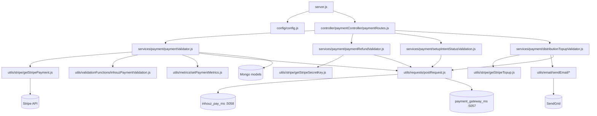

# payment_validation_ms

## 1. Summary

The payment validation service of the Inhouz ERP. Other services call it after a Stripe object is
created or changed; it re-reads the object from Stripe, decides whether the money actually moved,
persists the result (charges, refunds, top-ups, setup intents, metrics, MRR and conversion
trackers), and calls `inhouz_pay_ms` back with the final status. It does not take payments itself.
Source: `apps/payment_validation_ms` — a separate git repository, not the control repo.

## 2. Stack and commands

- Runtime: Node.js, CommonJS, Express 4. `package.json` declares `engines.node`
  `>=12.0.0 <17.5.0`.
- Package metadata is the shared template: `name` = `micro_service_template`, `description` =
  `The base of all simple erp microservices`. `package.json:2-3`
- Scripts: `start` = `node server.js`; `test` = `echo "Error: no test specified" && exit 1`.
  `package.json:7-9`
- Port: `PORT` env var, used at listen. `server.js:100`
- Start command: `npm start`. `package.json:8`
- Container: image `inhouz/payment_validation_ms`, 1 replica
  (`k8s/payment-validation-ms-deployment.yml:6,17`); service
  `payment-validation-ms-cluster-ip-service` on port 5050
  (`k8s/payment-validation-ms-cluster-ip-service.yml:4,10`).
- Healthcheck: `healthcheck.js` makes an HTTP request to `PORT`. `healthcheck.js:1,6`

## 3. Entry points

| Entry point | Where | How started |
|---|---|---|
| Cluster master | `server.js:39-56` | `node server.js`; forks `os.cpus().length` workers in production, 1 otherwise, and refork on exit |
| Express server | `server.js:57-103` | inside each worker; `app.listen(process.env.PORT)` at `server.js:100` |
| Route registration | `controller/paymentController/paymentRoutes.js:6-11` | `require(...)(app)` at `server.js:71` |
| 25 model registrations (25 `require`s) | `server.js:13-37` | worker start, before routes |
| Mongo connect / reconnect | `server.js:72-86`, `server.js:105-117` | on start; 5 s `setTimeout` retry on `disconnected` at `server.js:82` |
| Shutdown | `server.js:91-98` | `SIGINT`, `SIGTERM`, `uncaughtException` close mongoose |

No cron and no scheduler loop. The service is purely request-driven. The `setTimeout` at
`server.js:82` is the Mongo reconnect timer.

## 4. Module inventory

| Module | `file:line` | Owns | Public API | Kind |
|---|---|---|---|---|
| `server.js` | `server.js:1` | cluster, middleware stack, model loading, mongo lifecycle | — | effectful |
| `config/config.js` | `config/config.js:16` | cached config; secrets from `/mnt/secrets/<name>` with env fallback | `module.exports()` | effectful (filesystem + env) |
| `readSecret` | `config/config.js:4` | one secret read | `readSecret(name, envFallback)` | effectful |
| `paymentRoutes` | `controller/paymentController/paymentRoutes.js:6` | registers the 4 routes, no middleware | `(app) => void` | effectful |
| `paymentValidator` | `services/payment/paymentValidator.js:13` | validates a payment charge against Stripe, settles the charge, updates metrics and MRR | `(req,res)` | effectful (Mongo + Stripe + HTTP); holds charge settlement state (`:217`, `:248`) |
| `paymentRefundValidator` | `services/payment/paymentRefundValidator.js:10` | re-reads a Stripe refund and reports success/failure to `inhouz_pay_ms` | `(req,res)` | effectful |
| `setupIntentStatusValidation` | `services/payment/setupIntentStatusValidation.js:10` | validates a Stripe SetupIntent, records a saved payment method, triggers payment-link first payment | `(req,res)` | effectful |
| `distributionTopupValidator` | `services/payment/distributionTopupValidator.js:14` | validates a Stripe top-up and re-triggers the distribution run | `(req,res)` | effectful |
| `getStripePayment` | `utils/stripe/getStripePayment.js:22,29` | retrieve a PaymentIntent in the right environment | `(id, env)` | effectful |
| `getStripeTopup` | `utils/stripe/getStripeTopup.js:7` | retrieve a TopUp | `(id, env)` | effectful |
| `getStripeSecretKey` | `utils/stripe/getStripeSecretKey.js` | selects live vs test key from config | `(env)` | pure (selection only) |
| `inhouzPaymentValidation` | `utils/validationFunctions/inhouzPaymentValidation.js:7` | posts terminal charge status to `inhouz_pay_ms` (`markassuccess` / `cancelpayment`) | `(charge, status)` | effectful |
| `inhouzSubscriptionValidation` | `utils/validationFunctions/inhouzSubscriptionValidation.js` | same for subscription charges | `(charge, status)` | effectful |
| `subscriptionServiceValidation` | `utils/validationFunctions/subscriptionServiceValidation.js` | same for subscription-service charges | `(charge, status)` | effectful |
| `setPaymentMetrics` | `utils/metrics/setPaymentMetrics.js:5` | daily and hourly payment counters, amount and tax trackers | `(inhouzPayment, paymentCharge)` | effectful (Mongo) |
| `recursiveSanitizer` | `utils/sanitizer/recursiveSanitizer.js` | deep string sanitisation of every request body | `(value, sanitizer)` | pure |
| `postRequest` / `getRequest` / `deleteRequest` | `utils/requests/*.js:4` | JSON HTTP client | `(url, headers, body)` | effectful |
| `sendEmail`, `sendEmailByPermission` | `utils/email/sendEmail/*.js` | SendGrid mail, permission-targeted mail | `(msg)` | effectful |
| `isLoggedIn` | `middlewares/login/checkLogin.js:24,105` | session-cookie login (registered but not used by any of the 4 routes) | middleware | effectful |
| `moduleAccessCheck` | `middlewares/module/moduleAccessCheck.js:29` | module permission check (not mounted on any route) | middleware | effectful |
| `singleSubdomainValidation` | `middlewares/subdomain/*` | tenant subdomain check (not mounted) | middleware | effectful |

## 5. Side effects

| Effect | Where |
|---|---|
| MongoDB connect (`maxPoolSize: 1`) | `server.js:105-117` |
| Mongo reads/writes | `paymentValidator.js:71-76,211-248,288`; `paymentRefundValidator.js:78`; `setupIntentStatusValidation.js:52,83`; `distributionTopupValidator.js:57,75,149` |
| Stripe — retrieve PaymentIntent | `paymentValidator.js` via `utils/stripe/getStripePayment.js:22,29` |
| Stripe — retrieve Refund | `services/payment/paymentRefundValidator.js:120,128` |
| Stripe — retrieve SetupIntent | `services/payment/setupIntentStatusValidation.js:120,127` |
| Stripe — retrieve TopUp | `utils/stripe/getStripeTopup.js:7` |
| HTTP to `inhouz_pay_ms` — `markassuccess` | `utils/validationFunctions/inhouzPaymentValidation.js:35` |
| HTTP to `inhouz_pay_ms` — `cancelpayment` | `utils/validationFunctions/inhouzPaymentValidation.js:49` |
| HTTP to `inhouz_pay_ms` — `markrefundassuccess` | `services/payment/paymentRefundValidator.js:151` |
| HTTP to `inhouz_pay_ms` — `markrefundasfail` | `services/payment/paymentRefundValidator.js:159` |
| HTTP to `inhouz_pay_ms` — `paymentlink/initfixedflexpayment` | `services/payment/setupIntentStatusValidation.js:158` |
| HTTP to `payment_gateway_ms` — `distribute/serverrun` | `services/payment/distributionTopupValidator.js:239` |
| Metrics writes | `utils/metrics/setPaymentMetrics.js` |
| Email via SendGrid | `utils/email/sendEmail/sendEmail.js`; key from `config/config.js:19` |
| Secret files | `config/config.js:4-14` |
| Clock | `new Date().getTime()` in all four services, e.g. `paymentValidator.js:34` |
| Logging | `console.log` in every service, e.g. `paymentValidator.js:82` |
| Crypto | `cryptr` at `paymentValidator.js:4,33` |

## 6. State and state transitions

The service holds no state machine of its own; it advances the settlement flag on `paymentCharges`.
`transactionSettled` is written true on success and reset false on a failure branch
(`services/payment/paymentValidator.js:217`, `:248`), and every read filters
`transactionSettled: { $in: [false, null] }` (`:76`).

| From | To | Trigger | Guard |
|---|---|---|---|
| unsettled charge (`transactionSettled` false or null) | settled (`true`) | Stripe payment status `succeeded` | `paymentValidator.js:217` |
| unsettled charge | not settled (`false`) | any non-succeeded terminal status | `paymentValidator.js:248` |
| SetupIntent tracker created | validated | `setupIntentStatusValidation` re-reads the intent | tracker doc exists (`setupIntentStatusValidation.js:52`) |
| top-up queue row | processed | `distributionTopupValidator` re-reads the Stripe top-up | row matches `_id` + company + environment (`distributionTopupValidator.js:57`) |

Idempotency is by Mongo lookup: a charge already settled is not found and the call returns 404
"Payment charge was not found." (`paymentValidator.js:88-92`).

## 7. Data

Every model name — and therefore the collection — comes from an env var (`config/config.js`). Model
paths are from `apps/payment_validation_ms`.

| Model file | Env var | Collection (k8s value) | Key fields / validation |
|---|---|---|---|
| `model/payment/paymentCharge.js:5` | `PAYMENT_CHARGE_MODEL` | `paymentCharges` (`k8s/...:145-146`) | `companyId`, `assetOwnerCompanyId`, `chargeType` (enum, 6 values, `:12-20`), `timestamp`, `transactionId`, `paymentSystem` enum `['stripe']`, `transactionSettled` |
| `model/payment/paymentIntent.js:5` | `PAYMENT_INTENT_MODEL` | `paymentIntents` | intent record |
| `model/payment/paymentRefund.js:5` | `PAYMENT_RFUND_MODEL` (variable name is spelled `RFUND`) | `paymentRefunds` | refund record |
| `model/payment/paymentGateway.js:5` | `PAYMENT_GATEWAY_MODEL` | `paymentGateways` | company Stripe gateway |
| `model/payment/paymentLink.js:5` | `PAYMENT_LINK_MODEL` | `paymentLinks` | payment-link definition |
| `model/payment/deployedPaymentLink.js:5` | `DEPLOYED_PAYMENT_LINK_MODEL` | `deployedPaymentLinks` | deployed link |
| `model/payment/payoutAccount.js:5` | `PAYOUT_ACCOUNT_MODEL` | `payoutAccounts` | connected payout account |
| `model/payment/setupIntentValidationTracker.js:5` | `SETUP_INTENT_VALIDATION_TRACKER_MODEL` | `setupIntentValidationTracker` (`k8s/...:179-180`) | `setupIntentId` required, `environment` required, `payoutAccountId`, `isPaymentLink`, `paymentLinkType`, `assetOwnerCompanyId`; `strict: true`; index on `setupIntentId` |
| `model/payment/distributionAccountTopupQueue.js:5` | `DISTRIBUTION_ACCOUNT_TOPUP_QUEUE_MODEL` | `distributionAccountTopupQueue` | pending top-up |
| `model/payment/paymentDistribution.js:5` | `PAYMENT_DISTRIBUTION_MODEL` | `paymentDistributions` | distribution run |
| `model/payment/inhouzPayment.js:5` | `INHOUZ_PAYMENT_MODEL` | `inhouzPayments` (`k8s/...:191-192`) | `customerType` enum (`:21-25`), `paymentOrigin` enum (`:41-46`), `paymentType` enum (`:56-62`), `reupSubscriptionRateType` enum `['', day, week, month, year]` (`:154`) |
| `model/payment/inhouzPaymentTax.js:5` | `INHOUZ_PAYMENT_TAX_MODEL` | `inhouzPaymentTaxes` | tax per payment |
| `model/payment/inhouzPaymentMetrics.js:5` | `INHOUZ_PAYMENT_METRICS_MODEL` | `inhouzPaymentMetrics` | daily/hourly counters |
| `model/payment/inhouzPayMrrTracker.js:5` | `INHOUZ_PAY_MRR_TRACKER_MODEL` | `inhouzPayMrrTracker` | MRR per day |
| `model/payment/inhouzPayConversionTracker.js:5` | `INHOUZ_PAY_CONVERSION_TRACKER_MODEL` | `inhouzPayConversionTracker` | conversion funnel |
| `model/payment/inhouzPaymentMethodTracker.js:5` | `INHOUZ_PAYMENT_METHOD_TRACKER_MODEL` | `inhouzPayPaymentMethodTracker` | saved payment methods |
| `model/company/company.js:5` | `COMPANY_MODEL` | `company` | tenant company |
| `model/inhouzSubscription/inhouzSubscription.js:5` | `INHOUZ_SUBSCRIPTIONS_MODEL` | `inhouzSubscriptions` | subscription |
| `model/session/session.js:5` | `SESSION_MODEL` | `session` (`k8s/...:103-104`) | login session |
| `model/subscription/subscription.js:5`, `subscriber.js:6` | `SUBSCRIPTION_MODEL`, `SUBSCRIBER_MODEL` | `subscriptions`, `subscribers` | plan and subscriber |
| `model/user/user.js:6`, `useRoles.js:6` | `USER_MODEL`, `USER_ROLES_MODEL` | `users`, `userRoles` | identity |
| `model/rolesAndPermissions/permissions.js:6`, `roles.js:6` | `PERMISSION_MODEL`, `ROLE_MODEL` | `permissions`, `roles` | RBAC |

Shared with other services — the coupling not visible from this repo: `paymentCharges`,
`paymentIntents`, `paymentRefunds`, `paymentDistributions`, `payoutAccounts` and
`distributionAccountTopupQueue` are written by `inhouz_pay_ms` / `payment_gateway_ms` and only
**read and status-updated** here. `inhouzPaymentMetrics`, `inhouzPayMrrTracker`,
`inhouzPayConversionTracker` and `inhouzPaymentMethodTracker` are analytics written here and read
by the metrics services. `company`, `inhouzSubscriptions`, `session`, `users` and `roles` are
identity-owned and only read here (`middlewares/login/checkLogin.js:24,105`).

## 8. Public interfaces

Four `POST` routes, all body `{ encryptedPayload: string }`, all encrypted with
`config.sessionSecret` and carrying `{ payload, expirationTimestamp }`
(`services/payment/paymentValidator.js:15-49`). No auth middleware is mounted on any of them — the
encrypted payload is the only gate (`controller/paymentController/paymentRoutes.js:7-10`).

| Route | Handler | Payload fields | Effect |
|---|---|---|---|
| `POST /api/paymentvalidator/validate` | `paymentValidator` | `paymentChargeId`, `assetOwnerCompanyId`, `companyId`, `amount` (number) (`:51-54,56-71`) | settles the charge, updates metrics, notifies `inhouz_pay_ms` |
| `POST /api/paymentvalidator/refundvalidator` | `paymentRefundValidator` | `paymentRefundId`, `assetOwnerCompanyId`, `environment`, `stripePaymentIntentId`, `payoutAccountId`, `stripeRefundId`, `inhouzPaymentId` (`:45-50`) | posts `markrefundassuccess` / `markrefundasfail` |
| `POST /api/paymentvalidator/setupintentstatusvalidation` | `setupIntentStatusValidation` | `docId` (`:45-47`) | validates a SetupIntent, may start a payment-link first payment |
| `POST /api/paymentvalidator/topupvalidation` | `distributionTopupValidator` | `topupQueueId`, `assetOwnerCompanyId`, `environment` (`:45-48`) | validates the top-up, re-runs distribution |

Responses: `{ error: { message } }` with `400` for a malformed or expired payload, `401`-style
"Invalid request" for missing fields, `404` for a record not found, `500` for a Mongo or Stripe
error (`paymentValidator.js:23-27,44-48,66-70,88-92,100-104`). On success the handler returns the
downstream body verbatim, e.g. `res.send(response)` at `:157`.

## 9. Configuration

Secret-backed (file `/mnt/secrets/<name>`, env fallback, `config/config.js:4-14`):
`SENDGRID_API_KEY`, `SESSION_SECRET`, `MONGO_URL`, `CLIENT_SECRET_KEY`, `STRIPE_API_KEY`,
`TEST_STRIPE_API_KEY`.

`STRIPE_API_KEY` is read twice under two config keys (`stripeApiKey` and `productionStripeApiKey`,
`config/config.js:45,52`) and `TEST_STRIPE_API_KEY` once (`:53`); the live/test choice is made by
`utils/stripe/getStripeSecretKey.js`.

Plain env keys: `SECRETS_PATH`, `PORT`, `NODE_ENV`, `COOKIE_DOMAIN`, `SMPL_EMAIL`,
`INHOUZ_BASE_URL`, `INHOUZ_FROM_EMAIL`, `INHOUZ_PAY_MS_URL`, `PAYMENT_GATEWAY_MS_URL`, plus one
`*_MODEL` key per row in section 7 and the unused template keys `FLEX_FORM_FILE_MODEL`,
`FLEX_MODULE_MODEL`, `FLEX_COLLECTION_MODEL`, `FORM_MODEL`, `DATA_RULE_EXECUTION_RESULT_MODEL`,
`SESSION_VALIDATOR_MODEL`, `AUTH_LOG_MODEL`.

k8s sets about 88 env names (`k8s/payment-validation-ms-deployment.yml`), including many
`*_MODEL` keys this code never reads (`FUNCTION_MS_URL`, `FUNCTION_PARSER_MS_URL`,
`SCHEDULED_TASK_MS_URL`, `PAYMENT_MS_URL`, `QUERY_MODEL`, `SCHEMA_MODEL`,
`SUBSCRIBER_MIGRATION_QUEUE_MODEL`, …) — template leftovers from the copied deployment.

## 10. Dependencies

Direct, from `package.json`, with why:

- `express`, `body-parser`, `cookie-parser`, `cors`, `helmet`, `hpp` — server and hardening
  (`server.js:2-9,58-69`).
- `mongoose` — all models and the settlement updates (`server.js:3`, `paymentValidator.js:71`).
- `dotenv` — local env loading (`server.js:1`).
- `cryptr` — decrypts every inbound payload and encrypts the outbound callback
  (`paymentValidator.js:4,33`; `inhouzPaymentValidation.js:4,24`).
- `crypto-js` — session-cookie decryption (`middlewares/login/checkLogin.js:4`).
- `stripe` — re-reading PaymentIntents, Refunds, SetupIntents, TopUps
  (`paymentRefundValidator.js:119,127`).
- `node-fetch` — the callback client (`utils/requests/postRequest.js:1`).
- `moment` — expiry timestamps and metric buckets (`inhouzPaymentValidation.js:3,26`,
  `utils/metrics/setPaymentMetrics.js:3`).
- `sanitizer` — request sanitisation in all four services (`paymentValidator.js:10`).
- `lodash` — collection helpers.
- `validator` — schema field validation (`model/rolesAndPermissions/permissions.js:3`).
- `shortid` — query keys and tracker ids (`inhouzPaymentValidation.js:6,21`).
- `@sendgrid/mail` — failure notices for top-ups (`distributionTopupValidator.js:10-12`).
- `bcryptjs`, `connect-mongo`, `express-session`, `request-ip` — auth/session support inherited
  from the template.

## 11. Testing

No tests. `package.json:8` is `echo "Error: no test specified" && exit 1` and there is no
`test/`, `__tests__/` or spec file. Nothing is covered. Verification is manual: send an encrypted
payload to each of the four routes against Mongo and Stripe test mode.

## 12. Known issues and risks

- **No auth middleware on any route.** `controller/paymentController/paymentRoutes.js:7-10`
  registers all four handlers bare. Anyone who can reach port 5050 and forge or replay a payload
  can settle a charge or re-run a distribution. The payload encryption with `SESSION_SECRET`
  (`paymentValidator.js:33`) is the only control, and that same secret signs login cookies
  (`middlewares/login/checkLogin.js`).
- **Fixed 30-second payload expiry, no nonce store.** `utils/validationFunctions/inhouzPaymentValidation.js:26`
  sets `expirationTimestamp` to now + 30 s and nothing records a used payload
  (`paymentValidator.js:34-44`), so a captured payload can be replayed inside its window. The
  charge settle is idempotent, the callback is not proven to be.
- **Callback results are not checked.** `paymentRefundValidator.js:151-165` and
  `setupIntentStatusValidation.js:158` return the downstream body without inspecting it; a failed
  `markassuccess` still returns 200 to the sender.
- **`postRequest` at `distributionTopupValidator.js:239` is not awaited** — the distribution
  re-run is fire-and-forget, so a failure is invisible to the caller.
- **`paymentRefundValidator` calls Stripe twice in a branch** (`:120` and `:128`) — an extra API
  call per refund validation.
- **Typo in a config key.** `PAYMENT_RFUND_MODEL` (`config/config.js:50`) — missing an `E`. Any
  deployment that spells it `PAYMENT_REFUND_MODEL` silently gets `undefined` as the collection
  name and mongoose throws at model registration.
- **Cluster forks on every exit.** `server.js:47-50` re-forks unconditionally, so a crash loop
  becomes an infinite fork loop.
- **`uncaughtException` treated as shutdown.** `server.js:94` closes Mongo and takes the worker
  down mid-request.
- **Dead middleware.** `middlewares/login`, `module`, `subdomain` are registered model-side but
  mounted on no route; a reader may assume auth exists.
- **No tests** (`package.json:8`).
- **Credentials in source.** None embedded. `TEST_STRIPE_API_KEY` and `STRIPE_API_KEY` are read
  from files or env only (`config/config.js:45,52,53`); no key literal appears in the code.

## 13. Module map

## 14. Open questions

- Whether the four routes are meant to be reachable from the cluster only. The k8s service is
  `ClusterIP` (`k8s/payment-validation-ms-cluster-ip-service.yml`), which limits exposure to the
  cluster, but nothing in the code authenticates the caller.
- `paymentValidator.js:120-300` (the charge-type branches, MRR and conversion updates) was read
  only around the settlement writes (`:76`, `:217`, `:248`, `:288`). The per-charge-type
  accounting needs a dedicated read before anyone changes it.
- Which service writes `paymentCharges`: this repo reads and updates settlement only; the writer
  is `inhouz_pay_ms` by inference from the callback URLs, not proven here.
- The unused `*_MODEL` and `*_MS_URL` env vars in the deployment were not traced to any owner.
- `GET /` and any webhook route do not exist, so Stripe webhooks must be delivered elsewhere
  (`inhouz_pay_ms`), which was not verified.

Skipped: `utils/email/templates/*` (static HTML), `utils/date/*`, `utils/user/*` (support helpers),
`middlewares/**` beyond the model registrations (not mounted on any route), and the build/deploy
scripts (`build_ga.sh`, `deploy.sh`, `Dockerfile`, `kus/`). All are either unused here or
mechanical.
