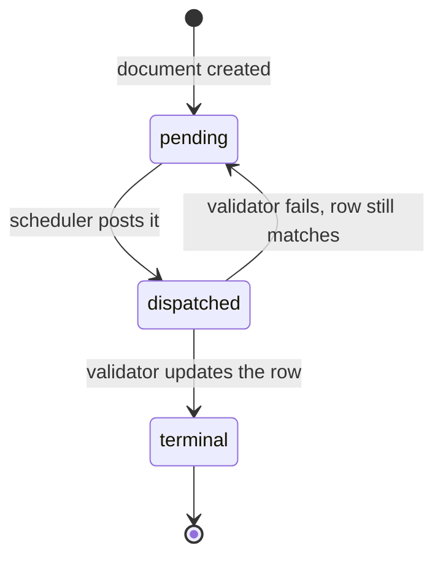
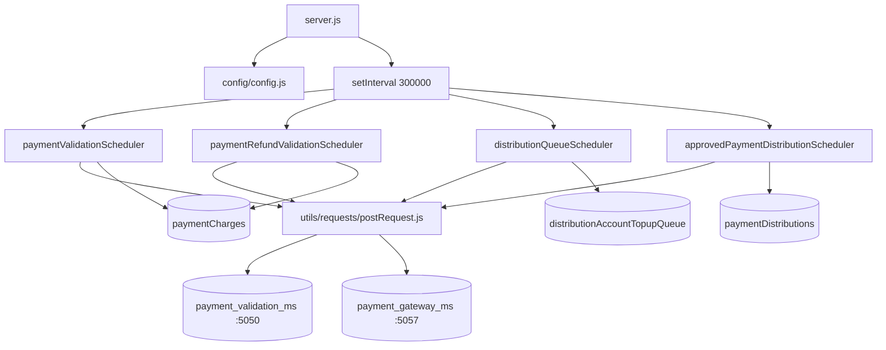

# payment_validation_scheduler_ms

## 1. Summary

A timer that re-drives stuck payment work. Every five minutes it scans four MongoDB collections
for documents that are not in a terminal state and POSTs each one to `payment_validation_ms` (to
settle charges, validate refunds and validate top-ups) or to `payment_gateway_ms` (to re-run an
approved distribution). It has no HTTP routes of its own; the Express server exists only so the
pod has a listening port for the healthcheck. Source: `apps/payment_validation_scheduler_ms` — a
separate git repository, not the control repo.

## 2. Stack and commands

- Runtime: Node.js, CommonJS, Express 4. `package.json` declares `engines.node`
  `>=12.0.0 <17.5.0`.
- Package metadata is wrong for this service: `name` = `subscription_migration_scheduler_ms`,
  `description` = `The subscription_migration_scheduler_ms`. `package.json:2-3`
- Scripts: `start` = `node --max-old-space-size=8192 server.js`; `test` =
  `echo "Error: no test specified" && exit 1`. `package.json:7-9`
- Start command: `npm start`. The 8 GB heap flag is part of the script, not a deployment setting.
- Port: `PORT` env var, `server.js:85`.
- Container: image `inhouz/payment_validation_scheduler_ms`, 1 replica
  (`k8s/payment-validation-scheduler-ms-deployment.yml:6,17`); service
  `payment-validation-scheduler-ms-cluster-ip-service` on 5049
  (`k8s/payment-validation-scheduler-ms-cluster-ip-service.yml:4,10`).
- No cluster fork here: `server.js:32` builds one Express app in one process, unlike its sibling
  services.

## 3. Entry points

| Entry point | Where | How started |
|---|---|---|
| Express server (healthcheck only) | `server.js:32-44,85-87` | `npm start`; `app.listen(process.env.PORT)` at `server.js:85`; **no routes are registered** |
| 5-minute scheduler loop | `server.js:78-83` | `setInterval(..., 300000)` on process start; runs all four schedulers in order |
| `paymentValidationScheduler` | `services/payment/paymentValidationScheduler.js:7` | called by the interval at `server.js:79` |
| `paymentRefundValidationScheduler` | `services/payment/paymentRefundValidationScheduler.js:7` | `server.js:80` |
| `distributionQueueScheduler` | `services/payment/distributionQueueScheduler.js:7` | `server.js:81` |
| `approvedPaymentDistributionScheduler` | `services/payment/approvedPaymentDistributionScheduler.js:7` | `server.js:82` |
| Model registration (4 models only) | `server.js:22-25` | worker start; the rest of the model `require`s are commented out (`server.js:15-21,26-30`) |
| Mongo connect / reconnect | `server.js:45-47,89-101` | on start; 5 s `setTimeout` retry at `server.js:55` |
| Shutdown | `server.js:64-72` | `SIGINT`, `SIGTERM`, `uncaughtException` close mongoose |

The immediate one-shot calls at `server.js:74-77` are all commented out, so nothing runs until the
first 5-minute tick.

## 4. Module inventory

| Module | `file:line` | Owns | Public API | Kind |
|---|---|---|---|---|
| `server.js` | `server.js:1` | config load, middleware stack, model loading, mongo lifecycle, the interval | — | effectful |
| `config/config.js` | `config/config.js` | cached config, secrets from `/mnt/secrets` with env fallback | `module.exports()` | effectful |
| `paymentValidationScheduler` | `services/payment/paymentValidationScheduler.js:7` | finds unsettled, non-cancelled charges and posts each to `/validate` | `async () => void` | effectful (Mongo + HTTP) |
| `paymentRefundValidationScheduler` | `services/payment/paymentRefundValidationScheduler.js:7` | finds `pending` refunds and posts each to `/refundvalidator` | `async () => void` | effectful |
| `distributionQueueScheduler` | `services/payment/distributionQueueScheduler.js:7` | finds `pending` top-up queue rows and posts each to `/topupvalidation` | `async () => void` | effectful |
| `approvedPaymentDistributionScheduler` | `services/payment/approvedPaymentDistributionScheduler.js:7` | finds approved distributions whose approval check time passed and re-runs them | `async () => void` | effectful (Mongo + HTTP + crypto + randomness) |
| `postRequest` | `utils/requests/postRequest.js:4` | the outbound JSON POST used by all four | `(url, headers, body)` | effectful |
| `getRequest` / `deleteRequest` | `utils/requests/*.js:1` | unused HTTP helpers | `(url, …)` | effectful |
| `recursiveSanitizer` | `utils/sanitizer/recursiveSanitizer.js` | deep string sanitisation | `(value, sanitizer)` | pure |
| `getUser` | `utils/user/getUser.js:18,44,84,118` | loads a user, roles and permissions | `(id)` | effectful |
| `encryptDecrypt` | `utils/cryptography/encryptDecrypt.js` | symmetric helper used by the API-key path | `(value)` | effectful (crypto) |
| `isLoggedIn` | `middlewares/login/checkLogin.js:24,105` | session login, mounted on no route | middleware | effectful |
| `moduleAccessCheck` | `middlewares/module/moduleAccessCheck.js:29` | module permission check, mounted on no route | middleware | effectful |
| `singleSubdomainValidation` | `middlewares/subdomain/*` | subdomain check, mounted on no route | middleware | effectful |

The pagination loop in each scheduler is a pure control structure (skip/limit counter) wrapped
around effectful Mongo and HTTP calls, so the module as a whole is `effectful`.

## 5. Side effects

| Effect | Where |
|---|---|
| MongoDB connect (`maxPoolSize: 1`) | `server.js:89-101` |
| Mongo read: `paymentCharges` unsettled and not cancelled | `paymentValidationScheduler.js:13-30` |
| Mongo read: refunds with `status: 'pending'` | `paymentRefundValidationScheduler.js:14-29` |
| Mongo read: top-up queue rows with `status: 'pending'` | `distributionQueueScheduler.js:13-28` |
| Mongo read: distributions `status: 'approved'`, `approvalCheckTimestamp < now`, `environment: 'production'` | `approvedPaymentDistributionScheduler.js:13-31` |
| HTTP POST `payment_validation_ms` `/api/paymentvalidator/validate` | `paymentValidationScheduler.js:64-68` |
| HTTP POST `payment_validation_ms` `/api/paymentvalidator/refundvalidator` | `paymentRefundValidationScheduler.js:70-74` |
| HTTP POST `payment_validation_ms` `/api/paymentvalidator/topupvalidation` | `distributionQueueScheduler.js:56-60` |
| HTTP POST `payment_gateway_ms` `/api/paymentgateway/distribution/distribute/serverrun` | `approvedPaymentDistributionScheduler.js:70-77` |
| Clock | `moment()` expiry at `paymentValidationScheduler.js:60`; `new Date().getTime()` at `approvedPaymentDistributionScheduler.js:11` |
| Randomness | `Math.random()` four times for the query key, `approvedPaymentDistributionScheduler.js:50` |
| Crypto | `cryptr.encrypt` in all four, e.g. `paymentValidationScheduler.js:52`; `cryptr.decrypt` at `approvedPaymentDistributionScheduler.js:49` |
| Secret files | `config/config.js:4-14` |
| Logging | `console.log` in every catch block, e.g. `paymentValidationScheduler.js:32,72` |

## 6. State and state transitions

The service owns no state. It drives documents owned elsewhere into a terminal state by posting
them to the validators.

| Collection | Selection filter | Target state | Driven by |
|---|---|---|---|
| `paymentCharges` | `transactionSettled ∈ [false, null]` and `cancelled ∈ [false, null]` (`paymentValidationScheduler.js:15-20`) | settled | `payment_validation_ms` `/validate` |
| `paymentRefunds` | `status: 'pending'` (`paymentRefundValidationScheduler.js:16`); enum is `pending`, `requires_action`, `succeeded`, `failed`, `canceled` (`model/payment/paymentRefund.js:63-71`) | one of the terminal values | `/refundvalidator` |
| `distributionAccountTopupQueue` | `status: 'pending'` (`distributionQueueScheduler.js:15`) | validator-defined | `/topupvalidation` |
| `paymentDistributions` | `status: 'approved'`, `approvalCheckTimestamp < now`, `environment: 'production'` (`approvedPaymentDistributionScheduler.js:14-20`) | `processing` → `complete` / `failed` | `payment_gateway_ms` `serverrun` |

The retry loop is the filter itself: a row that still matches the filter is re-sent on the next
tick. There is no attempt counter and no backoff.

## 7. Data

The service registers only four models (`server.js:22-25`); everything else in `model/` exists but
is not loaded here, because the `require`s are commented out (`server.js:15-21,26-30`). Collection
names come from env vars (`config/config.js`).

| Model file | Env var | Collection (k8s value) | Used for |
|---|---|---|---|
| `model/payment/paymentCharge.js:5` | `PAYMENT_CHARGE_MODEL` | `paymentCharges` | settle scan |
| `model/payment/paymentRefund.js:5` | `PAYMENT_RFUND_MODEL` (name is spelt without the `E`) | `paymentRefunds` | refund scan |
| `model/payment/distributionAccountTopupQueue.js:5` | `DISTRIBUTION_ACCOUNT_TOPUP_QUEUE_MODEL` | `distributionAccountTopupQueue` | top-up scan |
| `model/payment/paymentDistribution.js:5` | `PAYMENT_DISTRIBUTION_MODEL` | `paymentDistributions` | approved-distribution scan |

Validation rules that matter here:

- `paymentCharge.chargeType` is an enum of **three** values in this repo: `'inhouz account'`,
  `'subscription service'`, `'inhouz in-app charge'` (`model/payment/paymentCharge.js:12-16`).
  `payment_validation_ms` declares the same field on the same collection with **six** different
  values (`apps/payment_validation_ms/model/payment/paymentCharge.js:12-20`). The two schemas
  disagree about the same collection.
- `paymentDistribution.status` here is an enum of **seven** values and has no `'scheduled'`
  (`model/payment/paymentDistribution.js:50-57`), while `payment_gateway_ms` includes
  `'scheduled'` (`apps/payment_gateway_ms/model/payment/paymentDistribution.js:52-57`).
- `paymentRefund.status` enum: `pending`, `requires_action`, `succeeded`, `failed`, `canceled`
  (`model/payment/paymentRefund.js:63-71`).
- `distributionAccountTopupQueue.status` is a required free string, not an enum
  (`model/payment/distributionAccountTopupQueue.js:33-36`), so `'pending'` is a convention only.

Shared with other services: all four collections are written by `payment_gateway_ms` /
`inhouz_pay_ms` and only read by this scheduler. `paymentDistributions.approvalCheckTimestamp` is
set by the approval flow in `payment_gateway_ms` and is the scheduling key here
(`approvedPaymentDistributionScheduler.js:16-18`).

## 8. Public interfaces

No inbound interface. `server.js` registers zero routes, so every path returns Express's default
404. The service exposes nothing to the mesh except the healthcheck port 5049.

Outbound calls, all `POST` with body `{ encryptedPayload, serverEncrypted? }`:

| Target | Path | Payload fields | Where |
|---|---|---|---|
| `payment_validation_ms` :5050 | `/api/paymentvalidator/validate` | `paymentChargeId`, `companyId`, `assetOwnerCompanyId`, `amount` | `paymentValidationScheduler.js:52-68` |
| `payment_validation_ms` :5050 | `/api/paymentvalidator/refundvalidator` | `paymentRefundId`, `assetOwnerCompanyId`, `environment`, `stripePaymentIntentId`, `payoutAccountId`, `stripeRefundId`, `inhouzPaymentId` | `paymentRefundValidationScheduler.js:55-74` |
| `payment_validation_ms` :5050 | `/api/paymentvalidator/topupvalidation` | `topupQueueId`, `assetOwnerCompanyId`, `environment` | `distributionQueueScheduler.js:45-60` |
| `payment_gateway_ms` :5057 | `/api/paymentgateway/distribution/distribute/serverrun` | the stored payload plus `paymentDistributionId`, `fromServer`, `queryKey`, `encryptedKey`, `skipValidationCheck` | `approvedPaymentDistributionScheduler.js:51-77` |

Every payload is encrypted with `config.sessionSecret` and expires 60 s after creation
(`paymentValidationScheduler.js:60`).

## 9. Configuration

Secret-backed (file `/mnt/secrets/<name>`, env fallback, `config/config.js:4-14`):
`SESSION_SECRET`, `MONGO_URL`, `OPEN_EXCHANGE_RATES_API_KEY`, `CLIENT_SECRET_KEY` (and
`SENDGRID_API_KEY`, read into config but unused here).

Plain env keys actually read: `SECRETS_PATH`, `PORT`, `NODE_ENV`, `COOKIE_DOMAIN`, `SMPL_EMAIL`,
`INHOUZ_BASE_URL`, `PAYMENT_VALIDATOR_MS_URL`, `PAYMENT_GATEWAY_MS_URL`,
`SUBSCRIPTION_RENEWAL_MS_URL`, `PAYMENT_CHARGE_MODEL`, `PAYMENT_RFUND_MODEL`,
`PAYMENT_METHOD_MODEL`, `PAYMENT_INTENT_MODEL`, `PAYOUT_ACCOUNT_MODEL`,
`DISTRIBUTION_ACCOUNT_TOPUP_QUEUE_MODEL`, `PAYMENT_DISTRIBUTION_MODEL`, `EXCHANGE_RATE_CACHE_MODEL`,
`OPEN_EXCHANGE_RATES_BASE_URL`, `SUBSCRIBED_PACKAGE_MODEL`, `SUBSCRIPTION_MODEL`,
`SUBSCRIBER_MIGRATION_QUEUE_MODEL`, `USER_MODEL`, `USER_ROLES_MODEL`, `ROLE_MODEL`,
`PERMISSION_MODEL`, `SESSION_MODEL`, `SESSION_VALIDATOR_MODEL`, `COMPANY_MODEL`, `AUTH_LOG_MODEL`,
and the template keys `FLEX_FORM_FILE_MODEL`, `FLEX_MODULE_MODEL`, `FLEX_COLLECTION_MODEL`,
`FORM_MODEL`, `DATA_RULE_EXECUTION_RESULT_MODEL`.

`SUBSCRIPTION_RENEWAL_MS_URL` is read into `config.subscriptionRenewalMsUrl`
(`config/config.js:53`) and is used by no scheduler in this repo.

## 10. Dependencies

Direct, from `package.json`, with why:

- `express`, `body-parser`, `cookie-parser`, `cors`, `helmet`, `hpp` — only to own a listening port
  and satisfy the healthcheck (`server.js:2-9,32-44`).
- `mongoose` — the four collection scans (`paymentValidationScheduler.js:1,9`).
- `dotenv` — local env (`server.js:1`).
- `cryptr` — encrypts every outbound payload and decrypts the stored distribution payload
  (`paymentValidationScheduler.js:5,10`; `approvedPaymentDistributionScheduler.js:5,49`).
- `moment` — the 60 s payload expiry (`paymentValidationScheduler.js:3,60`).
- `node-fetch` — the HTTP client (`utils/requests/postRequest.js:1`).
- `crypto-js`, `node-rsa`, `bcryptjs`, `connect-mongo`, `express-session`, `request-ip` — auth and
  session support inherited from the template; none is on a live path here.
- `lodash` — used only by the unused login middleware (`middlewares/login/checkLogin.js:5`).
- `sanitizer`, `validator`, `shortid`, `@sendgrid/mail` — template leftovers; no live path reaches
  them in this repo.

## 11. Testing

No tests. `package.json:8` is `echo "Error: no test specified" && exit 1`, and there is no test
file. Nothing is covered. Verification is manual: seed a document in one of the four collections,
set `PAYMENT_VALIDATOR_MS_URL` / `PAYMENT_GATEWAY_MS_URL`, and watch the logs and the target
service.

## 12. Known issues and risks

- **Infinite tight loop on a read error.** In all four schedulers the catch branch sets
  `trackerCount = limit` and `continue`s without incrementing `skip`
  (`paymentValidationScheduler.js:36-39`, `paymentRefundValidationScheduler.js:35-38`,
  `distributionQueueScheduler.js:30-33`, `approvedPaymentDistributionScheduler.js:33-36`). When
  Mongo keeps failing, `limit === trackerCount` stays true and the `do/while` re-queries the same
  failing page forever, burning CPU and hammering the database.
- **Wrong collection for refunds.** `paymentRefundValidationScheduler.js:9` resolves
  `config.paymentChargeModel` — the charge collection — and queries it with refund fields such as
  `stripeRefundId` and `status: 'pending'` (`:14-26`). The refund model
  (`config.paymentRefundModel`) is never used in that scheduler. Pending refunds are therefore
  never picked up.
- **Skip-based pagination over a shrinking result set.** Each loop pages with `.skip(skip)`
  (`paymentValidationScheduler.js:29`, and the same in the other three) while the documents it
  just dispatched may leave the filter in the target service. Records are silently skipped
  between pages.
- **Fire-and-forget dispatch.** `postRequest` is not awaited in any of the four loops
  (`paymentValidationScheduler.js:64`, `paymentRefundValidationScheduler.js:70`,
  `distributionQueueScheduler.js:56`, `approvedPaymentDistributionScheduler.js:70`), so a failed
  POST is invisible and the next tick re-sends the same row indefinitely.
- **No overlap guard.** `setInterval` at `server.js:78` fires every 5 minutes regardless of whether
  the previous tick finished; a slow run stacks ticks and duplicates work.
- **Schedulers are not awaited by the interval.** `server.js:79-82` calls four async functions in
  sequence without `await`, so they run concurrently and an exception becomes an unhandled
  rejection.
- **Production-only distributions.** `approvedPaymentDistributionScheduler.js:19` hard-codes
  `environment: 'production'`, so approved distributions in test mode are never re-run.
- **Random query key.** `Math.random()` (`approvedPaymentDistributionScheduler.js:50`) is used to
  build a query key sent to the gateway; it is not a security token but it is not a stable
  idempotency key either.
- **Template identity and dead models.** `package.json:2-3` still names
  `subscription_migration_scheduler_ms`; 13 model `require`s are commented out
  (`server.js:15-21,26-30`) while the files remain, and auth middleware is loaded but mounted on
  nothing.
- **Schema drift with the sibling service.** The same two collections are declared with different
  enums here and in `payment_validation_ms` / `payment_gateway_ms` (section 7). Mongoose validates
  on write, so whichever service writes decides, and the others can read values their schema
  rejects.
- **No tests** (`package.json:8`).
- **Credentials in source.** None embedded. Every secret is read from a file or an env var
  (`config/config.js:4-14`).

## 13. Module map

## 14. Open questions

- Whether `paymentRefundValidationScheduler.js:9` is a copy-paste bug or intentional. The imports
  and field list say refunds; the model says charges. Not fixed here — recorded only.
- Whether `SUBSCRIPTION_RENEWAL_MS_URL` was meant for a fifth scheduler that was removed. The key
  is read into config and used nowhere.
- What clears `approvalCheckTimestamp` and who sets it. The field is read at
  `approvedPaymentDistributionScheduler.js:16`; the writer is in `payment_gateway_ms` by inference,
  not proven here.
- The commented-out model `require`s (`server.js:15-21,26-30`) include `payoutAccount`,
  `paymentMethod`, `paymentIntent`, `exchangeRateCache` and `subscription`; which of them a past
  scheduler needed is not determinable from this repo.
- The deployment sets many `*_MODEL` and `*_MS_URL` names this code never reads; no owner was
  traced.

Skipped: `model/**` beyond the four registered models (they are loaded by no code path here),
`middlewares/**` (mounted on no route), `utils/user/*` and `utils/cryptography/*` (no live caller),
and `build_ga*.sh` / `deploy.sh` / `Dockerfile` / `kus/` (mechanical build and deploy wrappers).
