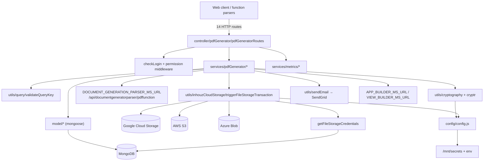

# pdf_generator_ms

## 1. Summary

`pdf_generator_ms` owns PDF templates and generated documents for Inhouz. It stores templates (`pdfGeneratorTemplates`), asks `document_generation_parser_ms` (via a public URL configured as `DOCUMENT_GENERATION_PARSER_MS_URL`) to render an app page into a PDF, downloads the result from Google Cloud Storage / AWS S3 / Azure Blob through a per-company `fileStorageServices` credential record, returns it base64-encoded, optionally emails it, and records usage metrics. It also exposes metrics endpoints and three internal document endpoints that authenticate with an RSA-encrypted payload plus a `queryKey` instead of a session. It lives in its own git repository at `apps/pdf_generator_ms/`. k8s: service `pdf-generator-ms-cluster-ip-service` on `5072` (`k8s/pdf-generator-ms-deployment.yml:28-29`), image `inhouz/pdf_generator_ms`, 1 replica (`k8s/pdf-generator-ms-deployment.yml:6,17`).

## 2. Stack and commands

- Runtime: Node.js; no `engines` field. Express 4 (`package.json`).
- Package manager: npm.
- Start: **no `start` script** in `package.json` (scripts block has only `test`); `Dockerfile:11` runs `npm run start`, which currently fails. The entry is `server.js` (`package.json` `main`).
- Test: `npm test` → `echo "Error: no test specified" && exit 1`.
- Port: `process.env.PORT` (`server.js:96`); k8s sets `PORT=5072` (`k8s/pdf-generator-ms-deployment.yml:28-29`).
- Body limit: 300 mb JSON (`server.js:61`).
- Health probe: `healthcheck.js:8` requests `/healthz`; no such route is registered.

## 3. Entry points

| Entry | Where | How it starts |
|---|---|---|
| Cluster master | `server.js:33-50` | Forks one worker per CPU when `NODE_ENV=production`, otherwise one |
| HTTP server | `server.js:96` | `app.listen(process.env.PORT)` in a worker |
| Route registration | `server.js:65` | `require("./controller/pdfGenerator/pdfGeneratorRoutes")(app)` |
| Mongo connection | `server.js:101-113` | `connectMongo()` at `server.js:67`; reconnect timer at `server.js:73-80` |
| Model registration | `server.js:13-31` | 19 model modules required at startup |
| Health probe script | `healthcheck.js:1-23` | `node healthcheck.js`, requests `GET /healthz` |

No cron, queue consumer or websocket server.

## 4. Module inventory

| Module / function | `file:line` | Responsibility | Public API | Kind |
|---|---|---|---|---|
| `app` / cluster bootstrap | `server.js:33-99` | Express wiring, worker fork, Mongo lifecycle | — | `effectful` |
| `connectMongo()` | `server.js:101` | Mongoose connection, `maxPoolSize: 1` | internal | `effectful` |
| `shutdownFunction(e)` | `server.js:89` | Close Mongo on signals / uncaught errors | process hooks | `effectful` |
| Route table | `controller/pdfGenerator/pdfGeneratorRoutes.js:19-34` | Mounts 14 routes with auth/permission middleware | HTTP | `effectful` |
| `createTemplate` | `services/pdfGenerator/createTemplate.js` | Create template + app build kickoff | `POST /api/pdfgenerator/template/create` | `effectful` |
| `createTemplateFromClone` | `services/pdfGenerator/createTemplateFromClone.js` | Clone an existing template | `POST …/template/createfromclone` | `effectful` |
| `editTemplate` | `services/pdfGenerator/editTemplate.js` | Update template | `POST …/template/edit` | `effectful` |
| `deleteTemplate` | `services/pdfGenerator/deleteTemplate.js` | Delete template and the built app (`appBuilderMsUrl`, `deleteTemplate.js:83`) | `DELETE …/template/delete/:templateId` | `effectful` |
| `getTemplate` | `services/pdfGenerator/getTemplate.js` | Read one template | `GET …/template/gettemplate/:templateId` | `effectful` |
| `getTemplates` | `services/pdfGenerator/getTemplates.js` | List templates | `POST …/template/gettemplates` | `effectful` |
| `templateFieldAvailabilityCheck` | `services/pdfGenerator/templateFieldAvailabilityCheck.js` | Field-collision check | `POST …/template/fieldavailabilitycheck` | `effectful` |
| `getPdfGenerationPackage` | `services/pdfGenerator/getPdfGenerationPackage.js` | Build the render package for the parser | `POST …/document/getpdfgenerationpackage` | `effectful` |
| `uploadPdfDocumentFile` | `services/pdfGenerator/uploadPdfDocumentFile.js:14` | Upload a PDF to company storage, delete on failure, send email | `POST …/document/uploadpdffile` | `effectful` |
| `startDocumentGeneration` | `services/pdfGenerator/startDocumentGeneration.js:14` | Create document row, call parser, download file, collect metrics | `POST …/document/startdocumentgeneration` | `effectful` |
| `getDocuments` | `services/pdfGenerator/getDocuments.js` | List generated documents | `POST …/document/getgenerateddocuments` | `effectful` |
| `getGeneratedDocument` | `services/pdfGenerator/getGeneratedDocument.js` | Read one generated document | `POST …/document/getgenerateddocument` | `effectful` |
| `topSectionMetrics` | `services/metrics/topSectionMetrics.js` | Aggregate top-section metrics | `POST …/metrics/topsection` | `effectful` |
| `timelineMetrics` | `services/metrics/timelineMetrics.js` | Aggregate timeline metrics | `POST …/metrics/timelinemetrics` | `effectful` |
| `triggerFileStorageTransaction` | `utils/inhouzCloudStorage/triggerFileStorageTransaction.js` | Dispatch upload/download/delete/copy/signed-URL to GCS, S3 or Azure | exports function | `effectful` (network, credentials) |
| `getFileStorageCredentials` | `utils/inhouzCloudStorage/getFileStorageCredentials.js:6` | Read `fileStorageServices`, decrypt provider credentials with `Cryptr` | exports function | `effectful` (DB, crypto) |
| `uploadPdfStaticFile` | `utils/staticFile/uploadPdfStaticFile.js:6` | Upload via storage transaction, return URL | exports function | `effectful` |
| `deleteCloudStorageFile` | `utils/staticFile/deleteCloudStorageFile.js` | Delete a stored file | exports function | `effectful` |
| `sendEmail` | `utils/sendEmail/sendEmail.js:7` | SendGrid delivery | exports function | `effectful` |
| `postRequest` / `getRequest` | `utils/requests/postRequest.js:1`, `utils/requests/getRequest.js:1` | `node-fetch` wrappers | exports function | `effectful` |
| `validateQueryKey` | `utils/query/validateQueryKey.js` | Validates the one-time `queryKey` used by the document endpoints | exports function | `effectful` (DB) |
| `encryptDecrypt` | `utils/cryptography/encryptDecrypt.js` | RSA encrypt/decrypt | exports function | `effectful` |
| `recursiveSanitizer` | `utils/sanitizer/recursiveSanitizer.js` | Request-body sanitizer | exports function | `pure` |
| `collectMetrics` | `utils/pdfFunction/collectMetrics.js` | Post-generation metric write | exports function | `effectful` |
| `config()` / `readSecret()` | `config/config.js:18,5` | Env and `/mnt/secrets` reads, cached | returns config | `effectful` |
| 19 model modules | `model/**` (registered `server.js:13-31`) | Schemas for pdf generator, app builder, subscription, storage, metrics, RBAC, session, user | Mongoose models | `effectful` |
| `checkLogin`, `hasGenericReadAccess`, `hasGenericWriteAccess` | `middlewares/login/checkLogin.js`, `middlewares/permission/*` | Session and permission gates on 11 of 14 routes | Express middleware | `effectful` |

## 5. Side effects

| Effect | System | `file:line` |
|---|---|---|
| Read secret files | Filesystem `/mnt/secrets` (`SECRETS_PATH`): `sendgridapikey`, `sessionsecret`, `mongourl`, `clientsecretkey`, `clientpublickey`, `gcsprojectid`, `gcsprivatekeyid`, `gcsprivatekey`, `gcsclientemail`, `gcsclientid`, `gcsclientx509certurl` | `config/config.js:5-15,21-61` |
| RSA operations | Local crypto | `utils/cryptography/encryptDecrypt.js` |
| `Cryptr` symmetric crypto with session secret | Local crypto (`startDocumentGeneration.js:33-38`) | `services/pdfGenerator/startDocumentGeneration.js:33-36,236,302` |
| Connect to MongoDB | `config.mongoUrl` | `server.js:102` |
| Read template | MongoDB `pdfGeneratorTemplates` | `services/pdfGenerator/startDocumentGeneration.js:82-91` |
| Read company | MongoDB `company` | `services/pdfGenerator/startDocumentGeneration.js:109-123` |
| Read subscription / license | MongoDB `inhouzSubscriptions` | `services/pdfGenerator/startDocumentGeneration.js:141-155` |
| Read app build | MongoDB `appBuilds` | `services/pdfGenerator/startDocumentGeneration.js:198-212` |
| Create generated document | MongoDB `pdfGeneratedDocuments` | `services/pdfGenerator/startDocumentGeneration.js:251-276` |
| Delete failed document | MongoDB `pdfGeneratedDocuments` | `services/pdfGenerator/startDocumentGeneration.js:320-326` |
| **POST render request to parser** | `config.documentGenerationParserMsUrl` + `/api/documentgeneratorparser/pdffunction`; in k8s the base is `https://www.inhouz.io` (`k8s/pdf-generator-ms-deployment.yml:320-321`) | `services/pdfGenerator/startDocumentGeneration.js:311-317` |
| **Download rendered file** | Storage provider via `triggerFileStorageTransaction` | `services/pdfGenerator/startDocumentGeneration.js:337-344` |
| **Upload / delete file** | Storage provider | `services/pdfGenerator/uploadPdfDocumentFile.js:202,249` |
| **Read storage credentials and decrypt them** | MongoDB `fileStorageServices`, `Cryptr` | `utils/inhouzCloudStorage/getFileStorageCredentials.js:19-93` |
| Google Cloud Storage upload/download/delete/copy/signed URL | GCS API | `utils/inhouzCloudStorage/googleCloud/*`; dispatch `utils/inhouzCloudStorage/triggerFileStorageTransaction.js:58-80` |
| AWS S3 upload/download/delete/copy/signed URL | AWS API (`aws-sdk`) | `utils/inhouzCloudStorage/aws/*`; dispatch `triggerFileStorageTransaction.js` |
| Azure Blob upload/download/delete/copy/signed URL | Azure API (`@azure/storage-blob`) | `utils/inhouzCloudStorage/microsoftAzure/*`; dispatch `triggerFileStorageTransaction.js` |
| **Send email** | SendGrid (`config.sendGridApiKey`) | `services/pdfGenerator/uploadPdfDocumentFile.js:266`; `utils/sendEmail/sendEmail.js:7` |
| **Call app-builder / view-builder** | `APP_BUILDER_MS_URL` → `http://app-builder-ms-cluster-ip-service:5016`, `VIEW_BUILDER_MS_URL` → `http://view-builder-ms-cluster-ip-service:5017` (`k8s/pdf-generator-ms-deployment.yml:298-301`) | `utils/appBuilder/deleteInhouzApp.js:66`, `utils/appBuilder/cloneInhouzApp.js:73`, `utils/appBuilder/buildInhouzApp.js:81`, `utils/appBuilder/getInhouzAppBuild.js:35`, `services/pdfGenerator/deleteTemplate.js:83` |
| Metrics writes | MongoDB `pdfGeneratorMetrics`, `pdfGeneratorSessionDuration`, `metricsCache` | `services/metrics/topSectionMetrics.js:139,157`, `services/metrics/timelineMetrics.js:105`, `utils/pdfFunction/collectMetrics.js` |
| Clock / randomness | Document names, keys, expiry | `services/pdfGenerator/startDocumentGeneration.js:235,237,245,247,294,307` |
| Logging | stdout `console.log` | `server.js:40,48,71,74,82,90,97`; `startDocumentGeneration.js:89,121,153,210,274,324,373` |
| Close Mongo on signal | MongoDB | `server.js:91-93` |

## 6. State and state transitions

No long-lived state machine. The generated-document row has an implicit two-step lifecycle driven by `startDocumentGeneration` and the parser callback:

| State | Field value | Entered by | Guard |
|---|---|---|---|
| Initialised | `documentGenerated: false` | `pdfGeneratedDocuments.create` (`startDocumentGeneration.js:252-272`) | template, company, active license and app build all exist |
| Rendered (external) | set by the parser / later update | `document_generation_parser_ms` using `documentGenerationKey` (`startDocumentGeneration.js:286-295`) | render succeeds |
| Deleted | row removed | parser call fails (`startDocumentGeneration.js:319-326`) | `docGenerationResponse.hasError` |

Freemium gate: a `freelancer` plan is rejected with 402 when `environment === "production"` or `pdfGenerationCount >= 50` (`startDocumentGeneration.js:177-189`).

## 7. Data

Collections used by this service (env var → collection, verified in config and models):

| Collection | Env var | Use |
|---|---|---|
| `pdfGeneratorTemplates` | `PDF_GENERATOR_TEMPLATE_MODEL` | Template read/write; fields `appId`, `companyId`, `documentName`, `initialData`, `completedDocumentFileStorageServiceId` (`startDocumentGeneration.js:83-86,191-194`) |
| `pdfGeneratedDocuments` | `PDF_GENERATED_DOCUMENT_MODEL` | Document rows; fields `documentName`, `appId`, `templateId`, `templateName`, `environment`, `companyId`, `createTimestamp`, `createdByEmail`, `documentData`, `documentGenerated`, `documentStaticFileId`, `documentGenerationEncryptedKey`, `startDocumentGenerationTimestamp`, `fileStorageServiceId`, `sendViaEmail`, `recipientEmail`, `emailSubject`, `emailMessage`, `emailSenderName` (`startDocumentGeneration.js:252-272`); schema `model/pdfGenerator/pdfGeneratedDocument.js:5` |
| `pdfGeneratorMetrics` | `PDF_GENERATOR_METRICS_MODEL` | Metric rows (`model/pdfGenerator/pdfGeneratorMetrics.js:5`) |
| `pdfGeneratorSessionDuration` | `PDF_GENERATOR_SESSION_DURATION_MODEL` | Duration rows (`model/pdfGenerator/pdfGeneratorSessionDuration.js:5`) |
| `metricsCache` | `METRICS_CACHE_MODEL` | Cached aggregates (`model/metrics/metricsCache.js:5`) |
| `queryKeyTracker` | `QUERY_KEY_TRACKER_MODEL` | One-time `queryKey` validation (`model/queryTracker/queryKeyTracker.js:5`) |
| `company` | `COMPANY_MODEL` | `companyName`, `subDomain` (`startDocumentGeneration.js:110-118`) |
| `inhouzSubscriptions` | `INHOUZ_SUBSCRIPTIONS_MODEL` | `pdfGenerationCount`, `subscriptionServicePlanType`, `active` (`startDocumentGeneration.js:142-151`) |
| `appBuilds` | `APP_BUILD_MODEL` | `appId`, `companyId` existence check (`startDocumentGeneration.js:199-207`) |
| `fileStorageServices` | `FILE_STORAGE_SERVICE_MODEL` | Per-company provider credentials, encrypted with `Cryptr` (`getFileStorageCredentials.js:19-93`) |

Shared-collection coupling not inferable from this repo:
- `company`, `inhouzSubscriptions`, `appBuilds`, `appElements`, `appPages`, `inhouzApps` are written by the app-builder/view-builder family; this service only reads them.
- `fileStorageServices` is the shared storage-credential table used by the sign and cloud-storage services.
- `pdfGeneratedDocuments` is also written by the document-generation parser path, which sets `documentGenerated`.

## 8. Public interfaces

All routes are `POST` JSON unless stated. The three document routes marked *internal* do **not** use `isLoggedIn`; they authenticate with an encrypted payload and `queryKey` (`controller/pdfGenerator/pdfGeneratorRoutes.js:27-29`).

| Method | Path | Middleware | `file:line` |
|---|---|---|---|
| POST | `/api/pdfgenerator/template/create` | isLoggedIn, write | `pdfGeneratorRoutes.js:20` |
| POST | `/api/pdfgenerator/template/createfromclone` | isLoggedIn, write | `:21` |
| POST | `/api/pdfgenerator/template/edit` | isLoggedIn, write | `:22` |
| DELETE | `/api/pdfgenerator/template/delete/:templateId` | isLoggedIn, write | `:23` |
| GET | `/api/pdfgenerator/template/gettemplate/:templateId` | isLoggedIn, read | `:24` |
| POST | `/api/pdfgenerator/template/gettemplates` | isLoggedIn, read | `:25` |
| POST | `/api/pdfgenerator/template/fieldavailabilitycheck` | isLoggedIn only | `:26` |
| POST | `/api/pdfgenerator/document/getpdfgenerationpackage` | internal | `:27` |
| POST | `/api/pdfgenerator/document/uploadpdffile` | internal | `:28` |
| POST | `/api/pdfgenerator/document/startdocumentgeneration` | internal | `:29` |
| POST | `/api/pdfgenerator/document/getgenerateddocuments` | isLoggedIn, read | `:30` |
| POST | `/api/pdfgenerator/document/getgenerateddocument` | isLoggedIn, read | `:31` |
| POST | `/api/pdfgenerator/metrics/topsection` | isLoggedIn, read | `:32` |
| POST | `/api/pdfgenerator/metrics/timelinemetrics` | isLoggedIn, read | `:33` |

Internal document request body: `{ encryptedPayload, serverEncrypted?: boolean, data?: object, user?: object }` (`startDocumentGeneration.js:17-20`). Decrypted payload requires `templateId`, `companyId`, `queryKey`, `environment`, optionally `fileKey`, `fileStorageServiceId`, `pageCaptureDelayMS`, `documentName`, `sendViaEmail`, `recipientEmail`, `emailSubject`, `emailMessage`, `emailSenderName` (`startDocumentGeneration.js:54-74,195,237,267-271`).

`startDocumentGeneration` response: `{ documentId, staticFileId, fileKey, documentName, environment, pdfGeneratorTemplateId, base64: "data:application/pdf;base64,…" }` (`:363-371`). Error shape: `{ error: { message } }` with 400 / 402 / 404 / 500.

Outbound contract: `POST {DOCUMENT_GENERATION_PARSER_MS_URL}/api/documentgeneratorparser/pdffunction` with `{ encryptedPayload }` (`startDocumentGeneration.js:311-317`). Callers of this service: `function_parser_ms` and `scheduled_task_function_parser_ms` per the brief; the route paths they hit were not re-verified in those repos.

## 9. Configuration

Env var names read here: `SECRETS_PATH`, `NODE_ENV`, `PORT`, `USER_MODEL`, `COMPANY_MODEL`, `ROLE_MODEL`, `PERMISSION_MODEL`, `USER_ROLES_MODEL`, `SESSION_MODEL`, `SESSION_VALIDATOR_MODEL`, `AUTH_LOG_MODEL`, `COOKIE_DOMAIN`, `INHOUZ_SUBSCRIPTIONS_MODEL`, `APP_PAGE_MODEL`, `INHOUZ_APP_MODEL`, `APP_ELEMENT_MODEL`, `APP_BUILDER_MS_URL`, `DOCUMENT_GENERATION_PARSER_MS_URL`, `INHOUZ_CLOUD_STORAGE_FILE_MODEL`, `FILE_STORAGE_SERVICE_MODEL`, `BASE_SERVER_URL`, `INHOUZ_PDF_GENERATOR_DRAFT_BUCKET_NAME`, `INHOUZ_PDF_GENERATOR_FINAL_BUCKET_NAME`, `PDF_GENERATOR_TEMPLATE_MODEL`, `PDF_GENERATED_DOCUMENT_MODEL`, `VIEW_BUILDER_MS_URL`, `APP_BUILD_MODEL`, `QUERY_KEY_TRACKER_MODEL`, `PDF_GENERATOR_METRICS_MODEL`, `PDF_GENERATOR_SESSION_DURATION_MODEL`, `METRICS_CACHE_MODEL`, `SENDGRID_API_KEY`, `SESSION_SECRET`, `MONGO_URL`, `CLIENT_SECRET_KEY`, `CLIENT_PUBLIC_KEY`, `GCS_PROJECT_ID`, `GCS_PRIVATE_KEY_ID`, `GCS_PRIVATE_KEY`, `GCS_CLIENT_EMAIL`, `GCS_CLIENT_ID`, `GCS_CLIENT_X509_CERT_URL` (`config/config.js:5-82`; `server.js:34`).

Secret-file names: `sendgridapikey`, `sessionsecret`, `mongourl`, `clientsecretkey`, `clientpublickey`, `gcsprojectid`, `gcsprivatekeyid`, `gcsprivatekey`, `gcsclientemail`, `gcsclientid`, `gcsclientx509certurl` (`config/config.js:21-61`).

Non-secret k8s values worth knowing: bucket names `inhouz_pdf_generator_draft_files` and `inhouz_pdf_generator_final_files` (`k8s/pdf-generator-ms-deployment.yml:352-355`), `DOCUMENT_GENERATION_PARSER_MS_URL=https://www.inhouz.io` (`:320-321`), `APP_BUILDER_MS_URL=http://app-builder-ms-cluster-ip-service:5016`, `VIEW_BUILDER_MS_URL=http://view-builder-ms-cluster-ip-service:5017` (`:298-301`).

The deployment also injects ~90 more env names (`S3_*`, `CLOUDFLARE_*`, `REDIS_*`, `INHOUZ_SIGN_*`, `PAYMENT_*`, `*_MODEL`) that this code does not read.

## 10. Dependencies

| Package | Why |
|---|---|
| `express`, `body-parser`, `cookie-parser`, `cors`, `helmet`, `hpp` | HTTP server and middleware (`server.js:2-8,53-64`) |
| `mongoose` | All persistence |
| `node-rsa` | RSA payload encryption (`config/config.js:1,35-42`) |
| `cryptr` | Symmetric encryption of query keys, document keys and storage credentials (`startDocumentGeneration.js:4,33,236`) |
| `@google-cloud/storage` | GCS upload/download/delete/copy/signed URL |
| `aws-sdk` | S3 equivalents (`utils/inhouzCloudStorage/aws/*`) |
| `@azure/storage-blob` | Azure Blob equivalents (`utils/inhouzCloudStorage/microsoftAzure/*`) |
| `@sendgrid/mail` | Email delivery (`utils/sendEmail/sendEmail.js:1`) |
| `node-fetch` | Internal HTTP calls to app-builder, view-builder, parser (`utils/requests/*`) |
| `js-base64` | Base64 of the encrypted router key (`startDocumentGeneration.js:9,300`) |
| `object-sizeof` | Payload size checks on upload (`uploadPdfDocumentFile.js:9`) |
| `moment` | 400-minute / 1000-minute expiry timestamps |
| `sanitizer` | Request-body sanitizing |
| `shrink-string` | Cache compression (`utils/appBuilder/cacheInhouzApp.js:3`) |
| `lodash` | `isEmpty` in storage dispatch |
| `dotenv`, `fs`, `path`, `os`, `cluster`, `http` | Node built-ins / env loading |
| `bcryptjs`, `connect-mongo`, `crypto-js`, `express-session`, `request-ip`, `shortid`, `validator` | Template leftovers, not used on the live path |

## 11. Testing

No tests. `npm test` exits 1. No test directory, framework, or CI workflow in the repo. The storage-provider dispatch (three providers) and the parser round-trip have no automated coverage, and the three unauthenticated document routes have no test to prove their encrypted-payload guard works.

## 12. Known issues and risks

- **Three document routes have no session auth** (`pdfGeneratorRoutes.js:27-29`). Protection is an RSA-encrypted payload plus a `queryKey`; anyone with the client public key can submit a payload, so `queryKey` validity is the only real gate. Worth confirming that `validateQueryKey` is single-use.
- **`npm run start` is broken.** `Dockerfile:11` runs it; `package.json` has no `start` script.
- **Parser is called over the public internet.** `DOCUMENT_GENERATION_PARSER_MS_URL=https://www.inhouz.io` (`k8s/pdf-generator-ms-deployment.yml:320-321`) rather than the in-cluster service, so the render path leaves the cluster and depends on ingress.
- **Large body limit.** `300mb` JSON (`server.js:61`); base64 PDFs arrive in the request body, which invites memory pressure.
- **`Math.random()` in file names** (`startDocumentGeneration.js:245,247`) is not a security control; collisions rely on `templateId`/`companyId`/timestamp.
- **Synchronous base64 in the response.** The whole PDF is returned inline (`startDocumentGeneration.js:370`) and also downloaded from storage first (`:337`), doubling transfer for large files.
- **Metrics write is fire-and-forget.** `collectMetrics(...)` is not awaited (`startDocumentGeneration.js:355`).
- **Download failure leaves a document row** marked not generated; only the parser-error branch deletes (`startDocumentGeneration.js:346-352`).
- **`unhandledRejection` closes the Mongo connection** (`server.js:88,91-93`), so one stray rejection degrades the worker.
- **Health endpoint missing** (`healthcheck.js:8`); Dockerfile declares no `HEALTHCHECK`.
- **Fire-and-forget email** in upload (`uploadPdfDocumentFile.js:266`); a SendGrid failure is not returned to the caller.
- **Storage credentials are decrypted per request** with the session secret (`getFileStorageCredentials.js:60-93`); rotating `SESSION_SECRET` breaks every stored company credential.
- **CORS restricted to `inhouz.localhost`** (`server.js:55`) while the parser posts to the public host; browser-origin callers on `inhouz.io` are not allowed.

No credential literal is embedded in the source. GCS values are read from `/mnt/secrets` (`config/config.js:53-61`); k8s references Kubernetes secrets by name (`k8s/pdf-generator-ms-deployment.yml:28-128`).

## 13. Module map

## 14. Open questions

- What `validateQueryKey` actually enforces (single use, expiry, company binding) was not read in full; only its call sites were inspected.
- Whether `function_parser_ms` and `scheduled_task_function_parser_ms` call `getpdfgenerationpackage` or `startdocumentgeneration` was not verified in those repos.
- The full `inhouzSubscriptions` and `fileStorageServices` schemas were not read; only the fields this service queries.
- Why `DOCUMENT_GENERATION_PARSER_MS_URL` points at the public host instead of the in-cluster parser service is not recorded.
- No `start` script exists, so the intended production command is inferred from `Dockerfile:11` and `main`.

Skipped: `build_ga*.sh`, `deploy.sh`, `docker-compose.yml`, `kus/`, `k8s/*-hpa.yml`, `k8s/*-vpa.yml`, the individual provider adapters under `utils/inhouzCloudStorage/{aws,googleCloud,microsoftAzure}/` (dispatch verified, each adapter not opened), the 19 model schemas beyond the fields queried, and the `middlewares/` bodies. They carry deployment config, provider specifics, or unrelated template code.
