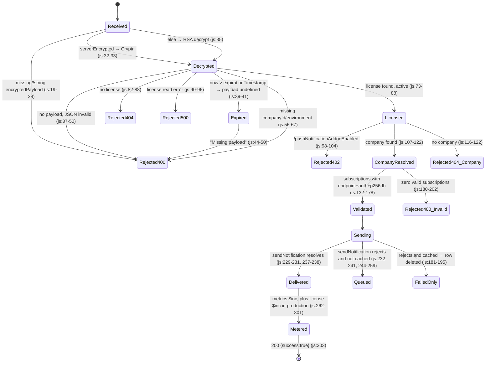
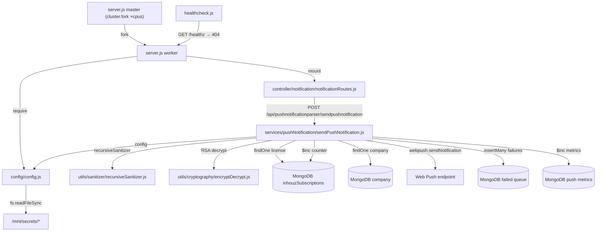

# push_notification_parser_ms

## 1. Summary

`push_notification_parser_ms` sends Web Push notifications to one company's browser subscriptions.
It is a single-route internal parser: a caller encrypts a payload with the shared session secret,
posts it, and the service decrypts it, checks the company's push-notification add-on, sends through
`web-push` with the platform VAPID keys, queues the failures for a later retry, and increments
per-hour metrics. It lives in its own repository, `apps/push_notification_parser_ms`, and ships the
image `inhouz/push_notification_parser_ms`.

## 2. Stack and commands

Node.js on `node:16.4-alpine` (`Dockerfile:1`), Express 4, Mongoose 7, `web-push` 3.6
(`package.json:25`, `package.json:32`, `package.json:40`). Engine range `>=12.0.0 <17.5.0`
(`package.json:6-8`).

| Item | Value | Evidence |
|---|---|---|
| Package name | `scheduled_task_scheduler_ms` (stale) | `package.json:2` |
| `main` | `server.js` | `package.json:5` |
| `start` | `node --max-old-space-size=8192 server.js` | `package.json:11` |
| `test` | `echo "Error: no test specified" && exit 1` | `package.json:10` |
| Container entry | `CMD ["npm", "run", "start"]` | `Dockerfile:11` |
| Port | `PORT`, k8s sets `5076` | `server.js:83`, `k8s/push-notification-parser-ms-deployment.yml:28-29` |
| Replicas | `1`, HPA 1→5 | `k8s/push-notification-parser-ms-deployment.yml:6`, `k8s/push-notification-parser-ms-hpa.yml:10-11` |
| k8s Service | ClusterIP `push-notification-parser-ms-cluster-ip-service`, port 5076 | `k8s/push-notification-parser-ms-cluster-ip-service.yml:2-11` |

Run: `npm start`. Start it by hand with `PORT`, `MONGO_URL` and the model env vars set; the secret
files are read from `SECRETS_PATH` (`config/config.js:6`).

## 3. Entry points

| Entry point | Where | How it starts |
|---|---|---|
| Cluster master | `server.js:20-37` | Forks `os.cpus().length` workers in production, 1 otherwise (`:21-24`), and re-forks on worker exit (`:26-37`) |
| Express app (worker) | `server.js:39-46` | Built only when `cluster.isMaster` is false (`:38`) |
| Route registration | `server.js:52` → `controller/notification/notificationRoutes.js:4` | `app.post('/api/pushnotificationparser/sendpushnotification', sendPushNotification)` |
| HTTP listener | `server.js:83` | `app.listen(process.env.PORT, …)`, one listener per worker |
| Mongo connect | `server.js:53-55` → `server.js:88-100` and `server.js:102-114` | Called at worker start if the connection is not established |
| Model registration | `server.js:13-18` | Six `require`s at module load, in master and workers |
| Signal / error handlers | `server.js:71-81` | `SIGINT`, `SIGTERM`, `uncaughtException`, `unhandledRejection` all close Mongo |
| Health probe script | `healthcheck.js:1-21` | Separate process, `GET /healthz` |

There is no cron, no timer, no queue consumer and no websocket handler in this repository.

## 4. Module inventory

| Module / function | `file:line` | Responsibility | Public API | Kind |
|---|---|---|---|---|
| cluster bootstrap | `server.js:20-37` | Fork workers, restart a dead worker | none | `effectful` |
| worker bootstrap | `server.js:38-86` | Middleware, route mount, Mongo, listener | none | `effectful` |
| `connectMongo()` | `server.js:88-100` **and** `server.js:102-114` | Duplicate declaration; the second wins | internal | `effectful` |
| `shutdownFunction(e)` | `server.js:76-81` | Close Mongo on signal | internal | `effectful` |
| `notificationRoutes(app)` | `controller/notification/notificationRoutes.js:3-5` | Register the one route | `(app) => void` | `effectful` |
| `sendPushNotification(req, res)` | `services/pushNotification/sendPushNotification.js:11-311` | Whole request pipeline: decrypt, authorise, validate, send, queue, meter | `async (req, res) => void` | `effectful` |
| `recursiveSanitizer(element, sanitizer)` | `utils/sanitizer/recursiveSanitizer.js:3-19` | Recursively apply an injected sanitizer | `{recursiveSanitizer}` | `pure` (sanitizer is injected) |
| `encryptDecrypt(data, encrypt, publicEncryt)` | `utils/cryptography/encryptDecrypt.js:3-22` | RSA decrypt/encrypt with the client key pair | `(data, bool, bool) => string` | `effectful`; returns the input unchanged on error (`:18-21`) |
| `config()` | `config/config.js:18-59` | Memoised config from secret files and env; builds two `NodeRSA` key objects (`:42-49`) | `() => config` | `effectful` with module-level cache (`:17-19`) |
| `readSecret(name, envFallback)` | `config/config.js:5-15` | Read `/mnt/secrets/<name>`, fall back to env | internal | `effectful` |
| failed-queue model | `model/pushNotification/failedPushNotificationQueue.js:5-32` | Queue document | mongoose model | `effectful` (registration) |
| metrics model | `model/pushNotification/pushNotificationMetrics.js:5-36` | Per-hour send counter | mongoose model | `effectful` (registration) |
| `inhouzSubscriptionSchema` | `model/inhouzSubscription/inhouzSubscription.js:5-240` | License document, owns `pushNotificationAddonEnabled` (`:143`) and `pushNotificationCount` (`:208`) | mongoose model | `effectful` (registration) |
| `companySchema` | `model/company/company.js:5-108` | Tenant existence check | mongoose model | `effectful` (registration) |
| `userSchema` | `model/user/user.js:6-107` | User document | mongoose model | `effectful`; registered but never queried here |
| `userRolesSchema` | `model/user/useRoles.js:6-51` | User-to-role mapping | mongoose model | `effectful`; unused here |
| `checkLogin` | `middlewares/login/checkLogin.js:9-150` | Session auth | `(req,res,next)` | `effectful`; never mounted |
| `moduleAccessCheck` | `middlewares/module/moduleAccessCheck.js:7-66` | Module entitlement | `(req,res,next)` | `effectful`; never mounted |
| `singleSubdomainValidation` | `middlewares/subdomain/singleSubdomainValidation.js:1-24` | Subdomain check | `(req,res,next)` | `effectful`; never mounted |
| `getUser(userId)` | `utils/user/getUser.js:5-158` | Load user + roles + permissions | `async (id) => object` | `effectful`; unreachable |
| `createEditByObject(user, deployDate)` | `utils/user/createEditByObject.js:1-22` | Build an audit object | `(user, ts) => object` | `pure`; unreachable |
| `postRequest` / `getRequest` / `deleteRequest` | `utils/requests/postRequest.js:3`, `getRequest.js:3`, `deleteRequest.js:3` | HTTP client helpers | `async (url, …)` | `effectful`; unreachable |

Only `config`, `utils/sanitizer`, `utils/cryptography` and the four models are reachable from the
route. The middlewares and `utils/requests` are template scaffolding with no caller.

## 5. Side effects

| Effect | `file:line` | Notes |
|---|---|---|
| Worker fork | `server.js:23`, `:36` | One process per CPU in production |
| HTTP listen | `server.js:83` | Port 5076 |
| Mongo connect | `server.js:89-99`, `:103-113` | `maxPoolSize: 1`, per worker |
| Mongo reconnect timer | `server.js:63-66` | 5 s after a disconnect |
| License read | `services/pushNotification/sendPushNotification.js:73-80` | `inhouzSubscriptions`, `{companyId, active:true}` |
| Company read | `sendPushNotification.js:107-114` | `company`, by `_id` |
| Web Push send | `sendPushNotification.js:204-242` | `webpush.setVapidDetails` then one `sendNotification` per subscription, sequential |
| Queue write | `sendPushNotification.js:254-258` | `insertMany`, not awaited |
| Queue delete | `sendPushNotification.js:185-193` | `deleteOne`, not awaited |
| Metrics write | `sendPushNotification.js:267-279` | `updateOne` with `$inc` on `count`, not awaited |
| License counter write | `sendPushNotification.js:286-295` | `$inc pushNotificationCount`, only when `environment === 'production'` |
| Filesystem read | `config/config.js:10` | `/mnt/secrets/*` |
| Env read | `config/config.js:6`, `:21-56`, `server.js:21`, `:83` | |
| Clock | `sendPushNotification.js:30`, `:39`, `:265-266` | Expiry check and hour/day stamps |
| Randomness | none in this code | `web-push` derives per-message encryption internally |
| Logging | `server.js:28-33`, `:58-69`, `:84`; `sendPushNotification.js:78`, `:112`, `:191`, `:233`, `:256`, `:281`, `:297`, `:305`; `encryptDecrypt.js:19` | `console.log` only; the Web Push error object is logged whole at `:233` |
| Outbound HTTP (non-push) | none | `node-fetch` is a dependency but not used by this route |

## 6. State and state transitions

The service is stateless. The states worth drawing are the ones a request and a queue row pass
through; nothing is persisted except the queue and the counters.

Queue row lifecycle, and the guard on each transition:

| From | To | Trigger | Guard |
|---|---|---|---|
| (none) | queued | a send fails on a fresh request | `!cachedNotification` (`:244`) |
| queued | replayed | a caller re-posts the rows with `cachedNotification=true` | caller-side; not in this repo |
| queued | sent | replay succeeds | valid `endpoint`/`keys` (`:147-172`) |
| queued | deleted | replay finds zero valid subscriptions | `processedNotifications.length === 0` (`:180-195`) |

## 7. Data

Collections are named by env vars, so the physical name is deployment configuration. The env var
names below are the join key across services.

| Env var | Document | Owned here? | Key fields and validation |
|---|---|---|---|
| `FAILED_PUSH_NOTIFICATION_QUEUE_MODEL` | failed-push queue | Yes (write), shares with whatever drains it | `companyId` String required, `timestamp` Number required, `encryptedNotification` String required, `environment` String optional; `strict:true`, `timestamps:true`, index `{timestamp:1, companyId:1}` (`model/pushNotification/failedPushNotificationQueue.js:5-26`) |
| `PUSH_NOTIFICATION_METRICS_MODEL` | per-hour send metrics | Yes | `companyId` required, `timestamp` Number required, `datestamp` Number required, `environment` String required, `count` Number; index `{environment:1, timestamp:1, companyId:1}` (`model/pushNotification/pushNotificationMetrics.js:5-30`) |
| `INHOUZ_SUBSCRIPTIONS_MODEL` | tenant license | **No** — written by the subscription and payment services | `serviceType` enum `custom\|default` required, `active` Boolean default true, `companyId` String required, `cancellationReason` enum `''\|switchOff\|planMigration`, `signupDateTimestamp` required, `cohort` required, `subscriptionDurationType` enum `month\|year` (`model/inhouzSubscription/inhouzSubscription.js:5-42`); `pushNotificationAddonEnabled` (`:143`), `pushNotificationCount` (`:208`) |
| `COMPANY_MODEL` | tenant | **No** | Read by `_id` only (`sendPushNotification.js:107-110`); full schema at `model/company/company.js:5-108` |

Cross-service data coupling:

- `inhouzSubscriptions` is the shared license collection. This service reads
  `pushNotificationAddonEnabled` as the feature gate (`sendPushNotification.js:98`) and increments
  `pushNotificationCount` (`:291-293`). Any change to either field by the subscription service
  changes this service's behaviour, and the counter here is a billing-relevant number.
- The failed-push queue is written here and drained by a caller outside this repository. It is
  aged out by `log_manager_ms`, which keeps 1 day for freelancer companies and 2 days otherwise
  (`apps/log_manager_ms/utils/logManager/collectionMap.js:165-170`). A retry window longer than
  that loses queued notifications.
- `pushNotificationMetrics` is likewise aged by `log_manager_ms`, 40 / 380 days depending on plan
  (`log_manager_ms/utils/logManager/collectionMap.js:86-91` names `inhouzPaymentMetrics`; the
  push metrics collection is **not** in that map, so it is never pruned — see section 12).

## 8. Public interfaces

| Interface | Shape | Evidence |
|---|---|---|
| `POST /api/pushnotificationparser/sendpushnotification` | Unauthenticated. Body: `{ encryptedPayload: string, serverEncrypted?: boolean, notifications?: array, cachedNotification?: boolean, environment: string }` | `notificationRoutes.js:4`; body read at `sendPushNotification.js:13-18` |

Decrypted payload shape (`sendPushNotification.js:38-54`): `{ expirationTimestamp: number, payload: { companyId: string } }`.

Notification element shape (`:142-172`, `:213-217`): `{ pushSubscriptionObject: { endpoint, keys: { auth, p256dh } }, notificationTitle, notificationMessage, notificationLink, notificationIconUrl, environment }`. A cached element additionally carries `encryptedNotification` and is merged after decrypt (`:136-141`).

Responses:

| Status | Body | When |
|---|---|---|
| 200 | `{ success: true }` | At least the pipeline completed; **send counts are not returned** (`:303`) |
| 400 | `{ error: { message } }` | Missing/invalid `encryptedPayload`, expired payload, missing `companyId`/`environment`, or zero valid subscriptions (`:23-27`, `:45-49`, `:62-66`, `:197-201`) |
| 402 | `{ error: { message } }` | `pushNotificationAddonEnabled` false (`:99-103`) |
| 404 | `{ error: { message } }` | License not found, or company not found (`:83-87`, `:117-121`) |
| 500 | `{ error: { message } }` | Mongo read error, unhandled throw (`:91-95`, `:125-129`, `:306-309`) |

The push bodies delivered to the browser are
`{title, body, link, icon, data:{url}}`, with the title prefixed `** Test ** ` outside production
(`:221-227`).

## 9. Configuration

Names only.

Secret files under `SECRETS_PATH` (default `/mnt/secrets`): `sendgridapikey`, `sessionsecret`,
`mongourl`, `clientsecretkey`, `clientpublickey`, `webpushpublickey`, `webpushprivatekey`
(`config/config.js:25-54`).

Env: `PORT` (`server.js:83`), `NODE_ENV` (`server.js:21`), `SECRETS_PATH` (`config/config.js:6`),
`SENDGRID_API_KEY`, `SESSION_SECRET`, `MONGO_URL`, `CLIENT_SECRET_KEY`, `CLIENT_PUBLIC_KEY`,
`WEB_PUSH_PUBLIC_KEY`, `WEB_PUSH_PRIVATE_KEY` (env fallbacks, `config/config.js:25-54`),
`FAILED_PUSH_NOTIFICATION_QUEUE_MODEL` (`:51`), `PUSH_NOTIFICATION_METRICS_MODEL` (`:52`),
`INHOUZ_SUBSCRIPTIONS_MODEL` (`:55`), `INHOUZ_SUPPORT_EMAIL` (`:56`), `COMPANY_MODEL` (`:31`),
`USER_MODEL` (`:30`), `ROLE_MODEL` (`:32`), `PERMISSION_MODEL` (`:33`), `USER_ROLES_MODEL` (`:34`),
`SESSION_MODEL` (`:35`), `SESSION_VALIDATOR_MODEL` (`:36`), `AUTH_LOG_MODEL` (`:37`),
`COOKIE_DOMAIN` (`:40`), `FLEX_FORM_FILE_MODEL`, `FLEX_MODULE_MODEL`, `FLEX_COLLECTION_MODEL`,
`FORM_MODEL`, `SMPL_EMAIL`, `DATA_RULE_EXECUTION_RESULT_MODEL` (`:21-27`),
`SCHEDULED_TASK_PARSER_MS_URL` (`:41`, read but never used).

Hard-coded: `adminPermission: "admin"` (`config/config.js:38`). The VAPID subject is derived from
`inhouzSupportEmail` at send time (`sendPushNotification.js:205`).

Set in k8s but not read by this code: `COOKIE_NAME`, `CUSTOM_DOMAIN_TERMINATION_QUEUE_MODEL`,
`CUSTOM_DOMAIN_LOG_MODEL`, `SAVED_APP_ELEMENT_MODEL`, `APP_BUILD_MODEL`,
`WEB_COMPONENT_ACCESS_TRACKER`, `APP_BUILD_REPORT_MODEL`, `APP_DEPLOYMENT_QUEUE_MODEL`,
`APP_DEPLOYMENT_QUEUE_LOG_MODEL`, `SUBSCRIBER_*`, `SUBSCRIPTION_*`, `VERSION_TRACKER_MODEL`,
`FLEX_API_MODEL`, `SERVICE_DISCOUNT_MODEL`, `CUSTOMERS_MODEL`, `CONTACTS_MODEL`, `PAYMENT_*`,
`PAYOUT_ACCOUNT_MODEL`, `INHOUZ_FROM_EMAIL` (`k8s/push-notification-parser-ms-deployment.yml:60-134`).

## 10. Dependencies

| Package | Why it is here |
|---|---|
| `web-push` | The VAPID send, `setVapidDetails` and one `sendNotification` per subscription (`sendPushNotification.js:8`, `:204-242`) |
| `cryptr` | AES decrypt of `encryptedPayload` when `serverEncrypted` is true, and encrypt/decrypt of queued rows (`:5`, `:31`, `:33`, `:136`, `:250`) |
| `node-rsa` | Builds the client key pair used by the RSA decrypt path (`config/config.js:1`, `:42-49`) |
| `mongoose` | Four models plus `findOne`/`insertMany`/`updateOne`/`deleteOne` |
| `express`, `body-parser`, `cookie-parser`, `cors`, `hpp`, `helmet` | HTTP shell (`server.js:2-8`, `:40-51`) |
| `moment` | Expiry-adjacent timestamps and hour/day buckets (`:9`, `:265-266`) |
| `lodash` | Imported at `:4` but not referenced in the handler |
| `sanitizer` | Injected into the body sanitizer (`:1-2`, `:13`) |
| `crypto-js`, `cryptr` (again), `bcryptjs`, `connect-mongo`, `express-session`, `request-ip`, `shortid`, `shrink-string`, `validator`, `@sendgrid/mail` | Carried from the template; no reference in the reachable code. `node-fetch` (`package.json:33`) is declared but unused by the route |
| `moment-timezone` | Declared (`package.json:31`); not required by any file here |

## 11. Testing

There are no tests. `npm test` is the template stub (`package.json:10`). No test directory, no test
framework among the dependencies. The decrypt path, the license gate, the subscription validation and
the failure queue are all uncovered. The only executable verification the repository ships is
`healthcheck.js`, which no manifest wires up (section 12).

## 12. Known issues and risks

1. **`connectMongo` is declared twice.** `server.js:88-100` and `server.js:102-114` are identical;
   the second silently overrides the first. Risk: any future edit to the first one is dead code.
2. **The route is unauthenticated.** `notificationRoutes.js:4` mounts the handler with no middleware,
   and the middleware directory is never used. The only gate is payload encryption with
   `sessionSecret` plus a caller-supplied `expirationTimestamp` (`sendPushNotification.js:31-42`).
   Risk: anyone who can reach port 5076 and knows the shared secret can send push notifications to
   any company's stored subscriptions and inflate `pushNotificationCount`, which is billing data.
3. **Contradicted brief.** `config/config.js:41` declares `scheduledTaskParserMsUrl` but nothing reads
   it; package name at `package.json:2` is still `scheduled_task_scheduler_ms`. Risk: readers assume
   a scheduler dependency that does not exist.
4. **An expired payload is reported as "Missing payload".** `sendPushNotification.js:39-41` leaves
   `payload` undefined, and `:44-49` returns 400 with the wrong message. Operators cannot distinguish
   a clock-skew or slow-caller problem from a malformed body.
5. **Malformed ciphertext is a 500.** `:38` calls `JSON.parse` inside the `try` with no local guard;
   a decrypt that returns a non-JSON string falls to the catch at `:304-310`. `encryptDecrypt` also
   returns its input unchanged on failure (`encryptDecrypt.js:18-21`), so the error surfaces as a
   parse error, not a decrypt error.
6. **Delete of corrupt queued rows removes at most one document.** `:185-193` calls `deleteOne` with
   `{_id: {$in: [...]}}`; `deleteOne` matches one document. The comment at `:182` says the rows are
   being cleared. Risk: corrupt rows survive and are retried on every drain.
7. **Three writes are not awaited.** `insertMany` (`:254`), `updateOne` for metrics (`:267`) and
   `updateOne` for the license counter (`:286`) all run fire-and-forget, and the handler returns 200
   at `:303` before any of them settle. Failures are only logged. Risk: a queued notification that
   was never stored is reported to the caller as success.
8. **Metrics `updateOne` has no `upsert`.** `:267-279` increments only an existing
   `{timestamp: hourStamp, datestamp, environment, companyId}` document. With no upsert, the first
   send in an hour writes nothing. Risk: metrics under-report, and the missing rows are silent.
9. **`pushNotificationCount` is incremented, never checked or decremented.** `:285-300` runs only
   when `environment === 'production'` (`:69`). If the same add-on has a quota, nothing here enforces
   it.
10. **Every process is both master and sender, on every CPU.** `server.js:21` forks
    `os.cpus().length` workers in production, each listening on 5076 and each opening its own Mongo
    pool of 1 (`:96`). Combined with the HPA range 1→5
    (`k8s/push-notification-parser-ms-hpa.yml:10-11`), one pod is many Node processes. Risk: process
    and connection counts multiply with the HPA and are not reflected in the deployment's `cpu`
    request (`k8s/push-notification-parser-ms-deployment.yml:24`).
11. **The health probe cannot pass.** `healthcheck.js:7` targets `/healthz`; no route is registered
    anywhere (`server.js:52` mounts only the notification route), and `Dockerfile` declares no
    `HEALTHCHECK`.
12. **Failure retry has no bound in this repository.** Failed sends are queued with no attempt
    counter (`:245-252`), and a permanently dead subscription (410/404 from the push service) is
    queued again on every replay. Whether the drainer gives up is decided outside this repo
    (section 14).
13. **Template debris.** Six models are registered but only four are queried; `utils/requests/*`,
    `middlewares/*` and `utils/user/*` have no caller; `config/config.js:20-49` builds keys nothing
    reads.
14. **The VAPID private key is a long-lived secret in a mounted file.** `config/config.js:54`,
    used at `sendPushNotification.js:204-208`. Rotation requires a coordinated redeploy of every
    worker; a rotation that only half-lands produces silent `sendNotification` failures.
15. **The whole `web-push` error is logged.** `:233` prints the error object, which can include the
    subscription endpoint (a user-identifying URL).

## 13. Module map

## 14. Open questions

- Who drains the failed-push queue with `cachedNotification=true`? No consumer exists in this
  repository, and the `SCHEDULED_TASK_PARSER_MS_URL` config key (`config/config.js:41`) is unread.
  The retry cadence and the give-up policy are therefore unknown.
- What is `pushNotificationCount` used for downstream — a quota, a billing line, or a dashboard?
  It is written at `sendPushNotification.js:291-293` and never compared to a plan limit here.
- The caller-supplied `expirationTimestamp` sets the replay window (`:39`). The approved brief says
  about 30 seconds; the exact value is set by the caller, so it cannot be confirmed from this repo.
- Which collection does `PUSH_NOTIFICATION_METRICS_MODEL` resolve to in each environment? It is
  env-only (`config/config.js:52`) and is not in `log_manager_ms`'s retention map
  (`apps/log_manager_ms/utils/logManager/collectionMap.js:1-171`), so the physical name and the
  pruning policy are both undetermined.
- The `environment` value used for the queue row is `notification.environment`
  (`sendPushNotification.js:249`), while the audit gate uses the body-level `environment` (`:69`).
  When the two differ, the metrics bucket follows the body and the queue row follows the notification.
  Whether callers keep them equal was not verifiable.
- Node engine range is `<17.5.0` (`package.json:6-8`) but the image is `node:16.4-alpine`
  (`Dockerfile:1`); whether the deployed image tag matches is not recorded in this repository.
