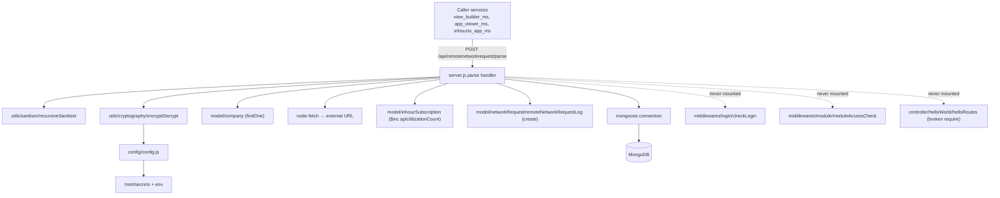

# remote_network_request_ms

## 1. Summary

`remote_network_request_ms` is an outbound-HTTP relay for Inhouz apps. A caller sends an RSA-encrypted, compressed payload naming a `url` and `fetchOptions`; the service decrypts it, checks that the company is not a `freelancer` account, performs the HTTP request with `node-fetch`, and returns the response body (or body plus headers) encrypted and compressed with the same key. It also increments the company's subscription `apiUtilizationCount` and writes a row to `remoteNetworkRequestLogs` for billing/usage. It lives in its own git repository at `apps/remote_network_request_ms/`, not in the control repo. k8s: service `remote-network-request-ms-cluster-ip-service` on port `5045` (`k8s/remote-network-request-ms-cluster-ip-service.yml:10`), image `inhouz/remote_network_request_ms`, 1 replica (`k8s/remote-network-request-ms-deployment.yml:6`, `:17`).

## 2. Stack and commands

- Runtime: Node.js, declared `">=12.0.0 <17.5.0"` (`package.json:7`); Express 4 (`package.json:16`).
- Package manager: npm, no lockfile in the repo root.
- Start: `npm start` → `node server.js` (`package.json:10-11`); container CMD is `npm run start` (`Dockerfile:11`).
- Test: `npm test` runs `echo "Error: no test specified" && exit 1` (`package.json:9`). There is no test suite.
- Port: `process.env.PORT` (`server.js:303`); k8s exposes `5045` (`k8s/remote-network-request-ms-cluster-ip-service.yml:10`).
- Health probe: `healthcheck.js` requests `GET /healthz` on `process.env.PORT || 8080` (`healthcheck.js:6-8`). No `/healthz` route exists in `server.js`.

## 3. Entry points

| Entry | Where | How it starts |
|---|---|---|
| Process bootstrap / cluster master | `server.js:24-41` | `node server.js`; forks `os.cpus().length` workers when `NODE_ENV=production`, otherwise 1 (`server.js:25-28`) |
| HTTP server | `server.js:303` | `app.listen(process.env.PORT)` inside a forked worker |
| `POST /api/remotenetworkrequest/parse` | `server.js:86` | Registered inline on the Express app |
| Mongo reconnect timer | `server.js:64-71` | `mongoose.connection.on("disconnected")` → `setTimeout(connectMongo, 5000)` |
| `GET /api/helloworld` | `controller/helloWorld/helloRoutes.js:4` | **Not registered.** `server.js` never requires `helloRoutes`, and the module it requires (`../../services/helloWorld/getHello`) does not exist in this repo |
| Mongo connection | `server.js:308-320` | `connectMongo()` called from `server.js:58` when readyState is not 1/2 |

There is no cron, queue consumer, websocket server or gRPC entry point.

## 4. Module inventory

| Module / function | `file:line` | Responsibility | Public API | Kind |
|---|---|---|---|---|
| `connectMongo()` | `server.js:308` | Opens the Mongoose connection with `maxPoolSize: 1` | internal | `effectful` (DB, logging) |
| `shutdownFunction(e)` | `server.js:79` | Closes the Mongo connection on SIGINT/SIGTERM/uncaughtException | bound to process signals | `effectful` (DB, process signals) |
| Parse route handler | `server.js:86-301` | Decrypt, authorize, forward HTTP, log usage, encrypt response | HTTP `POST /api/remotenetworkrequest/parse` | `effectful` (crypto, network, DB, clock) |
| Express app / middleware wiring | `server.js:43-59` | CORS, body parser, hpp, helmet, cookie parser | — | `effectful` |
| `config()` | `config/config.js:18-49` | Reads env and secret files once, caches result | returns config object | `effectful` (env, filesystem); cached module state |
| `readSecret(name, envFallback)` | `config/config.js:5-15` | Reads `/mnt/secrets/<name>` (or `SECRETS_PATH`), falls back to env var | internal | `effectful` (filesystem, env) |
| `encryptDecrypt(data, encrypt=false)` | `utils/cryptography/encryptDecrypt.js:3` | RSA `encryptPrivate` / `decrypt` with the client key | exports function | `effectful` (crypto, reads cached config, logs) |
| `recursiveSanitizer` | `utils/sanitizer/recursiveSanitizer.js` | Recursively sanitizes request body strings | exports function | `pure` |
| `monthIndexMap` | `utils/date/monthIndexMap.js` | Month index → month name table | exports array | `pure` |
| `remoteNetworkRequestLogSchema` / model | `model/networkRequest/remoteNetworkRequestLog.js:5-53` | Usage log schema and model registration | Mongoose model | `effectful` (model registration, config read) |
| `inhouzSubscription` model | `model/inhouzSubscription/inhouzSubscription.js:204` | Subscription schema and model | Mongoose model | `effectful` |
| `company` model | `model/company/company.js:108` | Company schema and model | Mongoose model | `effectful` |
| `user`, `useRoles`, `roles`, `permissions`, `session` models | `model/user/user.js:107`, `model/user/useRoles.js:51`, `model/rolesAndPermissions/roles.js:87`, `model/rolesAndPermissions/permissions.js:89`, `model/session/session.js:28` | Domain models registered but unused by the live route | Mongoose models | `effectful` |
| `checkLogin` middleware | `middlewares/login/checkLogin.js:9` | Session login check | Express middleware | `effectful` (DB, env, crypto); **not mounted** |
| `moduleAccessCheck` | `middlewares/module/moduleAccessCheck.js` | Flex-module access check | Express middleware | `effectful`; **not mounted** |
| `singleSubdomainValidation` | `middlewares/subdomain/singleSubdomainValidation.js` | Subdomain check | Express middleware | `effectful`; **not mounted** |

## 5. Side effects

| Effect | System | `file:line` |
|---|---|---|
| Read secret files | Filesystem `/mnt/secrets/<name>` (path from `SECRETS_PATH`) | `config/config.js:6-10` |
| Read env vars | Process environment | `config/config.js:21-46` |
| RSA private-key operations | Local crypto (`node-rsa`, key from config) | `utils/cryptography/encryptDecrypt.js:8,10` |
| Connect to MongoDB | `config.mongoUrl` | `server.js:309` |
| Reconnect after disconnect | Timer, 5000 ms | `server.js:67-69` |
| Read company (`findOne`, `companyType: "freelancer"`) | MongoDB `company` | `server.js:161-166` |
| **Outbound HTTP request to caller-supplied URL** | Arbitrary URL from decrypted payload | `server.js:192-195` |
| Increment `apiUtilizationCount` | MongoDB `inhouzSubscriptions` | `server.js:247-260` |
| Write usage log | MongoDB `remoteNetworkRequestLogs` | `server.js:262-278` |
| Clock (`new Date`, `moment()`) | Wall clock, drives 30 s expiry and log time buckets | `server.js:89,101,133,269-274` |
| Compress / decompress payloads | CPU (`shrink-string`) | `server.js:105,111,238` |
| Logging | stdout `console.log`/`console.error` | `server.js:31-39,62,65,73,80,168,213,258,276,284`; `config/config.js` none; `utils/cryptography/encryptDecrypt.js:14` |
| Read client IP / country / referrer headers | Incoming request headers (`CF-Connecting-IP`, `x-forwarded-for`, `CF-IPCountry`, `referrer`) | `server.js:264-268` |
| Cluster fork | OS processes | `server.js:24-28,40` |
| Close Mongo connection on signal | MongoDB | `server.js:81-83` |

No call to SendGrid, Stripe, Google Cloud Storage or any other third-party API happens in this service despite the dependencies and env names.

## 6. State and state transitions

There is no persisted state machine. The service is a stateless request relay; the only per-request lifecycle is:

| From | To | Trigger | Guard |
|---|---|---|---|
| Request received | Rejected 400 | `encryptedPayload` missing/not a string | `server.js:93` |
| Request received | Rejected 400 | decompression or decryption fails to produce a string | `server.js:111-113` |
| Decrypted payload | Empty payload | `expirationTimestamp` in the past | `server.js:133-135` (payload is left `{}`) |
| Decrypted payload | Rejected 400 | `url` or `companyId` missing, or `companyId` is not a valid ObjectId | `server.js:138-143` |
| Valid payload | Rejected 403 | company exists with `companyType: "freelancer"` | `server.js:172-189` |
| Valid payload | Forwarded | Fetch to `url` (no allow-list) | `server.js:192` |
| Forwarded | Responded 200 | fetch resolves (JSON or text) | `server.js:220-238,280` |
| Any step | Responded 500 | uncaught exception in handler | `server.js:283-299` |

Subscription `active` / plan state lives in `inhouzSubscriptions` (`model/inhouzSubscription/inhouzSubscription.js:11-19`) and is incremented, never transitioned, by this service.

## 7. Data

Only two collections are written; one is read.

**`remoteNetworkRequestLogs`** (collection name from `REMOTE_NETWORK_REQUEST_LOG_MODEL`) — `model/networkRequest/remoteNetworkRequestLog.js:5-53`:

| Field | Type | Rules |
|---|---|---|
| `companyId` | String | not required, no ObjectId cast (`:6-8`) |
| `originUrl` | String | `referrer` header (`:9-11`) |
| `originCountry` | String | `CF-IPCountry` header (`:12-14`) |
| `requestMethod` | String | enum `GET POST DELETE PATCH PUT` (`:15-18`) |
| `responseTimeMS` | Number | required (`:19-22`) |
| `ipAddress` | String | required (`:23-26`) |
| `monthYear` | String | required, `"<month>-<year>"` (`:27-30`) |
| `year`, `day`, `month` | Number | optional (`:31-33`) |
| `timestamp` | Number | required (`:34-37`) |

Options `strict: true`, `timestamps: true` (`:38-41`); compound index on `companyId, originUrl, requestMethod, monthYear, timestamp` (`:43-47`).

**`inhouzSubscriptions`** (from `INHOUZ_SUBSCRIPTIONS_MODEL`) — read/written only via `$inc: { apiUtilizationCount: 1 }` on `{ companyId, active: true }` (`server.js:247-256`); field declared at `model/inhouzSubscription/inhouzSubscription.js:164`. The full schema (`:5-200`+) is shared with the subscription services.

**`company`** (from `COMPANY_MODEL`) — read-only `findOne({ _id, companyType: "freelancer" })` (`server.js:162-166`), schema at `model/company/company.js:5-108`.

Shared-collection coupling the repo cannot show on its own:
- `remoteNetworkRequestLogs` is registered in `log_manager_ms` (`apps/log_manager_ms/utils/logManager/collectionMap.js`) and `account_termination_cron_ms` deletes from it per company (`apps/account_termination_cron_ms/utils/account/companyIdCollectionList.js`).
- `inhouzSubscriptions` and `company` are platform-wide collections read by many subscription and billing services.

## 8. Public interfaces

### `POST /api/remotenetworkrequest/parse` — `server.js:86`

Request body:

```json
{ "encryptedPayload": "<RSA-encrypted, compressed string>" }
```

Decrypted plaintext:

```json
{
  "payload": {
    "url": "https://…",
    "fetchOptions": { "method": "GET", "headers": {}, "body": "" },
    "companyId": "<ObjectId>",
    "getResponseHeaders": false
  },
  "expirationTimestamp": 1700000000000
}
```

Response (always encrypted, then compressed): `{ "encryptedResponse": "<string>" }`. Status codes: 200 success, 400 invalid/expired request, 403 freelancer company, 500 handler exception. The decrypted response envelope is `{ payload: <responseData | {responseHeaders, responseData} | {hasError, errorPayload}>, expirationTimestamp }` (`server.js:220-237`); errors are `{ payload: { error: { message } } }`.

### Callers (verified)

- `view_builder_ms` — `apps/view_builder_ms/utils/syncFunctionParser/functionTypeParser/remoteNetworkRequestParser.js:155`
- `app_viewer_ms` — `apps/app_viewer_ms/src/common/utils/functionParser/functionTypeParser/remoteNetworkRequestParser.js:162`
- `inhouz.io` / `inhouzio_app_ms` client parser — `apps/inhouzio_app_ms/client/src/utils/functionParser/functionTypeParser/remoteNetworkRequestParser.js`

No event, queue topic or CLI command.

## 9. Configuration

Env var names read by this repo: `SECRETS_PATH`, `NODE_ENV`, `PORT`, `FLEX_FORM_FILE_MODEL`, `FLEX_MODULE_MODEL`, `FLEX_COLLECTION_MODEL`, `FORM_MODEL`, `SENDGRID_API_KEY`, `SMPL_EMAIL`, `DATA_RULE_EXECUTION_RESULT_MODEL`, `SESSION_SECRET`, `MONGO_URL`, `USER_MODEL`, `COMPANY_MODEL`, `ROLE_MODEL`, `PERMISSION_MODEL`, `USER_ROLES_MODEL`, `SESSION_MODEL`, `SESSION_VALIDATOR_MODEL`, `AUTH_LOG_MODEL`, `CLIENT_SECRET_KEY`, `COOKIE_DOMAIN`, `INHOUZ_SUBSCRIPTIONS_MODEL`, `REMOTE_NETWORK_REQUEST_LOG_MODEL` (`config/config.js:6,21-46`).

Secret-file names read under `SECRETS_PATH` (default `/mnt/secrets`): `sendgridapikey`, `sessionsecret`, `mongourl`, `clientsecretkey` (`config/config.js:25,28,29,39,42`).

k8s sets many more model-name vars than this code reads (`k8s/remote-network-request-ms-deployment.yml`): `API_USAGE_LOG_MODEL`, `CHURN_TRACKER_MODEL`, `CONTACTS_MODEL`, `CUSTOMERS_MODEL`, `DATABASE_MODEL`, `DEPLOYED_API_ENDPOINTS_MODEL`, `EXCHANGE_RATE_CACHE_MODEL`, `FLEX_API_MODEL`, `FUNCTION_MS_URL`, `FUNCTION_PARSER_MS_URL`, `FUNCTION_VERSION_TRACKER_MODEL`, `INHOUZ_APP_MODEL`, `INHOUZ_FROM_EMAIL`, `IP_ADDRESS_LOCATION_MODEL`, `IP_LOCATION_FINDER_URL`, `OPEN_EXCHANGE_RATES_API_KEY`, `OPEN_EXCHANGE_RATES_BASE_URL`, `OPERATION_TRACKER_MODEL`, `PAYMENT_CHARGE_MODEL`, `PAYMENT_INTENT_MODEL`, `PAYMENT_METHOD_MODEL`, `PAYMENT_MS_URL`, `PAYOUT_ACCOUNT_MODEL`, `QUERY_MODEL`, `QUERY_VERSION_TRACKER`, `SCHEDULED_TASK_MS_URL`, `SCHEMA_MODEL`, `SERVICE_DISCOUNT_MODEL`, `SUBSCRIBED_PACKAGE_MODEL`, `SUBSCRIBER_ACTION_LOG_MODEL`, `SUBSCRIBER_CHANGE_LOG`, `SUBSCRIBER_MIGRATION_QUEUE_MODEL`, `SUBSCRIBER_MODEL`, `SUBSCRIPTION_MODEL`, `SUBSCRIPTION_SERVICE_CHARGE_FEE`, `SUBSCRIPTION_SERVICE_CHARGE_TYPE`, `SUBSCRIPTION_SERVICE_MODEL`, `SUBSCRIPTION_SESSION_MODEL`, `SUBSCRIPTION_USAGE_LOG`, `SYSTEM_USER_MODEL`, `VERSION_TRACKER_MODEL`. They are leftovers from the template deployment, not used here.

## 10. Dependencies

Direct dependencies from `package.json:14-39`, with the reason each is present in this repo:

| Package | Why |
|---|---|
| `express` | HTTP server and the single route |
| `body-parser` | JSON body parsing, 20 mb limit (`server.js:52`) |
| `cookie-parser` | Cookie parsing with `sessionSecret` (`server.js:55`) |
| `cors` | CORS for `*.inhouz.localhost` with credentials (`server.js:44-50`) |
| `helmet`, `hpp` | Security headers, HTTP parameter pollution guard (`server.js:53-54`) |
| `mongoose` | MongoDB access |
| `node-fetch` | The forwarded outbound request (`server.js:192`) |
| `node-rsa` | RSA encrypt/decrypt of the payload (`config/config.js:1,41`) |
| `shrink-string` | Compress/decompress the encrypted strings |
| `moment` | Expiry timestamps |
| `sanitizer` | Request-body sanitization (`server.js:12,90`) |
| `dotenv` | Loads `.env` in local dev (`server.js:1`) |
| `cluster`, `os`, `fs`, `path`, `http` | Node built-ins: worker fork, secret file reads, health probe |
| `@sendgrid/mail`, `bcryptjs`, `connect-mongo`, `crypto-js`, `cryptr`, `express-session`, `lodash`, `request`, `request-ip`, `shortid`, `validator` | Inherited from the `micro_service_template`; not used by the live route |

## 11. Testing

No tests. `npm test` exits 1 by design (`package.json:9`). No test directory, no test framework in dependencies, no CI workflow in the repo. Behaviour is verified only by the callers listed in section 8.

## 12. Known issues and risks

- **Unrestricted outbound request (SSRF surface).** `url` comes from the decrypted payload and is passed straight to `fetch` with no scheme, host, or private-range check (`server.js:136,192-195`). Any caller able to encrypt with the shared key can reach internal addresses.
- **Route has no auth middleware.** The only gate is possession of the RSA key plus a valid `companyId`; `checkLogin` exists but is never mounted (`server.js:43-59`; `middlewares/login/checkLogin.js:9`).
- **`fetchOptions["method"].toUpperCase()` throws when `method` is absent** (`server.js:267`), turning a successful forward into a 500 after the response was already computed. Express clients normally omit `method` for GET.
- **Decrypt fails open.** `encryptDecrypt` catches errors and returns the input unchanged (`utils/cryptography/encryptDecrypt.js:13-16`), so a wrong-key payload is parsed as plaintext rather than rejected.
- **Expiry is optional.** If `expirationTimestamp` is missing, `new Date().getTime() <= undefined` is false, `payload` stays `{}`, and the request is rejected as missing fields (`server.js:133-143`). A future timestamp more than 30 s out is accepted; there is no replay cache.
- **Health endpoint missing.** `healthcheck.js` probes `/healthz` (`healthcheck.js:8`) and the Dockerfile declares no `HEALTHCHECK` (`Dockerfile:11`); no `/healthz` route is registered in `server.js`.
- **Dead route code.** `controller/helloWorld/helloRoutes.js:4` requires `../../services/helloWorld/getHello`, which does not exist, and is never mounted; `src`/`services` directory is absent.
- **Usage accounting is fire-and-forget.** `updateOne` and `create` are not awaited (`server.js:247,262`), so failures are only logged and can be lost on shutdown.
- **`companyId` stored as String** while all queries use ObjectId values (`model/networkRequest/remoteNetworkRequestLog.js:6-8`), which limits index use on other consumers.
- **Single Mongo pool per worker** (`maxPoolSize: 1`, `server.js:316`) combined with a fork per CPU in production (`server.js:25`).
- **Secrets are read from a mounted path** and cached forever at first call (`config/config.js:17-19`); a rotated secret requires a restart.

No credential literal is embedded in the source; secrets are read from `/mnt/secrets` or env (`config/config.js:5-15`). `service-account.json.enc` is an encrypted file, not a plaintext key.

## 13. Module map



## 14. Open questions

- Which callers actually use the freemium/freelancer gate, and is the "upgrade to a paid plan" message enforced elsewhere too? Not determinable from this repo.
- What key material `CLIENT_SECRET_KEY` must hold (PEM private key vs. raw RSA components) is not documented; `node-rsa` is constructed with `{ environment: "node" }` (`config/config.js:41-44`).
- Whether `getResponseHeaders` is consumed by any caller: the field is read (`server.js:136,221`) but no caller in the listed parsers was inspected.
- The full `inhouzSubscriptions` schema was not read past line 200; field-level validation beyond `apiUtilizationCount` is not verified.
- Why the template's middleware and model set ships unused in this deployment is not recorded anywhere.

Skipped: `build_ga.sh`, `build_ga_prod.sh`, `deploy.sh`, `docker-compose.yml`, `kus/`, `k8s/*-hpa.yml`, `k8s/*-vpa.yml`, and the encrypted `service-account.json.enc`. They carry build/deploy configuration, not request behaviour.
