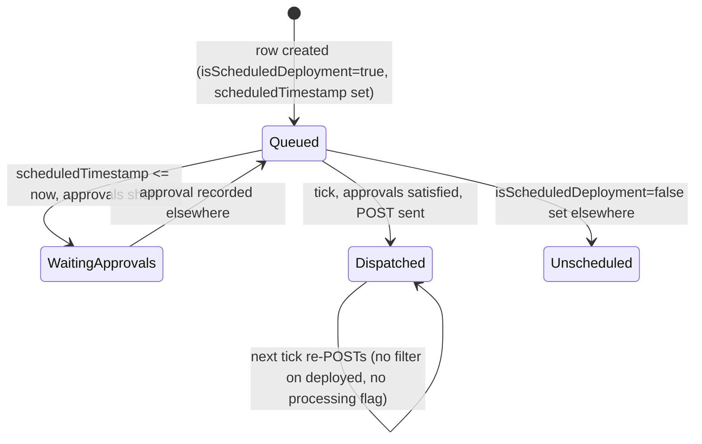
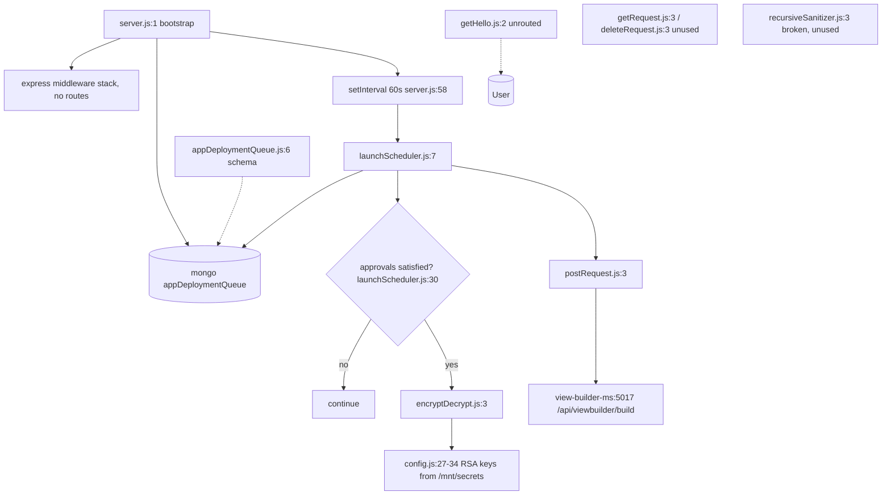

# scheduled_launch_ms

Repository: `apps/scheduled_launch_ms` (separate git repository, read through `.kilo/repos.json`;
not the control repo). All `file:line` citations are relative to that repository root.

## 1. Summary

Minute-tick worker that triggers scheduled app deployments. Every 60 seconds it reads
`appDeploymentQueue` for rows flagged `isScheduledDeployment: true` whose `scheduledTimestamp` has
passed, checks the approval threshold, and POSTs the deployment to the view-builder service to
start the build. The deployment row itself is created and maintained by another service; this
worker only fires it. It opens an HTTP listener but registers no route and publishes no ClusterIP
Service, so nothing in the cluster can call it.

## 2. Stack and commands

- Runtime: Node.js, `engines.node` `>=12.0.0 <17.5.0` (`package.json:5`).
- Start: `npm start` → `node --max-old-space-size=8192 server.js` (`package.json:9-10`).
- Test: `npm test` → `echo "Error: no test specified" && exit 1` (`package.json:8`). No tests.
- Port: `PORT`, set to `5100` in k8s (`k8s/scheduled-launch-ms-deployment.yml:28-29`,
  `containerPort` at `:26`), read at `server.js:62`.
- Image: `inhouz/scheduled_launch_ms`, replicas `1`
  (`k8s/scheduled-launch-ms-deployment.yml:6,17`). Only a Deployment and a VPA manifest ship; there
  is **no** ClusterIP Service in `k8s/`.
- Single process, no `cluster` fork (`server.js:1-78`).
- `package.json` description is the template string `The base of all simple erp microservices` (`package.json:4`).

## 3. Entry points

| Entry | Location | Started by |
|---|---|---|
| HTTP listener | `server.js:62` | `node server.js`; serves nothing (no route registered, `server.js:16-27` only installs middleware) |
| 60 s scheduler tick | `server.js:58-60` | `setInterval(60000)` at boot → `launchScheduler()` |
| Mongo connect | `server.js:66-78`, called at `server.js:29` | bootstrap |
| Reconnect timer | `server.js:35-42` | mongoose `disconnected` event, 5 s |
| Graceful shutdown | `server.js:47-55` | `SIGINT`, `SIGTERM`, `uncaughtException` |
| Health probe script | `healthcheck.js:3-7` | Docker `HEALTHCHECK`, probes `localhost:$PORT/healthz` |
| Model registration | `server.js:14` | boot: `require("./model/appDeploymentQueue")` |

The only timer is `server.js:58`; the only `setTimeout` is the reconnect delay at `server.js:38`.

## 4. Module inventory

| Name | Location | Owns | Public API | Kind |
|---|---|---|---|---|
| bootstrap | `server.js:1-78` | express middleware stack, mongo lifecycle, the 60 s interval | process entry | `effectful` |
| `connectMongo` | `server.js:66-78` | Mongo connection, `maxPoolSize: 1` | internal | `effectful` |
| `launchScheduler` | `utils/scheduler/launchScheduler.js:7` | selects due scheduled deployments, checks approval gate, POSTs to view-builder | `() => Promise<void>` | `effectful` |
| `appDeploymentQueue` model | `model/appDeploymentQueue.js:6` | deployment queue schema | `mongoose.model` export | `reactive` (schema definition, no I/O) |
| `encryptDecrypt` | `utils/cryptography/encryptDecrypt.js:3` | RSA public-key encrypt of `companyId` and `userId` payloads | `(data, encrypt, publicEncrypt) => string` | `effectful` (crypto + config read) |
| `postRequest` | `utils/requests/postRequest.js:3` | JSON POST with `node-fetch` | `(url, headers, data) => Promise<obj>` | `effectful` |
| `getRequest` | `utils/requests/getRequest.js:3` | JSON GET with `credentials: 'include'` | `(url) => Promise<obj>` | `effectful` (unused) |
| `deleteRequest` | `utils/requests/deleteRequest.js:3` | DELETE, `{hasError}` on non-200 | `(url) => Promise<obj>` | `effectful` (unused) |
| `recursiveSanitizer` | `utils/sanitizer/recursiveSanitizer.js:3` | walks a body and sanitises strings | object map | `pure` intended, **broken** (see §12) |
| `getHello` | `services/helloWorld/getHello.js:4` | template handler that returns every user | express handler | `effectful` (unrouted, dead) |

`getHello` is the only file under `services/`; it is not required by `server.js` and its model
handle (`mongoose.model('User')` at `getHello.js:2`) would throw `MissingSchemaError` because no
`User` schema is registered in this repository.

## 5. Side effects

| Effect | Location |
|---|---|
| MongoDB connect | `server.js:67-77` |
| MongoDB `find` on `appDeploymentQueue` | `utils/scheduler/launchScheduler.js:11-21` |
| HTTP POST to view-builder | `utils/scheduler/launchScheduler.js:65-69` |
| Network target | `http://view-builder-ms-cluster-ip-service:5017/api/viewbuilder/build` (`k8s/scheduled-launch-ms-deployment.yml:91-92`, path at `launchScheduler.js:66`) |
| Filesystem read of secrets | `config/config.js:10` |
| Environment read | `config/config.js:21-26` |
| Clock | `launchScheduler.js:9` (`new Date().getTime()`), `:42,50` (`moment().add(5,'minutes')`) |
| Crypto | `encryptDecrypt.js:10` (public-key encrypt) |
| Logging | `launchScheduler.js:19,72`; `server.js:33,36,44,63,76`; `encryptDecrypt.js:19` |

No SendGrid, Stripe, OpenExchangeRates, Cloudflare, S3 or Redis call exists in the code, although
the deployment injects those env var names.

## 6. State and state transitions

State lives on an `appDeploymentQueue` document; this service reads it and never writes it.

| Field state | Trigger | Guard in this service | Outcome |
|---|---|---|---|
| `isScheduledDeployment: true`, `scheduledTimestamp <= now` | 60 s tick | `numberOfRequiredApprovals == 0` **or** `approvedCount >= numberOfRequiredApprovals` (`launchScheduler.js:30-37`) | POST to view-builder |
| same | 60 s tick | approvals insufficient (`launchScheduler.js:33-36`) | `continue`, no POST, retried next minute |
| `isScheduledDeployment: false` | 60 s tick | filter at `launchScheduler.js:12` | never selected |
| `scheduledTimestamp > now` | 60 s tick | filter at `launchScheduler.js:13-15` | never selected |



**There is no terminal state in this service.** The schema has `deployed` (`model/appDeploymentQueue.js:25-28`)
but the scheduler's filter does not include `deployed: false` (`launchScheduler.js:11-16`) and it
never writes `deployed`, so a due scheduled deployment matches on every tick until another service
flips `isScheduledDeployment` to `false`.

## 7. Data

One schema, `model/appDeploymentQueue.js:6`, collection from `APP_DEPLOYMENT_QUEUE_MODEL` →
`appDeploymentQueue` (`k8s/scheduled-launch-ms-deployment.yml:89-90`).

| Field | Type | Rule |
|---|---|---|
| `companyId` | String | required (`:7-10`) |
| `appId` | String | required (`:11-14`) |
| `isScheduledDeployment` | Boolean | default `false` (`:15-18`) |
| `scheduledTimestamp` | Number | optional (`:19-21`) — the due-time the scheduler compares |
| `launchDateTime`, `launchTimezone` | String | optional (`:22-23`) |
| `activeVersionMap` | Mixed | optional (`:24`) |
| `deployed` | Boolean | default `false` (`:25-28`) — **not used by the scheduler** |
| `approvalRequired` | Boolean | default `false` (`:29-32`) — not used by the scheduler |
| `numberOfRequiredApprovals` | Number | optional (`:33-35`) |
| `approvedCount` | Number | default `0` (`:36-39`) |
| `approvals[]` | subdoc | `email` validated with `validator.isEmail`, message `'{VALUE} is not a valid email'`; `createdDate` Number required (`:40-58`) |
| `rejections[]` | subdoc | same email validation; `createdDate` required (`:59-79`) |
| `compressedAppVariationDataMap` | String | optional (`:80`) |
| `editDate` | Number | optional (`:81-83`) |
| `lastUpdatedById` | String | optional (`:84-86`) — encrypted into the `x-server-userid` header |
| `cachedCookieString`, `cachedCsrfToken` | String | optional (`:87-88`) — credential material stored on the row |
| `systemGenerated` | Boolean | default `false` (`:89-92`) |

Schema options: `strict: true`, `useNestedStrict: true`, `timestamps: true` (`:93-97`).
Index: `appId + companyId + isScheduledDeployment + deployed + scheduledTimestamp`
(`:99-103`) — the index covers the query; the query simply does not use `deployed`.

Shared-collection coupling: `appDeploymentQueue` is **written by the view-builder / app-builder
path** (the deploy request that marks a deployment as scheduled) and by whoever records approvals;
that writer is not in this repository. The same collection is read by `app_builder_ms`. The
deployment also injects ~30 model-name env vars for collections this service never touches
(`k8s/scheduled-launch-ms-deployment.yml:66-96`).

## 8. Public interfaces

No inbound interface: no routes (`server.js:16-27`), no Service manifest, port 5100 unreachable
from other pods.

Outbound, the only call:

```
POST {VIEW_BUILDER_URL}/api/viewbuilder/build
Content-Type: application/json
x-server-userid: <RSA public-key encrypt of {userId: lastUpdatedById, expirationTimestamp: now+5min}>

body: {
  ...<the whole appDeploymentQueue document, lean>,
  encryptedCompanyId: "<RSA public-key encrypt of {companyId, expirationTimestamp: now+5min}>",
  appId,
  companyId,
  existingDeployment: true
}
```

Built at `utils/scheduler/launchScheduler.js:39-69`. Response is discarded; `postRequest` would
return `{hasError, errorPayload, errorMessage}` on failure (`utils/requests/postRequest.js:13-53`)
and nothing reads it.

## 9. Configuration

Names only, no values.

- Secrets from files under `SECRETS_PATH` (default `/mnt/secrets`) with env fallback:
  `sessionsecret`/`SESSION_SECRET`, `mongourl`/`MONGO_URL`,
  `clientsecretkey`/`CLIENT_SECRET_KEY`, `clientpublickey`/`CLIENT_PUBLIC_KEY`
  (`config/config.js:5-15,21-22,24,27-34`).
- Read by code: `APP_DEPLOYMENT_QUEUE_MODEL` (`config/config.js:25`), `VIEW_BUILDER_URL`
  (`config/config.js:26`), `PORT` (`server.js:62`, `healthcheck.js:6`), `SECRETS_PATH`
  (`config/config.js:6`). That is the entire set of four.
- Injected but unread: `STRIPE_API_KEY`, `OPEN_EXCHANGE_RATES_API_KEY`,
  `OPEN_EXCHANGE_RATES_BASE_URL`, `IP_LOCATION_FINDER_URL`, `INHOUZ_FROM_EMAIL`, `COOKIE_NAME`,
  `COOKIE_DOMAIN`, `SENDGRID_API_KEY`, `CHURN_TRACKER_MODEL`, `CONTACTS_MODEL`,
  `CUSTOMERS_MODEL`, `EXCHANGE_RATE_CACHE_MODEL`, `FLEX_API_MODEL`, `FLEX_COLLECTION_MODEL`,
  `INHOUZ_APP_MODEL`, `IP_ADDRESS_LOCATION_MODEL`, `PAYMENT_*`, `PAYOUT_ACCOUNT_MODEL`,
  `SERVICE_DISCOUNT_MODEL`, `SUBSCRIBED_PACKAGE_MODEL`, `SUBSCRIBER_*`, `SUBSCRIPTION_*`,
  `USER_MODEL`, `USER_ROLES_MODEL`, `ROLE_MODEL`, `PERMISSION_MODEL`, `SESSION_MODEL`,
  `SESSION_VALIDATOR_MODEL`, `AUTH_LOG_MODEL`, `VERSION_TRACKER_MODEL`
  (`k8s/scheduled-launch-ms-deployment.yml`).

## 10. Dependencies

Direct, from `package.json:13+`:

- `mongoose` — the only data access, on `appDeploymentQueue`.
- `node-fetch` — the POST to view-builder (`utils/requests/postRequest.js:1`).
- `moment` — the 5-minute expiry stamp on both encrypted payloads (`launchScheduler.js:42,50`).
- `node-rsa` — the `encryptedCompanyId` and `x-server-userid` values
  (`config/config.js:1,27-34`).
- `validator` — email validation in `approvals`/`rejections`
  (`model/appDeploymentQueue.js:4,44-48,62-66`).
- `express`, `body-parser`, `cookie-parser`, `cors`, `hpp`, `helmet` — an HTTP stack with no
  routes.
- `dotenv` — `.env` load (`server.js:1`).
- `@sendgrid/mail`, `bcryptjs`, `connect-mongo`, `crypto-js`, `cryptr`, `express-session`,
  `lodash`, `request-ip`, `sanitizer`, `shortid` — template baggage. Only `lodash` is reached, and
  only from the broken sanitizer.

## 11. Testing

No tests. `npm test` is the create-package stub and exits 1 (`package.json:8`). The approval gate
(`launchScheduler.js:30-37`) and the two encrypted payloads are unverified by any automated check.

## 12. Known issues and risks

- **Re-dispatch every minute after the due time.** The query filters on
  `isScheduledDeployment: true` and `scheduledTimestamp <= now` only
  (`launchScheduler.js:11-16`). `deployed` exists on the schema (`model/appDeploymentQueue.js:25-28`)
  and is indexed (`:101`) but is not in the filter, and this service never clears
  `isScheduledDeployment` or sets `deployed`. Unless the view-builder does that synchronously, every
  due row is POSTed again on each 60 s tick, rebuilding the app repeatedly.
- **No in-flight guard.** There is no `processing` flag and no atomic claim. Two replicas, or a
  view-builder call that takes longer than 60 s, double-dispatches. `replicas: 1` narrows it to the
  slow-call case.
- **Dispatch result ignored.** `postRequest(...)` is called without `await`
  (`launchScheduler.js:65-69`) and its `{hasError}` return is dropped. A failed dispatch is retried
  only because the row stays due, with no backoff and no failure counter.
- **Crypto failure leaks plaintext.** `encryptDecrypt` returns the **input string unchanged** in its
  catch block (`utils/cryptography/encryptDecrypt.js:18-21`). A bad or missing key therefore puts
  plaintext JSON into `encryptedCompanyId` and into the `x-server-userid` header
  (`launchScheduler.js:39-58`) instead of failing the dispatch.
- **A missing key does not fail at boot.** `readSecret` swallows a missing file and falls back to
  `process.env[...] || ""` (`config/config.js:9-14`), so an absent RSA key builds an empty-key
  `NodeRSA` and only fails per call, into the leak above.
- **`recursiveSanitizer` is broken twice over.** It assigns to an undeclared global
  (`utils/sanitizer/recursiveSanitizer.js:3` — no `const`/`let`), and it reassigns the local
  `element` (`:13`) without writing back into the parent, so sanitisation has no effect. It is
  also not called by any live path in this repository.
- **Approval gate reads `approvalRequired` but never uses it.** `approvalRequired` is on the schema
  (`model/appDeploymentQueue.js:29-32`) and is ignored; only `numberOfRequiredApprovals` is checked
  (`launchScheduler.js:30-37`). A row with `approvalRequired: false` and
  `numberOfRequiredApprovals: 3` still waits for three approvals.
- **Approval gate can be bypassed by data.** `numberOfRequiredApprovals=0` or a negative value
  skips the gate entirely (`launchScheduler.js:31`), and `approvedCount` is trusted from the
  document with no recomputation from the `approvals` array length.
- **Credential material on the queue row.** `cachedCookieString` and `cachedCsrfToken` are stored
  fields (`model/appDeploymentQueue.js:87-88`) and are spread into the outgoing payload by
  `...deployment` (`launchScheduler.js:60`), so a user's cached session cookie and CSRF token are
  forwarded to view-builder on every dispatch.
- **Dead template code.** `services/helloWorld/getHello.js:2` calls `mongoose.model('User')` for a
  schema this repo never registers; requiring it would throw at import time.
- **Health probe target does not exist.** `healthcheck.js:7` probes `GET /healthz`; no such route is
  registered.
- **No Service manifest** for a process that binds port 5100; the listener is unused surface.
- **Silent query failure.** A Mongo read error is turned into `[]` by the `.catch`
  (`launchScheduler.js:18-21`), which is indistinguishable from "nothing is due".
- **Template metadata.** `package.json:4` description is the template string
  `The base of all simple erp microservices`.

No credential was found embedded in a source file in this repository. Every secret is read from
`/mnt/secrets` or an env var (`config/config.js:5-15`).

## 13. Module map



## 14. Open questions

- Does view-builder clear `isScheduledDeployment` or set `deployed: true` when it accepts the
  dispatch? Nothing in this repository does, and without that the minute-tick re-POSTs forever.
- Who creates `appDeploymentQueue` rows and who increments `approvedCount`? Not in this repository.
- Is `approvalRequired` meant to gate the check in addition to `numberOfRequiredApprovals`? The
  field is defined and never read.
- Should `cachedCookieString` / `cachedCsrfToken` be forwarded to view-builder? They are spread into
  the payload today; that may be intentional (view-builder replays the session) or a leak.
- Why does the deployment inject ~30 model names and payment/Stripe env vars when
  `config/config.js` reads four keys? Template inheritance is the likely answer; unchecked.
- Is the port-5100 listener intentional? There is no route and no Service manifest.

Skipped: `utils/requests/getRequest.js` and `deleteRequest.js` were shape-checked only (unused).
`utils/sanitizer/recursiveSanitizer.js` was read to line 20 only. No Dockerfile was read. The
`services/helloWorld/` directory contains one dead file and was not explored further.
