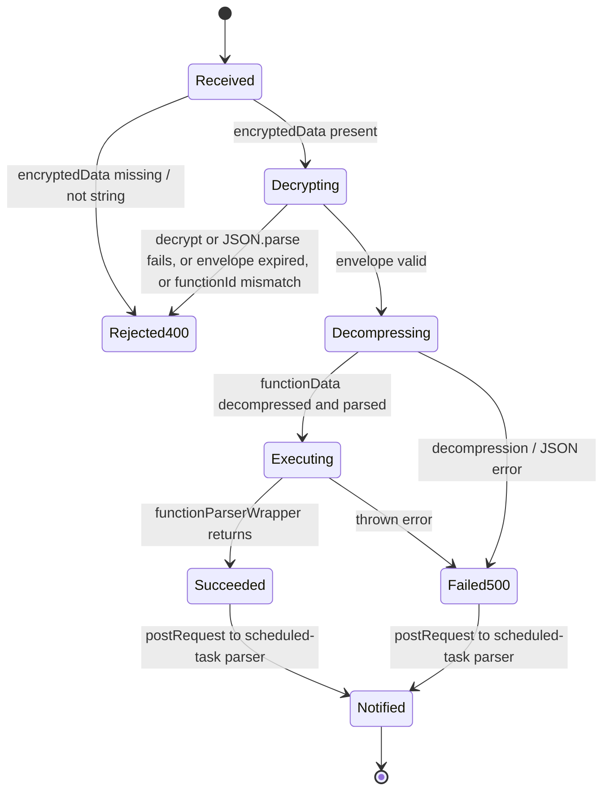
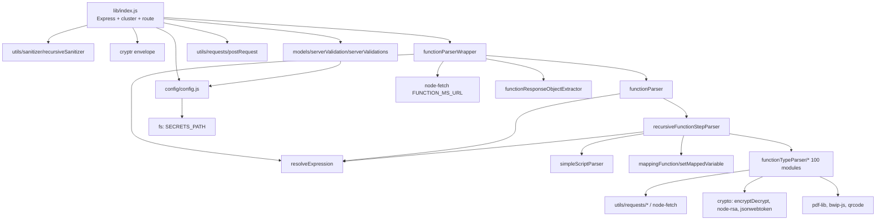

# scheduled_task_function_parser_ms

## 1. Summary

Server-side interpreter for user-defined function graphs. A scheduled-task parser hands it a
compressed function tree (one primary function plus referenced functions) and the runtime
parameters, and this service executes the function step by step: variables, expressions, loops,
conditionals, and roughly ninety side-effecting step types (HTTP calls, MongoDB, Redis, S3, PDF,
signing, payments). It returns the function result plus an updated scheduled-task object, encrypted
with a shared secret, and posts that envelope back to the scheduled-task parser's `resolve`
endpoint. It lives in its own git repository at `apps/scheduled_task_function_parser_ms/`
(`control` repo holds only the docs; every `file:line` below is relative to that service repository).

## 2. Stack and commands

Runtime: Node.js with Babel. `package.json` declares `"engine": { "node": ">=12.0.0 <17.5.0" }`
(`package.json:6-8`). Framework: Express 4, Mongoose 7, `node-fetch` 2 (`package.json:66-100`).

Scripts quoted from `package.json:10-15`:

| Script | Command |
|---|---|
| `start` | `nodemon lib/index.js --exec babel-node --presets es2015,stage-2` |
| `build` | `babel lib -d dist` |
| `serve` | `node dist/index.js` |
| `prodstart` | `babel lib -d dist && node dist/index.js` |

Port: `PORT`, read directly at `lib/index.js:257`. The k8s service maps port `5038`
(`k8s/scheduled-task-function-parser-ms-cluster-ip-service.yml:9-10`). Container image
`inhouz/scheduled_task_function_parser_ms`, `replicas: 1`
(`k8s/scheduled-task-function-parser-ms-deployment.yml:6`, `:17`).

## 3. Entry points

| Entry point | Location | How it starts |
|---|---|---|
| Cluster bootstrap | `lib/index.js:33-50` | Forks `os.cpus().length` workers in production, `1` otherwise (`:34`); re-forks on worker exit (`:39-50`) |
| Express app + HTTP listener | `lib/index.js:52`, `:257` | `app.listen(process.env.PORT)` |
| Sole HTTP route `POST /api/scheduledtaskfunctionparser/parsefunction` | `lib/index.js:88-255` | Registered inline on the app |
| Mongo connect / reconnect | `lib/index.js:60-86`, `:262-274` | `connectMongo()` at boot; 5 s retry on `disconnected` (`:70-72`); closed on `SIGINT`/`SIGTERM`/`uncaughtException` (`:78-86`) |
| Unmounted router `GET /` | `lib/routes/index.js:6-8` | **Never mounted.** `lib/index.js` does not import `lib/routes/index.js` |
| Scheduled-task enqueue callback (outgoing) | `lib/index.js:217-221`, `:247-251` | `postRequest` to `SCHEDULED_TASK_PARSER_MS_URL/api/scheduledtaskparser/resolve` |
| Function fetch fallback | `lib/utils/functionParser/functionParserWrapper.js:41-58` | `POST FUNCTION_MS_URL/api/function/getfunction` when the function is not in the supplied map |

## 4. Module inventory

Core modules (all paths from `lib/`).

| Name | file:line | Responsibility | Public API | Kind |
|---|---|---|---|---|
| Express bootstrap | `index.js:1-274` | App wiring, cluster, Mongo lifecycle, the parse route | default app side effect | effectful |
| Config | `config/config.js:18-59` | Reads secrets from `SECRETS_PATH` files with env fallback; builds RSA keys | default object | effectful (filesystem, env) |
| `readSecret` | `config/config.js:5-15` | File-first secret loader | `(name, envFallback) => string` | effectful (filesystem, env) |
| `connectMongo` | `index.js:262-274` | Mongoose connect, `maxPoolSize: 1` | `() => void` | effectful |
| Parse route handler | `index.js:89-254` | Decrypt envelope, validate, decompress, execute, re-encrypt, notify parser | Express handler | effectful |
| `functionParserWrapper` | `utils/functionParser/functionParserWrapper.js:9-151` | Resolves function data, evaluates declared parameter scripts, invokes the parser | `async (params) => response` | effectful (HTTP, clock) |
| `functionParser` | `utils/functionParser/functionParser.js:5-77` | Initialises variables/parameters, normalises workflows, delegates to the step parser | `async (functionObject, parameterObj, setStateFunction, functionMap, mappedVariables) => response` | reactive (mutates variable maps) |
| `recursiveFunctionStepParser` | `utils/functionParser/recursiveFunctionStepParser.js:97-...` | The interpreter: recursive step walk, `functionType` dispatch, accumulator | `async (steps, variableMap, parameterObject, functionMap, variableIdMap, setStateFunction, runTests, responseAccumulator, stepCount, prevStepId)` | effectful (delegates to effectful step parsers) |
| `resolveExpression` | `utils/functionParser/simpleScript/expressionParser/resolveExpression.js:12` | Expression evaluation entry | `async (expr, ...) => { value, variableObject }` | pure for arithmetic; reactive for variable lookups |
| `simpleScriptParser` | `utils/functionParser/simpleScript/simpleScriptParser.js` | Script (statement list) evaluation | `async (...)` | reactive |
| `setMappedVariable` | `utils/functionParser/mappingFunction/setMappedVariable.js` | Applies mapping functions to a value | `async (...)` | reactive |
| `functionResponseObjectExtractor` | `utils/functionParser/general/functionResponseObjectExtractor.js:1` | Shapes the final response object | `(responseObject, index) => object` | pure |
| `getLoopLimit` | `utils/functionParser/general/getLoopLimit.js` | Loop guard constant | `() => number` | pure |
| `scriptObjectParser` | `utils/functionParser/scriptObjectParser/scriptObjectParser.js` | Script object normalisation | `(...)` | pure/reactive |
| `postRequest` | `utils/requests/postRequest.js:3-63` | JSON POST with normalised error shape | `async (url, headers, data) => json` | effectful |
| `getRequest` | `utils/requests/getRequest.js:4` | JSON GET | `async (url, ...)` | effectful |
| `deleteRequest` | `utils/requests/deleteRequest.js:4` | JSON DELETE | `async (url, ...)` | effectful |
| `encryptDecrypt` | `utils/cryptography/encryptDecrypt.js:4-27` | RSA encrypt/decrypt with configured client keys | `(data, encrypt, publicEncrypt, publicDecrypt) => string` | effectful (key material from config) |
| `parseEncryptDecrypt` | `utils/cryptography/parseEncryptDecrypt.js` | Symmetric parse helper | `(...)` | effectful |
| `publicDecrypt` | `utils/cryptography/publicDecrypt.js` | Public-key decrypt | `(...)` | effectful |
| `recursiveSanitizer` | `utils/sanitizer/recursiveSanitizer.js` | Recursively sanitises request bodies | `(value, sanitizer) => value` | pure |
| `dotNotationMapper` | `utils/data/dotNotationMapper.js` | Dot-path read | `(...)` | pure |
| `dotNotationObjectUpdate` | `utils/data/dotNotationObjectUpdate.js` | Dot-path write | `(...)` | pure (returns new object) |
| `fileToBase64` | `utils/base64/fileToBase64.js` | File to base64 | `(...)` | effectful (filesystem) |
| `Logger` (winston subclass) | `helpers/winston-logger.js:19-...` | Console + file transports | `class Logger` | effectful (filesystem, logging) |
| `serverValidation` model | `models/serverValidation/serverValidations.js:5-29` | Server-validator token schema | mongoose model | effectful |
| `serverValidatorFunction` | `utils/serverValidator/serverValidatorFunction.js:7-44` | Mints a 40 s validator key | `async (companyId) => { key } \| { error }` | effectful (DB, clock, randomness) |

`functionTypeParser/` holds 100 modules, each `export default async function(...)` and each
dispatched by one `functionType` string in `recursiveFunctionStepParser.js`. They group into:

| Family | Modules | Example citation |
|---|---|---|
| Control flow | `ifElseParser`, `forLoopParser`, `whileLoopParser`, `switchParser` | `functionTypeParser/ifElseParser.js` |
| Expression/value helpers | `objectAssignParser`, `idParser`, `base64Parse`, `parseCrypto`, `jsonToCsvParser`, `jsonToXmlParser`, `xmlToJsonParser`, `stringToArrayBufferParser`, `arrayBufferToBase64Parser`, `compressDecompressParser`, `objectSizeParser`, `imageResizeParser` | `functionTypeParser/objectAssignParser.js` |
| Transport / storage | `networkRequestParser`, `sqlDbParser`, `mongoDbParser`, `redisParser`, `awsS3Parser`, `fileStorageUploadParser`, `fileStorageGetFileParser`, `fileStorageDeleteParser`, `fileStorageStreamUploadParser` | `functionTypeParser/mongoDbParser.js:8` |
| Crypto / identity | `secretKeyParser`, `jwtSignParser`, `jwtVerifyParser`, `jwkToPemParser`, `generateWsConnectionKeyParser`, `refreshWsClientKeyParser` | `functionTypeParser/secretKeyParser.js:100` |
| Documents / media | `generateServerPdfParser`, `splitPdfPagesParser`, `generateBarcodeParser`, `generateQrCodeParser`, `convertToBlobParser` | `functionTypeParser/generateServerPdfParser.js` |
| Inhouz domain steps | `createInhouzProjectParser`, `getInhouzProjectParser`, `getInhouzProjectsParser`, `changeInhouzProjectOwnerParser`, `changeInhouzProjectStatusParser`, `deleteInhouzProjectParser`, `createInhouzSignDocumentParser`, `sendInhouzSignDocumentParser`, `getInhouzSignDocumentParser`, `getInhouzSignDocumentsParser`, `getInhouzSignDocumentFileParser`, `cancelInhouzSignDocumentParser`, `deleteInhouzSignDocumentParser`, `generateInhouzSignUrlParser`, `createOneTimePaymentLinkParser`, `createFixedSchedulePaymentLinkParser`, `paymentLinkStatusUpdateParser`, `deletePaymentLinkParser`, `paymentRefundParser`, `singlePaymentDistributionParser`, `batchPaymentDistributionParser`, `subscriptionOnDemandPaymentParser`, `deactiveInhouzPaymentParser`, `enrichSubscriberDataParser`, `enrichProductDataParser`, `enrichPaymentSubscriberDataParser`, `getSubscriberCountParser`, `getSubscribersParser`, `getPaymentSubscriberCountParser`, `getSubscribedTenantParser`, `getSubscribedTenantCountParser`, `productSearchParser`, `productCountParser`, `paymentSubscriberSearchParser`, `updateSubscriptionSubscriberDataParser`, `manageSubscriptionUserRestrictionParser`, `addSubscriptionServiceExternalUsersParser`, `addSubscriptionServiceInternalUsersParser`, `cancelSubscriptionServiceInternalUsersParser`, `signupSubscriptionServiceExternalUsersParser`, `addInhouzCloudUserParser`, `cancelInhouzCloudUserParser`, `setInhouzCloudUserRoleParser`, `getSystemUserApiKeyParser` | `functionTypeParser/createInhouzProjectParser.js:160` |
| Runtime/UI affordances | `setResponseStatusParser`, `setResponseHeaderParser`, `setCookieParser`, `setDomPropertyParser`, `getDomProperyParser`, `navigationParser`, `windowLocationParser`, `getEnvironmentParser`, `socket`-adjacent parsers (web socket key) | `functionTypeParser/setResponseStatusParser.js` |

The exhaustive list of dispatched `functionType` values is the set of `functionType === '<name>'`
comparisons in `recursiveFunctionStepParser.js` (84 distinct values, including `setVariable`,
`break`, `continue`, `returnStatement`).

## 5. Side effects

| Effect | Where |
|---|---|
| MongoDB connect / reconnect | `lib/index.js:60-74`, `:262-274` |
| MongoDB read/write (server validator) | `lib/utils/serverValidator/serverValidatorFunction.js:13-17`; `lib/utils/functionParser/functionTypeParser/mongoDbParser.js:204` |
| Filesystem: secret files under `SECRETS_PATH` | `lib/config/config.js:6-14` |
| Filesystem: log directory + log files | `lib/helpers/winston-logger.js:13-25` |
| Filesystem: file-to-base64 | `lib/utils/base64/fileToBase64.js` |
| HTTP out: scheduled-task parser `resolve` | `lib/index.js:217-221` and `:247-251` |
| HTTP out: function fetch | `lib/utils/functionParser/functionParserWrapper.js:41-58` |
| HTTP out: per-step service calls (21 distinct config URLs) | `functionTypeParser/*Parser.js`; highest counts: `config.inhouzSignMsUrl` 8, `config.multimediaMsUrl` 7, `config.inhouzProjectMsUrl` 7, `config.subscriberDataFunctionMsUrl` 6, `config.paymentLinkMsUrl` 6, `config.inhouzPayMsUrl` 6 |
| Clock | `moment()` at `lib/index.js:212`, `:242`; `lib/utils/functionParser/functionParserWrapper.js:32`; `lib/utils/serverValidator/serverValidatorFunction.js:11` |
| Randomness | `shortid.generate()` at `lib/utils/serverValidator/serverValidatorFunction.js:10` |
| Logging | `console.log` throughout (e.g. `lib/index.js:65`, `:224`, `:258`); winston in `lib/helpers/winston-logger.js` (not imported by `lib/index.js`; the imports are commented out at `lib/index.js:22-28`) |
| Timers | DB reconnect `setTimeout` `lib/index.js:70`; user-authored `setTimeout` step `functionTypeParser/setTimeoutParser.js:40` |

## 6. State and state transitions

No persistent state machine in this service. The per-request lifecycle is a linear pipeline with
two outcomes, and the only durable record is the `serverValidators` document (created only when
`serverValidatorFunction` is called; it is not called from `lib/index.js`).



| Transition | Trigger | Guard |
|---|---|---|
| `Received → Rejected400` | request without `encryptedData` | `typeof encryptedData === "string"` (`lib/index.js:97-108`) |
| `Decrypting → Rejected400` | envelope check | `expirationTimestamp >= now` and `payload.functionId === body.functionId` (`lib/index.js:113-132`) |
| `Executing → Succeeded` | `functionParserWrapper` resolves | none; errors are returned as data (`functionParserWrapper.js:139-150`) |
| `Failed500` | any thrown error in the handler | `catch` at `lib/index.js:223` |

Scheduled-task entity state (`scheduledTaskId`, `isRecurrent`, `triggerTimestamp`, `startdate`,
`_id`) is carried through untouched in `cachedTask` (`lib/index.js:196-203`); this service does not
own that state machine.

## 7. Data

One model is registered in this repository.

| Model | Collection | file:line | Fields and validation |
|---|---|---|---|
| `config.serverValidatorModel` | value of `SERVER_VALIDATOR_MODEL` (k8s sets `serverValidators` per the brief, not visible in code) | `lib/models/serverValidation/serverValidations.js:5-29` | `expirationTimestamp: Number required`; `key: String required index`; `active: Boolean default true`; `companyId: String required index`; `strict: true`, `timestamps: true` |

Mongo connection: `config.mongoUrl` from secret file `mongourl` or `MONGO_URL`
(`lib/config/config.js:19`), `maxPoolSize: 1` (`lib/index.js:270`).

**Correction to the brief.** The brief lists 29 "mongo collections" harvested from the k8s
deployment env. In this code only `FUNCTION_MODEL` and `SERVER_VALIDATOR_MODEL` are read
(`lib/config/config.js:20`, `:24`), and only `SERVER_VALIDATOR_MODEL` backs a mongoose model. The
other model env vars (`SUBSCRIBER_MODEL`, `PAYMENT_INTENT_MODEL`, `ROLE_MODEL`, …) are set in
`k8s/scheduled-task-function-parser-ms-deployment.yml` but never read by this repository. This
service accesses other domains' data only through HTTP step parsers, not through shared collections.

Request payload to the route (shape inferred from destructuring at `lib/index.js:96`, `:134-153`):

```
{ encryptedData, functionId, routeParameters, queryStringParameters, companyId,
  requestBody, userAgent, user, requestHeaders, functionData, functionIds,
  environment, scheduledTaskId, isRecurrent, triggerTimestamp, startdate,
  taskObj, functionParameters, functionGenerated }
```

`functionData` is a `shrink-string`-compressed JSON document with shape
`{ primaryFunction, referencedFunctions[] }` (`lib/index.js:154-165`).

## 8. Public interfaces

| Interface | Shape |
|---|---|
| `POST /api/scheduledtaskfunctionparser/parsefunction` | Request as above. `200` → `{ payload, task, encryptedData }` (`lib/index.js:205-222`). `400` → `{ hasReturnStatement: false, returnStatement: undefined, updatedVariableObject: { runtime_response_status_code: 400 }, hasError: true, errorPayload: "Invalid request. Required fields are missing." }` (`:98-107`). `500` → same shape with `500` / `"Internal server error."` (`:225-233`) |
| Outgoing `POST /api/scheduledtaskparser/resolve` | Body `{ payload, task, encryptedData }`; `encryptedData` is Cryptr-encrypted `{ _id, expirationTimestamp }` valid 60 s (`lib/index.js:209-221`) |
| Outgoing `POST /api/function/getfunction` | Body `{ encryptedCompanyId, functionId, prod: true, environment }` (`functionParserWrapper.js:51-56`) |
| Step-level external calls | One `fetch` per step parser, e.g. `functionTypeParser/mongoDbParser.js:204`, `functionTypeParser/createInhouzProjectParser.js:160` |
| CLI | None. No bin entry in `package.json`. |

No queue topic or event bus. There is no websocket server; `functionTypeParser/generateWsConnectionKeyParser.js`
only mints keys for another service.

## 9. Configuration

Env var names only.

Secrets (read from files under `SECRETS_PATH` with env fallback): `MONGO_URL`, `SESSION_SECRET`,
`CLIENT_SECRET_KEY`, `CLIENT_PUBLIC_KEY`, plus `SECRETS_PATH` itself (`lib/config/config.js:5-38`).

Service URLs: `FUNCTION_MS_URL`, `AUTHENTICATION_MS_URL`, `SUBSCRIPTION_SIGNUP_MS_URL`,
`DATABASE_EXECUTION_MS_URL`, `PAYMENT_GATEWAY_MS_URL`, `PUSH_NOTIFICATION_PARSER_MS_URL`,
`ACCOUNT_TERMINATION_MS_URL`, `INHOUZ_SIGN_MS_URL`, `SUBSCRIPTION_MS_URL`,
`INHOUZ_PROJECT_MS_URL`, `PAYMENT_LINK_MS_URL`, `SCHEDULED_TASK_MS_URL`, `INHOUZ_PAY_MS_URL`,
`INHOUZ_COMMERCE_MS_URL`, `SUBSCRIBER_DATA_FUNCTION_MS_URL`, `MULTIMEDIA_MS_URL`,
`PDF_GENERATOR_MS_URL`, `SYSTEM_USER_MS_URL`, `SUBSCRIPTION_SERVICE_MS_URL`,
`GENERAL_TASK_PARSER_MS_URL`, `SCHEDULED_TASK_PARSER_MS_URL` (`lib/config/config.js:26-58`).

Model names: `FUNCTION_MODEL`, `SERVER_VALIDATOR_MODEL`. Other: `BASE_SERVER_URL`, `PORT`,
`NODE_ENV`.

Declared in k8s but unused by code: `SENDGRID_API_KEY`, `OPEN_EXCHANGE_RATES_API_KEY`,
`STRIPE_API_KEY`, `OPEN_EXCHANGE_RATES_BASE_URL`, `IP_LOCATION_FINDER_URL`, `COOKIE_NAME`,
`COOKIE_DOMAIN`, `INHOUZ_FROM_EMAIL`, `SUBSCRIPTION_SERVICE_CHARGE_FEE`,
`SUBSCRIPTION_SERVICE_CHARGE_TYPE` (see the env block in
`k8s/scheduled-task-function-parser-ms-deployment.yml`). No credential values are recorded here.

## 10. Dependencies

Direct dependencies from `package.json:66-100`, with the reason each is present.

| Dependency | Why |
|---|---|
| `express`, `body-parser`, `cors`, `helmet`, `hpp`, `compression`, `cookie-parser` | HTTP server, 20 MB JSON body, security and cookie middleware (`lib/index.js:52-57`) |
| `mongoose` | Server-validator model and connection |
| `node-fetch` | Every outbound HTTP call (`requests/*.js`, step parsers) |
| `cryptr` | Request/response envelope encryption (`lib/index.js:58`, `:110`) |
| `node-rsa`, `jwk-to-pem` | RSA helpers and JWK conversion (`encryptDecrypt.js`, `jwkToPemParser.js`) |
| `shrink-string` | Compresses/decompresses function data (`lib/index.js:17`) |
| `moment`, `moment-timezone` | Timestamps and expiry |
| `lodash`, `immutability-helper` | Object/array helpers inside expression and mapping parsers |
| `shortid`, `uuid` | Validator keys and generated ids |
| `sanitizer` | Request body sanitisation (`lib/index.js:15`) |
| `@sendgrid/mail` | Email step support |
| `bcryptjs`, `crypto-js`, `js-base64` | Hashing / encoding steps |
| `jsonwebtoken` | `jwtSignParser` / `jwtVerifyParser` |
| `bwip-js`, `qrcode`, `pdf-lib` | Barcode, QR, PDF generation and page split |
| `json-2-csv`, `jstoxml`, `txml` | CSV / XML conversion steps |
| `form-data`, `object-sizeof`, `resize-img`, `shrink-string` | Upload bodies, size checks, image resize |
| `request-ip`, `express-useragent` | Request metadata |
| `validator` | Input validation in step parsers |
| `dotenv`, `regenerator-runtime` | Runtime bootstrap (`lib/index.js:3-4`) |
| `winston`, `morgan`, `connect-mongo` | Logging/session scaffolding; winston logger is present but not wired into `index.js` |
| `cryptr`, `express-session`, `eslint` | Session/secret scaffolding; no session store is mounted from this repo |

Build-only: `babel-cli`, `babel-eslint`, `babel-preset-es2015`, `babel-preset-stage-2`,
`babel-register` (`package.json:49-55`).

## 11. Testing

No tests. There is no `test` script in `package.json`, no test runner dependency, and no test
directory. `recursiveFunctionStepParser` accepts a `runTests` flag (`recursiveFunctionStepParser.js:100`)
but no caller in this repository sets it. Coverage: none. Verification must be done by exercising
the route with a valid envelope from a caller that holds `SESSION_SECRET`.

## 12. Known issues and risks

- **Wide-open CORS.** `cors()` with no options allows any origin on the only route
  (`lib/index.js:53`).
- **No caller authentication beyond the envelope.** The parse route trusts any body that decrypts
  with the shared `SESSION_SECRET`; the server-validator header is commented out
  (`lib/utils/functionParser/functionParserWrapper.js:49`). A leaked secret is full execution
  access to every step parser, including `sqlDbParser`, `mongoDbParser`, `awsS3Parser` and payment
  steps.
- **Fire-and-forget callback.** `postRequest(...)` to the scheduled-task parser is not awaited
  (`lib/index.js:217-221`, `:247-251`); a failure is silent and the caller has already received
  `200`.
- **Expired envelope falls through silently.** When `expirationTimestamp < now` the code leaves
  `payload` undefined and returns the generic 400 (`lib/index.js:113-132`); no distinct error.
- **`req` is passed into the parser.** `parameters.req = req` (`lib/index.js:178`) hands the live
  Express request object, including the socket, to arbitrary user-authored function steps.
- **Secret loading falls back to env vars** when the secret file is missing
  (`lib/config/config.js:12-14`), so a misconfigured mount degrades to a different credential
  source without an error.
- **SIGKILL is not handled** and `uncaughtException` closes Mongo and exits without logging
  (`lib/index.js:78-86`).
- **Passwords, keys, tokens in cleartext in the request model**: the route decrypts a JSON blob and
  spreads `functionParameters` into `parameters` when `functionGenerated` is true
  (`lib/index.js:181-186`).
- **Dead code is deployed**: the unmounted router in `lib/routes/index.js` and the unused winston
  logger suggest template leftovers.
- **No input size limit on `functionData`** beyond the 20 MB body cap (`lib/index.js:54`); the
  decompressed JSON is parsed with no depth guard (`lib/index.js:155`).
- **`console.log` is the only logging path in the live server** (`lib/index.js:65`, `:224`), so
  there is no structured log for failed parses.

No live-looking credential literal was found in `lib/` by the scan.

## 13. Module map



## 14. Open questions

- **Mode: full read?** No. Inventory came from `find` over `lib/` (150 JS files) and the brief;
  nine files were opened in full: `lib/index.js`, `lib/config/config.js`, `lib/routes/index.js`,
  `functionParserWrapper.js`, `functionParser.js`, `recursiveFunctionStepParser.js` (first 330
  lines), `postRequest.js`, `serverValidations.js`, `serverValidatorFunction.js`,
  `encryptDecrypt.js`, and `winston-logger.js` (first 30 lines). The remaining ~90
  `functionTypeParser/` modules and the `simpleScript/expressionMethods` family were catalogued by
  directory listing plus `grep` of `functionType ===` and `fetch(`; each is cited by file and the
  dispatch name is in `recursiveFunctionStepParser.js`.
- **What `SERVER_VALIDATOR_MODEL` resolves to at runtime** cannot be read from this repo; the brief
  says `serverValidators`, but no code or checked-in manifest pins the value.
- **Whether the scheduled-task parser expects `resolve` synchronously** cannot be determined from
  this side; the call is fire-and-forget.
- **What `shrink-string` `decompress` does with malformed input** was not traced; the failure path
  is the generic 500.
- **Why 29 model env vars are deployed** when only one is read is unexplained; likely a shared
  deployment template. Recorded as a contradiction rather than resolved.
- **No tests exist**, so no behaviour below the route (loop limits, expression semantics, step
  parsers) could be confirmed by execution.
