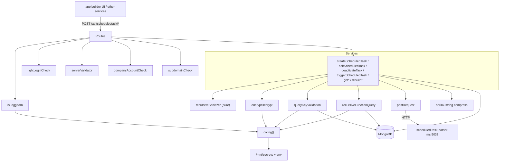

# scheduled_task_ms

Repository: `apps/scheduled_task_ms/` (separate git repository, not the control repo).
Every `file:line` below is relative to that repository root.

## 1. Summary

`scheduled_task_ms` is the scheduled-task registry for the Inhouz app builder. It stores the
scheduled tasks a company creates against a deployed function (`scheduledTasks`), keeps an
execution log of past runs (`scheduledTaskLogs`), and holds the frozen, compressed copy of the
function plus its referenced functions that a task needs in order to run without re-resolving the
function graph. It is the CRUD and dispatch surface for scheduled tasks: the app-builder UI and the
`function_parser_ms` / `functions_ms` / `scheduled_task_function_parser_ms` services create, edit,
list and deactivate tasks here, and this service forwards a task to
`scheduled_task_parser_ms` when it is time to run it.

## 2. Stack and commands

- Runtime: Node.js, `engines.node` `>=12.0.0 <17.5.0` (`package.json:7`).
- Framework: Express 4 (`server.js:2`), Mongoose 7 (`server.js:4`).
- Port: 5007, read from `process.env.PORT` (`server.js:91`, `k8s/scheduled-task-ms-deployment.yml:26`).
- Start command, quoted from `package.json:11`: `"start": "node server.js"`.
- Test command, quoted from `package.json:10`: `"test": "echo \"Error: no test specified\" && exit 1"`.
- Container: image `inhouz/scheduled_task_ms`, replicas 1
  (`k8s/scheduled-task-ms-deployment.yml:6`, `:17`). K8s Service
  `scheduled-task-ms-cluster-ip-service`, ClusterIP, port 5007 → targetPort 5007
  (`k8s/scheduled-task-ms-cluster-ip-service.yml:4,10,11`).
- `healthcheck.js` probes `http://localhost:$PORT/healthz` (`healthcheck.js:5-7`), but no
  `/healthz` route is registered — see §12.

## 3. Entry points

| Entry point | Where | How it starts |
|---|---|---|
| Express HTTP server | `server.js:91` | `node server.js`; `app.listen(process.env.PORT)` |
| Cluster master / fork | `server.js:30-47` | `cluster.fork()` once per CPU when `NODE_ENV === "production"`, otherwise one worker |
| Route registration | `server.js:61` → `controller/scheduledTask/scheduledTaskRoutes.js:18` | called with the express app |
| Mongo connect + retry | `server.js:64`, `:96-107` | on boot; `setTimeout(..., 5000)` retry on `disconnected` (`server.js:73`) |
| Shutdown handlers | `server.js:81-89` | `SIGINT`, `SIGTERM`, `uncaughtException` close the mongoose connection |
| Health probe | `healthcheck.js:1-19` | Docker HEALTHCHECK helper; exits 0 on HTTP 200 |

Live routes (registered in `controller/scheduledTask/scheduledTaskRoutes.js`):

| Method and path | Line | Middleware chain |
|---|---|---|
| POST `/api/scheduledtask/create` | `:19` | `lightLoginCheck` → `createScheduledTask` |
| POST `/api/scheduledtask/servercreate` | `:20` | `serverValidator` → `createScheduledTask` |
| POST `/api/scheduledtask/deactivate` | `:21` | none → `deactivateTask` |
| POST `/api/scheduledtask/run` | `:22` | `isLoggedIn` → `triggerScheduledTask` |
| POST `/api/scheduledtask/edit` | `:23` | `isLoggedIn` → `companyAccountCheck` → `subdomainCheck` → `editScheduledTask` |
| POST `/api/scheduledtask/rebuildscheduledtasks` | `:24` | `isLoggedIn` → `companyAccountCheck` → `rebuildScheduledTasks` |
| POST `/api/scheduledtask/getscheduledtasks` | `:27` | `isLoggedIn` → `subdomainCheck` → `getScheduledTasks` |
| POST `/api/scheduledtask/getscheduledtasklogs` | `:28` | `isLoggedIn` → `subdomainCheck` → `getScheduledTaskLogs` |
| POST `/api/scheduledtask/getscheduledtask` | `:29` | `isLoggedIn` → `subdomainCheck` → `getScheduledTask` |

Commented out, therefore not routed: `/settaskversion` (`:25`), `/gettasktracker` (`:26`),
`/deploy` (`:30`). The handler modules still exist and are still `require`d at `:4`, `:5`, `:8`.

## 4. Module inventory

| Name | Where | Owns | Public API | Kind |
|---|---|---|---|---|
| server bootstrap | `server.js:1-107` | express app, model registration, cluster, mongo connect | side effects only | `effectful` |
| `config()` | `config/config.js:18-54` | cached config object, secret file reads | `() => config` | `effectful` (reads filesystem and env; caches result in `cachedConfig`, `:17`) |
| `readSecret` | `config/config.js:5-15` | reads `/mnt/secrets/<name>` with env fallback | `(name, envFallback) => string` | `effectful` |
| `scheduledTaskRoutes` | `controller/scheduledTask/scheduledTaskRoutes.js:18-31` | route table | `(app) => void` | `effectful` |
| `createScheduledTask` | `services/scheduledTask/createScheduledTask.js:12-236` | validate company + deployed function, freeze function graph, insert task | `(req, res)` | `effectful` (state + Mongo + clock + random ObjectId) |
| `editScheduledTask` | `services/scheduledTask/editScheduledTask.js:11-220` | re-resolve function graph, update task | `(req, res)` | `effectful` |
| `deactivateTask` | `services/scheduledTask/deactivateTask.js:8-116` | `updateMany` → `active:false, archived:true` | `(req, res)` | `effectful` |
| `triggerScheduledTask` | `services/scheduledTask/triggerScheduledTask.js:11-137` | decrypt payload, look up task, POST to parser | `(req, res)` | `effectful` |
| `deployScheduledTask` | `services/scheduledTask/deployScheduledTask.js:6-224` | promote a task version, write version tracker | `(req, res)` | `effectful` (not routed) |
| `setTaskVersion` | `services/scheduledTask/setTaskVersion.js:8-250` | activate/deactivate task versions | `(req, res)` | `effectful` (not routed) |
| `getScheduledTasks` | `services/scheduledTask/getScheduledTasks.js:8-41` | filtered list + count | `(req, res)` | `effectful` |
| `getScheduledTask` | `services/scheduledTask/getScheduledTask.js:7-59` | one task by query | `(req, res)` | `effectful` |
| `getScheduledTaskLogs` | `services/scheduledTask/getScheduledTaskLogs.js:8-39` | filtered execution log list | `(req, res)` | `effectful` |
| `getTaskTracker` | `services/scheduledTask/getTaskTracker.js:6-48` | version tracker read | `(req, res)` | `effectful` (not routed) |
| `rebuildScheduledTasks` | `services/scheduledTask/rebuildScheduledTasks.js:10-171` | re-freeze function data for every task of a function | `(req, res)` | `effectful` |
| `recursiveFunctionQuery` | `utils/functions/recursiveFunctionQuery.js:72` | resolve a function's reference graph | `{recursiveFunctionQuery}` | `effectful` (Mongo reads) |
| `encryptDecrypt` | `utils/cryptography/encryptDecrypt.js:3` | symmetric encrypt/decrypt of payloads | `(data, encrypt=false)` | `effectful` (uses a key from config; deterministic given the key) |
| `queryKeyValidation` | `utils/queryKey/queryKeyValidation.js:4-78` | single-use access-key check; records the key after first use | `(key) => {success} \| {error}` | `effectful` (Mongo read + write) |
| `postRequest` / `getRequest` / `deleteRequest` | `utils/requests/postRequest.js:3`, `getRequest.js:3`, `deleteRequest.js:3` | HTTP helpers over `node-fetch` | `(url, headers, data)` | `effectful` |
| `recursiveSanitizer` | `utils/sanitizer/recursiveSanitizer.js:19` | deep XSS sanitize of the request body | `{recursiveSanitizer}` | `pure` |
| `parseFilter` | `utils/filter/parseFilter.js:5` | turn a client filter object into a Mongo query | `(filter={})` | `pure` |
| `filterMap`, `nonRegexList`, `taskTypeMap` | `utils/filter/filterMap.js:1`, `nonRegexList.js:1`, `taskTypeMap.js:1` | filter field whitelist and mappings | object / array | `pure` |
| `getUser` | `utils/user/getUser.js:5` | load a user plus roles | `(userId) => user \| {error}` | `effectful` |
| `createEditByObject` | `utils/user/createEditByObject.js:1` | build the `createdBy` / `editedBy` sub-object | `(user, deployDate)` | `pure` |
| `isLoggedIn` | `middlewares/login/checkLogin.js:9` | decrypt `SMPL` cookie or `x-access-token`, validate session + CSRF, load company | `(req,res,next)` | `effectful` |
| `lightLoginCheck` | `middlewares/login/lightLoginCheck.js:9` | same as above with a lighter session check | `(req,res,next)` | `effectful` |
| `companyAccountCheck` | `middlewares/company/companyAccountCheck.js:1` | reject non-active company | `(req,res,next)` | `effectful` |
| `subdomainCheck` | `middlewares/subdomain/singleSubdomainValidation.js:1` | require the request subdomain to match `req.user.subDomain` | `(req,res,next)` | `pure` (compares request fields only) |
| `serverValidator` | `middlewares/serverValidator/serverValidator.js:5` | decrypt a server validator key, check expiry | `(req,res,next)` | `effectful` (Mongo read) |
| `moduleAccessCheck` | `middlewares/module/moduleAccessCheck.js:7` | module permission gate | `(req,res,next)` | `effectful` (Mongo read) |

## 5. Side effects

| Effect | Where |
|---|---|
| Read secret files from `SECRETS_PATH` and env fallbacks | `config/config.js:6,10,13` |
| Construct an RSA key from the client secret | `config/config.js:47-50` |
| Mongo connect, max pool size 1 | `server.js:97-107` |
| Mongo connection event logging | `server.js:67-80` |
| `console.log` throughout services (error paths, connection state) | e.g. `createScheduledTask.js:81,118,211,228` |
| Clock reads (`new Date().getTime()`, `moment()`) | `createScheduledTask.js:29,200`, `triggerScheduledTask.js:32,114`, `deactivateTask.js:29` |
| Randomness (`new mongoose.Types.ObjectId().toHexString()`) for `scheduledTaskId` | `createScheduledTask.js:156,179` |
| Mongo reads: `company`, `deployedFunctions`, `scheduledTasks`, `scheduledTaskLogs`, `versionTracker`, `session`, `queryKeyTracker`, `serverValidators` | `createScheduledTask.js:75,110,154`, `getScheduledTasks.js:17`, `getScheduledTaskLogs.js:17`, `getScheduledTask.js:24`, `deployScheduledTask.js:25-26`, `triggerScheduledTask.js:69`, `queryKeyValidation.js:17,45` |
| Mongo writes: task insert/update, log insert, query-key insert, version tracker update | `createScheduledTask.js:201`, `deactivateTask.js:82`, `editScheduledTask.js:168`, `rebuildScheduledTasks.js:142`, `queryKeyValidation.js:45`, `deployScheduledTask.js:56-187` |
| Outgoing HTTP POST to `scheduled-task-parser-ms-cluster-ip-service:5037/api/scheduledtaskparser/parse` | `triggerScheduledTask.js:118-126`, URL from `config/config.js:42` and `k8s/scheduled-task-ms-deployment.yml:157-158` |
| HTTP client (`node-fetch`) | `utils/requests/postRequest.js:4`, `getRequest.js:4`, `deleteRequest.js:4` |
| Filesystem read of secret files | `config/config.js:10` |

No Stripe, SendGrid, exchange-rate or storage call exists in the code, even though the deployment
injects `STRIPE_API_KEY`, `SENDGRID_API_KEY`, `OPEN_EXCHANGE_RATES_*` and `PAYMENT_MS_URL`
(`k8s/scheduled-task-ms-deployment.yml:50-59,130-137`). Those are unused env vars for this image.

## 6. State and state transitions

The `scheduledTasks` document carries four boolean life-cycle flags: `active`, `archived`,
`processing`, `paused` (`model/scheduledTask/scheduledTask.js:15,54,64,75`), plus the version
counters in `versionTracker` (`activeVersion`, `deployedVersion`, `model/versionTracker/versionTracker.js:22,26`).

| From | To | Trigger | Guard |
|---|---|---|---|
| (none) | created, `active:true`, `archived:false`, `processing:false`, `paused:false` | POST `/create` or `/servercreate` (`createScheduledTask.js:201`) | valid company of status `active` (`:101`), deployed function exists (`:122`), unique `scheduledTaskId` (`:158-181`) |
| created | edited | POST `/edit` (`editScheduledTask.js:168`) | caller's `companyId` equals `scheduledTaskObject.companyId` (`:62-68`) |
| active | deactivated, `active:false`, `archived:true` | POST `/deactivate` (`deactivateTask.js:82-93`) | single-use `queryKey` (`:69-72`) |
| any | `processing:true` | set by the parser side of the flow, not by this repo | — |
| `processing:true` | run refused | POST `/run` (`triggerScheduledTask.js:97-103`) | returns 400 "Task is currently running." |
| version | version N deployed | POST `/deploy` (`deployScheduledTask.js:56-88`) | handler exists but the route is commented out (`scheduledTaskRoutes.js:30`) |
| version | version N active | POST `/settaskversion` (`setTaskVersion.js:63-101`) | handler exists but the route is commented out (`scheduledTaskRoutes.js:25`) |

No other state machine exists in this repository. The scheduler that sets `processing` and writes
`scheduledTaskLogs` lives in another service (`scheduled_task_scheduler_ms`), and this repo only
reads that flag.

## 7. Data

| Model | Collection (env → name) | Key fields and rules |
|---|---|---|
| `scheduledTask` | `SCHEDULED_TASK_MODEL` → `scheduledTasks` | `taskName` required; `environment` enum `development\|test\|production` required; `scheduledTaskId` required; `companyId` required; `functionId` required; `functionData` (compressed string) required; `scheduleType` enum `projection\|preciseDate\|''`; `isRecurrent` default false; `active` default true; `archived` default false; `processing` default false (schema `:64`, described as `paused` in §6 — the field is `processing`); `paused` default false; compound index over 15 fields (`model/scheduledTask/scheduledTask.js:5-92`) |
| `scheduledTaskLog` | `SCHEDULED_TASK_LOG_MODEL` → `scheduledTaskLogs` | same shape as the task plus `executionTimestamp` and `executionDurationMS` (both required), `success`, `failMessage`, `runtimePayload`, `monthYear`, `year`, `day`, `month` (`model/scheduledTask/scheduledTaskLog.js:70-84`); second compound index (`:90-99`) |
| `versionTracker` | `VERSION_TRACKER_MODEL` → `versionTracker` | `itemId`, `companyId`, `itemType` required and indexed; `activeVersion` default 1; `deployedVersion` default 0; `deployDate` (`model/versionTracker/versionTracker.js:6-30`). `itemType` documented in-code as `scheduledTask, query, function, api, schema`; this service uses `scheduledTask` (`config/config.js:33`) |
| `company` | `COMPANY_MODEL` → `company` | read only (`createScheduledTask.js:75-79`); `status` must be `active` (`:101`) |
| `deployedFunction` | `DEPLOYED_FUNCTION_MODEL` → `deployedFunctions` | read only; matched on `companyId, functionId, environment` (`createScheduledTask.js:111-115`); `functionReferences` drives the graph (`:130`) |
| `queryKeyTracker` | `QUERY_KEY_TRACKER_MODEL` → `queryKeyTracker` | `{key, timestamp}` recorded on first use (`queryKeyValidation.js:45`); a second use of the same key is rejected (`:34-39`) |
| `session`, `user`, `userRoles`, `roles`, `permissions`, `serverValidator` | `SESSION_MODEL`, `USER_MODEL`, `USER_ROLES_MODEL`, `ROLE_MODEL`, `PERMISSION_MODEL`, `SERVER_VALIDATOR_MODEL` | registered for the auth middlewares (`server.js:14-28`); owned by other services, read here |

Shared collections, i.e. data coupling a reader cannot infer from this repo:

- `scheduledTasks` — written here; read and updated by `scheduled_task_scheduler_ms` and
  `scheduled_task_function_parser_ms` (the scheduler sets `processing` and appends logs).
- `scheduledTaskLogs` — the schema is defined here (`model/scheduledTask/scheduledTaskLog.js:101`)
  but the scheduler is the writer.
- `deployedFunctions` — owned by the functions service; read here.
- `versionTracker` — shared with every versioned resource in the platform; the
  `itemType: "scheduledTask"` rows are this service's.
- `session`, `sessionValidator`, `User`, `roles`, `permissions` — the platform-wide auth
  collections.
- `company` — the platform-wide tenant collection.

## 8. Public interfaces

All routes are POST with a JSON body. Auth is cookie `SMPL` or header `x-access-token`
(`checkLogin.js:11`).

| Route | Request body | Response |
|---|---|---|
| `/api/scheduledtask/create` | `{ scheduledTaskObject, encryptedCompanyId? }` (`createScheduledTask.js:14-22`) | the created task document, or `{error:{message}}` with 400/403/404/500 |
| `/api/scheduledtask/servercreate` | same; company comes from the decrypted server payload | same |
| `/api/scheduledtask/edit` | `{ scheduledTaskObject, encryptedCompanyId? }`, must carry `scheduledTaskId` (`editScheduledTask.js:14-23`) | updated task or `{error}` |
| `/api/scheduledtask/deactivate` | `{ encryptedPayload }` containing `{companyId, queryKey, scheduledTaskId? \| taskName?}` (`deactivateTask.js:11-47`) | `{success:true}` or `{error}` |
| `/api/scheduledtask/run` | `{ encryptedPayload }` containing `{companyId, scheduledTaskId, queryKey}` (`triggerScheduledTask.js:14-62`) | `{success:true}` after the parser is called; 400 when `processing`, 401 on bad key, 404 when missing |
| `/api/scheduledtask/rebuildscheduledtasks` | `{ encryptedPayload }` containing `{companyId, functionId, functionData, environment}` (`rebuildScheduledTasks.js:14-56`) | result of the bulk update |
| `/api/scheduledtask/getscheduledtasks` | filter object per `utils/filter/parseFilter.js` | `{scheduledTasks, total_count}` (`getScheduledTasks.js:24-30`) |
| `/api/scheduledtask/getscheduledtasklogs` | filter object | log list |
| `/api/scheduledtask/getscheduledtask` | `{scheduledTaskId}` or `{taskName}` | one task |

Outgoing call: `POST ${SCHEDULED_TASK_PARSER_MS_URL}/api/scheduledtaskparser/parse` with the task
document plus `{encryptedData, serverEncrypted:true}` (`triggerScheduledTask.js:118-126`). The
response is deliberately not awaited — the request is fired and `/run` returns `{success:true}`
immediately.

Inbound callers: `function_parser_ms`, `functions_ms`, `scheduled_task_function_parser_ms`
(per the deployment-wide caller list). `/servercreate` is the machine-to-machine variant guarded by
`serverValidator` instead of a session.

## 9. Configuration

Names only, no values.

Code-read: `SECRETS_PATH`, `FLEX_FORM_FILE_MODEL`, `FLEX_MODULE_MODEL`, `FLEX_COLLECTION_MODEL`,
`FORM_MODEL`, `SMPL_EMAIL`, `MONGO_URL`, `USER_MODEL`, `COMPANY_MODEL`, `SCHEDULED_TASK_MODEL`,
`SCHEDULED_TASK_LOG_MODEL`, `VERSION_TRACKER_MODEL`, `ROLE_MODEL`, `PERMISSION_MODEL`,
`USER_ROLES_MODEL`, `SESSION_MODEL`, `COOKIE_DOMAIN`, `FUNCTION_MODEL`,
`SCHEDULED_TASK_PARSER_MS_URL`, `QUERY_KEY_TRACKER_MODEL`, `FUNCTION_VERSION_TRACKER_MODEL`,
`OPERATION_TRACKER_MODEL`, `SERVER_VALIDATOR_MODEL`, `DEPLOYED_FUNCTION_MODEL`, `PORT`,
`NODE_ENV`, `SENDGRID_API_KEY`, `CLIENT_SECRET_KEY`, `SESSION_SECRET` (`config/config.js:18-53`).

Secret file names read from `SECRETS_PATH`: `sendgridapikey`, `mongourl`, `clientsecretkey`,
`sessionsecret` (`config/config.js:25,27,38,39,48`).

Injected by the deployment but not read by this code: `COOKIE_NAME`, `INHOUZ_FROM_EMAIL`,
`OPEN_EXCHANGE_RATES_API_KEY`, `OPEN_EXCHANGE_RATES_BASE_URL`, `STRIPE_API_KEY`, `PAYMENT_MS_URL`,
`IP_LOCATION_FINDER_URL`, and the tenant/billing collection names
(`k8s/scheduled-task-ms-deployment.yml:28-160`).

## 10. Dependencies

Direct, from `package.json:15-41`:

| Package | Why |
|---|---|
| `express` | HTTP server and routing |
| `mongoose` | MongoDB ODM, all persistence |
| `body-parser` | JSON body parsing, 20 MB limit (`server.js:57`) |
| `cookie-parser` | signed cookie parsing for the `SMPL` session cookie (`server.js:60`) |
| `cors` | allow `*.inhouz.localhost` origins with credentials (`server.js:49-55`) |
| `helmet`, `hpp` | header hardening and parameter-pollution guard (`server.js:58-59`) |
| `dotenv` | load `.env` for local runs (`server.js:1`) |
| `cryptr` | encrypt/decrypt session tokens, server validator keys and run payloads |
| `node-rsa` | build an RSA key object from the client secret (`config/config.js:47`) |
| `lodash` | emptiness/equality helpers in the services |
| `moment`, `moment-timezone` | `preciseDate` to timestamp conversion (`createScheduledTask.js:197`) |
| `shrink-string` | compress the frozen function graph into `functionData` (`createScheduledTask.js:151`) |
| `sanitizer` | XSS sanitization of every request body |
| `node-fetch` | HTTP calls to the parser service |
| `validator` | string validation in the models |
| `@sendgrid/mail`, `connect-mongo`, `express-session`, `crypto-js`, `passport`, `passport-local-mongoose`, `request-ip` | declared but not required anywhere in this repo's source; leftover from the shared service template |

## 11. Testing

There are no tests. `npm test` is the npm placeholder that exits 1 (`package.json:10`). No test
directory, no test runner, no fixture. Nothing is covered. `healthcheck.js` is the only executable
check and it self-reports a status code; it does not assert behaviour.

## 12. Known issues and risks

- **Health check target does not exist.** `healthcheck.js:7` probes `/healthz`; `server.js` and the
  route file register no such path, so the probe gets a 404 and exits 1. A container health check
  using this script fails on a healthy process.
- **Three routes are dead.** `/settaskversion`, `/gettasktracker` and `/deploy` are commented out
  (`controller/scheduledTask/scheduledTaskRoutes.js:25,26,30`) while their handlers are still
  loaded (`:4,5,8`). The version lifecycle in `deployScheduledTask.js` and `setTaskVersion.js`
  cannot be reached over HTTP.
- **`/deactivate` has no auth middleware.** `scheduledTaskRoutes.js:21` goes straight to the
  handler. Its only guard is the single-use `queryKey` (`deactivateTask.js:69`), so anyone holding
  a fresh key can deactivate tasks for any `companyId` in the payload.
- **Fire-and-forget parser call.** `triggerScheduledTask.js:118` calls `postRequest` without
  `await`, so a parser failure is never observed and `/run` reports success regardless. The task is
  also not marked `processing` here, so two concurrent `/run` calls can both pass the
  `processing` check at `:97`.
- **Single-use query key has no expiry check.** `queryKeyValidation.js:17-45` rejects a key only if
  it was already used; nothing in that module enforces a time window on `timestamp`.
- **Config caches at first require.** `config/config.js:17-19` memoises the config object, so a
  changed secret file needs a process restart.
- **`config.js` returns `""` when a secret is missing.** `config/config.js:13` falls back to an
  empty string, so a missing `SESSION_SECRET` produces a Cryptr instance over an empty key instead
  of a startup failure.
- **Unused env vars imply a shared template.** The deployment injects Stripe, SendGrid and
  payment-service configuration that this image never reads
  (`k8s/scheduled-task-ms-deployment.yml:50-59,130-137`); a real Stripe or payment key is mounted
  into a pod that has no code path for it.
- **`mongoUrl` comes from a mounted secret or env.** No hardcoded connection string, but the
  fallback path in `readSecret` means a misconfigured mount silently degrades to env or `""`.
- **No credential is embedded in source.** Scanned all `.js`/`.json`/`.yml`/`.sh` for key-shaped
  literals: none found. `service-account.json.enc` is an encrypted blob checked into the repo; it
  is not readable without its key, but it should not be in a source repository.
- **Error responses leak internals.** `createScheduledTask.js:232` returns `errorPayload : e`, the
  raw exception object, to the client.

## 13. Module map

Call direction: routes → middleware → service → utilities → MongoDB; only `postRequest` leaves the
service boundary, toward `scheduled_task_parser_ms`.

## 14. Open questions

- Who writes `scheduledTaskLogs` and sets `processing`? Not this repo; it is the scheduler. The
  exact writer and the reset rule for a stuck `processing:true` were not determined here.
- Does `queryKeyTracker` have a TTL index? Not defined in this repo; the model is registered for
  the key check but the collection is shared, so the TTL, if any, lives with its owner.
- Are `/settaskversion`, `/gettasktracker` and `/deploy` superseded by the scheduler service, or
  should the routes be restored? Commented out with no note.
- `createScheduledTask` still passes `company` status and deployed-function checks; whether
  `/servercreate` callers already did those checks is not determinable from this repo.
- Skipped: the k8s `kus/` kustomize trees (base/dev/prod) were read only as a duplicate of
  `k8s/`; `.github/workflows/`, `.travis.yml`, `build_ga*.sh`, `deploy.sh`, `docker-compose.yml`
  are CI/deploy plumbing and were not documented as behaviour. `service-account.json.enc` was not
  decrypted. `node_modules/` was excluded.
