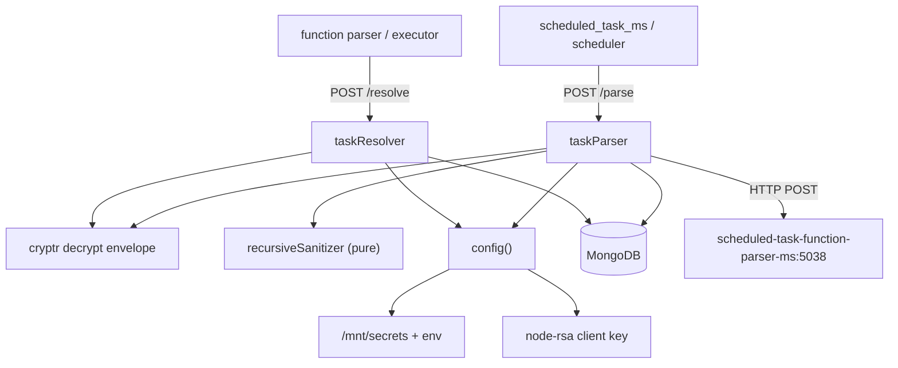

# scheduled_task_parser_ms

Repository: `apps/scheduled_task_parser_ms/` (separate git repository, not the control repo).
Every `file:line` below is relative to that repository root.

## 1. Summary

`scheduled_task_parser_ms` is the entry gate of the scheduled-task execution pipeline. It accepts a
trigger from `scheduled_task_ms` (or the scheduler), verifies the encrypted envelope, re-loads the
task, enforces the freelancer monthly execution quota, marks the task `processing:true`, then
forwards the frozen function payload to `scheduled_task_function_parser_ms`. It also exposes a
`/resolve` callback that the executor calls when a run finishes: that callback flips `processing`
off, closes or re-arms the task, writes one `scheduledTaskLogs` document and increments the
subscription execution counter.

## 2. Stack and commands

- Runtime: Node.js, `engines.node` `>=12.0.0 <17.5.0` (`package.json:6`).
- Framework: Express 4 (`server.js:2`), Mongoose 7 (`server.js:3`).
- Port: 5037 from `process.env.PORT` (`server.js:80`, `k8s/scheduled-task-parser-ms-deployment.yml:26`).
- Start command, quoted from `package.json:11`: `"start": "node server.js"`.
- Test command, quoted from `package.json:10`: `"test": "echo \"Error: no test specified\" && exit 1"`.
- Container: image `inhouz/scheduled_task_parser_ms`, replicas 1
  (`k8s/scheduled-task-parser-ms-deployment.yml:16,17`). K8s Service
  `scheduled-task-parser-ms-cluster-ip-service`, ClusterIP, 5037 → 5037
  (`k8s/scheduled-task-parser-ms-cluster-ip-service.yml:4,10,11`).
- `healthcheck.js:7` probes `/healthz`, which is not a registered route — see §12.

## 3. Entry points

| Entry point | Where | How it starts |
|---|---|---|
| Express HTTP server | `server.js:80` | `node server.js`, `app.listen(process.env.PORT)` |
| Cluster master / fork | `server.js:20-37` | one fork per CPU in production, otherwise one worker |
| Route registration | `server.js:51` → `controller/scheduledTask/taskRoutes.js:4` | called with the express app |
| Mongo connect + retry | `server.js:53-65`, `:85-97` | on boot; 5 s retry on `disconnected` (`server.js:63`) |
| Shutdown handlers | `server.js:70-78` | `SIGINT`, `SIGTERM`, `uncaughtException` |
| Health probe | `healthcheck.js:1-19` | Docker HEALTHCHECK helper |

Routes (`controller/scheduledTask/taskRoutes.js`):

| Method and path | Line | Middleware | Handler |
|---|---|---|---|
| POST `/api/scheduledtaskparser/parse` | `:5` | none | `taskParser` |
| POST `/api/scheduledtaskparser/resolve` | `:6` | none | `taskResolver` |

Both routes are unauthenticated at the HTTP layer. The only guard is the encrypted envelope the
caller must produce with the shared secrets. The `middlewares/` directory exists but nothing
requires it — `grep -rn "middlewares/"` returns no hits outside the middleware files themselves.

## 4. Module inventory

| Name | Where | Owns | Public API | Kind |
|---|---|---|---|---|
| server bootstrap | `server.js:1-97` | express app, model registration, cluster, mongo | — | `effectful` |
| `config()` | `config/config.js:18-52` | cached config, secret-file reads, RSA key construction | `() => config` | `effectful` (filesystem, env, cache) |
| `readSecret` | `config/config.js:5-15` | `/mnt/secrets/<name>` with env fallback | `(name, envFallback) => string` | `effectful` |
| `taskRoutes` | `controller/scheduledTask/taskRoutes.js:4-7` | two POST routes | `(app) => void` | `effectful` |
| `taskParser` | `services/scheduledTask/taskParser.js:10-283` | verify envelope, quota check, mark processing, forward to the function parser | `(req, res)` | `effectful` (Mongo read/write, clock, HTTP, logging) |
| `taskResolver` | `services/scheduledTask/taskResolver.js:7-140` | close the run, write the log, increment the counter | `(req, res)` | `effectful` (Mongo write, clock) |
| `encryptDecrypt` | `utils/cryptography/encryptDecrypt.js:3-17` | RSA decrypt (or encrypt with the private key) of a payload | `(data, encrypt=false)` | `effectful` (key from config; logs, catches, and returns the input on error) |
| `recursiveSanitizer` | `utils/sanitizer/recursiveSanitizer.js:19` | deep sanitize of the request body | `{recursiveSanitizer}` | `pure` |
| `getUser` | `utils/user/getUser.js:5` | load user, roles and permissions | `(userId)` | `effectful` (not called by the routes) |
| `createEditByObject` | `utils/user/createEditByObject.js:1` | build a createdBy/editedBy object | `(user, deployDate)` | `pure` (not called by the routes) |
| `isLoggedIn` | `middlewares/login/checkLogin.js` | session/CSRF gate | `(req,res,next)` | `effectful` (dead code, not required) |
| `moduleAccessCheck` | `middlewares/module/moduleAccessCheck.js:7` | module permission gate | `(req,res,next)` | `effectful` (dead code, not required) |
| `subdomainCheck` | `middlewares/subdomain/singleSubdomainValidation.js` | subdomain match | `(req,res,next)` | `pure` (dead code, not required) |

## 5. Side effects

| Effect | Where |
|---|---|
| Secret file read from `SECRETS_PATH` | `config/config.js:6,10` |
| RSA key construction from the client secret | `config/config.js:43-46` |
| Mongo connect, max pool 1 | `server.js:86-96` |
| Connection event logging | `server.js:55-68` |
| Clock reads | `taskParser.js:39,60-61,249-253`, `taskResolver.js:31,60,99` |
| Mongo read `scheduledTasks` by `_id` when the envelope says `init` | `taskParser.js:64-71` |
| Mongo read `company` | `taskParser.js:118-125` |
| Mongo read `inhouzSubscriptions` | `taskParser.js:140-148` |
| Mongo update `scheduledTasks` → `processing:false, paused:true` on quota exhaustion | `taskParser.js:171-186` |
| Mongo update `scheduledTasks` → `processing:true`, `lastTriggerTimestamp` | `taskParser.js:197-213` |
| Mongo update `scheduledTasks` → `processing:false`, `active` on resolve | `taskResolver.js:74-86` |
| Mongo insert `scheduledTaskLogs` | `taskResolver.js:96-111` |
| Mongo `$inc` `inhouzSubscriptions.scheduledTaskExecutionCount` | `taskResolver.js:113-127` |
| Outgoing HTTP POST to `scheduled-task-function-parser-ms-cluster-ip-service:5038/api/scheduledtaskfunctionparser/parsefunction` | `taskParser.js:258-266`; URL from `config/config.js:44` and `k8s/scheduled-task-parser-ms-deployment.yml:90-91` |
| `console.log` on every error path, plus a "Mismatch IDs" log that prints two ids | `taskParser.js:50,52,69,123,146,184,211,268,276`; `taskResolver.js:84,109,125,133` |

The outbound call sets a hard-coded Chrome `User-Agent` (`taskParser.js:263`). Nothing explains why.

## 6. State and state transitions

The `scheduledTasks` document has `active`, `processing`, `paused`, `archived`
(`model/scheduledTask/scheduledTask.js`), and `inhouzSubscriptions` has `active` and
`freeMonthlyScheduledTasks` / `scheduledTaskExecutionCount`
(`model/inhouzSubscription/inhouzSubscription.js:122,172`).

| From | To | Trigger | Guard |
|---|---|---|---|
| idle (`processing:false`) | running (`processing:true`, `lastTriggerTimestamp` set) | `/parse` (`taskParser.js:197-213`) | valid unexpired envelope whose `payload._id` equals the body `_id` (`:45-58`); task found when `init` (`:73-87`); company active or the task is auto-deactivated (`:127-136`); freelancer quota not exhausted (`:170-193`) |
| running | closed (`processing:false`, `active:false`) | `/resolve` for a non-recurrent task (`taskResolver.js:66-67,74-86`) | envelope id matches `task._id` (`:37-43`) |
| running | re-armed (`processing:false`, `active:true`) | `/resolve` for a recurrent task (`taskResolver.js:67`) | same |
| any | paused (`paused:true`, `processing:false`) | quota exhausted on `/parse` (`taskParser.js:177-180`) | freelancer company, `scheduledTaskExecutionCount >= freeMonthlyScheduledTasks` (`:170`) |
| any | `active:false`, `processing:false` | company not `active` (`taskParser.js:132-135`, `:223-233`) | `company.status !== 'active'` |

The `/parse` handler has an ordering bug: it writes `active:false, processing:false` into `setObj`
for an inactive company (`:132-135`), then writes `processing:true` and spreads `setObj` into the
same update (`:203-207`). The spread comes last, so `processing:false` wins. The handler then
returns 403 at `:228-232`, and the task is left `processing:false` — correct by accident, not by
design. Report this as an issue, not a feature.

## 7. Data

| Model | Collection | Key fields / rules |
|---|---|---|
| `scheduledTask` | `SCHEDULED_TASK_MODEL` → `scheduledTasks` | full mirror of the `scheduled_task_ms` schema: `taskName`, `environment` enum, `scheduledTaskId`, `companyId`, `functionId`, `functionData` required; `active`, `isRecurrent`, `processing`, `paused`, `archived`; same 15-field compound index (`model/scheduledTask/scheduledTask.js:5-94`) |
| `scheduledTaskLog` | `SCHEDULED_TASK_LOG_MODEL` → `scheduledTaskLogs` | same shape plus `executionTimestamp`, `executionDurationMS`, `success`, `failMessage`, `runtimePayload`, `monthYear`, `year`, `day`, `month` (`model/scheduledTask/scheduledTaskLog.js`) |
| `inhouzSubscription` | `INHOUZ_SUBSCRIPTIONS_MODEL` → `inhouzSubscriptions` | `serviceType` enum `custom\|default`, `active` default true, `cancellationReason` enum, `companyId`, `currency` default `USD`, `signupDateTimestamp`, `cohort`, `subscriptionDurationType` enum `month\|year`, `subscriptionRenewalDayIntervalCount` enum `30\|360`, `subscriptionRenewalDate`, `utilityRenewalDate`, `freeMonthlyScheduledTasks` (`:122`), `scheduledTaskExecutionCount` (`:172`) (`model/inhouzSubscription/inhouzSubscription.js:5-204`) |
| `company` | `COMPANY_MODEL` → `company` | read only: `companyType` (`model/company/company.js:10`), `status` (`:57`) |

Shared collections and who else touches them:

- `scheduledTasks` — schema duplicated from `scheduled_task_ms`; written by
  `scheduled_task_ms` (create/edit/deactivate), `scheduled_task_parser_ms` (this service:
  `processing`, `lastTriggerTimestamp`, `paused`, `active`) and read by
  `scheduled_task_scheduler_ms`. Three owners of one document. Any schema change must land in all
  three repositories.
- `scheduledTaskLogs` — written here (`taskResolver.js:96`); the schema is also defined in
  `scheduled_task_ms` and `scheduled_task_scheduler_ms`.
- `inhouzSubscriptions` — owned by the subscription service; this service increments
  `scheduledTaskExecutionCount` (`taskResolver.js:119-121`).
- `company`, `User`, `userRoles`, `session`, `sessionValidator` — platform-wide auth/tenant
  collections, read by the unused middlewares.

## 8. Public interfaces

**`POST /api/scheduledtaskparser/parse`** (`taskParser.js:10`)

Request:

```json
{
  "encryptedData": "<string>",
  "serverEncrypted": true,
  "_id": "<task _id>",
  "init": true,
  "scheduledTaskId": "...", "companyId": "...", "environment": "...",
  "functionId": "...", "functionData": "...", "functionParameters": {},
  "isRecurrent": false, "functionGenerated": false
}
```

`serverEncrypted:true` means the envelope is Cryptr-encrypted with the shared session secret;
otherwise it is RSA-encrypted and decrypted with the client key (`taskParser.js:32-36`). The
envelope is `{payload, expirationTimestamp}` and must contain `payload._id` matching the body `_id`
(`:45-58`). When `payload.init` is set, the task is reloaded from Mongo and the body is replaced by
it (`:63-94`).

Responses: 200 `{sentToProcessor: true}` (`:272`); 400 invalid/mismatched envelope (`:21,53,109`);
403 inactive company (`:228`) or quota exhausted (`:188`); 404 task or licence missing (`:74,151`);
500 Mongo failure (`:82,159,216,277`).

**`POST /api/scheduledtaskparser/resolve`** (`taskResolver.js:7`)

```json
{ "encryptedData": "<string>", "task": { ... }, "payload": { "hasError": false, "errorPayload": "" } }
```

The envelope carries `_id` and must equal `task._id` (`:37-43`). Response 200
`{complete: true}` (`:129`); 500 on validation failure or exception (`:38,46,134`).

Inbound callers: `scheduled_task_ms` (`POST /api/scheduledtaskparser/parse`, e.g.
`triggerScheduledTask.js:119` in the sibling repo), `scheduled_task_scheduler_ms`, and per the
caller list also `function_parser_ms` and `scheduled_task_function_parser_ms`.

## 9. Configuration

Names only.

Code-read: `SECRETS_PATH`, `FLEX_FORM_FILE_MODEL`, `FLEX_MODULE_MODEL`, `FLEX_COLLECTION_MODEL`,
`FORM_MODEL`, `SMPL_EMAIL`, `DATA_RULE_EXECUTION_RESULT_MODEL`, `USER_MODEL`, `COMPANY_MODEL`,
`ROLE_MODEL`, `PERMISSION_MODEL`, `USER_ROLES_MODEL`, `SESSION_MODEL`, `SESSION_VALIDATOR_MODEL`,
`AUTH_LOG_MODEL`, `COOKIE_DOMAIN`, `SCHEDULED_TASK_MODEL`, `SCHEDULED_TASK_LOG_MODEL`,
`SCHEDULED_TASK_FUNCTION_PARSER_MS_URL`, `INHOUZ_SUBSCRIPTIONS_MODEL`, `PORT`, `NODE_ENV`,
`SENDGRID_API_KEY`, `CLIENT_SECRET_KEY`, `SESSION_SECRET` (`config/config.js:18-51`).

Secret files read from `SECRETS_PATH`: `sendgridapikey`, `sessionsecret`, `mongourl`,
`clientsecretkey` (`config/config.js:25,26,27,41,43`).

Hard-coded config constants: `adminPermission: "admin"` (`config/config.js:38`).

Deployment injects 59 env entries (`k8s/scheduled-task-parser-ms-deployment.yml`), including
Stripe, payment, exchange-rate and subscriber collections this code never reads.

## 10. Dependencies

| Package | Why |
|---|---|
| `express` | HTTP server and routing |
| `mongoose` | all MongoDB access |
| `body-parser` | 20 MB JSON bodies (`server.js:46`) |
| `cookie-parser` | signed cookies (`server.js:49`) although no route reads them |
| `cors` | `*.inhouz.localhost` with credentials (`server.js:39-45`) |
| `helmet`, `hpp` | header hardening, parameter-pollution guard (`server.js:47-48`) |
| `cryptr` | decrypt the trigger envelope, encrypt the outbound envelope (`taskParser.js:6,28,249`; `taskResolver.js:5,25`) |
| `node-rsa` | RSA client key (`config/config.js:43`) |
| `node-fetch` | POST to `scheduled_task_function_parser_ms` (`taskParser.js:7,258`) |
| `moment` | expiry timestamp arithmetic (`taskParser.js:253`) |
| `sanitizer` | request-body XSS sanitization |
| `lodash` | helpers in the unused middlewares and `getUser` |
| `validator` | model-level string validation |
| `bcryptjs`, `shortid`, `crypto-js`, `@sendgrid/mail`, `connect-mongo`, `express-session`, `request-ip` | declared, not required by any source file in this repo |

## 11. Testing

No tests. `npm test` is the placeholder that exits 1 (`package.json:10`). No test directory, no
runner, no fixture. The execution pipeline — quota gate, processing flag, log write — has no
automated coverage in this repository.

## 12. Known issues and risks

- **Health check target does not exist.** `healthcheck.js:7` probes `/healthz`; no route serves it.
- **Both routes are unauthenticated.** `taskRoutes.js:5-6` attach no middleware. A caller who
  cannot forge an envelope is rejected, but the endpoint is exposed to any pod in the cluster and
  the `serverEncrypted` branch (`taskParser.js:32-33`) trusts a client-supplied boolean to choose
  the weaker Cryptr path.
- **`encryptDecrypt` returns the plaintext on failure.** `utils/cryptography/encryptDecrypt.js:15`
  catches every error, logs it, and `return data`. A failed decrypt therefore returns the ciphertext
  upward, where `JSON.parse` throws — but a short or malformed input can flow on as if decrypted.
- **Inactive-company branch is self-contradictory.** `taskParser.js:132-135` sets
  `processing:false` into `setObj`, `:203-207` spreads it *after* `processing:true`, then `:228`
  returns 403. The task is therefore never marked processing, but `lastTriggerTimestamp` still
  advances. The comment at `:196` ("mark as processing") does not match the behaviour.
- **Quota check has a race.** The `scheduledTaskExecutionCount >= freeMonthlyScheduledTasks` test
  (`taskParser.js:170`) reads a value and increments it later in a different request
  (`taskResolver.js:119-121`). Concurrent runs can exceed the free tier.
- **`/parse` is fire-and-forget toward the function parser.** `taskParser.js:258` fetches without
  `await`, so a downstream failure is only logged, and the task stays `processing:true` until a
  `/resolve` that may never come. There is no timeout or sweep in this repo.
- **`/resolve` writes the log without awaiting.** `taskResolver.js:96` and `:113` do not await the
  insert or the `$inc`, so the 200 response can be sent before either completes.
- **`taskResolver.js:92-94` is dead code** (`delete task['_id']` repeated after `:69-71`). Because
  `_id` is deleted, the log document cannot reference the originating task.
- **A missing or broken `company` row is not handled.** `taskParser.js:127-136` checks
  `company._id` before `company.status`; if `company` is `undefined` (Mongo `catch` returns
  `{error:true}`), the next line (`:138`, `company['companyType']`) still runs. `{error:true}` is
  truthy, so `company._id` is undefined and the check at `:129` short-circuits, but `:138` reads a
  property off a defined object. The `{error:true}` case is untouched until `:223-233`, which tests
  `company['_id']` and so treats the error object as a healthy company.
- **`Mismatch IDs` logs two task identifiers.** `taskParser.js:50` writes the decrypted `_id` and
  the body `_id` at info level, on every mismatched request.
- **No credential is embedded in source.** Scanned `.js`/`.json`/`.yml`/`.sh` for key-shaped
  literals: none found. `service-account.json.enc` is an encrypted blob committed to the repo
  (same as its sibling services); it is not readable without the key but should not be in source.

## 13. Module map



Call direction: route → service → (config, sanitizer, MongoDB, one outbound HTTP call). There is no
shared controller layer and no middleware in the path.

## 14. Open questions

- Who calls `/resolve`? The executing side is not in this repo. The caller sets `payload.hasError`
  and `payload.errorPayload`, and its failure handling determines whether a task is ever freed from
  `processing:true`.
- Is there a sweeper that clears stale `processing:true` tasks? Nothing here.
- Should the `serverEncrypted` flag be derived rather than trusted? As written, a caller chooses
  which key type to be checked against.
- Why the hard-coded browser `User-Agent` on the internal call (`taskParser.js:263`)?
- `functionGenerated` is forwarded but its meaning is not defined in this repo.
- Skipped: `kus/` kustomize trees, `.github/workflows/`, `.travis.yml`, `build_ga*.sh`,
  `deploy.sh`, `docker-compose.yml` (CI/deploy plumbing, not behaviour); `service-account.json.enc`
  not decrypted; `node_modules/` excluded. The three `middlewares/` files were read only to confirm
  they are unreferenced.
