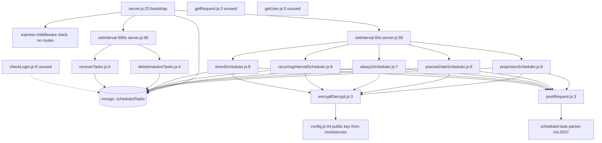

# scheduled_task_scheduler_ms

Repository: `apps/scheduled_task_scheduler_ms` (separate git repository, read through
`.kilo/repos.json`; not the control repo). All `file:line` citations are relative to that
repository root.

## 1. Summary

Timer worker that decides *when* a scheduled task is due and hands it to the parser service. Every
60 seconds it runs five selectors over the `scheduledTasks` collection (always, precise-date,
projection, interval, timed) and POSTs each due task to
`scheduled-task-parser-ms-cluster-ip-service:5037/api/scheduledtaskparser/parse` with an
RSA-encrypted init payload. Every 10 minutes it deletes inactive tasks and clears tasks stuck in
`processing`. It exposes an HTTP listener but registers no routes and publishes no ClusterIP
Service, so it is a worker that happens to open a port.

## 2. Stack and commands

- Runtime: Node.js, `engines.node` `>=12.0.0 <17.5.0` (`package.json:6-8`).
- Start: `npm start` → `node --max-old-space-size=8192 server.js` (`package.json:11`).
- Test: `npm test` → `echo "Error: no test specified" && exit 1` (`package.json:10`). No tests.
- Port: `PORT`, set to `5036` in k8s (`k8s/scheduled-task-scheduler-ms-deployment.yml:28-29`,
  `containerPort` at `:26`); read at `server.js:81`.
- Image: `inhouz/scheduled_task_scheduler_ms`, replicas `1`
  (`k8s/scheduled-task-scheduler-ms-deployment.yml:6,17`). Only a Deployment and a VPA ship;
  there is **no** ClusterIP Service manifest in `k8s/`.
- No cluster fork: this service runs one process (`server.js:25-83`).

## 3. Entry points

| Entry | Location | Started by |
|---|---|---|
| HTTP listener | `server.js:81` | `node server.js`; serves nothing (no route registered, `server.js:25-37` only installs middleware) |
| 60 s tick | `server.js:58-64` | `setInterval(60000)` at boot: `projectionScheduler`, `preciseDateScheduler`, `alwaysScheduler`, `recurringIntervalScheduler`, `timedScheduler` |
| 600 s tick | `server.js:66-69` | `setInterval(600000)` at boot: `deleteInactiveTasks`, `recoverTasks` |
| Mongo connect | `server.js:85-97`, called at `server.js:40` | bootstrap |
| Reconnect timer | `server.js:46-53` | mongoose `disconnected` event, 5 s |
| Graceful shutdown | `server.js:71-79` | `SIGINT`, `SIGTERM`, `uncaughtException` |
| Health probe script | `healthcheck.js:3-6` | Docker `HEALTHCHECK`, probes `localhost:$PORT/healthz` |
| Model registration | `server.js:19-23` | boot: 5 `require` calls |

`middlewares/login/checkLogin.js`, `middlewares/module/moduleAccessCheck.js` and
`middlewares/subdomain/*` are present but **wired to nothing** — no route uses them.

## 4. Module inventory

| Name | Location | Owns | Public API | Kind |
|---|---|---|---|---|
| bootstrap | `server.js:25-83` | express middleware stack, mongo lifecycle, both intervals | process entry | `effectful` |
| `connectMongo` | `server.js:85-97` | Mongo connection, `maxPoolSize: 1` | internal | `effectful` |
| `projectionScheduler` | `services/scheduledTask/projectionScheduler.js:8` | `scheduleType: 'projection'`, one-shot after `creationTimestamp + projectionHours` | `() => Promise<void>` | `effectful` |
| `preciseDateScheduler` | `services/scheduledTask/preciseDateScheduler.js:8` | `scheduleType: 'preciseDate'` where `preciseDateTimestamp <= now` | `() => Promise<void>` | `effectful` |
| `alwaysScheduler` | `services/scheduledTask/alwaysScheduler.js:7` | `recurrenceType: 'always'`, fires on every tick | `() => Promise<void>` | `effectful` |
| `recurringIntervalScheduler` | `services/scheduledTask/recurringIntervalScheduler.js:8` | `recurrenceType: 'interval'`, due at `lastTriggerTimestamp` (or creation) `+ intervalHours` | `() => Promise<void>` | `effectful` |
| `timedScheduler` | `services/scheduledTask/timedScheduler.js:8` | `recurrenceType: 'timed'`, window check per timezone entry in `timedSchedule` | `() => Promise<void>` | `effectful` |
| `deleteInactiveTasks` | `services/scheduledTask/deleteInavtiveTasks.js:4` | hard-deletes every `active: false` task | `() => Promise<void>` | `effectful` |
| `recoverTasks` | `services/scheduledTask/recoverTasks.js:5` | clears `processing: true` when `lastTriggerTimestamp` is older than 24 h | `() => Promise<void>` | `effectful` |
| `encryptDecrypt` | `utils/cryptography/encryptDecrypt.js:3` | RSA encrypt with the client public key | `(data, encrypt, publicEncrypt) => string` | `effectful` (crypto + config) |
| `postRequest` | `utils/requests/postRequest.js:3` | JSON POST with `node-fetch`, normalises error payloads | `(url, headers, data) => Promise<obj>` | `effectful` |
| `getRequest` | `utils/requests/getRequest.js:3` | JSON GET with `credentials: 'include'` | `(url) => Promise<obj>` | `effectful` |
| `deleteRequest` | `utils/requests/deleteRequest.js:3` | DELETE returning `{hasError}` on non-200 | `(url) => Promise<obj>` | `effectful` |
| `getUser` | `utils/user/getUser.js:5` | loads user/roles/permissions | `(userId) => user` | `effectful` |
| `isLoggedIn` | `middlewares/login/checkLogin.js:9` | cookie session decrypt and `req.user` attach | `(req,res,next)` | `effectful` (unused) |
| `moduleAccessCheck` | `middlewares/module/moduleAccessCheck.js:29` | flex-module access gate | `(req,res,next)` | `effectful` (unused) |
| `recursiveSanitizer` | `utils/sanitizer/recursiveSanitizer.js:19` | sanitises every string in a body | object map | `pure` (unused here) |

`getRequest`, `deleteRequest`, `getUser` and all middleware are unused by this service: the only
outbound helper on a live path is `postRequest`.

## 5. Side effects

| Effect | Location |
|---|---|
| MongoDB connect | `server.js:86-96` |
| `find` on `scheduledTasks` (projection) | `projectionScheduler.js:12-48` (aggregate) |
| `find` on `scheduledTasks` (preciseDate) | `preciseDateScheduler.js:12-26` |
| `find` on `scheduledTasks` (always) | `alwaysScheduler.js:10-21` |
| `aggregate` on `scheduledTasks` (interval) | `recurringIntervalScheduler.js:12-57` |
| `find` on `scheduledTasks` (timed) | `timedScheduler.js:11-24` |
| `deleteMany` on `scheduledTasks` | `deleteInavtiveTasks.js:7-9` |
| `updateMany` on `scheduledTasks` | `recoverTasks.js:9-22` |
| HTTP POST to parser | `projectionScheduler.js:74`, `preciseDateScheduler.js:52`, `alwaysScheduler.js:47`, `recurringIntervalScheduler.js:83`, `timedScheduler.js:145` — all to `${scheduledTaskParserMsUrl}/api/scheduledtaskparser/parse` |
| Network target | `http://scheduled-task-parser-ms-cluster-ip-service:5037` (`k8s/scheduled-task-scheduler-ms-deployment.yml:95-96`) |
| Filesystem read of secrets | `config/config.js:10` |
| Environment read | `config/config.js:20-56` |
| Clock | `preciseDateScheduler.js:10`, `projectionScheduler.js:10`, `recurringIntervalScheduler.js:10`, `recoverTasks.js:7`, `moment().add(1000,'seconds')` in every scheduler (e.g. `alwaysScheduler.js:41`) |
| Timezone | `moment-timezone` at `timedScheduler.js:45,86` |
| Crypto | `encryptDecrypt.js:10` (RSA public-key encrypt) |
| Logging | every scheduler `catch` block, e.g. `alwaysScheduler.js:23,57`; `server.js:44,47,55,82,95` |

No SendGrid, Stripe, OpenExchangeRates, Cloudflare, S3 or Redis call exists in the code, although
the deployment injects those env var names.

## 6. State and state transitions

The unit of state is one `scheduledTasks` document; the scheduler only ever flips `processing`
back to `false`. It never sets `processing: true` and never writes `lastTriggerTimestamp` — the
parser service owns both (inferred: no writer exists here).

| From | Trigger | Guard | To |
|---|---|---|---|
| new task | created by another service | `active=true, processing=false, paused=false` | selectable by a scheduler |
| selectable | any of the five schedulers matches | task shape matches that scheduler's filter | POST sent to parser; document unchanged by this service |
| dispatched | parser accepts | parser sets `processing=true` (external) | `processing=true` |
| `processing=true` | parser finishes | parser clears the flag and advances `lastTriggerTimestamp` (external) | selectable again |
| `processing=true` | `recoverTasks` every 10 min | `active=true` **and** `lastTriggerTimestamp <= now-24h` | `processing=false` |
| any | `paused=true` | — | excluded from every scheduler |
| `active=false` | `deleteInactiveTasks` every 10 min | `active=false` | document hard-deleted |
| `active=true` | `active` set false elsewhere | — | `active=false` |

```mermaid
stateDiagram-v2
  [*] --> Active: created (active=true, processing=false)
  Active --> Processing: scheduler POSTs; parser sets processing=true
  Processing --> Active: parser clears processing, sets lastTriggerTimestamp
  Processing --> Active: recoverTasks after 24h stale
  Active --> Paused: paused=true
  Paused --> Active: paused=false
  Active --> Inactive: active=false
  Paused --> Inactive: active=false
  Inactive --> [*]: deleteInactiveTasks (hard delete)
```



There is no explicit `archived` handling: `archived` exists on the schema
(`model/scheduledTask/scheduledTask.js:54-57`) but no scheduler filters on it, so an archived task
with `active=true` is still dispatched.

## 7. Data

| Model | Collection (env → value) | Key fields | Rules |
|---|---|---|---|
| `model/scheduledTask/scheduledTask.js:5` | `SCHEDULED_TASK_MODEL` → `scheduledTasks` | `taskName`, `environment`, `active`, `scheduledTaskId`, `isRecurrent`, `recurrenceType`, `scheduleType`, `projectionHours`, `preciseDate`, `preciseDateTimezone`, `preciseDateTimestamp`, `lastTriggerTimestamp`, `intervalHours`, `timedSchedule[]`, `companyId`, `functionId`, `functionIds[]`, `functionData`, `creationTimestamp`, `processing`, `paused`, `archived` | `taskName`, `environment`, `scheduledTaskId`, `companyId`, `functionId`, `functionData` are `required`; `environment` enum `development/test/production`; `scheduleType` enum `projection/preciseDate/''`; `isRecurrent`/`active`/`processing`/`paused`/`archived` default booleans; `strict` + `useNestedStrict` (`:79-83`) |
| `model/scheduledTask/scheduledTaskLog.js:5` | `SCHEDULED_TASK_LOG_MODEL` → `scheduledTaskLogs` | same shape as the task, but `preciseDate` is `{}` (`:33`) | same required/enums; registered at `server.js:23` but **never read or written** by this repository (`grep` finds only `config.js:42` and `server.js:23`) |
| `model/company/company.js:5` | `COMPANY_MODEL` → `company` | company record | shared identity schema, unused here |
| `model/user/user.js:6` | `USER_MODEL` → `User` | user record | shared identity schema, unused here |
| `model/user/useRoles.js:6` | `USER_ROLES_MODEL` → `userRoles` | user↔role mapping | shared identity schema, unused here |

Index: one compound index over 15 fields including `active`, `processing`, `paused`,
`recurrenceType`, `scheduleType`, `preciseDateTimestamp` (`model/scheduledTask/scheduledTask.js:85-92`).

Shared-collection coupling — the part not visible from this repo:

- `scheduledTasks` is **written by another service** (task CRUD lives outside this repository) and
  read/written here. Its write path is not in this repo.
- `scheduledTaskLogs` is presumably written by the parser service; nothing here touches it.
- `User`, `company`, `userRoles`, `roles`, `permissions`, `session`, `sessionValidator`,
  `authenticationLogs` are the shared identity collections every Inhouz service reads; this
  service only `require`s the models (`server.js:19-21`) and never queries them.
- The deployment injects ~40 more model-name env vars (subscribers, subscriptions, payments,
  exchange-rate cache, flex, version tracker) that no code in this repository reads
  (`k8s/scheduled-task-scheduler-ms-deployment.yml:66-112` and beyond).

## 8. Public interfaces

No inbound interface. No routes are registered (`server.js:25-37` installs only `cors`,
`body-parser`, `hpp`, `helmet`, `cookieParser`), and there is no Service manifest, so nothing in
the cluster can address the listener on 5036.

Outbound, the only call is:

```
POST {SCHEDULED_TASK_PARSER_MS_URL}/api/scheduledtaskparser/parse
Content-Type: application/json
body: {
  _id: "<task id>",          // spread from the projected doc, plus:
  encryptedData: "<base64>"  // RSA-public-key encrypt of:
                             // { payload: {_id, init:true}, expirationTimestamp: now+1000s }
}
```

Built at `alwaysScheduler.js:35-54` (identical block in the other four: `preciseDateScheduler.js:40`,
`projectionScheduler.js:62`, `recurringIntervalScheduler.js:71`, `timedScheduler.js:133`).
`init: true` is the only payload field the scheduler sets.

Response handling: `postRequest` returns `{hasError, errorPayload, errorMessage}` on non-200 or a
JSON `error` body, otherwise the parsed JSON (`utils/requests/postRequest.js:13-53`). **No caller
inspects the return value** — every scheduler discards it.

## 9. Configuration

Names only, no values.

- Secrets from files under `SECRETS_PATH` (default `/mnt/secrets`) with env fallback:
  `sendgridapikey`/`SENDGRID_API_KEY`, `sessionsecret`/`SESSION_SECRET`,
  `mongourl`/`MONGO_URL`, `clientsecretkey`/`CLIENT_SECRET_KEY`,
  `clientpublickey`/`CLIENT_PUBLIC_KEY` (`config/config.js:5-15,25,28-29,39,44-55`).
- Referenced by code: `SCHEDULED_TASK_MODEL`, `SCHEDULED_TASK_LOG_MODEL`,
  `SCHEDULED_TASK_PARSER_MS_URL` (`config/config.js:41-43`); `PORT` (`server.js:81`);
  `NODE_ENV` (in the unused login middleware); `USER_MODEL`, `COMPANY_MODEL`, `ROLE_MODEL`,
  `PERMISSION_MODEL`, `USER_ROLES_MODEL`, `SESSION_MODEL`, `SESSION_VALIDATOR_MODEL`,
  `AUTH_LOG_MODEL`, `COOKIE_DOMAIN`, `SMPL_EMAIL`, `FLEX_FORM_FILE_MODEL`, `FLEX_MODULE_MODEL`,
  `FLEX_COLLECTION_MODEL`, `FORM_MODEL`, `DATA_RULE_EXECUTION_RESULT_MODEL`
  (`config/config.js:21-40`).
- Injected but unread: `STRIPE_API_KEY`, `OPEN_EXCHANGE_RATES_API_KEY`,
  `OPEN_EXCHANGE_RATES_BASE_URL`, `IP_LOCATION_FINDER_URL`, `PAYMENT_MS_URL`,
  `INHOUZ_FROM_EMAIL`, `COOKIE_NAME`, `CHURN_TRACKER_MODEL`, `CONTACTS_MODEL`,
  `CUSTOMERS_MODEL`, `EXCHANGE_RATE_CACHE_MODEL`, `FLEX_API_MODEL`, `INHOUZ_APP_MODEL`,
  `IP_ADDRESS_LOCATION_MODEL`, `PAYMENT_CHARGE_MODEL`, `PAYMENT_INTENT_MODEL`,
  `PAYMENT_METHOD_MODEL`, `PAYOUT_ACCOUNT_MODEL`, `SERVICE_DISCOUNT_MODEL`,
  `SUBSCRIBED_PACKAGE_MODEL`, `SUBSCRIBER_*`, `SUBSCRIPTION_*`, `VERSION_TRACKER_MODEL`
  (`k8s/scheduled-task-scheduler-ms-deployment.yml`).

## 10. Dependencies

Direct, from `package.json:15+`:

- `mongoose` — all reads/writes to `scheduledTasks`.
- `node-fetch` — the POST to the parser (`utils/requests/postRequest.js:1`).
- `moment`, `moment-timezone` — due-date arithmetic and the per-timezone hour check
  (`timedScheduler.js:45,86`).
- `node-rsa` — the `encryptedData` payload (`config/config.js:1,44-55`).
- `express`, `body-parser`, `cookie-parser`, `cors`, `hpp`, `helmet` — an HTTP stack with no
  routes. Present but functionally unused.
- `dotenv` — `.env` load (`server.js:1`).
- `lodash`, `sanitizer`, `validator`, `bcryptjs`, `cryptr`, `express-session`, `connect-mongo`,
  `crypto-js`, `request-ip`, `shortid`, `shrink-string`, `@sendgrid/mail` — template baggage;
  `cryptr` and `sanitizer` are only reached from the unused middleware.
- Node built-ins `fs`, `path`, `os`, `http` — secret files, the probe script.

## 11. Testing

No tests. `npm test` is the create-package stub and exits 1 (`package.json:10`). No fixtures, no
mocks, no integration harness. The five due-date selectors, especially `timedScheduler`'s
wraparound hour maths (`timedScheduler.js:39-130`), are completely unverified by automated tests.

## 12. Known issues and risks

- **The service has no addressable interface.** It listens on `PORT` (`server.js:81`) but registers
  no route and ships no Service manifest; any client hitting 5036 gets a 404 from Express.
  `healthcheck.js:7` probes `/healthz`, which does not exist — a Docker `HEALTHCHECK` using this
  script would mark the container unhealthy.
- **No retry, no backoff, no result inspection.** Every scheduler fires `postRequest(...)` without
  `await` and without reading the result (`alwaysScheduler.js:47`, `preciseDateScheduler.js:52`,
  `projectionScheduler.js:74`, `recurringIntervalScheduler.js:83`, `timedScheduler.js:145`). If the
  parser is down, an `always` task is re-POSTed every 60 s forever, and a `preciseDate` task every
  60 s after its due time. There is no dead-letter, no failed-attempt counter, no throttle.
- **Dispatch is not atomic.** The schedulers read `processing: false` and POST; nothing here marks
  the task `processing` before the call. Two replicas, or a slow parser, would double-fire. The
  guard depends entirely on the parser setting `processing: true` (external, unverified). With
  `replicas: 1` (`k8s/...deployment.yml:6`) the duplicate risk is currently a slow-parser race, not
  a replica race.
- **`deleteInactiveTasks` deletes hard and unscoped.** `deleteMany({active:false})`
  (`deleteInavtiveTasks.js:7-9`) removes every inactive task in the shared `scheduledTasks`
  collection, across all companies and environments. Its promise is not awaited (no `await`, no
  `.then` on the outer call) and the inner `.catch` returns `{deletedCount: 0}`
  (`deleteInavtiveTasks.js:10-12`), so a failure is silent.
- **`recoverTasks` can miss stuck tasks.** The filter requires `lastTriggerTimestamp <= now-24h`
  (`recoverTasks.js:13-15`). A task that was set `processing: true` before it ever ran has no
  `lastTriggerTimestamp`, so it is never recovered and is stuck forever.
- **`recoverTasks` also un-awaited**, same silent-failure pattern (`recoverTasks.js:9-26`).
- **`archived` is not filtered.** `archived` is on the schema
  (`model/scheduledTask/scheduledTask.js:54-57`) but no scheduler filter includes it, so an
  archived task that is still `active: true` keeps firing.
- **Copy-paste log label.** `timedScheduler.js:156` logs
  `'/alwaysScheduler catch block error'`, so timed-scheduler failures are indistinguishable from
  always-scheduler failures in the logs.
- **Crypto failure falls back to plaintext.** `encryptDecrypt` returns the input string in its
  catch block (`utils/cryptography/encryptDecrypt.js:18-21`), so a bad RSA key puts clear JSON into
  `encryptedData` instead of failing the dispatch (`alwaysScheduler.js:35-45` and the same block in
  the other four schedulers).
- **Unused imports.** `moment-timezone` is required but never used in `projectionScheduler.js:4`,
  `preciseDateScheduler.js:4`, `recurringIntervalScheduler.js:4`; `moment` is unused in
  `recoverTasks.js:3` beyond the timestamp line.
- **Overlapping ticks.** The five 60 s schedulers are started without `await`
  (`server.js:58-64`); if one tick takes longer than 60 s the next interval starts on top of it.
- **`timedScheduler` hour maths is opaque.** The wraparound block
  (`timedScheduler.js:47-84`) mutates `endhour`/`adjustedHour` in ways that are hard to verify, and
  `startHour > hour` comparisons mix a 0-23 hour with a possibly >24 `starthour`.
- **Dead auth surface.** `middlewares/login/checkLogin.js` and `middlewares/module/moduleAccessCheck.js`
  are shipped but unreachable; they still load models and crypto at require time.
- **`scheduledTaskLogs` is dead.** The model is registered (`server.js:23`) and never used.
- **Node engine ceiling.** `engines.node` `<17.5.0` (`package.json:7`) blocks current LTS images
  unless the field is ignored at build time.

No credential was found embedded in a source file in this repository. Every secret is read from
`/mnt/secrets` or an env var (`config/config.js:5-15`).

## 13. Module map



## 14. Open questions

- Who sets `processing: true` and advances `lastTriggerTimestamp`? The parser service is the only
  candidate; this repository never writes either field.
- Is the HTTP listener intentional at all? No route and no Service manifest exist; the port may be
  a template leftover.
- Should `deleteInactiveTasks` scope the delete by `companyId`/`environment`? The current code
  deletes globally.
- Should `recoverTasks` cover tasks with no `lastTriggerTimestamp` (e.g. use `createdAt` as a
  fallback)? Today they are unrecoverable.
- Is `scheduledTaskLogs` written by the parser, or is it abandoned? Nothing here writes it.
- Why does the service require the identity models (`server.js:19-21`) and ship login middleware it
  never mounts? Template inheritance is the likely answer; unchecked.

Skipped: `utils/user/getUser.js`, `middlewares/*`, `model/user/*`, `model/company/*` were read only
by line reference because they are unreachable from the live path and are documented in the
identity-service handovers. `utils/sanitizer/recursiveSanitizer.js` and
`utils/requests/getRequest.js` / `deleteRequest.js` were shape-checked only. No Dockerfile read.
