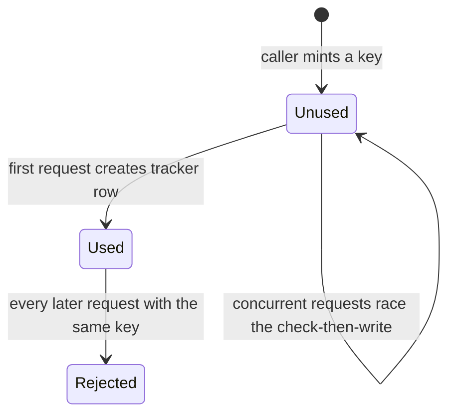
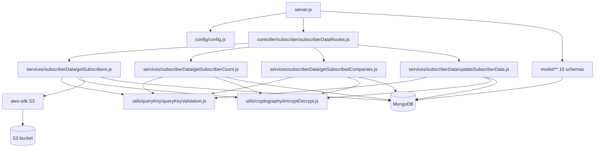

# subscriber_data_function_ms

Repository: `apps/subscriber_data_function_ms` — a separate git repository under `apps/` in the
control repo `kilo_inhouz_ai`. Every `file:line` below is relative to that service repo root.

## 1. Summary

A read-mostly data-access function for the subscription platform. Other services call it through
four encrypted POST endpoints to list subscribers, count subscribers, query which tenants a
company is subscribed to, and patch a subscriber profile. Every call is authorised by a single-use
`queryKey` recorded in `queryKeyTracker`, not by a user session. It joins `subscriptions` to
`subscribers` with a Mongo aggregation, strips secrets from the result, and signs S3 URLs for
profile images. It writes only two things: the query-key tracker row and the subscriber update-log
row. The code is a copy of the `micro_service_template` scaffold (`package.json:2`), and most of
the copied model and middleware files are not used.

## 2. Stack and commands

- Runtime: Node.js, `engines` `>=12.0.0 <17.5.0` (`package.json:5-7`). Express 4, Mongoose 7,
  `cluster` module, AWS SDK v2.
- Scripts (`package.json:9-12`):
  - `npm start` → `node server.js`
  - `npm test` → `echo "Error: no test specified" && exit 1` (no tests exist)
- Listens on `process.env.PORT` (`server.js:87`); the k8s service is
  `subscriber-data-function-ms-cluster-ip-service` on port 5055
  (`k8s/subscription-metrics-ms-cluster-ip-service.yml:4,9-11`).
- Image `inhouz/subscriber_data_function_ms`, replicas `1`
  (`k8s/subscription-metrics-ms-deployment.yml:6,17`).
- The k8s manifest **file names** say `subscription-metrics-ms`, the service name inside says
  `subscriber-data-function-ms`. See §12.

## 3. Entry points

| Entry point | `file:line` | How it is started |
|---|---|---|
| HTTP server listen | `server.js:87` | `npm start`; `PORT` from k8s env |
| Cluster master / worker fork | `server.js:24-41` | Automatic on boot; CPU-count workers in production, 1 otherwise (`server.js:25`) |
| Route registration | `controller/subscriber/subscriberDataRoutes.js:6-11` | Called from `server.js:57` |
| `POST /api/subscriberdatafunction/getsubscribers` | `controller/subscriber/subscriberDataRoutes.js:7` | `services/subscriberData/getSubscribers.js` |
| `POST /api/subscriberdatafunction/getsubscribercount` | `controller/subscriber/subscriberDataRoutes.js:8` | `services/subscriberData/getSubscriberCount.js` |
| `POST /api/subscriberdatafunction/querysubscribedtenant` | `controller/subscriber/subscriberDataRoutes.js:9` | `services/subscriberData/getSubscribedCompanies.js` |
| `POST /api/subscriberdatafunction/updatesubscriberdata` | `controller/subscriber/subscriberDataRoutes.js:10` | `services/subscriberData/updateSubscriberData.js` |
| Mongo connect | `server.js:92-104` | At worker start (`server.js:60`) and 5 s after a disconnect (`server.js:68-72`) |
| Health probe | `healthcheck.js:1-21` | Container healthcheck; calls `/healthz` on `PORT` |

No middleware is mounted on any route (`subscriberDataRoutes.js:7-10`). There is no cron, no
queue consumer and no websocket server.

## 4. Module inventory

| Name | `file:line` | Responsibility | Public API | Kind |
|---|---|---|---|---|
| Boot / cluster supervisor | `server.js:1-104` | Registers 10 models, forks workers, mounts routes, connects Mongo | process entry | `effectful` |
| `connectMongo()` | `server.js:92` | Opens Mongoose with `maxPoolSize: 1` | internal | `effectful` |
| `config()` factory | `config/config.js:18-58` | Reads env and secret files, caches for the process | `module.exports()` | `effectful` |
| `readSecret()` | `config/config.js:5-15` | Reads `/mnt/secrets/<name>`, falls back to env | internal | `effectful` |
| `subscriberDataRoutes(app)` | `controller/subscriber/subscriberDataRoutes.js:6` | Registers the four POST routes | `(app)` | `effectful` |
| `getSubscribers` | `services/subscriberData/getSubscribers.js:9` | Aggregates subscriptions + subscribers, signs S3 image URLs | Express handler | `effectful` |
| `getSubscriberCount` | `services/subscriberData/getSubscriberCount.js:7` | Counts subscribers for an asset/company | Express handler | `effectful` |
| `getSubscribedCompanies` | `services/subscriberData/getSubscribedCompanies.js:10` | Lists tenants/companies subscribed to an asset | Express handler | `effectful` |
| `updateSubscriberData` | `services/subscriberData/updateSubscriberData.js:11` | Patches a subscriber profile with a field denylist and logs the change | Express handler | `effectful` |
| `queryKeyValidation` | `utils/queryKey/queryKeyValidation.js:4` | Rejects an already-used key, then records it | `async (key)` | `effectful` |
| `encryptDecrypt` | `utils/cryptography/encryptDecrypt.js:3` | RSA decrypt of the request payload | `(data, encrypt, publicEncrypt)` | `effectful` (crypto, logs) |
| `recursiveSanitizer` | `utils/sanitizer/recursiveSanitizer.js` | Sanitizes every string in the body | `(body, sanitizer)` | `pure` |
| `getUser` | `utils/user/getUser.js:18` | Loads user, roles and permissions; not mounted | `(userId)` | `effectful` |
| `checkLogin` | `middlewares/login/checkLogin.js:9` | Session + CSRF middleware; not mounted | Express middleware | `effectful` |
| `moduleAccessCheck` | `middlewares/module/moduleAccessCheck.js` | Module entitlement; not mounted | Express middleware | `effectful` |
| subdomain middleware | `middlewares/subdomain/` | Subdomain handling; not mounted | Express middleware | unclear, unused |
| 10 model modules | `model/**/*.js` | Schemas; 10 required at `server.js:13-22` | `mongoose.model(...)` | `effectful` |

## 5. Side effects

| Effect | Where | `file:line` |
|---|---|---|
| MongoDB connect | boot | `server.js:92-104` |
| `queryKeyTracker` read | `getSubscribers` | `getSubscribers.js:88-91` |
| `queryKeyTracker` write (fire-and-forget) | `getSubscribers` | `getSubscribers.js:109-115` |
| `queryKeyTracker` read + write | `queryKeyValidation` | `utils/queryKey/queryKeyValidation.js:18,44` |
| `subscriptions` aggregate | `getSubscribers` | `getSubscribers.js:320-393` |
| `subscribers` update | `updateSubscriberData` | `updateSubscriberData.js:88-98` |
| `subscribers` read | `updateSubscriberData` | `updateSubscriberData.js:113-118` |
| `subscriberDataUpdateLogs` insert (fire-and-forget) | `updateSubscriberData` | `updateSubscriberData.js:126-133` |
| S3 presigned URL generation | `getSubscribers` | `getSubscribers.js:389-391,417-427` |
| AWS credentials from mounted secrets | config | `config/config.js:49-51` |
| Clock | payload expiry, tracker timestamp | `getSubscribers.js:29,116`; `queryKeyValidation.js:43` |
| Filesystem read of mounted secrets | config | `config/config.js:10` |
| Environment read | config | `config/config.js:21-52` |
| Logging | `console.log` on every error path | `getSubscribers.js:92,112,442`; `updateSubscriberData.js:100,120,135,142` |
| Cluster worker restart | boot | `server.js:30-41` |

There are **no outgoing HTTP calls** to other services. The `SUBSCRIPTION_METRICS_MS_URL` env var
is set in the deployment (`k8s/subscription-metrics-ms-deployment.yml:147`) but nothing in the code
reads it.

## 6. State and state transitions

The service has no business state machine. Its only state writes are the query-key tracker and the
update log.

`queryKeyTracker` acts as a single-use token ledger:

| State | Condition | Action |
|---|---|---|
| Unused key | `findOne({key})` returns null (`queryKeyValidation.js:18-33`) | `create({key, timestamp})` (`:44`) |
| Used key | `findOne` returns a document with `_id` (`:35-41`) | 401 `Access token rejected.` |
| Lookup failed | `.catch` returns `{error:true}` (`:27-33`) | 500 `Failed to validate token` |

There is no TTL on the tracker collection (`model/queryTracker/queryKeyTracker.js:5-21`), so `Used`
is terminal and the collection only grows.

## 7. Data

| Env var | Collection | Schema | Key fields / rules |
|---|---|---|---|
| `SUBSCRIBER_MODEL` | `subscribers` | `model/subscription/subscriber.js:6` | `email` required + `validator.isEmail`; `companyId`, `assetOwnerCompanyId` required + indexed; `subscriberType` enum `internal/external`; `active` default true; `subscribedAssetIds[]`; `strict:false` (arbitrary extra fields persist) |
| `SUBSCRIPTION_MODEL` | `subscriptions` | `model/subscription/subscription.js:6` | joined to `subscribers` in the aggregation (`getSubscribers.js:320-393`) |
| `SUBSCRIBER_DATA_UPDATE_LOG_MODEL` | `subscriberDataUpdateLogs` | `model/subscription/subscriberDataUpdateLog.js:6` | `email`, `companyId`, `assetOwnerCompanyId`, `assetId`, `data`, `timestamp` |
| `QUERY_KEY_TRACKER_MODEL` | `queryKeyTracker` | `model/queryTracker/queryKeyTracker.js:5` | `key` required, **not unique**; compound non-unique index `key+timestamp` (`:19-21`); no TTL |
| `COMPANY_MODEL` | `company` | `model/company/company.js:5` | company/tenant records |
| `SESSION_MODEL` | `session` | `model/session/session.js:5` | unused by mounted routes |
| `USER_MODEL`, `USER_ROLES_MODEL`, `ROLE_MODEL`, `PERMISSION_MODEL` | `User`, `userRoles`, `roles`, `permissions` | `model/user/*.js`, `model/rolesAndPermissions/*.js` | unused by mounted routes |
| `AUTH_LOG_MODEL`, `VERSION_TRACKER_MODEL`, `PAYOUT_ACCOUNT_MODEL`, ... | env-declared only | no schema in repo | set in k8s, unused |

**Shared-collection coupling.** `subscribers`, `subscriptions` and `company` are the platform-wide
collections also written by `subscription_ms`, `subscription_migration_parser_ms`,
`subscription_migration_scheduler_ms` and read by `subscriber_data_function_ms`. This service is
the only writer of `subscriberDataUpdateLogs` and `queryKeyTracker` that appears in this repo. A
change to the subscriber field denylist (`updateSubscriberData.js:74-79`) directly changes what
every consumer of `subscribers` sees.

## 8. Public interfaces

All four routes are `POST`, take `{encryptedPayload: string}` where the RSA payload is
`{payload: {...}, expirationTimestamp: number}`, and reject an expired or missing payload with 400
(`getSubscribers.js:18-42`). `recursiveSanitizer` runs on the body first.

| Route | Payload fields | Response |
|---|---|---|
| `getsubscribers` | `companyId, functionType ('getSubscribers'\|'enrichSubscriberData'), queryKey, skip, limit, subscriberType, assetId, assetType, environment, activeOnly, tenantId`; body may also carry `emails[]` for `enrichSubscriberData` (`getSubscribers.js:44-82`) | `{subscribers: [...]}` with `passwordHash`, `encryptedApiKey`, `key`, `imageFileKey`, `_id` stripped and `imageUrl` added (`getSubscribers.js:394-439`) |
| `getsubscribercount` | `companyId, functionType ('getSubscriberCount'), queryKey, subscriberType, assetId, assetType, environment, activeOnly, tenantId` (`getSubscriberCount.js:41-45`) | count payload (same encrypted envelope) |
| `querysubscribedtenant` | `tenantId, environment, status, tenantName, assetOwnerCompanyId, signupStartDate, signupEndDate, sort, countOnly, assetId, queryKey, skip, limit` (`getSubscribedCompanies.js:41-49`) | tenant list or count |
| `updatesubscriberdata` | `subscriberEmail, assetOwnerCompanyId, assetId, userData{}, queryKey` (`updateSubscriberData.js:45-48`) | `{success:true}` or `{error:{message}}` |

Auth semantics: a missing or malformed field set returns **401 `Access denied`**
(`getSubscribers.js:52-64`), a reused `queryKey` returns 401 `Access token rejected.`
(`queryKeyValidation.js:35-41`).

## 9. Configuration

Env var names only.

- Secrets (file under `SECRETS_PATH`, fallback env): `SESSION_SECRET`, `MONGO_URL`,
  `SENDGRID_API_KEY`, `STRIPE_API_KEY`, `S3_ACCESS_KEY_ID`, `S3_SECRET_KEY`, `S3_BUCKET_NAME`,
  `CLIENT_SECRET_KEY`, `CLIENT_PUBLIC_KEY` (`config/config.js:5-15,25-29,49-51`).
- `SECRETS_PATH`, `PORT`, `NODE_ENV` (`config/config.js:6`; `server.js:25,87`;
  `middlewares/login/checkLogin.js:129`).
- Model keys: `USER_MODEL`, `COMPANY_MODEL`, `ROLE_MODEL`, `PERMISSION_MODEL`,
  `USER_ROLES_MODEL`, `SESSION_MODEL`, `SESSION_VALIDATOR_MODEL`, `AUTH_LOG_MODEL`,
  `SUBSCRIBER_MODEL`, `SUBSCRIPTION_MODEL`, `SUBSCRIPTION_SERVICE_MODEL`,
  `QUERY_KEY_TRACKER_MODEL`, `SUBSCRIBER_DATA_UPDATE_LOG_MODEL`, `COOKIE_DOMAIN`
  (`config/config.js:30-52`).
- Other keys read but unused by mounted code: `FLEX_FORM_FILE_MODEL`, `FLEX_MODULE_MODEL`,
  `FLEX_COLLECTION_MODEL`, `FORM_MODEL`, `SMPL_EMAIL`, `DATA_RULE_EXECUTION_RESULT_MODEL`
  (`config/config.js:21-27`).
- Declared in k8s but never read: `SUBSCRIPTION_METRICS_MS_URL`, `SUBSCRIPTION_SERVICE_CHARGE_FEE`,
  `OPEN_EXCHANGE_RATES_API_KEY`, `OPEN_EXCHANGE_RATES_BASE_URL`, `INHOUZ_FROM_EMAIL`,
  `IP_LOCATION_FINDER_URL`, `SUBSCRIBER_CHANGE_LOG`, `SUBSCRIPTION_USAGE_LOG`,
  `SUBSCRIPTION_RECURRING_REVENUE_TRACKER_MODEL`, `DAILY_SUBSCRIPTION_RECURRING_REVENUE_TRACKER_MODEL`,
  `CHURN_TRACKER_MODEL`, `CONTACTS_MODEL`, `CUSTOMERS_MODEL`, `EXCHANGE_RATE_CACHE_MODEL`,
  `FLEX_API_MODEL`, `INHOUZ_APP_MODEL`, `IP_ADDRESS_LOCATION_MODEL`, `PAYOUT_ACCOUNT_MODEL`,
  `SERVICE_DISCOUNT_MODEL`, `SUBSCRIBED_PACKAGE_MODEL`, `SUBSCRIBER_ACTION_LOG_MODEL`,
  `SUBSCRIBER_MIGRATION_QUEUE_MODEL`, `SUBSCRIPTION_SESSION_MODEL`, `VERSION_TRACKER_MODEL`.
  These are leftovers from the shared template deployment.
- Hard-coded: CORS origin `/inhouz.localhost/` (`server.js:46`); 20 MB body limit
  (`server.js:52`); S3 URL expiry 86400 s (`getSubscribers.js:420,427`).

## 10. Dependencies

Direct dependencies from `package.json:14-40`:

| Package | Why |
|---|---|
| `express` | HTTP server and routing |
| `mongoose` | MongoDB ODM for all collections |
| `aws-sdk` | S3 presigned `getObject` URLs (`getSubscribers.js:6,389`) |
| `immutability-helper` | Required at `getSubscribers.js:7`; no visible `update(...)` call in the file |
| `body-parser` | JSON parsing, 20 MB |
| `cookie-parser` | Signed cookie parsing (`server.js:55`); no cookie is read by a mounted route |
| `cors` | Origin allow-list |
| `helmet`, `hpp` | Header hardening, parameter-pollution guard |
| `dotenv` | Local `.env` |
| `lodash` | `isEmpty` in the services |
| `moment` | Signup date window in `getSubscribedCompanies` |
| `sanitizer` | Input sanitization |
| `validator` | Email validation in `updateSubscriberData.js:55` and the schema |
| `node-rsa` | RSA keypair for `encryptDecrypt` |
| `cryptr`, `crypto-js`, `bcryptjs`, `connect-mongo`, `express-session`, `request-ip`, `shortid`, `@sendgrid/mail` | Present, not used by mounted code |

## 11. Testing

There are no tests. `npm test` exits 1 (`package.json:10`). No test directory, no fixtures. The
aggregation pipeline, the field denylist and the single-use-key race are unverified by any test.

## 12. Known issues and risks

1. **No k8s manifest name matches the service** — the files are
   `k8s/subscription-metrics-ms-*.yml` but the Service is
   `subscriber-data-function-ms-cluster-ip-service`
   (`k8s/subscription-metrics-ms-cluster-ip-service.yml:4`). A separate repo
   `apps/subscription_metrics_ms` exists, so these manifests are copy-paste leftovers from that
   service. Any tooling that maps repo name to manifest name will miss this one.
2. **`queryKey` uniqueness is not enforced by the database** — `model/queryTracker/queryKeyTracker.js:6-9`
   has no `unique:true`; `queryKeyValidation.js:18-44` does check-then-write. Two concurrent
   requests with the same key both pass.
3. **Tracker has no TTL** — `queryKeyTracker.js:5-21`; one row per accepted request, forever.
4. **Duplicate key-check logic** — `getSubscribers.js:88-115` repeats the same read-then-create
   that `queryKeyValidation.js:18-51` already implements. `getSubscriberCount` repeats it a third
   time at `getSubscriberCount.js:69-...`.
5. **Fire-and-forget writes** — `QueryKeyTrackerCollection.create` (`getSubscribers.js:109`) and
   `SubscriberDataUpdateLogCollection.create` (`updateSubscriberData.js:126`) are not awaited, so a
   write failure is logged but never returned.
6. **Mass assignment into `subscribers`** — `updateSubscriberData.js:72-97` applies `$set: userData`
   after deleting a denylist. The schema is `strict:false`
   (`model/subscription/subscriber.js:66-68`), so any other key, including a nested document, is
   written. A field added to the schema later is writable by default.
7. **Health probe has no route** — `healthcheck.js:7` requests `/healthz`; only the four
   `/api/subscriberdatafunction/*` routes exist (`subscriberDataRoutes.js:7-10`).
8. **All four routes are unauthenticated at the HTTP layer** — no middleware (`subscriberDataRoutes.js:7-10`);
   the only gate is the encrypted payload plus a replayable-until-used `queryKey`.
9. **Payload expiry is checked against the caller's clock** — `getSubscribers.js:29`, 30 s windows
   minted by callers; no server-side nonce store.
10. **`SUBSCRIPTION_METRICS_MS_URL` is set but unread** — if this service is the
    `subscription-metrics-ms` the manifest names, the outbound metric call is missing entirely.
11. **`maxPoolSize: 1`** — `server.js:100` on a service that runs aggregations.
12. **`immutability-helper` is required but unused** — `getSubscribers.js:7`; dead weight.
13. **Cluster forks on every CPU in production** — `server.js:25`; each worker opens its own
    single-connection pool, and each holds its own config cache (`config/config.js:17-19`).
14. **`console.log` is the only logging** — no structured logger; errors include raw driver
    messages (`getSubscribers.js:92,112`).

No credential is embedded in source. S3 and Mongo secrets come from `/mnt/secrets` or env
(`config/config.js:5-15,49-51`).

## 13. Module map

## 14. Open questions

- `package.json:2` still says `micro_service_template`, and 24 model keys are set in k8s while 10
  models exist. Is this repo still expected to grow into the template, or should the unused env
  vars be removed from the deployment?
- The manifest files are named `subscription-metrics-ms-*`, and a separate repo
  `apps/subscription_metrics_ms` exists. Confirm the metrics manifests are a copy-paste leftover
  and not a second deployment of this service under the metrics name.
- `getSubscribers` accepts `subscriberType` and `tenantId` in the payload (`getSubscribers.js:45-49`)
  but the aggregation path for them was not traced. Which fields actually filter the pipeline?
- The brief says the callers are `function_parser_ms` and `scheduled_task_function_parser_ms`. No
  caller is visible in this repo. Confirm both still call these routes and mint a fresh `queryKey`
  each time, since reuse is rejected.
- `SUBSCRIBER_CHANGE_LOG` is set in k8s but no schema exists. Is it a legacy collection name?
