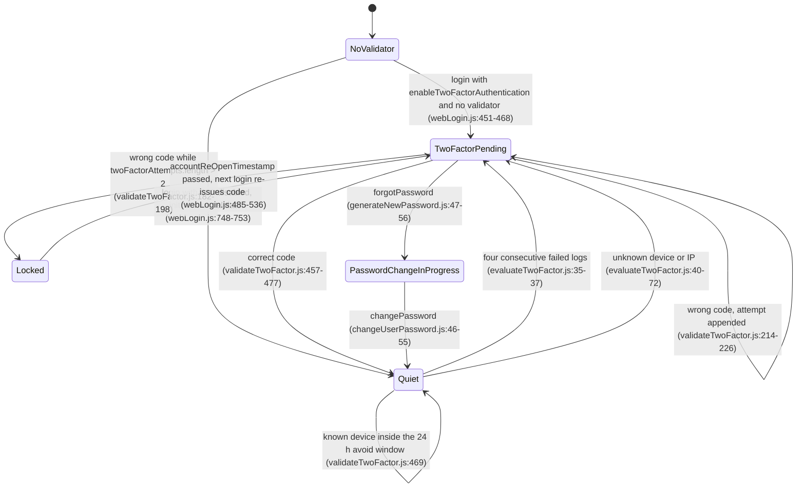
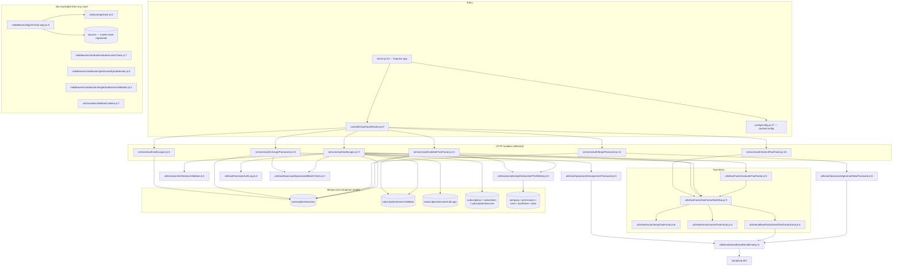

# subscription_authentication_ms

Every claim below carries a `file:line` citation from the repository root of
`apps/subscription_authentication_ms`. A row without one was dropped.

Mode: **full read** — all 49 JavaScript files, all 16 k8s/kustomize manifests, the Dockerfile, the
three shell scripts, both GitHub workflows and `.travis.yml` were read. Nothing was sampled.

**Repository:** the service is its own git repository, repo id `subscription_authentication_ms`,
registered at `apps/subscription_authentication_ms` in `.kilo/repos.json`. Checked-out branch is
`dev`, head `41ecb27` (`git -C apps/subscription_authentication_ms log --oneline -1`). Every path
in this file is relative to that repository.

## 1. Summary

`subscription_authentication_ms` is the subscriber login gateway for the Inhouz subscription
platform. It authenticates an external or internal subscriber against the `subscriptions` /
`subscribers` collections, issues an opaque `SUBSCR` session cookie backed by a
`subscriptionSessions` document, enforces optional two-factor email codes, and implements the
forgot-password and change-password flows. It does not issue or verify the platform's own
employee session: that is `subscription_authorization_ms`, which reads the same session collection.
The service is a single Express 4 app that forks a Node cluster worker per CPU, binds Mongo through
Mongoose, and sends mail through SendGrid. Public exposure is not declared in this repository: the
`/api/subscriptionauthentication` path is routed to cluster IP service port 5030 by the ingress
that lives in the `authentication_ms` repository (`authentication_ms/k8s/inhouz-ingress-service.yml:300-307`).

## 2. Stack and commands

| Item | Value | Source |
|---|---|---|
| Runtime | Node.js `>=12.0.0 <17.5.0` | `package.json:6-8` |
| Container base | `node:16.4-alpine` | `Dockerfile:1` |
| Framework | Express `^4.16.4` | `package.json:25` |
| Database driver | Mongoose `^7.4.0` | `package.json:31` |
| Package manager | npm — `RUN npm install`, no lockfile in the repo | `Dockerfile:7`, `.gitignore:3` |
| Start command | `npm run start` → `node server.js` | `package.json:11`, `Dockerfile:11` |
| Test command | `npm test` → prints `Error: no test specified` and exits 1 | `package.json:10` |
| Port | `PORT` env var, read directly at listen time | `server.js:88` |
| Port in Kubernetes | `5030` | `k8s/subscription-authentication-ms-deployment.yml:28-29` |
| Port in docker-compose | maps `5001:5001` but sets no `PORT`, so the app listens on an OS-assigned port | `docker-compose.yml:10-11`, `server.js:88` |
| ClusterIP service | `subscription-authentication-ms-cluster-ip-service` | `k8s/subscription-authentication-ms-cluster-ip-service.yml:4` |
| Health probe | none configured; `healthcheck.js` targets `/healthz`, which no route serves | `healthcheck.js:7`, `controller/auth/authRoutes.js:10-16` |

There is no build step, no transpile step, no linter and no formatter configuration in the
repository.

## 3. Entry points

### 3.1 The server process

| Entry point | file:line | How it is started |
|---|---|---|
| `server.js` — cluster master, forks one worker per CPU in production, one otherwise | `server.js:25-42` | `node server.js` (`package.json:11`), or `npm run start` in the container (`Dockerfile:11`) |
| Worker branch — builds the Express app, mounts middleware, registers routes, connects Mongo, listens | `server.js:43-91` | forked by the master at `server.js:28` |
| `connectMongo()` — retried on `disconnected` after 5 s | `server.js:93-104`, retry at `server.js:66-73` | called at `server.js:60` |
| `shutdownFunction` — closes Mongo on `SIGINT`, `SIGTERM`, `uncaughtException` | `server.js:77-86` | signal handlers |
| `healthcheck.js` — HTTP GET to `/healthz`, exits 0/1 | `healthcheck.js:7-19` | nothing invokes it: no `HEALTHCHECK` in `Dockerfile:1-11` and no k8s probe (`k8s/subscription-authentication-ms-deployment.yml:1-145`) |

### 3.2 HTTP surface

All routes are registered in one file and all are `POST` (`controller/auth/authRoutes.js:10-16`).
No route uses a middleware: the `require` on line 1 is imported and never referenced.

| Method | Path | Handler | file:line |
|---|---|---|---|
| POST | `/api/subscriptionauthentication/weblogin` | `webLogin` | `controller/auth/authRoutes.js:10` |
| POST | `/api/subscriptionauthentication/appviewerlogin` | `webLogin` (same handler) | `controller/auth/authRoutes.js:11` |
| POST | `/api/subscriptionauthentication/weblogout` | `webLogout` | `controller/auth/authRoutes.js:12` |
| POST | `/api/subscriptionauthentication/validatetwofactor` | `validateTwoFactor` | `controller/auth/authRoutes.js:13` |
| POST | `/api/subscriptionauthentication/resendtwofactor` | `resendTwoFactor` | `controller/auth/authRoutes.js:14` |
| POST | `/api/subscriptionauthentication/forgotpassword` | `forgotPassword` | `controller/auth/authRoutes.js:15` |
| POST | `/api/subscriptionauthentication/changepassword` | `changePassword` | `controller/auth/authRoutes.js:16` |

### 3.3 Non-entries

`deploy.sh` (`deploy.sh:1-15`), `build_ga.sh` (`build_ga.sh:1-74`), `build_ga_prod.sh` and the two
GitHub workflows (`.github/workflows/cicd-dev.yml:1-46`, `cicd-prod.yml:1-46`) are CI/deploy
entry points, not runtime entry points. There is no cron job, no queue consumer, no migration
script and no CLI in this repository.

## 4. Module inventory

`pure` = deterministic, no I/O and no state. `reactive` = reads or writes state. `effectful` =
touches Mongo, network, filesystem, env, clock, randomness or logging.

### 4.1 Bootstrap and configuration

| Module | file:line | Responsibility | Public API | Kind |
|---|---|---|---|---|
| `server.js` (worker branch) | `server.js:43-91` | Builds the app, mounts `cors`/`body-parser`/`hpp`/`helmet`/`cookie-parser`, registers routes, wires Mongo events and signals | process side effect only | effectful |
| cluster fork loop | `server.js:25-42` | Forks workers; restarts a dead worker | none | effectful |
| `connectMongo` | `server.js:93-104` | `mongoose.connect` with `maxPoolSize: 1`; the third argument is a bare `console.log`, not an error callback | none | effectful |
| `config()` | `config/config.js:17-56` | Builds and caches the config object once per process; reads secrets from files then env | the config object | effectful — filesystem + env, plus a module-level cache (`config/config.js:16-18`) |
| `readSecret` | `config/config.js:5-14` | Reads `<SECRETS_PATH>/<name>`, falls back to the env var, else `""` | `string` | effectful — filesystem, env |
| `NodeRsaClientPrivateKey` | `config/config.js:48-53` | RSA key built at config time from the `clientsecretkey` secret | NodeRSA instance | effectful — a bad or empty secret throws here, at require time |

### 4.2 HTTP handlers

| Module | file:line | Responsibility | Public API | Kind |
|---|---|---|---|---|
| `webLogin` | `services/auth/webLogin.js:17-819` | Decrypts the request envelope, resolves subscription → subscriber → service → validator, runs the two-factor branches, upserts the session, sets five cookies, writes the auth log | `(req, res)` | effectful — Mongo, clock, randomness, cookies, logging |
| `webLogout` | `services/auth/webLogout.js:6-106` | Deletes the session named by the `SUBSCR` cookie and clears five cookies | `(req, res)` | effectful |
| `validateTwoFactor` | `services/auth/validateTwoFactor.js:13-545` | Verifies the emailed code, locks after repeated failures, upserts the session, records approved IP and device | `(req, res)` | effectful |
| `resendTwoFactor` | `services/auth/resendTwoFactor.js:10-258` | Re-issues a code for an existing validator | `(req, res)` | effectful |
| `forgotPassword` | `services/auth/forgotPassword.js:12-362` | Generates a new password, refuses while a session is live, deletes sessions, emails the password | `(req, res)` | effectful |
| `changePassword` | `services/auth/changePassword.js:13-343` | Verifies the current password, refuses while a session is live, deletes sessions, writes the new hash | `(req, res)` | effectful |
| `webLogin copy.js` | `services/auth/webLogin copy.js:1-800` | An older copy of `webLogin`, not required by anything | none | dead code — effectful if it were called |

### 4.3 Two-factor domain

| Module | file:line | Responsibility | Public API | Kind |
|---|---|---|---|---|
| `twoFactorWorkflow` | `utils/twoFactor/twoFactorWorkflow.js:9-85` | Sets the code, sends the mail, re-reads the validator, returns the encrypted validator id | `async (userAccount)` → `{id, twoFactorRequired, success}` or `{error}` | effectful |
| `setupTwoFactor` | `utils/twoFactor/setupTwoFactor.js:6-64` | Upserts `twoFactorRequired`, a 4-digit token and a 10-minute expiry | `async (userAccount)` → `{success, twoFactorToken}` | effectful — randomness `utils/twoFactor/setupTwoFactor.js:14`, clock, Mongo |
| `cancelTwoFactor` | `utils/twoFactor/cancelTwoFactor.js:4-48` | Clears the two-factor flags | `async (userAccount)` → `{success}` | effectful — and broken, see §12.1 |
| `evaluateTwoFactor` | `utils/twoFactor/evaluateTwoFactor.js:6-101` | Decides whether the next login needs a code: four failed logs in a row, or an unknown device/IP | `async (userAccount, sessionValidator, req)` → `{twoFactorRequired}` | effectful — Mongo read, clock, request IP |
| `initSessionValidator` | `utils/session/initSessionValidator.js:5-66` | Upserts a validator with the current IP and device pre-approved | `async (userAccount, req)` → `{success}` | effectful |
| `sendTwoFactorEmail` | `utils/email/twoFactor/sendTwoFactorEmail.js:4-28` | Renders and sends the code mail from `noreply@inhouz.io` | `(userAccount, token)` → `{success}` | effectful — network |
| `twoFactorEmailTemplate` | `utils/email/twoFactor/twoFactorEmailTemplate.js:1-65` | HTML mail body | `(userAccount, token)` → `{success, emailTemplate}` | pure — string building only; its catch returns `{success: true}` with no template (`:64`) |

### 4.4 Session, password and profile

| Module | file:line | Responsibility | Public API | Kind |
|---|---|---|---|---|
| `sessionAuthLog` | `utils/auth/sessionAuthLog.js:4-22` | Appends one `subscriptionSessionAuthLogs` document | `async (params)` | effectful |
| `getSubscriberProfileData` | `utils/subscription/getSubscriberProfileData.js:5-209` | Assembles the profile the client receives, expands tier permissions, adds asset-owner branding | `async ({subscriber, subscription, subscriptionService, destination})` → profile or `{error}` | effectful |
| `getUser` | `utils/user/getUser.js:5-160` | Loads a `User`, joins `userRoles` → `roles` → `permissions`, strips `key` and `passwordHash` | `async (userId)` → user with `permissions` | effectful — dead in this service, no caller |
| `createEditByObject` | `utils/user/createEditByObject.js:1-23` | Builds an audit `editedBy` object | `(user, deployDate)` → object | pure — dead in this service |
| `passwordMatchCheck` | `utils/auth/password/passwordMatchCheck.js:3-12` | `bcrypt.compareSync` against `passwordHash` | `(userAccount, password)` → `boolean` | pure — CPU only, deterministic for a given hash and input |
| `changeUserPassword` | `utils/auth/password/changeUserPassword.js:6-80` | Writes the caller's password hash, clears `passwordChangeInProgress`, sends the confirmation mail | `async (userAccount, newPassword, validatorId, isInternalUser)` → `{success}` or `{error}` | effectful |
| `generateNewPassword` | `utils/auth/password/generateNewPassword.js:6-85` | Generates the new password, writes its hash, sets `passwordChangeInProgress: true`, emails it | `async (userAccount, validatorId, isInternalUser)` → `{success}` or `{error}` | effectful — randomness `:14`, Mongo, network |
| `setBaseCookies` | `utils/cookies/setBaseCookies.js:7-58` | Intended cookie bundle | `async (params)` | dead and broken — throws on an undefined `encryptedRefreshToken` (`:40`) |

### 4.5 Mail, crypto and sanitising

| Module | file:line | Responsibility | Public API | Kind |
|---|---|---|---|---|
| `sendEmail` | `utils/email/sendEmail/sendEmail.js:4-29` | Sets the SendGrid key and sends; `sgMail.send` is not awaited (`:23`), so it always reports success | `(to, from, subject, text, html)` → `{success}` | effectful |
| `sendNewPasswordEmail` | `utils/email/password/sendNewPasswordEmail.js:4-29` | Renders and sends the new-password mail | `(userAccount, password, isInternalUser)` → `{success}` | effectful |
| `sendPasswordResetSuccessEmail` | `utils/email/password/sendPasswordResetSuccessEmail.js:4-26` | Renders and sends the reset-confirmation mail | `(userAccount, isInternalUser)` → `{success}` | effectful |
| `newPasswordEmailTemplate` | `utils/email/password/newPasswordEmailTemplate.js:1-81` | HTML mail body | function → `{success, emailTemplate}` | pure |
| `passwordResetSuccessEmailTemplate` | `utils/email/password/passwordResetSuccessEmailTemplate.js:1-76` | HTML mail body | function → `{success, emailTemplate}` | pure |
| `encryptDecrypt` | `utils/cryptography/encryptDecrypt.js:3-17` | RSA `encryptPrivate` / `decrypt` with the cached key; on any failure it returns the input unchanged (`:13-16`) | `(data, encrypt=false)` → `string` | effectful — reads the cached key, logs on failure |
| `recursiveSanitizer` | `utils/sanitizer/recursiveSanitizer.js:3-17` | Walks a body and sanitises leaf strings | `(element, sanitizer)` → element | reactive — assigns an undeclared global `recursiveSanitizer` at `:3` and mutates its input |

### 4.6 Middleware and models

| Module | file:line | Responsibility | Public API | Kind |
|---|---|---|---|---|
| `checkLogin` | `middlewares/login/checkLogin.js:9-151` | Employee session check against the `session` collection, slides expiry 30 min, injects `req.user` | Express middleware | effectful — dead: not mounted, and its model is not registered |
| `moduleAccessCheck` | `middlewares/module/moduleAccessCheck.js:7-67` | Module-level access check | Express middleware | effectful — dead: not mounted, and `config.flexModuleModel` is never set by any deployment |
| `getOwnerBySubdomain` | `middlewares/subdomain/getOwnerBySubdomain.js:4-49` | Resolves the asset-owner company from the subdomain | Express middleware | effectful — dead: imported at `controller/auth/authRoutes.js:1`, never used |
| `singleSubdomainValidation` | `middlewares/subdomain/singleSubdomainValidation.js:1-25` | Compares `req.subdomains[0]` with `req.user.subDomain` | Express middleware | reactive — reads `req`, calls `next`; dead |
| 11 Mongoose models | `model/**/*.js` | Schema registration; each binds its model name from `config()` | Mongoose model | effectful — reads env, registers global model state |

Model files: `model/user/user.js:108`, `model/rolesAndPermissions/permissions.js:89`,
`model/rolesAndPermissions/roles.js:87`, `model/user/useRoles.js:51`,
`model/company/company.js:108`, `model/session/subscriptionSession.js:93`,
`model/session/subscriptionSessionValidator.js:89`,
`model/session/subscriptionSessionAuthLog.js:60`, `model/subscription/subscriber.js:74`,
`model/subscription/subscriptionService.js:443`, `model/subscription/subscription.js:215`.
A twelfth file, `model/session/session.js:28`, is never required by `server.js:13-23`.

## 5. Side effects

### 5.1 MongoDB

One connection, `maxPoolSize: 1`, per worker (`server.js:94-102`); the cluster forks one worker
per CPU in production (`server.js:26`), so the process pool is one connection per core.
Reconnect after 5 s on `disconnected` (`server.js:66-73`). All reads and writes go through
`mongoose.model(<name from config>)`.

| Collection | Read | Written | file:line |
|---|---|---|---|
| `subscriptionSessions` | yes | upsert, update, delete | `services/auth/webLogin.js:650-679`, `services/auth/webLogin.js:710-722`, `services/auth/validateTwoFactor.js:352-380`, `services/auth/webLogout.js:50-56` |
| `subscriptionSessionValidator` | yes | upsert, update | `services/auth/webLogin.js:373-387`, `utils/twoFactor/setupTwoFactor.js:16-45`, `utils/session/initSessionValidator.js:15-48` |
| `subscriptionSessionAuthLogs` | yes | insert | `utils/auth/sessionAuthLog.js:6-9`, read at `utils/twoFactor/evaluateTwoFactor.js:14-22` |
| `subscriptions` | yes | no | `services/auth/webLogin.js:126-136`, `services/auth/forgotPassword.js:102-107` |
| `subscribers` | yes | password hash only | `services/auth/webLogin.js:230-236`, `utils/auth/password/generateNewPassword.js:19-31` |
| `subscriptionServices` | yes | no | `services/auth/webLogin.js:312-320` |
| `company` | yes | no | `utils/subscription/getSubscriberProfileData.js:19-30`, `:126-142` |
| `permissions` | yes | no | `utils/subscription/getSubscriberProfileData.js:168-178` |
| `User` | yes | no | `utils/subscription/getSubscriberProfileData.js:73-79`, `utils/user/getUser.js:19-22` |
| `userRoles`, `roles` | yes | no | `utils/user/getUser.js:45-49`, `:85-91` |
| `session` | yes | update | `middlewares/login/checkLogin.js:24-28`, `:83-92` — dead path, model not registered |

### 5.2 Network

| Target | Purpose | file:line |
|---|---|---|
| SendGrid API | two-factor code, new password, reset confirmation | `utils/email/sendEmail/sendEmail.js:1`, `:6`, `:23` |
| No HTTP call to any other Inhouz service | no `axios`/`request`/`http` client in the dependency list (`package.json:15-37`) | — |

The k8s env var `authentication_MS_URL` is declared (`k8s/subscription-authentication-ms-deployment.yml:128-129`)
but nothing reads it, and there is no HTTP client dependency to use it with.

### 5.3 Filesystem, env, clock, randomness, logging

| Effect | file:line |
|---|---|
| Reads secret files from `SECRETS_PATH` (default `/mnt/secrets`) | `config/config.js:6-12` |
| Reads env vars for every model name and for `PORT`/`NODE_ENV` | `config/config.js:20-47`, `server.js:88` |
| `moment()` for every session, refresh, lock and code expiry | `services/auth/webLogin.js:624`, `:647`, `utils/twoFactor/setupTwoFactor.js:13` |
| `new Date().getTime()` for datestamps | `services/auth/webLogin.js:35`, `services/auth/validateTwoFactor.js:119` |
| `mongoose.Types.ObjectId().toHexString()` as CSRF token | `services/auth/webLogin.js:625` |
| `Math.random()` for the two-factor code and for the generated password | `utils/twoFactor/setupTwoFactor.js:14`, `utils/auth/password/generateNewPassword.js:14` |
| Cookies written: `SUBSCR`, `x-react`, `subSessionExpirationTimestamp`, `sessionExpirationTimestamp`, `refreshToken` | `services/auth/webLogin.js:756-795` |
| Cookies cleared on logout | `services/auth/webLogout.js:58-92` |
| `console.log` in every catch block, and a plaintext forgot-password log line | `services/auth/forgotPassword.js:56-61`, `:355` |

## 6. State and state transitions

Three state machines live in this service. Only the first two have guards in code.

### 6.1 Login session (`subscriptionSessions`)

| State | Meaning | Entered by | Guard |
|---|---|---|---|
| absent | no session document for (subscriber, service, tier, device) | logout deletes it (`services/auth/webLogout.js:50-56`), or it never existed | — |
| active | `expirationTimestamp > now` | upsert on successful login or code entry (`services/auth/webLogin.js:650-679`, `services/auth/validateTwoFactor.js:352-380`) | active subscriber, service `deployed` + `serviceIsActive`, valid password, two-factor satisfied |
| expired | `expirationTimestamp <= now` | time only; nothing deletes it | read path only |

The upsert key is `{subscriberEmail, companyId, assetOwnerCompanyId, subscriptionServiceId,
subscriptionServiceTierId, deviceId}` (`services/auth/webLogin.js:651-658`), so one document per
device per tier, not one per user. Session length is `sessionDurationMinutes || 60`
(`services/auth/webLogin.js:624`), sourced from `subscriptionServices.sessionDurationMinutes`
(`model/subscription/subscriptionService.js:433-436`).

### 6.2 Two-factor validator (`subscriptionSessionValidator`)

| Field | Values | Set at | Guard that reads it |
|---|---|---|---|
| `twoFactorRequired` | `true` / `false`, default `true` | `model/session/subscriptionSessionValidator.js:47-50` | `services/auth/validateTwoFactor.js:131-137`, `services/auth/webLogin.js:539` |
| `accountLocked` + `accountReOpenTimestamp` | lock for 10 minutes | `services/auth/validateTwoFactor.js:188-192` | `services/auth/webLogin.js:485-507`, `services/auth/validateTwoFactor.js:139-148` |
| `twoFactorAttempts` | array of `{timestamp, ipAddress}` | `services/auth/validateTwoFactor.js:219-224` | lock threshold at `:182` |
| `twoFactorToken` | 4 digits, 10-minute expiry | `utils/twoFactor/setupTwoFactor.js:13-14`, `:27-30` | `services/auth/validateTwoFactor.js:181` |
| `avoidTwoFactorTimestamp` | now + 24 h after a successful code | `services/auth/validateTwoFactor.js:469` | `utils/twoFactor/evaluateTwoFactor.js:47` |
| `approvedIpAddresses`, `approvedDeviceIdList` | appended, never trimmed | `services/auth/validateTwoFactor.js:442-454` | `utils/twoFactor/evaluateTwoFactor.js:40-68` |
| `passwordChangeInProgress` | `true` between forgot and change | `utils/auth/password/generateNewPassword.js:53` | `services/auth/webLogin.js:477-483` |

### 6.3 Subscription (read-only here)

The service reads `subscriptions.status` and `activeSubscriber`; it never writes them.
Guards: `destination === 'app'` requires `activeSubscriber` true and status not
`paused`/`cancelled` (`services/auth/webLogin.js:200-226`). The stored enum is
`active | paused | inRenewal | cancelled` (`model/subscription/subscription.js:195-199`).
`inRenewal` is not blocked by this guard.

## 7. Data

Eleven models are registered in `server.js:13-23`. The model name passed to
`mongoose.model(name, schema, name)` is the collection name, and it comes from an env var, so the
collection a service touches is a deployment concern, not a code constant.

| Model file | Env var | Collection (from the deployment) | Key fields and validation |
|---|---|---|---|
| `model/user/user.js:108` | `USER_MODEL` | `User` (`k8s/...deployment.yml:70-71`) | `email` unique + `validator.isEmail` (`:16-26`), `key` unique + required (`:32-36`), `passwordHash` required (`:65-68`), `active` required (`:69-74`) |
| `model/rolesAndPermissions/permissions.js:89` | `PERMISSION_MODEL` | `permissions` (`:74-75`) | `permissionName` required (`:7-10`), `companyId` required + indexed (`:14-18`); `createdBy.email` must be an email (`:41-47`) |
| `model/rolesAndPermissions/roles.js:87` | `ROLE_MODEL` | `roles` (`:68-69`) | `roleName` required (`:7-10`), `permissionIdList: [String]` (`:14`), `companyId` required + indexed (`:15-19`) |
| `model/user/useRoles.js:51` | `USER_ROLES_MODEL` | `userRoles` (`:76-77`) | `userId` unique (`:7-11`), `roleIdList: [String]` (`:17`) |
| `model/company/company.js:108` | `COMPANY_MODEL` | `company` (`:72-73`) | `companyType` enum of 8 values (`:10-18`), `subDomain` lowercased (`:19-22`), `status` enum `active/cancelled/paused` (`:57-61`), 8-field compound index (`:101-106`) |
| `model/session/subscriptionSession.js:93` | `SUBSCRIPTION_SESSION_MODEL` | `subscriptionSessions` (`:120-121`) | `subscriberType` enum `internal/external` (`:19-23`), `destination` enum `app/backOffice` (`:34-38`), `csrfToken`/`deviceId`/`encryptedRefreshToken` required (`:47-76`) |
| `model/session/subscriptionSessionValidator.js:89` | `SUBSCRIPTION_SESSION_VALIDATOR_MODEL` | `subscriptionSessionValidator` (`:86-87`) | `twoFactorRequired` default `true` (`:47-50`), `accountLocked` default `false` (`:52-55`), compound index `:82-87` |
| `model/session/subscriptionSessionAuthLog.js:60` | `SUBSCRIPTION_SESSION_AUTH_LOG_MODEL` | `subscriptionSessionAuthLogs` (`:100-101`) | `activity` enum `login/logout` (`:27-31`), `success` required + indexed (`:32-36`) |
| `model/subscription/subscriber.js:74` | `SUBSCRIBER_MODEL` | `subscribers` (`:88-89`) | `email` lowercased, trimmed, indexed, email-validated (`:17-29`), `subscriberType` enum (`:11-16`), `passwordHash` (`:67-69`), `active` default `true` (`:61-65`) |
| `model/subscription/subscriptionService.js:443` | `SUBSCRIPTION_SERVICE_MODEL` | `subscriptionServices` (`:90-91`) | `assetType` enum `api/view` (`:46-50`), `environment` enum (`:66-73`), `enableTwoFactorAuthentication` default `true` (`:96-99`), `twoFactorIntervalHours` default 24 (`:100-103`), `customPaymentTiers` sub-schema (`:104-240`), `sessionDurationMinutes` default 60 (`:433-436`) |
| `model/subscription/subscription.js:215` | `SUBSCRIPTION_MODEL` | `subscriptions` (`:134-135`) | `subscriptionType` enum `recurring/oneTime/payAsYouGo` (`:24-31`), `status` enum `active/paused/inRenewal/cancelled` (`:195-199`), `environment` required enum (`:117-121`), `createdDate` required (`:185-188`) |
| `model/session/session.js:28` | `SESSION_MODEL` | `session` (`:78-79`) | `ipAddress`, `userId`, `beginTimeStamp`, `expirationTimestamp` required (`:6-23`); **never registered** |

### 7.1 Collections shared with other services

The session models are the coupling point. Other repositories bind the same env var and therefore
the same collection, and their login middleware reads the document this service writes:

| Repository | Evidence |
|---|---|
| `account_termination_ms` | `account_termination_ms/config/config.js:50-53` |
| `subscription_settings_ms` | `subscription_settings_ms/config/config.js:39-41` |
| `subscription_ms` | `subscription_ms/middlewares/subscription/checkSubscriberLogin.js:26` |
| `inhouz_file_upload_ms` | `inhouz_file_upload_ms/middlewares/login/isSubscriberLoggedIn.js:25` |
| `subscription_signup_ms` | `subscription_signup_ms/middlewares/login/subscriptionCheckLogin.js:26` |
| `subscription_payment_ms` | `subscription_payment_ms/middlewares/login/checkLogin.js:25` |
| `subscription_migration_parser_ms` | `subscription_migration_parser_ms/middlewares/login/subscriptionCheckLogin.js:26` |
| `payment_gateway_ms` | `payment_gateway_ms/middlewares/login/subscriptionCheckLogin.js:23` |
| `late_payment_ms` | `late_payment_ms/middlewares/login/subscriptionCheckLogin.js:26` |
| `inhouz_pay_ms` | `inhouz_pay_ms/middlewares/subscription/checkSubscriberLogin.js:26` |
| `website_resource_ms` | `website_resource_ms/middlewares/login/subscriptionCheckLogin.js:23` |

Consequence: the `subscriptionSessions` schema here is a cross-repository contract. A change to
`csrfToken`, `expirationTimestamp` units or `encryptedSessionData` in this file breaks the login
check in eleven other repositories that hold their own copy of the schema.

`subscriptions`, `subscribers`, `subscriptionServices`, `company` and `User` are read here and
written by the signup, settings and renewal services, which are outside this cluster and were not
read for this file.

## 8. Public interfaces

All endpoints are `POST`, all take a single RSA-encrypted field `encryptedData` whose plaintext is
`{data: {...}, expirationTimestamp: <ms>}` (`services/auth/webLogin.js:36-52`), and all respond
with either a payload or `{error: {message}}`.

| Route | Request fields (after decrypt) | Success response | Error statuses | file:line |
|---|---|---|---|---|
| `/weblogin`, `/appviewerlogin` | `subscriberEmail`, `subscriberPassword`, `destination`, optional `assetOwnerCompanyId`, `environment`, `assetId`, `companyId`, `accountSettingsSlug` | `{success: true}` + 5 cookies, or `{id, twoFactorRequired: true}` | 400 missing/expired envelope, 401 validation, 403 inactive subscription or subscriber, 404 not found, 500 server error | `services/auth/webLogin.js:54-80`, `:166`, `:221`, `:258`, `:342`, `:810` |
| `/weblogout` | none; reads the `SUBSCR` cookie and the `deviceId` cookie | `{success: boolean}` | 401 missing/invalid session, 500 error | `services/auth/webLogout.js:8-47`, `:94-96` |
| `/validatetwofactor` | `id` (encrypted validator id), `token` | `{success: true}` + 5 cookies | 400 envelope, 401 missing fields / wrong code, 500 no validator, 404 service or session missing | `services/auth/validateTwoFactor.js:51-137`, `:536` |
| `/resendtwofactor` | `id` | `{id, twoFactorRequired: true, success: true}` | 400 envelope, 401 missing fields, 500 not authorized / no validator | `services/auth/resendTwoFactor.js:13-78`, `:249` |
| `/forgotpassword` | `subscriberEmail`, `destination`, optional `assetOwnerCompanyId`, `environment`, `assetId`, `companyId` | `{success: true}` | 401 validation, 403 a session is live, 404 subscription or service, 500 error | `services/auth/forgotPassword.js:49-79`, `:261`, `:353` |
| `/changepassword` | adds `changeRequestPassword`, `newPassword` | `{success: true}` | 401 validation, 403 live session or wrong current password, 404, 500 | `services/auth/changePassword.js:50-79`, `:296`, `:318`, `:334` |

### 8.1 Cookies

| Cookie | httpOnly | Content | file:line |
|---|---|---|---|
| `SUBSCR` | yes | Cryptr-encrypted session `_id` | `services/auth/webLogin.js:756-763` |
| `x-react` | no | RSA-encrypted CSRF token, with `+` `/` `=` substituted | `services/auth/webLogin.js:764-773` |
| `subSessionExpirationTimestamp` | no | session expiry, ms | `services/auth/webLogin.js:774-781` |
| `sessionExpirationTimestamp` | no, `secure: false` always | session expiry, ms | `services/auth/webLogin.js:782-787` |
| `refreshToken` | no | Cryptr-encrypted `{data, expirationTimestamp}` | `services/auth/webLogin.js:788-795` |
| `deviceId` | read, never set here | device identity supplied by the client | `services/auth/webLogin.js:59` |

`domain` is `req.hostname` for the five it sets (`services/auth/webLogin.js:762`).

### 8.2 Events, topics, CLI

None. No event emitter, no queue client, no CLI, no migration.

## 9. Configuration

### 9.1 Names read by the code

`SECRETS_PATH` (`config/config.js:6`), `PORT` (`server.js:88`), `NODE_ENV` (`server.js:26`,
`services/auth/webLogin.js:758`), `SENDGRID_API_KEY`, `SESSION_SECRET`, `MONGO_URL`,
`CLIENT_SECRET_KEY` (file-or-env fallbacks at `config/config.js:24`, `:27`, `:28`, `:38`),
`FLEX_FORM_FILE_MODEL`, `FLEX_MODULE_MODEL`, `FLEX_COLLECTION_MODEL`, `FORM_MODEL`, `SMPL_EMAIL`,
`DATA_RULE_EXECUTION_RESULT_MODEL`, `USER_MODEL`, `COMPANY_MODEL`, `ROLE_MODEL`,
`PERMISSION_MODEL`, `USER_ROLES_MODEL`, `SESSION_MODEL`, `SESSION_VALIDATOR_MODEL`,
`AUTH_LOG_MODEL`, `COOKIE_DOMAIN`, `SUBSCRIPTION_SESSION_VALIDATOR_MODEL`,
`SUBSCRIPTION_SESSION_MODEL`, `SUBSCRIBER_MODEL`, `SUBSCRIPTION_SERVICE_MODEL`,
`SUBSCRIPTION_MODEL`, `SUBSCRIPTION_SESSION_AUTH_LOG_MODEL` (`config/config.js:20-47`).
Request header names used: `CF-Connecting-IP`, `x-forwarded-for`, `x-csrfToken`, `x-access-token`
(`services/auth/webLogin.js:83`, `services/auth/validateTwoFactor.js:120`,
`middlewares/login/checkLogin.js:11-12`).

### 9.2 Names declared by the deployment but never read by the code

`COOKIE_NAME`, `INHOUZ_FROM_EMAIL`, `AUTH_LOG_MODEL` is read but only by dead code,
`SUBSCRIBER_CHANGE_LOG`, `SUBSCRIPTION_USAGE_LOG`, `VERSION_TRACKER_MODEL`, `FLEX_API_MODEL`,
`SUBSCRIBER_ACTION_LOG_MODEL`, `SUBSCRIBER_MIGRATION_QUEUE_MODEL`, `SERVICE_DISCOUNT_MODEL`,
`CUSTOMERS_MODEL`, `CONTACTS_MODEL`, `authentication_CHARGE_MODEL`, `PAYOUT_ACCOUNT_MODEL`,
`authentication_METHOD_MODEL`, `authentication_INTENT_MODEL`, `OPEN_EXCHANGE_RATES_BASE_URL`,
`OPEN_EXCHANGE_RATES_API_KEY`, `STRIPE_API_KEY`, `SUBSCRIPTION_SERVICE_CHARGE_FEE`,
`SUBSCRIPTION_SERVICE_CHARGE_TYPE`, `authentication_MS_URL`, `CHURN_TRACKER_MODEL`,
`EXCHANGE_RATE_CACHE_MODEL`, `INHOUZ_APP_MODEL`, `IP_ADDRESS_LOCATION_MODEL`,
`IP_LOCATION_FINDER_URL`, `SUBSCRIBED_PACKAGE_MODEL`
(`k8s/subscription-authentication-ms-deployment.yml:60-143`). Verified absent from
`config/config.js:19-54` and from every `config.*` read in the repository.

Names matching the `authentication_*` pattern (`authentication_CHARGE_MODEL`,
`authentication_METHOD_MODEL`, `authentication_INTENT_MODEL`, `authentication_MS_URL`) are
leftovers from the payment service template this repo was cut from; they are not valid variable
names for any code path here.

### 9.3 Secret delivery

Two delivery paths exist and both are live:

- `k8s/` (used by `deploy.sh:9`, `:14`) passes secrets as `secretKeyRef` env vars
  (`k8s/subscription-authentication-ms-deployment.yml:30-59`).
- `kus/` (used by `build_ga.sh:72`, `build_ga_prod.sh:72`) mounts a GCP Secret Manager CSI volume at
  `/mnt/secrets` (`kus/base/subscription-authentication-ms-deployment.yml:15-23`, `:36-40`) and
  comments the `secretKeyRef` blocks out (`:44-73`). The secret file names it materialises are in
  `kus/dev/secret-provider-class.yml:9-50`; the code reads only `sendgridapikey`, `sessionsecret`,
  `mongourl` and `clientsecretkey` (`config/config.js:24-38`).

No secret value appears in this repository. `service-account.json.enc` is an
openssl-encrypted blob decrypted only in Travis (`.travis.yml:11`) with env-provided key and IV.

## 10. Dependencies

Direct dependencies only (`package.json:15-37`), with the reason each is present.

| Package | Why it is there | Used? |
|---|---|---|
| `@sendgrid/mail` | sends the three mail types | yes, `utils/email/sendEmail/sendEmail.js:1` |
| `bcryptjs` | password hash and compare | yes, `utils/auth/password/passwordMatchCheck.js:1`, `utils/auth/password/generateNewPassword.js:3` |
| `body-parser` | JSON body, 20 MB limit | yes, `server.js:53` |
| `connect-mongo` | intended Mongo session store | **no** — no `express-session` mount anywhere |
| `cookie-parser` | parses cookies, signed with `sessionSecret` | yes, `server.js:56` |
| `cors` | origin regex `/inhouz.localhost/` with credentials | yes, `server.js:45-51` |
| `crypto-js` | — | **no** import in the repository |
| `cryptr` | AES encrypt/decrypt of session ids, CSRF tokens, refresh tokens | yes, 9 files |
| `dotenv` | loads `.env` | yes, `server.js:1` |
| `express` | HTTP framework | yes, `server.js:44` |
| `express-session` | — | **no** mount in the repository |
| `helmet` | security headers | yes, `server.js:55` |
| `hpp` | HTTP parameter pollution guard | yes, `server.js:54` |
| `lodash` | `isEmpty`, `uniq` | yes, `utils/user/getUser.js:3`, `middlewares/login/checkLogin.js:5` |
| `moment` | clocks for sessions, expiries and locks | yes, 8 files |
| `mongoose` | ODM | yes, 33 files |
| `node-rsa` | RSA key for the client envelope and the CSRF cookie | yes, `config/config.js:48` |
| `request-ip` | client IP when `CF-Connecting-IP` is absent | yes, `services/auth/validateTwoFactor.js:120` |
| `sanitizer` | leaf-string sanitising of request bodies | yes, 7 files |
| `shortid` | imported by `setupTwoFactor` | imported, never called (`utils/twoFactor/setupTwoFactor.js:2`) |
| `validator` | email validation in schemas and handlers | yes, 13 files |

## 11. Testing

There are no tests. `package.json:10` is the npm default stub (`echo "Error: no test specified" &&
exit 1`). There is no test directory, no test runner in the dependency list, no fixture and no CI
test step: both workflows run only `build_ga.sh` / `build_ga_prod.sh`
(`.github/workflows/cicd-dev.yml:38-46`, `cicd-prod.yml:38-46`).

Covered by nothing: the login branches, the two-factor lockout counter, the password-reset flow,
the session upsert key, and the cookie flags.

## 12. Known issues and risks

### 12.1 Functional defects

| # | Issue | Evidence |
|---|---|---|
| 1 | `cancelTwoFactor` calls `require('../../config/config')` without invoking it, so `config.subscriptionSessionValidatorModel` is `undefined` and `mongoose.model(undefined, …)` throws. Every call fails and returns `{success: false}`, so the rollback in `twoFactorWorkflow` never rolls anything back. | `utils/twoFactor/cancelTwoFactor.js:2`, `:11` vs the correct pattern at `utils/twoFactor/twoFactorWorkflow.js:5` |
| 2 | `forgotPassword` and `resendTwoFactor` call `moment(...)` in the account-locked branch without requiring `moment`, so that branch throws a `ReferenceError` and falls through to the generic 500. | `services/auth/forgotPassword.js:233` (no `require('moment')` in `:1-11`), `services/auth/resendTwoFactor.js:138` (no require in `:1-8`) |
| 3 | `setBaseCookies` references an undefined `encryptedRefreshToken`. The function always throws and returns an error object. | `utils/cookies/setBaseCookies.js:40` |
| 4 | `initSessionValidator` is called without `await` on the only path that uses it, so the validator may not exist when the cookie is returned. | `services/auth/webLogin.js:752` |
| 5 | `sendEmail` does not await `sgMail.send`, so every caller sees `{success: true}` even when SendGrid rejects. `twoFactorWorkflow` depends on that return value to decide whether to cancel the code. | `utils/email/sendEmail/sendEmail.js:23`, consumer at `utils/twoFactor/twoFactorWorkflow.js:24-35` |
| 6 | `twoFactorEmailTemplate` returns `{success: true}` with **no** `emailTemplate` on error, so a template failure sends an empty body and still reports success. | `utils/email/twoFactor/twoFactorEmailTemplate.js:62-64` |
| 7 | `model/session/session.js` is never required, so `mongoose.model(config.sessionModel)` in `checkLogin` throws `MissingSchemaError` if that middleware is ever mounted. | `server.js:13-23`, `middlewares/login/checkLogin.js:24` |
| 8 | `moduleAccessCheck` has two guards that are always false: `!typeof x === 'string'` and `!moduleSplit.length > 1`. Neither can reject a request, so the validation is dead. | `middlewares/module/moduleAccessCheck.js:11`, `:20` |
| 9 | `subscriptions` declares a compound index over `subscriberUserId` and `assetId`, fields that do not exist in the schema. | `model/subscription/subscription.js:206-213` vs the field list `:6-204` |
| 10 | `hasDailyPingLimit` is typed `String` with default `false`. | `model/subscription/subscription.js:86-89` |
| 11 | `recursiveSanitizer` assigns to an undeclared global and recurses into arrays without passing the sanitiser. | `utils/sanitizer/recursiveSanitizer.js:3`, `:10` |
| 12 | `encryptDecrypt` fails open: on any decrypt error it returns the input unchanged instead of `undefined`. | `utils/cryptography/encryptDecrypt.js:13-16` |
| 13 | `x-csrfToken` and the `deviceId` cookie are required by every handler, but this service never sets `deviceId`; a missing header reaches `cryptr.decrypt(undefined)` and throws into the generic catch. | `services/auth/webLogin.js:72`, `services/auth/validateTwoFactor.js:72` |
| 14 | `refreshToken` cookie `maxAge` is hardcoded to 2 h while the token it carries expires at `sessionDuration + 120` minutes, so cookie and token disagree. | `services/auth/webLogin.js:647` (token) vs `:793` (cookie) |
| 15 | `sessionExpirationTimestamp` is set with `secure: false` on every path, including production. | `services/auth/webLogin.js:782-787` |

### 12.2 Security risks

| # | Risk | Evidence |
|---|---|---|
| 16 | The two-factor code is `Math.random().toFixed(7).slice(3)` — a 4-digit number from a non-cryptographic PRNG, compared with `!==`. Brute force is bounded only by the 3-attempt lock. | `utils/twoFactor/setupTwoFactor.js:14`, `:30`, compare at `services/auth/validateTwoFactor.js:181` |
| 17 | The generated "new password" emailed by forgot-password is the same 4-digit generator — a 10 000-value password space, with no forced change on next login (`passwordChangeInProgress` is cleared by the next change, not by login). | `utils/auth/password/generateNewPassword.js:14`, `:53` |
| 18 | IP-allow-list checks are commented out in both password flows, so a password reset is accepted from any IP. | `services/auth/forgotPassword.js:218-224`, `services/auth/changePassword.js:254-260` |
| 19 | Forgot-password requires that no session is live, but a live session is detected from `subscriptionSessions` only, which logout deletes; an abandoned session blocks the flow for its full duration (up to the configured tier duration). | `services/auth/forgotPassword.js:237-266` |
| 20 | `forgotPassword` logs the subscriber email, destination, asset-owner id and device id in plaintext on every request. | `services/auth/forgotPassword.js:56-61` |
| 21 | CORS is configured for `origin: /inhouz.localhost/` only; production browser traffic works only because it is same-origin through the ingress, and any other origin is rejected. | `server.js:45-51` |
| 22 | `config()` builds the RSA key at require time. If the `clientsecretkey` secret is missing, `new NodeRSA("")` throws during startup, before any logging is configured. | `config/config.js:48-53` |
| 23 | The process-wide `uncaughtException` handler closes Mongo but never exits, so a worker can stay alive after a fatal error with no database. | `server.js:80-86` |
| 24 | `mongoose.connect` is called with `console.log` as the third argument and no `.catch`, so a failed initial connect is not handled by any error path. | `server.js:94-104` |

### 12.3 Dead code carried in the repository

`middlewares/login/checkLogin.js` (never mounted), `middlewares/module/moduleAccessCheck.js`,
`middlewares/subdomain/getOwnerBySubdomain.js` (imported at
`controller/auth/authRoutes.js:1`, unused), `middlewares/subdomain/singleSubdomainValidation.js`,
`utils/user/getUser.js` (only reachable from `checkLogin`), `utils/user/createEditByObject.js`,
`utils/cookies/setBaseCookies.js`, `model/session/session.js`, `services/auth/webLogin copy.js`
(800 lines duplicating `webLogin`), `healthcheck.js`. Roughly a third of the repository is
unreachable from the seven live routes.

`checkLogin` also compares seconds with milliseconds: `moment().unix()` at
`middlewares/login/checkLogin.js:23` against `expirationTimestamp` written in ms at
`services/auth/webLogin.js:624`.

### 12.4 Configuration drift

The `k8s/` and `kus/` trees disagree on secret delivery (§9.3), on memory request (`300Mi` at
`k8s/…deployment.yml:23` vs `0.3Gi` at `kus/base/…deployment.yml:32`), and on whether the
`secretKeyRef` env block is active or commented out. `deploy.sh` applies `k8s/`;
`build_ga.sh` applies `kus/dev`; `build_ga_prod.sh` applies `kus/prod`. A deploy therefore changes
which mechanism supplies every secret.

## 13. Module map

## 14. Open questions

1. **Who calls this service?** No other repository in `apps/` contains an HTTP call to
   `/api/subscriptionauthentication` (grep over all 79 `apps/` repositories, JS and YAML). The
   only reference is the ingress in `authentication_ms`
   (`authentication_ms/k8s/inhouz-ingress-service.yml:300-307`). The caller is therefore an
   external frontend, not present in this workspace: `apps/web` and `apps/mobile` hold only
   `AGENTS.md`.
2. **What produces `deviceId`?** Every handler requires the `deviceId` cookie
   (`services/auth/webLogin.js:59`, `:71`) but nothing in this repository sets it. The client must
   set it, and no client is in the workspace.
3. **Are the `kus/` manifests live?** `deploy.sh` applies `k8s/` while `build_ga.sh` applies
   `kus/dev`; `.travis.yml:20-24` deploys from `master` via `deploy.sh`. Which path is current
   cannot be determined from the repository.
4. **Is `twoFactorIntervalHours` read anywhere?** It is stored on the service
   (`model/subscription/subscriptionService.js:100-103`) and deployed, but no code reads it. The
   avoid-window is hardcoded to 24 h at `services/auth/validateTwoFactor.js:469`.
5. **What is the intended `environment` contract?** `webLogin` accepts an optional `environment`
   filter (`services/auth/webLogin.js:86-88`) in the encrypted body but passes `undefined` when the
   client omits it, so the subscription query is un-scoped by environment on that path.
6. **Why do `AUTH_LOG_MODEL`, `SESSION_MODEL` and `SESSION_VALIDATOR_MODEL` remain deployed?**
   Their only consumers are the unmounted `checkLogin` middleware and an unregistered model. Whether
   they are intended for a future employee-login split cannot be determined here.
