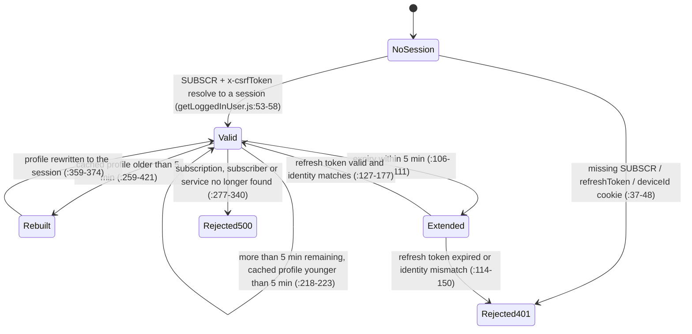
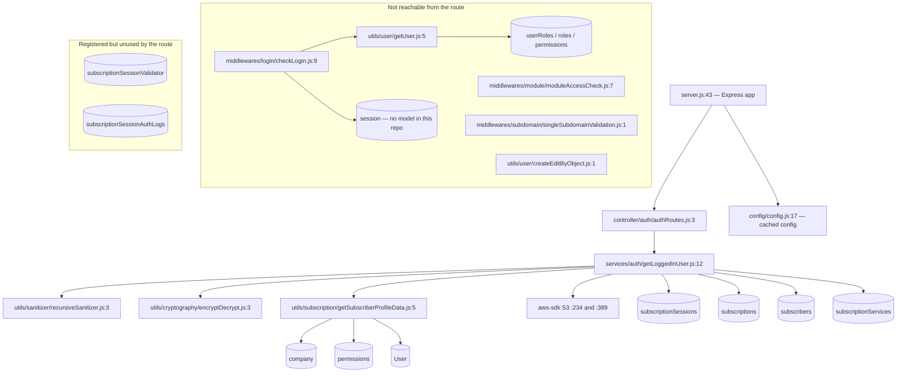

# subscription_authorization_ms

Every claim below carries a `file:line` citation from the repository root of
`apps/subscription_authorization_ms`. A row without one was dropped.

Mode: **full read** — all 24 JavaScript files, all 16 k8s/kustomize manifests, the Dockerfile, the
three shell scripts, both GitHub workflows and `.travis.yml` were read. Nothing was sampled.

**Repository:** the service is its own git repository, repo id `subscription_authorization_ms`,
registered at `apps/subscription_authorization_ms` in `.kilo/repos.json`. Checked-out branch is
`dev`, head `383945a` (`git -C apps/subscription_authorization_ms log --oneline -1`). Every path in
this file is relative to that repository.

## 1. Summary

`subscription_authorization_ms` is the read side of the subscriber session. It exposes one
endpoint, `POST /api/subscriptionauthorization/getloggedinuser`, which takes the `SUBSCR` cookie
written by `subscription_authentication_ms`, validates it against the `subscriptionSessions`
collection, slides the expiry forward, and returns the subscriber profile — either from the
encrypted copy cached on the session or by rebuilding it from `subscriptions`, `subscribers` and
`subscriptionServices`. It also mints short-lived S3 signed URLs for the subscriber avatar and the
service logo. It writes nothing to the database except the session expiry, the refresh token and
the cached profile. The public path is routed to cluster IP service port 5031 by the ingress in the
`authentication_ms` repository (`authentication_ms/k8s/inhouz-ingress-service.yml:308-315`).

## 2. Stack and commands

| Item | Value | Source |
|---|---|---|
| Runtime | Node.js `>=12.0.0 <17.5.0` | `package.json:5-7` |
| Container base | `node:16.4-alpine` | `Dockerfile:1` |
| Framework | Express `^4.16.4` | `package.json:26` |
| Database driver | Mongoose `^7.4.0` | `package.json:32` |
| Object storage client | `aws-sdk` `^2.1115.0` — S3 signed URLs only | `package.json:17`, `services/auth/getLoggedInUser.js:234-251` |
| Package manager | npm — `RUN npm install`, no lockfile in the repo | `Dockerfile:7`, `.gitignore:3` |
| Start command | `npm run start` → `node server.js` | `package.json:11`, `Dockerfile:11` |
| Test command | `npm test` → prints `Error: no test specified` and exits 1 | `package.json:10` |
| Port | `PORT` env var, read at listen time | `server.js:87` |
| Port in Kubernetes | `5031` | `k8s/subscription-authorization-ms-deployment.yml:28-29` |
| Port in docker-compose | maps `5001:5001` but sets no `PORT`, so the app listens on an OS-assigned port | `docker-compose.yml:10-11` |
| ClusterIP service | `subscription-authorization-ms-cluster-ip-service` | `k8s/subscription-authorization-ms-cluster-ip-service.yml:4` |
| Health probe | none; `healthcheck.js` targets `/healthz`, which no route serves | `healthcheck.js:7`, `controller/auth/authRoutes.js:4` |

No build step, no transpile step, no linter and no formatter configuration exists.

## 3. Entry points

### 3.1 The server process

| Entry point | file:line | How it is started |
|---|---|---|
| `server.js` — cluster master, one worker per CPU in production, one otherwise | `server.js:25-42` | `node server.js` (`package.json:11`) or `npm run start` (`Dockerfile:11`) |
| Worker branch — app, middleware, routes, Mongo, listen | `server.js:43-90` | forked at `server.js:28` |
| `connectMongo()` — retried 5 s after a disconnect | `server.js:92-104`, retry at `server.js:66-73` | called at `server.js:60` |
| `shutdownFunction` — closes Mongo on `SIGINT`, `SIGTERM`, `uncaughtException` | `server.js:77-86` | signal handlers |
| `healthcheck.js` | `healthcheck.js:7-19` | nothing invokes it: no `HEALTHCHECK` in `Dockerfile:1-11`, no probe in `k8s/subscription-authorization-ms-deployment.yml:1-160` |

### 3.2 HTTP surface

| Method | Path | Handler | file:line |
|---|---|---|---|
| POST | `/api/subscriptionauthorization/getloggedinuser` | `getLoggedInUser` | `controller/auth/authRoutes.js:4` |

That is the whole surface. There is no second route, no health route, no metrics route and no
static mount.

### 3.3 Non-entries

`deploy.sh:1-15`, `build_ga.sh:1-74`, `build_ga_prod.sh`, `.github/workflows/cicd-dev.yml:1-46`
and `.github/workflows/cicd-prod.yml:1-46` are CI/deploy paths only. No cron, queue consumer,
migration or CLI exists.

## 4. Module inventory

`pure` = deterministic, no I/O, no state. `reactive` = reads or writes state. `effectful` = Mongo,
network, filesystem, env, clock, randomness or logging.

### 4.1 Bootstrap and configuration

| Module | file:line | Responsibility | Public API | Kind |
|---|---|---|---|---|
| `server.js` (worker branch) | `server.js:43-90` | Mounts `cors`, `body-parser` (20 MB), `hpp`, `helmet`, `cookie-parser`, registers the one route, wires Mongo events and signals, listens | process side effect | effectful |
| cluster fork loop | `server.js:25-42` | Forks workers, restarts a dead one | none | effectful |
| `connectMongo` | `server.js:92-104` | `mongoose.connect` with `maxPoolSize: 1`; third argument is a bare `console.log` | none | effectful |
| `config()` | `config/config.js:17-56` | Builds and caches config once per process | the config object | effectful — filesystem + env, plus a module cache (`:16-18`) |
| `readSecret` | `config/config.js:5-14` | Reads `<SECRETS_PATH>/<name>`, falls back to the env var, else `""` | `string` | effectful |
| `NodeRsaClientPrivateKey` | `config/config.js:48-51` | RSA key from the `clientsecretkey` secret, built at require time | NodeRSA instance | effectful — throws here if the secret is missing or empty |

### 4.2 HTTP handler

| Module | file:line | Responsibility | Public API | Kind |
|---|---|---|---|---|
| `getLoggedInUser` | `services/auth/getLoggedInUser.js:12-430` | Validates session + CSRF, optionally extends expiry from the refresh token, returns the cached profile or rebuilds it, signs two S3 URLs, refreshes the `expirationTimestamp` cookies | `(req, res)` | effectful — Mongo reads and writes, S3 signing, clock, cookies, logging |

### 4.3 Utilities

| Module | file:line | Responsibility | Public API | Kind |
|---|---|---|---|---|
| `getSubscriberProfileData` | `utils/subscription/getSubscriberProfileData.js:5-209` | Rebuilds the profile: company, external extra fields or internal `User` record, tier lookup, asset-owner branding, permission expansion, age | `async ({subscriber, subscription, subscriptionService, destination})` → profile or `{error}` | effectful |
| `encryptDecrypt` | `utils/cryptography/encryptDecrypt.js:3-17` | RSA `encryptPrivate` / `decrypt` with the cached key; returns the input unchanged on failure (`:13-16`) | `(data, encrypt=false)` → `string` | effectful — reads the cached key, logs on failure |
| `recursiveSanitizer` | `utils/sanitizer/recursiveSanitizer.js:3-17` | Sanitises leaf strings of the request body | `(element, sanitizer)` → element | reactive — assigns an undeclared global at `:3`, mutates its input |
| `getUser` | `utils/user/getUser.js:5-159` | Loads `User`, joins `userRoles` → `roles` → `permissions`, strips `key` and `passwordHash` | `async (userId)` → user with `permissions` | effectful — dead: its only caller is the unmounted `checkLogin` |
| `createEditByObject` | `utils/user/createEditByObject.js:1-23` | Builds an audit `editedBy` object | `(user, deployDate)` → object | pure — dead in this service |

### 4.4 Middleware

| Module | file:line | Responsibility | Public API | Kind |
|---|---|---|---|---|
| `checkLogin` | `middlewares/login/checkLogin.js:9-151` | Employee session check against the `session` collection; slides 30 min; injects `req.user` | Express middleware | effectful — dead: not mounted, and no `session` model exists in this repository |
| `moduleAccessCheck` | `middlewares/module/moduleAccessCheck.js:7-67` | Module access check | Express middleware | effectful — dead: not mounted, and `FLEX_MODULE_MODEL` is not set by any manifest here |
| `singleSubdomainValidation` | `middlewares/subdomain/singleSubdomainValidation.js:1-25` | Compares `req.subdomains[0]` with `req.user.subDomain` | Express middleware | reactive — reads `req`, calls `next`; dead |

### 4.5 Models

Eleven Mongoose models, all registered in `server.js:13-23`: `model/user/user.js:109`,
`model/rolesAndPermissions/permissions.js:89`, `model/rolesAndPermissions/roles.js:87`,
`model/user/useRoles.js:51`, `model/company/company.js:109`,
`model/session/subscriptionSession.js:88`, `model/session/subscriptionSessionValidator.js:82`,
`model/session/subscriptionSessionAuthLog.js:60`, `model/subscription/subscriber.js:74`,
`model/subscription/subscriptionService.js:447`, `model/subscription/subscription.js:215`.
Each is `effectful`: it reads env through `config()` and registers global model state. Only three
of the eleven are read or written by the live route (§7).

## 5. Side effects

### 5.1 MongoDB

One connection per worker, `maxPoolSize: 1` (`server.js:93-101`); production forks one worker per
CPU (`server.js:26`).

| Collection | Read | Written | file:line |
|---|---|---|---|
| `subscriptionSessions` | find by `_id` + `csrfToken` | update expiry + refresh token, update cached profile, clear `sessionExpirationTimestamp` cookie on failure | `services/auth/getLoggedInUser.js:53-58`, `:158-173`, `:359-374` |
| `subscriptions` | findOne by `_id` + subscriber + owner + active | no | `services/auth/getLoggedInUser.js:264-271` |
| `subscribers` | findOne by email + owner + company + active + `subscriptionIds` | no | `services/auth/getLoggedInUser.js:290-297` |
| `subscriptionServices` | findOne by service, owner, active, deployed, tier id | no | `services/auth/getLoggedInUser.js:316-323` |
| `company` | findOne twice: subscriber company, asset-owner company | no | `utils/subscription/getSubscriberProfileData.js:19-30`, `:126-142` |
| `permissions` | find by tier permission ids | no | `utils/subscription/getSubscriberProfileData.js:168-178` |
| `User` | findOne for internal subscribers | no | `utils/subscription/getSubscriberProfileData.js:73-79` |
| `userRoles`, `roles` | only through the dead `getUser` | no | `utils/user/getUser.js:45-49`, `:85-91` |
| `session` | only through the dead `checkLogin`, and the model is not defined | no | `middlewares/login/checkLogin.js:24-28` |

The route is effectively read-only against the business collections. The only writes are to the
session document it validates.

### 5.2 Network

| Target | Purpose | file:line |
|---|---|---|
| AWS S3 | `getSignedUrl('getObject', …)`, 3-hour expiry, for the subscriber avatar and service logo | `services/auth/getLoggedInUser.js:234-251`, `:389-406` |
| No Inhouz service | no HTTP client dependency and no internal host in the code | `package.json:15-38` |

### 5.3 Filesystem, env, clock, logging

| Effect | file:line |
|---|---|
| Reads secret files from `SECRETS_PATH` (default `/mnt/secrets`) | `config/config.js:6-12` |
| Reads env for every model name and for `PORT`/`NODE_ENV` | `config/config.js:20-55`, `server.js:87` |
| `new Date().getTime()` as the single clock in the handler | `services/auth/getLoggedInUser.js:52` |
| `moment()` for every new expiry | `services/auth/getLoggedInUser.js:155-157`, `:358`, `:371` |
| Cookies cleared on every failure path: `sessionExpirationTimestamp` | `services/auth/getLoggedInUser.js:38-42`, `:71-75`, `:115-119`, `:140-144`, `:180-184`, `:278-282`, `:304-308`, `:330-334`, `:350-354` |
| Cookies refreshed on extension: `subSessionExpirationTimestamp`, `sessionExpirationTimestamp`, `refreshToken` | `services/auth/getLoggedInUser.js:194-215`, `:409-414` |
| `console.log` per catch block, with the Mongo error object | `services/auth/getLoggedInUser.js:175`, `:273`, `:299`, `:325`, `:376`, `:423` |

## 6. State and state transitions

No explicit state machine object exists. The session has three observable phases, driven purely by
timestamps on the `subscriptionSessions` document.

| Phase | Condition | What the handler does | file:line |
|---|---|---|---|
| valid, not near expiry | `expirationTimestamp - now >= 300000` ms | returns the cached or rebuilt profile; no write to expiry | `services/auth/getLoggedInUser.js:106-111`, `:218-258` |
| near expiry or expired | `expirationTimestamp - now < 300000` ms, or already past | checks the refresh token, then extends the session and the refresh token | `services/auth/getLoggedInUser.js:106-191` |
| refresh token expired or mismatched | refresh `expirationTimestamp < now`, or any of six identity fields differ | clears the expiry cookie, returns 401 | `services/auth/getLoggedInUser.js:112-150` |

Identity check on refresh (`services/auth/getLoggedInUser.js:128-138`): `subscriberEmail`,
`companyId`, `assetOwnerCompanyId`, `subscriptionServiceId`, `subscriptionServiceTierId`,
`deviceId` must all equal the session, and the refresh `deviceId` must equal the request cookie.

There is no logout here: deletion happens in `subscription_authentication_ms`
(`subscription_authentication_ms/services/auth/webLogout.js:50-56`).

## 7. Data

The model name passed to `mongoose.model(name, schema, name)` is the collection name and comes from
an env var, so the collection is a deployment concern.

| Model file | Env var | Collection (from the deployment) | Key fields and validation |
|---|---|---|---|
| `model/session/subscriptionSession.js:88` | `SUBSCRIPTION_SESSION_MODEL` | `subscriptionSessions` (`k8s/…deployment.yml:135-136`) | `subscriberType` enum `internal/external` (`:19-23`), `destination` enum `app/backOffice` (`:34-38`), `csrfToken`/`deviceId`/`encryptedRefreshToken` required (`:47-73`), `subscriptionId` **optional** String (`:55`) |
| `model/session/subscriptionSessionValidator.js:82` | `SUBSCRIPTION_SESSION_VALIDATOR_MODEL` | `subscriptionSessionValidator` (`:99-100`) | `twoFactorRequired` default `true` (`:43-46`), `accountLocked` default `false` (`:48-51`), `twoFactorToken` (`:57`); **no** `approvedDeviceIdList` and no `avoidTwoFactorTimestamp` |
| `model/session/subscriptionSessionAuthLog.js:60` | `SUBSCRIPTION_SESSION_AUTH_LOG_MODEL` | `subscriptionSessionAuthLogs` (`:131-132`) | `activity` enum `login/logout` (`:27-31`), `success` required + indexed (`:32-36`) |
| `model/subscription/subscription.js:215` | `SUBSCRIPTION_MODEL` | `subscriptions` (`:149-150`) | `status` enum `active/paused/inRenewal/cancelled` (`:195-199`), `activeSubscriber` default `true` (`:122-125`), `environment` required enum (`:117-121`) |
| `model/subscription/subscriber.js:74` | `SUBSCRIBER_MODEL` | `subscribers` (`:103-104`) | `email` indexed + email-validated but **not** lowercased or trimmed (`:17-29`), `subscriberType` enum (`:11-16`), `active` default `true` (`:61-65`) |
| `model/subscription/subscriptionService.js:447` | `SUBSCRIPTION_SERVICE_MODEL` | `subscriptionServices` (`:105-106`) | `customPaymentTiers` sub-schema (`:104-240`), `assetType` enum `api/view` (`:46-50`), `payoutAccountId` (`:74-76`), `sessionDurationMinutes` (`:433-436`) |
| `model/company/company.js:109` | `COMPANY_MODEL` | `company` (`:87-88`) | `status` enum `active/cancelled/paused` (`:57-61`), `subDomain` lowercased (`:19-22`), `subscriptionPayoutAccountId` String (`:96`) |
| `model/user/user.js:109` | `USER_MODEL` | `User` (`:85-86`) | `email` unique + validated (`:16-26`), `passwordHash` required (`:65-68`) |
| `model/rolesAndPermissions/permissions.js:89` | `PERMISSION_MODEL` | `permissions` (`:89-90`) | `permissionName` required, `companyId` required + indexed |
| `model/rolesAndPermissions/roles.js:87` | `ROLE_MODEL` | `roles` (`:83-84`) | `permissionIdList: [String]`, `companyId` required + indexed |
| `model/user/useRoles.js:51` | `USER_ROLES_MODEL` | `userRoles` (`:91-92`) | `userId` unique, `roleIdList: [String]` |

### 7.1 Where this schema differs from `subscription_authentication_ms`

The two services hold independent copies of the same four session schemas, and they have drifted.
Both bind the same collections, so the differences are load-bearing:

| Field | Here | In `subscription_authentication_ms` |
|---|---|---|
| `subscriptionSession.subscriptionId` | optional String (`model/session/subscriptionSession.js:55`) | required String (`subscription_authentication_ms/model/session/subscriptionSession.js:55-58`) |
| `subscriptionSession` schema options | `strict` + `timestamps` (`:77-80`) | adds `useNestedStrict` (`subscription_authentication_ms/model/session/subscriptionSession.js:80-84`) |
| `subscriptionSessionValidator.approvedDeviceIdList` | absent | present (`subscription_authentication_ms/model/session/subscriptionSessionValidator.js:43-46`) |
| `subscriptionSessionValidator.avoidTwoFactorTimestamp` | absent | present (`subscription_authentication_ms/model/session/subscriptionSessionValidator.js:74-76`) |
| `subscriber.email` | not lowercased, not trimmed (`:17-29`) | lowercased and trimmed (`subscription_authentication_ms/model/subscription/subscriber.js:17-29`) |
| `subscription.subscriberEmail` | not lowercased, not trimmed (`:6-31`) | lowercased and trimmed (`subscription_authentication_ms/model/subscription/subscription.js:6-31`) |
| `company.subscriptionPayoutAccountId` | present (`:96`) | absent (`subscription_authentication_ms/model/company/company.js:92-95`) |
| Profile `subscriptionPayoutAccountId` source | the **subscriber's** company record (`utils/subscription/getSubscriberProfileData.js:163`) | the **asset owner's** service record (`subscription_authentication_ms/utils/subscription/getSubscriberProfileData.js:163`) |

Because Mongoose does not validate on update by default and both services `findOne` with the same
field names, the missing `lowercase`/`trim` in this copy changes query behaviour: an
`authentication_ms` document is stored lowercased, and a lookup here is only correct because the
email it derives from the session was already lowercased upstream
(`subscription_authentication_ms/services/auth/webLogin.js:82`).

### 7.2 Collections shared with other services

`subscriptionSessions` is the cross-repository session contract. Eleven other repositories bind the
same env var and read the document this service extends:

| Repository | Evidence |
|---|---|
| `account_termination_ms` | `account_termination_ms/config/config.js:50-53` |
| `subscription_settings_ms` | `subscription_settings_ms/config/config.js:39-41` |
| `subscription_ms` | `subscription_ms/middlewares/subscription/checkSubscriberLogin.js:26` |
| `inhouz_file_upload_ms` | `inhouz_file_upload_ms/middlewares/login/isSubscriberLoggedIn.js:25` |
| `subscription_signup_ms` | `subscription_signup_ms/middlewares/login/subscriptionCheckLogin.js:26` |
| `subscription_payment_ms` | `subscription_payment_ms/middlewares/login/checkLogin.js:25` |
| `subscription_migration_parser_ms` | `subscription_migration_parser_ms/middlewares/login/subscriptionCheckLogin.js:26` |
| `payment_gateway_ms` | `payment_gateway_ms/middlewares/login/subscriptionCheckLogin.js:23` |
| `late_payment_ms` | `late_payment_ms/middlewares/login/subscriptionCheckLogin.js:26` |
| `inhouz_pay_ms` | `inhouz_pay_ms/middlewares/subscription/checkSubscriberLogin.js:26` |
| `website_resource_ms` | `website_resource_ms/middlewares/login/subscriptionCheckLogin.js:23` |

`subscription_authentication_ms` is the only writer of the document on login
(`subscription_authentication_ms/services/auth/webLogin.js:650-679`,
`services/auth/validateTwoFactor.js:352-380`).

## 8. Public interfaces

One route.

**`POST /api/subscriptionauthorization/getloggedinuser`** (`controller/auth/authRoutes.js:4`).

Request:

| Carrier | Field | Required | Purpose | file:line |
|---|---|---|---|---|
| cookie | `SUBSCR` | yes | Cryptr-encrypted session `_id` | `services/auth/getLoggedInUser.js:33` |
| header | `x-csrfToken` | yes | Cryptr-encrypted CSRF token, must match the session | `services/auth/getLoggedInUser.js:34`, `:51` |
| cookie | `refreshToken` | yes | Cryptr-encrypted `{data, expirationTimestamp}` | `services/auth/getLoggedInUser.js:35` |
| cookie | `deviceId` | yes | device identity, compared against the refresh token | `services/auth/getLoggedInUser.js:36`, `:137` |
| body | `encryptedData` | no | RSA envelope; its `payload.companyId` narrows the session query | `services/auth/getLoggedInUser.js:14-32` |

Response shapes:

| Case | Status | Body | file:line |
|---|---|---|---|
| cached profile still fresh | 200 | `{...cachedProfile, expirationTimestamp, imageUrl, serviceImageUrl}` | `services/auth/getLoggedInUser.js:253-258` |
| profile rebuilt | 200 | `{...profile, expirationTimestamp, imageUrl, serviceImageUrl}` | `services/auth/getLoggedInUser.js:415-420` |
| missing cookie/header | 401 | `{error: {message: 'Not Authorized'}}` | `services/auth/getLoggedInUser.js:37-48` |
| session missing or CSRF mismatch | 401 | `{error: {message: 'Not Authorized'}}` | `services/auth/getLoggedInUser.js:67-81` |
| refresh token expired or identity mismatch | 401 | `{error: {message: 'Not Authorized'}}` | `services/auth/getLoggedInUser.js:114-125`, `:128-150` |
| session read error, expiry write failure, entity no longer present | 500 | `{error: {message: 'An error occured while getting loggedin user data.'}}` | `services/auth/getLoggedInUser.js:83-94`, `:179-190`, `:277-340` |
| any thrown exception | **200** | `{error: {message: 'An error occured while getting loggedin user data.'}}` | `services/auth/getLoggedInUser.js:422-429` |

The profile body carries: `firstName`, `middleName`, `lastName`, `email`, `sex`, `dob`, `age`,
`imageFileKey`, `planName`, `serviceName`, `subscriberType`, `companyId`, `assetOwnerCompanyId`,
`companyName`, `environment`, `subscriptionServiceId`, `subscriptionServiceTierId`, `subscriberId`,
`subscriptionId`, `assetType`, `serviceImageFileKey`, `subscriptionPayoutAccountId`,
`paymentGatewayId`, `enablePaymentDistribution`, `permissions`, `permissionIds`,
`permissionNames`, plus `assetOwnerSubDomain`, `assetOwnerCompanyLogoId`, `assetOwnerCompanyName`
when the owner company is found (`utils/subscription/getSubscriberProfileData.js:92-198`). For
`destination === 'backOffice'` it also returns `editableProfile` and `signupExtraDataFields`
(`utils/subscription/getSubscriberProfileData.js:121-124`).

No events, topics or CLI commands.

## 9. Configuration

### 9.1 Names read by the code

`SECRETS_PATH` (`config/config.js:6`), `PORT` (`server.js:87`), `NODE_ENV` (`server.js:26`,
`services/auth/getLoggedInUser.js:197`), `SENDGRID_API_KEY`, `SESSION_SECRET`, `MONGO_URL`,
`CLIENT_SECRET_KEY` (file-or-env fallbacks at `config/config.js:24`, `:27`, `:28`, `:38`),
`S3_ACCESS_KEY_ID`, `S3_SECRET_KEY`, `S3_BUCKET_NAME` (file-or-env fallbacks at
`config/config.js:52-54`), `FLEX_FORM_FILE_MODEL`, `FLEX_MODULE_MODEL`, `FLEX_COLLECTION_MODEL`,
`FORM_MODEL`, `SMPL_EMAIL`, `DATA_RULE_EXECUTION_RESULT_MODEL`, `USER_MODEL`, `COMPANY_MODEL`,
`ROLE_MODEL`, `PERMISSION_MODEL`, `USER_ROLES_MODEL`, `SESSION_MODEL`,
`SESSION_VALIDATOR_MODEL`, `AUTH_LOG_MODEL`, `COOKIE_DOMAIN`,
`SUBSCRIPTION_SESSION_VALIDATOR_MODEL`, `SUBSCRIPTION_SESSION_MODEL`, `SUBSCRIBER_MODEL`,
`SUBSCRIPTION_SERVICE_MODEL`, `SUBSCRIPTION_MODEL`, `SUBSCRIPTION_SESSION_AUTH_LOG_MODEL`
(`config/config.js:20-47`). Header name used: `x-csrfToken` (`services/auth/getLoggedInUser.js:34`).

### 9.2 Names declared by the deployment but never read by the code

`COOKIE_NAME`, `INHOUZ_FROM_EMAIL`, `SUBSCRIBER_CHANGE_LOG`, `SUBSCRIPTION_USAGE_LOG`,
`VERSION_TRACKER_MODEL`, `FLEX_API_MODEL`, `SUBSCRIBER_ACTION_LOG_MODEL`,
`SUBSCRIBER_MIGRATION_QUEUE_MODEL`, `SERVICE_DISCOUNT_MODEL`, `CUSTOMERS_MODEL`, `CONTACTS_MODEL`,
`authorization_CHARGE_MODEL`, `PAYOUT_ACCOUNT_MODEL`, `authorization_METHOD_MODEL`,
`authorization_INTENT_MODEL`, `OPEN_EXCHANGE_RATES_BASE_URL`, `OPEN_EXCHANGE_RATES_API_KEY`,
`STRIPE_API_KEY`, `SUBSCRIPTION_SERVICE_CHARGE_FEE`, `SUBSCRIPTION_SERVICE_CHARGE_TYPE`,
`authorization_MS_URL`, `CHURN_TRACKER_MODEL`, `EXCHANGE_RATE_CACHE_MODEL`, `INHOUZ_APP_MODEL`,
`IP_ADDRESS_LOCATION_MODEL`, `IP_LOCATION_FINDER_URL`, `SUBSCRIBED_PACKAGE_MODEL`
(`k8s/subscription-authorization-ms-deployment.yml:75-158`). None appears in
`config/config.js:19-55`.

`COOKIE_DOMAIN` and `SENDGRID_API_KEY` are read into config but never used: this handler sets
cookie domain from `req.hostname` (`services/auth/getLoggedInUser.js:41`) and sends no mail
(`package.json:16` declares `@sendgrid/mail`, no file requires it).

### 9.3 Secret delivery

- `k8s/` (used by `deploy.sh:9`, `:14`) supplies secrets as `secretKeyRef` env vars, including the
  three S3 values (`k8s/subscription-authorization-ms-deployment.yml:30-74`).
- `kus/` (used by `build_ga.sh:72`, `build_ga_prod.sh:72`) mounts GCP Secret Manager at
  `/mnt/secrets` (`kus/base/subscription-authorization-ms-deployment.yml:15-23`, `:36-40`) and
  comments the `secretKeyRef` blocks out (`:44-88`). File names it materialises are in
  `kus/dev/secret-provider-class.yml:9-50`; the code reads only `sendgridapikey`,
  `sessionsecret`, `mongourl`, `clientsecretkey`, `s3accesskeyid`, `s3secretkey`, `s3bucketname`
  (`config/config.js:24-54`).

No secret value appears in this repository. `service-account.json.enc` is an openssl-encrypted blob
decrypted only in Travis (`.travis.yml:11`).

## 10. Dependencies

Direct dependencies only (`package.json:15-38`).

| Package | Why it is there | Used? |
|---|---|---|
| `@sendgrid/mail` | inherited from the template | **no** — no file requires it |
| `aws-sdk` | S3 `getSignedUrl` for the two images | yes, `services/auth/getLoggedInUser.js:10`, `:234`, `:389` |
| `bcryptjs` | inherited; no password work here | **no** |
| `body-parser` | JSON body, 20 MB | yes, `server.js:53` |
| `connect-mongo` | intended Mongo session store | **no** — no `express-session` mount |
| `cookie-parser` | parses the three cookies, signed with `sessionSecret` | yes, `server.js:56` |
| `cors` | origin regex `/inhouz.localhost/` with credentials | yes, `server.js:45-51` |
| `crypto-js` | — | **no** import |
| `cryptr` | decrypts `SUBSCR`, `x-csrfToken`, `refreshToken`; re-encrypts the token and the profile | yes, `services/auth/getLoggedInUser.js:3`, `:49-51` |
| `dotenv` | loads `.env` | yes, `server.js:1` |
| `express` | HTTP framework | yes, `server.js:44` |
| `express-session` | — | **no** mount |
| `helmet` | security headers | yes, `server.js:55` |
| `hpp` | parameter pollution guard | yes, `server.js:54` |
| `lodash` | `isEmpty`, `isEqual` | yes, `services/auth/getLoggedInUser.js:7` |
| `moment` | new expiry timestamps | yes, `services/auth/getLoggedInUser.js:6`, `:155-157` |
| `mongoose` | ODM | yes, 17 files |
| `node-rsa` | the client envelope key | yes, `config/config.js:48` |
| `request-ip` | — | **no** — imported nowhere; IP is not read on this path |
| `sanitizer` | body sanitising | yes, `services/auth/getLoggedInUser.js:5`, `:14` |
| `shortid` | — | **no** import |
| `validator` | email validation in schemas | yes, 9 files |

## 11. Testing

There are no tests. `package.json:10` is the npm stub (`echo "Error: no test specified" && exit
1`). No test directory, no runner in the dependency list, no fixture, and no CI test step: both
workflows run only the build/deploy script (`.github/workflows/cicd-dev.yml:38-46`,
`cicd-prod.yml:38-46`).

Covered by nothing: the refresh-token identity comparison, the 5-minute extension window, the
cached-profile path, the S3 signing path, and the response status of the catch-all.

## 12. Known issues and risks

### 12.1 Functional defects

| # | Issue | Evidence |
|---|---|---|
| 1 | The catch-all returns HTTP **200** with an error body, so a client that checks only status treats every server fault as success. | `services/auth/getLoggedInUser.js:422-429` |
| 2 | `data` is assigned without declaration inside the decrypt block, creating an implicit global. | `services/auth/getLoggedInUser.js:26` |
| 3 | The envelope key is `payload` here, while every endpoint in `subscription_authentication_ms` reads `data` from the same RSA envelope. One of the two cannot be right for a shared client. | `services/auth/getLoggedInUser.js:26` vs `subscription_authentication_ms/services/auth/webLogin.js:41`, `services/auth/validateTwoFactor.js:37`, `services/auth/forgotPassword.js:36` |
| 4 | The rebuilt-profile path writes `55` minutes of cache TTL and expiry, ignoring `sessionDurationMinutes`, while the extension path honours it. | `services/auth/getLoggedInUser.js:358`, `:371` vs `:155-157` |
| 5 | The rebuilt path reassigns `newSessionExpirationDate` (55 min) and then writes it into the `sessionExpirationTimestamp` cookie, overwriting the extension value computed earlier in the same request. | `services/auth/getLoggedInUser.js:358`, `:409-414` |
| 6 | `getUser` has no `ObjectId` check on `userId`, unlike the copy in the authentication service; an invalid id throws a cast error inside the dead middleware. | `utils/user/getUser.js:6-16` vs `subscription_authentication_ms/utils/user/getUser.js:7-17` |
| 7 | `moduleAccessCheck` has two always-false guards: `!typeof x === 'string'` and `!moduleSplit.length > 1`. | `middlewares/module/moduleAccessCheck.js:11`, `:20` |
| 8 | `recursiveSanitizer` assigns an undeclared global and recurses into arrays without the sanitiser. | `utils/sanitizer/recursiveSanitizer.js:3`, `:10` |
| 9 | `encryptDecrypt` fails open and returns the input unchanged on any error. | `utils/cryptography/encryptDecrypt.js:13-16` |
| 10 | `subscriptionSessionValidator` in this copy has no `approvedDeviceIdList` and no `avoidTwoFactorTimestamp`, so a document written by the authentication service and bound to this schema loses those fields on `save()` (they are only read here, so no current failure). | `model/session/subscriptionSessionValidator.js:6-73` vs `subscription_authentication_ms/model/session/subscriptionSessionValidator.js:43-76` |
| 11 | `getSubscriberProfileData` reads `subscriptionPayoutAccountId` from the subscriber's own company, while the authentication service reads the asset owner's `payoutAccountId`. The same field name in the client payload therefore means two different things depending on which service produced it. | `utils/subscription/getSubscriberProfileData.js:163` vs `subscription_authentication_ms/utils/subscription/getSubscriberProfileData.js:163` |
| 12 | `age` is only computed when `profile.dob` is set and parses as a moment; `dob` is stored as a Number (epoch) in both the `User` and `Subscriber` schemas. | `utils/subscription/getSubscriberProfileData.js:196-198`, `model/user/user.js:43` |

### 12.2 Security risks

| # | Risk | Evidence |
|---|---|---|
| 13 | The session cookie, CSRF token and refresh token are all decrypted with `cryptr.decrypt` inside one `try`; a malformed `x-csrfToken` header throws and is reported as a generic success-shaped error rather than a 401. | `services/auth/getLoggedInUser.js:50-51`, `:422-429` |
| 14 | `encryptedData` is optional, so the `companyId` narrowing of the session lookup is optional too. A caller without the body matches on `_id` + `csrfToken` alone. | `services/auth/getLoggedInUser.js:19-32`, `:54-58` |
| 15 | The `refreshToken` cookie is set `httpOnly: false`, so the refresh credential is readable by any script on the page. | `services/auth/getLoggedInUser.js:208-215` |
| 16 | `sessionExpirationTimestamp` is always `secure: false`. | `services/auth/getLoggedInUser.js:202-207`, `:409-414` |
| 17 | S3 credentials are long-lived static keys held in config, not an instance role; the signed URL expiry is 3 h. | `config/config.js:52-54`, `services/auth/getLoggedInUser.js:240-242` |
| 18 | CORS is `origin: /inhouz.localhost/` only. | `server.js:45-51` |
| 19 | `uncaughtException` closes Mongo but never exits the worker. | `server.js:80-86` |
| 20 | `mongoose.connect` has `console.log` as its third argument and no `.catch`, so a failed connect has no handler. | `server.js:93-103` |
| 21 | The RSA key is constructed at require time; a missing `clientsecretkey` secret crashes startup before any handler is registered. | `config/config.js:48-51` |

### 12.3 Dead code and template leftovers

`middlewares/login/checkLogin.js`, `middlewares/module/moduleAccessCheck.js`,
`middlewares/subdomain/singleSubdomainValidation.js`, `utils/user/getUser.js`,
`utils/user/createEditByObject.js` are unreachable from the single live route. `checkLogin` also
targets a `session` model that does not exist in this repository at all
(`middlewares/login/checkLogin.js:24` vs the model list at `server.js:13-23`).

Seven of the twenty-one direct dependencies are unused (§10). Four deployed env var names carry an
`authorization_` prefix that no code reads
(`k8s/subscription-authorization-ms-deployment.yml:125`, `:129`, `:133`, `:143`) — the last commit
on the branch is `streamlined payment gateway`, so these are leftovers from the payment service
template this repository was cut from.

Two of the eleven registered models (`subscriptionSessionValidator`,
`subscriptionSessionAuthLog`) are never read or written by the live route: the handler uses neither
two-factor state nor auth logging.

### 12.4 Configuration drift

`k8s/` and `kus/` disagree on secret delivery (§9.3), on the memory request (`300Mi` at
`k8s/…deployment.yml:23` vs `0.3Gi` at `kus/base/…deployment.yml:32`), and on whether the
`secretKeyRef` env block is active or commented out. `deploy.sh` applies `k8s/`; `build_ga.sh`
applies `kus/dev`; `build_ga_prod.sh` applies `kus/prod`.

## 13. Module map

## 14. Open questions

1. **Who calls this service?** No repository in `apps/` contains an HTTP call to
   `/api/subscriptionauthorization` (grep over all 79 `apps/` repositories, JS and YAML). The only
   reference is the ingress in `authentication_ms`
   (`authentication_ms/k8s/inhouz-ingress-service.yml:308-315`). The caller is an external
   frontend; `apps/web` and `apps/mobile` hold only `AGENTS.md`.
2. **Which envelope key is canonical, `data` or `payload`?** This handler reads `payload`
   (`services/auth/getLoggedInUser.js:26`); every handler in `subscription_authentication_ms` reads
   `data`. The client that encrypts both is not in this workspace.
3. **Is the 55-minute cache TTL intentional?** It is a literal, twice
   (`services/auth/getLoggedInUser.js:358`, `:371`), while the extension path uses
   `sessionDurationMinutes || 60`. Whether the rebuild path is meant to pin the session to a fixed
   55 minutes cannot be determined from the code.
4. **Is `subscriptionPayoutAccountId` the owner's or the subscriber's?** The two services disagree
   (§7.1). Payment distribution reads this field, so the answer matters; the payment service was
   not read for this file.
5. **Is the `session`/`authenticationLogs` model split planned?** `checkLogin` and its dependencies
   are fully written but unusable because no `session` model is registered here. Whether this
   service is meant to take over employee login from `authentication_ms` cannot be determined.
6. **Are the `kus/` manifests live?** `deploy.sh` applies `k8s/`, `build_ga.sh` applies `kus/dev`,
   and `.travis.yml:20-24` deploys from `master` through `deploy.sh`. The current deploy path is
   not determinable from the repository.
