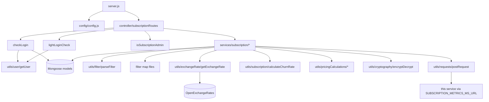

# subscription_metrics_ms

## 1. Summary

Repository `subscription_metrics_ms` (repo id `subscription_metrics_ms` in `.kilo/repos.json`,
checkout at `apps/subscription_metrics_ms`, git branch `dev`). A read-only analytics API for the
subscription system: it answers subscriber, subscription, usage-log, action-log, MRR/ARR, churn and
lifetime-value questions for a subscribing company, and returns data for the back-office charts.
The numbers are computed from the `subscribers`, `subscriptions`, `subscribedPackages`,
`subscriberUsageLogs`, `subscriberActionLogs`, `churnTracker`,
`subscriptionRecurringRevenueTracker` and `dailySubscriptionRecurringRevenueTracker` collections.
This service writes almost nothing: only the session heartbeat and the exchange-rate cache.

## 2. Stack and commands

- Runtime: Node.js `>=12.0.0 <17.5.0` (`package.json:5-7`); image `inhouz/subscription_metrics_ms`
  (`k8s/subscription-metrics-ms-deployment.yml:17`); `replicas: 1` (`:6`).
- HTTP: Express 4 with body-parser, cookie-parser, cors, helmet, hpp (`server.js:2-8`).
- Data: Mongoose 7 (`package.json:31`).
- Outbound HTTP: `node-fetch` 2 (`package.json:32`) for OpenExchangeRates and the self-call in
  `getLifetimeValue`.
- Scripts: `start` = `node server.js`, `test` = `echo "Error: no test specified" && exit 1`
  (`package.json:9-12`).
- Start: `npm start`; listens on `process.env.PORT` (`server.js:97`), set to `5011`
  (`k8s/subscription-metrics-ms-deployment.yml:28-29`); ClusterIP port `5011`
  (`k8s/subscription-metrics-ms-cluster-ip-service.yml:10`).

## 3. Entry points

| Entry point | Where | How |
|---|---|---|
| HTTP server | `server.js:97` | `npm start` |
| Cluster master / worker fork | `server.js:35-52` | implicit; one worker per CPU in production |
| Mongo connect + reconnect | `server.js:69-86`, `server.js:102-113` | worker start; 5s retry |
| Shutdown | `server.js:87-95` | `SIGINT`, `SIGTERM`, `uncaughtException` |
| Route table | `controller/subscription/subscriptionRoutes.js:22-39` | mounted at `server.js:67` |
| Health probe script | `healthcheck.js:1-21` | standalone; `GET /healthz` is not implemented (§12) |

No cron, queue consumer or scheduled aggregation. The tracker collections this service reads are
written by other services; nothing here computes and stores them.

## 4. Module inventory

| Module / export | file:line | Owns | Public API | Kind |
|---|---|---|---|---|
| server bootstrap | `server.js:1-113` | Express app, cluster, Mongo lifecycle, 21 model registrations | entry | effectful |
| config factory | `config/config.js:18-75` | env, secret files, NodeRSA key, literal permission names | `()` → config | effectful, cached state |
| `readSecret` | `config/config.js:5-15` | secret file with env fallback | internal | effectful |
| routes registrar | `controller/subscription/subscriptionRoutes.js:22-39` | 16 POST routes | `(app)` | effectful |
| `checkLogin` | `middlewares/login/checkLogin.js:9-151` | full session validation, 60-minute sliding expiry, sets `req.user` and cookies `x-java` and `sessionExpirationTimestamp` | `(req,res,next)` | effectful |
| `lightLoginCheck` | `middlewares/login/lightLoginCheck.js:9-128` | same, but calls `next()` when the session is absent or invalid | `(req,res,next)` | effectful |
| `isSubscriptionAdmin` | `middlewares/permissions/isSubscriptionAdmin.js:3-24` | requires the `subscriptionAdmin` permission | `(req,res,next)` | pure read of `req.user` |
| `isAllowedDeveloper` | `middlewares/permissions/isAllowedDeveloper.js` | developer permission gate | `(req,res,next)` | pure read; unused by the routes |
| `apiKeyValidation` | `middlewares/apiKey/apiKeyValidation.js:6-70` | `X-API-KEY` header → Cryptr decrypt → `User.key` lookup | `(req,res,next)` | effectful; unused by the routes |
| `moduleAccessCheck` | `middlewares/module/moduleAccessCheck.js` | Flex module gate | `(req,res,next)` | effectful; unmounted |
| `singleSubdomainValidation` | `middlewares/subdomain/singleSubdomainValidation.js` | subdomain gate | `(req,res,next)` | pure read; unmounted |
| `getSubscribedCompanies` | `services/subscription/getSubscribedCompanies.js:5-74` | `distinct` company ids from subscribers, then company names | `(req,res)` | effectful |
| `getSubscribers` | `services/subscription/getSubscribers.js:12-331` | pipeline over `subscribers` + company + subscription + service | `(req,res)` | effectful |
| `getSubscriptions` | `services/subscription/getSubscriptions.js:14-453` | pipeline over `subscriptions` + subscriber + service, adds price text | `(req,res)` | effectful |
| `getServiceUsageLogs` | `services/subscription/getServiceUsageLogs.js:13-341` | pipeline over usage logs, computes `apiUtilization` | `(req,res)` | effectful |
| `getSubscriberActionLogs` | `services/subscription/getSubscriberActionLogs.js:12-325` | pipeline over action logs | `(req,res)` | effectful |
| `getSubscribedPackages` | `services/subscription/getSubscribedPackages.js:12-329` | packages for a company with prices and subscriber counts | `(req,res)` | effectful |
| `getSubscribedServices` | `services/subscription/getSubscribedServices.js:12-243` | services + tiers for a company | `(req,res)` | effectful |
| `getSubscriberCount` | `services/subscription/getSubscriberCount.js:7-104` | `countDocuments` of active subscriptions | `(req,res)` | effectful |
| `dailyActiveUserCount` | `services/subscription/dailyActiveUserCount.js:7-78` | `distinct` subscription ids in one day | `(req,res)` | effectful |
| `subscriberCountChart` | `services/subscription/subscriberCountChart.js:8-160` | churn tracker + unsubscribe logs → chart series | `(req,res)` | effectful |
| `getRecurringRevenue` | `services/subscription/getRecurringRevenue.js:8-129` | one month's MRR/ARR from the monthly tracker | `(req,res)` | effectful |
| `getRecurringRevenues` | `services/subscription/getRecurringRevenues.js:8-157` | monthly series from the monthly tracker | `(req,res)` | effectful |
| `getDailyRecurringRevenues` | `services/subscription/getDailyRecurringRevenues.js:9-155` | daily series from the daily tracker | `(req,res)` | effectful |
| `getCurrentRecurringRevenue` | `services/subscription/getCurrentRecurringRevenue.js:9-203` | recomputes MRR live from subscriptions + packages | `(req,res)` | effectful |
| `getChurn` | `services/subscription/getChurn.js:9-155` | churn between two days via `calculateChurnRate` | `(req,res)` | effectful |
| `getLifetimeValue` | `services/subscription/getLifetimeValue.js:8-113` | calls its own `/getchurndata` and `/getrecurringrevenue`, then LTV = ARPU / churn | `(req,res)` | effectful (outbound HTTP to itself) |
| `parseFilter` | `utils/filter/parseFilter.js:1-42` | allow-list filter mapper | `(filter, map, nonRegex, typeMap)` | pure |
| `getExchangeRate` | `utils/exchangeRate/getExchangeRate.js:5-84` | 1-hour cached OpenExchangeRates lookup, upserts `exchangeRateCache` | `(currency)` → rates | effectful |
| `postRequest` | `utils/requests/postRequest.js:3-64` | JSON POST helper returning `{hasError,...}` on non-200 | `(url, method, data, headers)` | effectful |
| `calculateChurnRate` | `utils/subscription/calculateChurnRate.js:1-52` | churn count, rate, churned MRR/ARR | `(startChurn, endChurn, rates, baseCurrency)` | pure |
| `calculateChurnedRevenue` | `utils/subscription/calculateChurnedRevenue.js:6-102` | churned revenue from tier prices | `(churnList, currency, user)` | effectful (Mongo) |
| `calculateRevenueChurn` | `utils/subscription/calculateRevenueChurn.js:3-34` | wraps the above for two dates | `(...)` | effectful |
| `planPriceCalculation` | `utils/pricingCalculations/planPriceCalculation.js` | tier price in one currency | `({...})` → price object | pure |
| `addonPriceCalculation` | `utils/pricingCalculations/addonPriceCalculation.js` | add-on price | `({...})` → price object | pure |
| `encryptDecrypt` | `utils/cryptography/encryptDecrypt.js` | RSA private-key encrypt/decrypt | `(data, encrypt)` | effectful |
| `monthIndexMap`, `monthLengthMap` | `utils/date/monthIndexMap.js:1-14`, `utils/date/monthLengthMap.js:1-16` | month name and length tables | object / function | pure |
| `recursiveSanitizer` | `utils/sanitizer/recursiveSanitizer.js:3-17` | intended sanitizer | `(element, sanitizer)` | no-op in practice (§12) |
| `getUser` | `utils/user/getUser.js` | user + roles + permission names | `(userId)` | effectful |
| filter maps | `utils/subscriber/filter/*.js`, `utils/subscriberAction/filter/*.js`, `utils/subscriptionUsage/filter/*.js`, `utils/subscribedPackage/filter/*.js` | per-endpoint allow-lists | plain objects | pure |
| model modules | `server.js:13-33` | schema registration (§7) | model | reactive |

## 5. Side effects

| Effect | Where |
|---|---|
| MongoDB connect/reconnect/close | `server.js:69-86`, `:102-113`, `:91-94` |
| Mongo read `session`, and update `expirationTimestamp` on every authenticated call | `middlewares/login/checkLogin.js:24-36,83-95`; `lightLoginCheck.js:20-32,63-75` |
| Mongo read `User`/`UserRoles`/`Role`/`Permission` | `utils/user/getUser.js` (via `checkLogin.js:72`) |
| Mongo read `company` | `checkLogin.js:105-112` |
| Mongo aggregate `subscribers` | `services/subscription/getSubscribers.js:311-317` |
| Mongo aggregate `subscriptions` | `getSubscriptions.js:365-371` |
| Mongo aggregate `subscriberUsageLogs` | `getServiceUsageLogs.js:295-301` |
| Mongo aggregate `subscriberActionLogs` | `getSubscriberActionLogs.js:292-298`; `subscriberCountChart.js:89-99` |
| Mongo read `churnTracker` | `getChurn.js:70-106`; `subscriberCountChart.js:68-78` |
| Mongo read monthly/daily revenue trackers | `getRecurringRevenue.js:81-88`; `getRecurringRevenues.js:86-94`; `getDailyRecurringRevenues.js:84-92` |
| Mongo read `subscriptions` + `subscribedPackages` | `getCurrentRecurringRevenue.js:91-97,146-157` |
| Mongo `count` on `subscriptions` | `getSubscribedPackages.js:261-274` |
| Mongo `distinct` | `getSubscribedCompanies.js:18-28`; `dailyActiveUserCount.js:53-56` |
| Mongo upsert `exchangeRateCache` | `utils/exchangeRate/getExchangeRate.js:54-70` |
| HTTP GET OpenExchangeRates | `utils/exchangeRate/getExchangeRate.js:37` |
| HTTP POST to itself (`SUBSCRIPTION_METRICS_MS_URL`) | `services/subscription/getLifetimeValue.js:44-57,68-80` |
| Filesystem secret read | `config/config.js:6-14` |
| Env read | `config/config.js:21-72`, `server.js:36,97` |
| Clock | `getExchangeRate.js:18`; `getLifetimeValue.js:27-35`; `checkLogin.js:23,82`; `getRecurringRevenue.js:27,62-69`; `subscriberCountChart.js:35-36` |
| Cookies written (`x-java`, `sessionExpirationTimestamp`) | `checkLogin.js:126-141`; `lightLoginCheck.js:102-117` |
| Crypto | `checkLogin.js:20-22,124-125`; `encryptDecrypt.js` |
| Logging | every catch block returns or logs the raw error object |

Writes: only `session.expirationTimestamp` (login heartbeat) and `exchangeRateCache`. No
subscription, subscriber or tracker document is created or changed here.

## 6. State and state transitions

No domain state machine. The only transition this service owns is the sliding session expiry:

| From | To | Trigger | Guard |
|---|---|---|---|
| session live | extended 60 minutes | any authenticated request | `datestamp <= expirationTimestamp` (`checkLogin.js:62-70`) |
| session expired | rejected | authenticated request | request passes `expirationTimestamp` |
| session absent | anonymous | `lightLoginCheck` route | falls through to the service, which requires `encryptedCompanyId` or `internal` (`lightLoginCheck.js:13-15`) |

The analytics values themselves are point-in-time computations, not stored states.

## 7. Data

| Model | file:line | Env → collection (k8s line) | Key fields and validation |
|---|---|---|---|
| Subscriber | `model/subscription/subscriber.js:6-68` | `SUBSCRIBER_MODEL` → `subscribers` (`k8s/...deployment.yml:86-87`) | `subscriberType` enum internal/external, `email` validated, `companyId`, `assetOwnerCompanyId`, `subscriptionIds[]`, `active` |
| Subscription | `model/subscription/subscription.js:6-211` | `SUBSCRIPTION_MODEL` → `subscriptions` (`:134-135`) | same shape as `subscription_ms`: enums for type, serviceType, rate type, environment, assetType, status |
| SubscriptionService | `model/subscription/subscriptionService.js` | `SUBSCRIPTION_SERVICE_MODEL` → `subscriptionServices` (`:88-89`) | tiers, add-ons, signup fields, `deployed`, `version` |
| SubscribedPackage | `model/subscription/subscriptionPackage.js:5-146` | `SUBSCRIBED_PACKAGE_MODEL` → `subscribedPackages` (`:142-143`) | `packageType` enum subscriptionPlan/addOn, `assetType` enum api/view, `signupRateType` required, `currency` required; **`timestamp : true` is a typo** so `createdAt`/`updatedAt` are not maintained (`:129`) |
| SubscriptionUsageLog | `model/subscription/subscriptionUsageLog.js` | `SUBSCRIPTION_USAGE_LOG` → `subscriberUsageLogs` (`:92-93`) | usage events read by `getServiceUsageLogs` and `dailyActiveUserCount` |
| SubscriberActionLog | `model/subscription/subscriberActionLogs.js:96` | `SUBSCRIBER_ACTION_LOG_MODEL` → `subscriberActionLogs` (`:98-99`) | `subscriberAction` values such as `unsubscribed` (`subscriberCountChart.js:93`) |
| ChurnTracker | `model/subscription/churnTracker.js:5-100` | `CHURN_TRACKER_MODEL` → `churnTracker` (`:126-127`) | `baseSubscriberCount`, `subscriberCount`, `day`/`month`/`year`, `monthYear`, `mrr`, `baseMrr`, `currency`, `environment` required |
| SubscriptionRecurringRevenueTracker | `model/subscription/subscriptionRecurringRevenueTracker.js:5-69` | `SUBSCRIPTION_RECURRING_REVENUE_TRACKER_MODEL` → `subscriptionRecurringRevenueTracker` (`:102-103`) | `mrr`, `arr`, `userCount`, `monthYear`, `timestamp`, `serviceType`, `environment` required |
| DailySubscriptionRecurringRevenueTracker | `model/subscription/dailySubscriptionRecurringRevenueTracker.js:5-68` | `DAILY_SUBSCRIPTION_RECURRING_REVENUE_TRACKER_MODEL` → `dailySubscriptionRecurringRevenueTracker` (`:132-133`) | as above plus `datestamp` required |
| ExchangeRateCache | `model/payment/exchangeRateCache.js:5-20` | `EXCHANGE_RATE_CACHE_MODEL` → `exchangeRateCache` (`:130-131`) | unique `baseCurrency`, `rates` object, `timestamp` |
| ServiceDiscount | `model/subscription/serviceDiscount.js` | `SERVICE_DISCOUNT_MODEL` → `serviceDiscounts` (`:104-105`) | registered, never queried by any service in this repo |
| InhouzApp | `model/appBuilder/inhouzApp.js` | `INHOUZ_APP_MODEL` → `inhouzApps` (`:136-137`) | registered, unused |
| FlexApi | `model/api/flexApi.js` | `FLEX_API_MODEL` → `flexApi` (`:96-97`) | registered, unused |
| SubscriberMigrationQueue | `model/subscription/subscriberMigrationQueue.js` | `SUBSCRIBER_MIGRATION_QUEUE_MODEL` → `subscriberMigrationQueue` (`:100-101`) | registered, unused |
| VersionTracker | `model/versionTracker/versionTracker.js` | `VERSION_TRACKER_MODEL` → `versionTracker` (`:94-95`) | registered, unused |
| SubscriberChangeLog | `model/subscription/subscriberChangeLog.js` | `SUBSCRIBER_CHANGE_LOG` → `subscriberChangeLogs` (`:90-91`) | registered, unused |
| Session / Company / User / UserRoles / Role / Permission | `model/session/session.js`, `model/company/company.js`, `model/user/*.js`, `model/rolesAndPermissions/*.js` | `SESSION_MODEL` → `session`, `COMPANY_MODEL` → `company`, `USER_MODEL` → `User`, `USER_ROLES_MODEL` → `userRoles`, `ROLE_MODEL` → `roles`, `PERMISSION_MODEL` → `permissions` (`:68-83`) | identity and RBAC; the copies match the other services |

Shared collections inside the cluster:

| Collection | Also read or declared in |
|---|---|
| `subscribers`, `subscriptions`, `subscriptionServices`, `subscribedPackages`, `churnTracker`, `subscriberActionLogs`, `subscriberMigrationQueue`, `serviceDiscounts`, `exchangeRateCache` | `apps/subscription_ms`, `apps/subscription_signup_ms` |
| `subscriberUsageLogs` | written by whichever service records API pings (`subscription_ms` util `logSubscriptionUsage` is the nearest writer) |
| `subscriptionRecurringRevenueTracker`, `dailySubscriptionRecurringRevenueTracker` | written outside this cluster, presumably by the renewal/scheduler services; no writer was found in these six repositories |
| `company`, `session`, `User`, `userRoles`, `roles`, `permissions` | all six services in this cluster |

## 8. Public interfaces

All routes are `POST` with a JSON body. Authentication column: **strict** = `checkLogin` +
`isSubscriptionAdmin`; **light** = `lightLoginCheck`, session optional, access then decided inside
the handler.

| Path | Auth | Body | Response |
|---|---|---|---|
| `/api/subscriptionmetrics/getsubscribedcompanies` | strict (`subscriptionRoutes.js:23`) | none | `{ results: [{_id, companyName}] }` (`getSubscribedCompanies.js:63-65`) |
| `/api/subscriptionmetrics/getsubscribers` | light (`:24`) | `{ filter, sort, skip, limit, internal, myExternal, encryptedCompanyId }` | `{ results, total_count }` (`getSubscribers.js:319-322`) |
| `/api/subscriptionmetrics/getSubscriptions` | light (`:25`) | same | `{ results, total_count }` (`getSubscriptions.js:441-444`) |
| `/api/subscriptionmetrics/getserviceusagelogs` | light (`:26`) | same | `{ results, total_count }` (`getServiceUsageLogs.js:329-332`) |
| `/api/subscriptionmetrics/getsubscriberactionlogs` | light (`:27`) | same | `{ results, total_count }` (`getSubscriberActionLogs.js:313-316`) |
| `/api/subscriptionmetrics/getsubscribedpackages` | **none** (`:28`) | `{ filter, sort, skip, limit, encryptedCompanyId }` | `{ results, total_count }` (`getSubscribedPackages.js:317-320`) |
| `/api/subscriptionmetrics/getSubscribedServices` | light (`:29`) | `{ filter, sort, skip, limit, internal, myExternal, encryptedCompanyId }` | `{ subscribedServices: [...] }` (`getSubscribedServices.js:232-234`) |
| `/api/subscriptionmetrics/getsubscribercount` | strict (`:30`) | `{ subscriptionServiceId, subscriptionServiceTierId, startdate, enddate, companyId, serviceType, environment }` | `{ subscriberCount }` (`getSubscriberCount.js:93-95`) |
| `/api/subscriptionmetrics/getdailyactiveusercount` | strict (`:31`) | `{ subscriptionServiceId, subscriptionServiceTierId, date, companyId, userType, environment }` | `{ userCount }` (`dailyActiveUserCount.js:69`) |
| `/api/subscriptionmetrics/getrecurringrevenue` | strict (`:32`) | `{ currency, monthYear, ... }` | `{ MRR, ARR, monthYear, userCount, monthlyRevenuePerUser, annualRevenuePerUser, currency }` (`getRecurringRevenue.js:112-120`) |
| `/api/subscriptionmetrics/getcurrentrecurringrevenue` | strict (`:33`) | `{ currency, startdate, enddate, ... }` | same shape (`getCurrentRecurringRevenue.js:186-194`) |
| `/api/subscriptionmetrics/getrecurringrevenues` | strict (`:34`) | `{ currency, startDate, endDate, ... }` | `{ results, total_count }` (`getRecurringRevenues.js:145-148`) |
| `/api/subscriptionmetrics/getdailyrecurringrevenues` | strict (`:35`) | `{ currency, startDate, endDate, ... }` | `{ results, total_count }` (`getDailyRecurringRevenues.js:143-146`) |
| `/api/subscriptionmetrics/getchurndata` | strict (`:36`) | `{ currency, startDate, endDate, ... }` | churn object: `churnCount`, `churnRate`, `currentSubscriberCount`, `startingSubscriberCount`, `churnedMRR`, `churnedArr`, `churnedRevenueRate` (`calculateChurnRate.js:34-43`, spread at `getChurn.js:141-146`) |
| `/api/subscriptionmetrics/getlifetimevalue` | strict (`:37`) | `{ currency, ... }` | `{ LTV, ARPU, churnRate, churnRateUnit, MRR, userCount, currency }` (`getLifetimeValue.js:96-104`) |
| `/api/subscriptionmetrics/subscribercountchart` | strict (`:38`) | `{ startDate, endDate, ... }` | `{ results: [{group, count, timestamp}] }` (`subscriberCountChart.js:109-151`) |

List endpoints share the paging shape `{ filter, sort, skip, limit }`; `sort` is passed straight to
`$sort` and `skip`/`limit` are coerced with `Number()`.

No events, topics or CLI commands. Internal caller: `getLifetimeValue` posts to
`SUBSCRIPTION_METRICS_MS_URL` (`getLifetimeValue.js:45,69`), which the deployment points at this
same service (`k8s/subscription-metrics-ms-deployment.yml:128-129`).

## 9. Configuration

Env var names only: `PORT`, `NODE_ENV`, `SECRETS_PATH`, `MONGO_URL`, `SESSION_SECRET`,
`CLIENT_SECRET_KEY`, `SENDGRID_API_KEY`, `INHOUZ_FROM_EMAIL`, `COOKIE_DOMAIN`, `COOKIE_NAME`,
`STRIPE_API_KEY`, `OPEN_EXCHANGE_RATES_API_KEY`, `OPEN_EXCHANGE_RATES_BASE_URL`,
`SUBSCRIPTION_METRICS_MS_URL`, `FLEX_COLLECTION_MODEL`, `FLEX_MODULE_MODEL`, `FLEX_FORM_FILE_MODEL`,
`FORM_MODEL`, `DATA_RULE_EXECUTION_RESULT_MODEL`, `USER_MODEL`, `COMPANY_MODEL`, `ROLE_MODEL`,
`PERMISSION_MODEL`, `USER_ROLES_MODEL`, `SESSION_MODEL`, `SESSION_VALIDATOR_MODEL`, `AUTH_LOG_MODEL`,
`SUBSCRIBER_MODEL`, `SUBSCRIPTION_MODEL`, `SUBSCRIPTION_SERVICE_MODEL`, `SUBSCRIPTION_USAGE_LOG`,
`SUBSCRIBER_CHANGE_LOG`, `SUBSCRIBER_ACTION_LOG_MODEL`, `SUBSCRIBER_MIGRATION_QUEUE_MODEL`,
`SERVICE_DISCOUNT_MODEL`, `SUBSCRIBED_PACKAGE_MODEL`, `CHURN_TRACKER_MODEL`,
`SUBSCRIPTION_RECURRING_REVENUE_TRACKER_MODEL`,
`DAILY_SUBSCRIPTION_RECURRING_REVENUE_TRACKER_MODEL`, `EXCHANGE_RATE_CACHE_MODEL`,
`INHOUZ_APP_MODEL`, `FLEX_API_MODEL`, `VERSION_TRACKER_MODEL`, `IP_LOCATION_FINDER_URL`.

Config literals (not env): `adminPermission = "admin"`, `apiSubscriptionType = "api"`,
`subscriptionServiceVersionTracker = "subscriptionService"`,
`subscriptionAdminPermission = "subscriptionAdmin"`,
`subscriptionDeveloperPermission = "subscriptionDeveloper"` (`config/config.js:38,49-52`).

Secret files: `sendgridapikey`, `sessionsecret`, `mongourl`, `clientsecretkey`,
`openexchangeratesapikey` (`config/config.js:25,28,29,39,56-59`).

Note: the deployment names three keys `metrics_CHARGE_MODEL`, `metrics_METHOD_MODEL` and
`metrics_INTENT_MODEL` (`k8s/subscription-metrics-ms-deployment.yml:110-117`) while the code reads
`PAYMENT_CHARGE_MODEL`, `PAYMENT_METHOD_MODEL`, `PAYMENT_INTENT_MODEL` (`config/config.js` has no
such keys at all in this repo; the deployment names are leftovers). No model in this repo needs them.

## 10. Dependencies

| Dependency | Why |
|---|---|
| `express` | HTTP server |
| `mongoose` | all reads and the session/exchange-rate writes |
| `node-fetch` | OpenExchangeRates fetch and the self-call |
| `cryptr` | session cookie decryption (`checkLogin.js:3`) |
| `node-rsa` | client-view encryption (`config/config.js:1,69-72`) |
| `moment` | date bucketing and session expiry |
| `lodash` | `isEmpty`, `orderBy`, `uniq` |
| `validator` | email validation in schemas |
| `sanitizer` | intended sanitization |
| `request-ip` | declared; no `request-ip` call was found in the source |
| `body-parser`, `cookie-parser`, `cors`, `helmet`, `hpp` | HTTP plumbing |
| `@sendgrid/mail`, `bcryptjs`, `connect-mongo`, `express-session`, `shortid`, `crypto-js` | declared, never required — dead |

## 11. Testing

No tests. `npm test` exits 1 (`package.json:10`). The analytics maths (churn, MRR, LTV, currency
conversion) has no unit test at all, and it is the part most likely to be wrong — see §12 items 2–4.

## 12. Known issues and risks

1. **One route has no authentication middleware.**
   `/api/subscriptionmetrics/getsubscribedpackages` is registered with no gate
   (`controller/subscription/subscriptionRoutes.js:28`). Access control depends entirely on the
   decryptable `encryptedCompanyId` in the body (`getSubscribedPackages.js:22-51`).
2. **Currency conversion multiplies by the wrong rate.** `getExchangeRate` asks
   OpenExchangeRates for `base=<requested currency>` (`utils/exchangeRate/getExchangeRate.js:37`), so
   the returned `rates` object has no entry for the base currency. Four services then use
   `exchangeRates[currency]` — the base — when a row's currency differs from the target
   (`getRecurringRevenue.js:105`, `getRecurringRevenues.js:127`, `getDailyRecurringRevenues.js:125`,
   `getCurrentRecurringRevenue.js:173`). That key is `undefined`, so MRR becomes `NaN` for any mixed
   currency month. `calculateChurnRate.js:15` and `:27` index by the row's currency and are correct.
3. **`getCurrentRecurringRevenue` multiplies by an undefined rate without a guard**
   (`:171-175`): unlike the monthly paths it does not even check whether the package currency equals
   the target currency.
4. **Division by zero.** `getLifetimeValue.js:92` computes `ARPU = MRR / userCount` and `:94`
   `LTV = ARPU / churn`; `userCount` 0 gives `Infinity`/`NaN`, and `churnRate` 0 falls back to the
   string `'Unknown'` only for `LTV`.
5. **Self-call amplification.** `getLifetimeValue` re-enters the same service over HTTP for churn and
   MRR (`getLifetimeValue.js:44-80`), repeating auth, session refresh and full collection scans.
6. **`Model.count()` on Mongoose 7.** `getSubscribedPackages.js:261` and `:269` call
   `SubscriptionCollection.count(...)`, which Mongoose 6 deprecated in favour of
   `countDocuments()`; the repo pins `mongoose ^7.4.0` (`package.json:31`). If the method is gone in
   the installed minor, listing packages throws and returns the generic error.
7. **`sort` is passed through untrusted.** Every list endpoint pushes the caller's `sort` object
   into `$sort` (`getSubscribers.js:295-299`, `getSubscriptions.js:349-353`,
   `getServiceUsageLogs.js:279-283`, `getSubscriberActionLogs.js:276-280`,
   `getSubscribedPackages.js:216-221`).
8. **`recursiveSanitizer` is a no-op** (`utils/sanitizer/recursiveSanitizer.js:3-16`): it reassigns
   a local parameter and never writes the sanitized value back; line 3 declares an implicit global.
9. **Wrong join collection.** Seven pipelines `$lookup` `from: 'companies'`
   (`getSubscribers.js:118,139`; `getSubscriptions.js:134,155`; `getServiceUsageLogs.js:113,134`;
   `getSubscriberActionLogs.js:111,132`; `getSubscribedPackages.js:74,95`) while the company
   collection is `company` (`k8s/subscription-metrics-ms-deployment.yml:72-73`). Every
   `companyName`/`assetOwnerCompanyName` projection is therefore empty.
10. **`timestamp : true` typo** in the package schema (`model/subscription/subscriptionPackage.js:129`)
    means `createdAt`/`updatedAt` are never populated, yet the endpoint projects them
    (`getSubscribedPackages.js:196-197`).
11. **Auth is "light" on the data-heavy routes.** Five list routes call `lightLoginCheck`, which calls
    `next()` with no user when the cookie is missing or invalid
    (`middlewares/login/lightLoginCheck.js:13-15,33-38,50-54`). Their access decision is then the
    caller-supplied `internal` flag plus the encrypted token, not a session.
12. **Public-key confidentiality is assumed.** `encryptDecrypt` uses `encryptPrivate`
    (`utils/cryptography/encryptDecrypt.js:8`), so the "encrypted company id" is readable by anyone
    holding the matching public key, and on error the function returns the input unchanged
    (`:13-16`).
13. **`/healthz` is not implemented** (`healthcheck.js:7`), and the Dockerfile has no `HEALTHCHECK`.
14. **HTTP 200 for failures.** Almost every handler returns `res.send({ error })`, so a failure looks
    like a success to the caller (e.g. `getSubscribers.js:325-329`).

No credential literal was found in this repository's source.

## 13. Module map

Direction: route → auth middleware → service → (pure filter/pricing utils, exchange-rate adapter,
Mongo models). The only outbound HTTP is OpenExchangeRates and the self-call in
`getLifetimeValue`.

## 14. Open questions

- Which service writes `subscriptionRecurringRevenueTracker` and
  `dailySubscriptionRecurringRevenueTracker`? No writer exists in this cluster.
- Is `/getsubscribedpackages` meant to be public? It is the only route with no middleware.
- Was `companies` ever a real collection name, or is every `$lookup` broken in production?
- Are `SERVICE_DISCOUNT_MODEL`, `INHOUZ_APP_MODEL`, `FLEX_API_MODEL`, `VERSION_TRACKER_MODEL`,
  `SUBSCRIBER_CHANGE_LOG` and `SUBSCRIBER_MIGRATION_QUEUE_MODEL` deliberate registrations, or
  copy-paste from the template? None is queried in this repository.
- Is the `getchurndata` start/end date format (`MM-DD-YYYY` via `new Date(...)`) safe for every
  locale the callers use? `getChurn.js:66,93` depends on `Date` string parsing.
