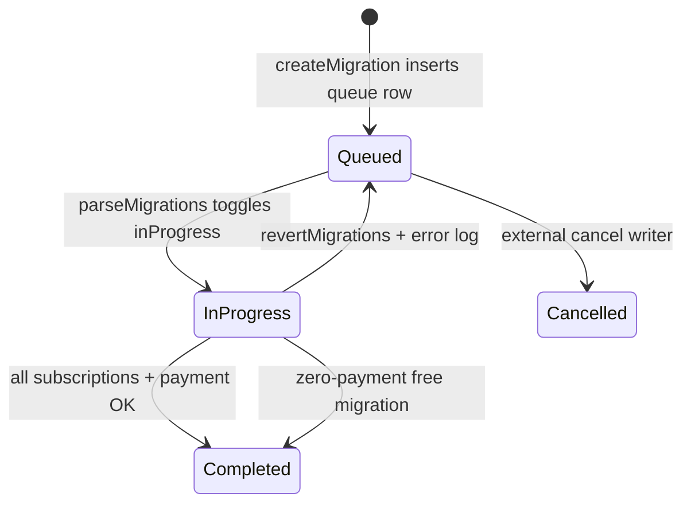
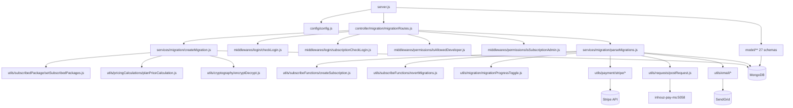

# subscription_migration_parser_ms

Repository: `apps/subscription_migration_parser_ms` — a separate git repository under `apps/` in the
control repo `kilo_inhouz_ai`. Every `file:line` below is relative to that service repo root.

## 1. Summary

A two-call service-migration engine for the Inhouz subscription platform. An admin posts an
encrypted payload to queue a migration of many subscribers from one subscription service to
another; the queued rows are stored in `subscriberMigrationQueue` and pre-built packages in
`subscribedPackages`. A second call, made later by `subscription_migration_scheduler_ms`, posts the
package id to run the migration: new subscriptions are created, old ones deactivated, Stripe
payments and refunds are issued through `inhouz_pay_ms`, and success/failure emails are sent. The
service holds almost no state of its own; it is a transactional writer over shared subscription
collections and a client of the pay service.

## 2. Stack and commands

- Runtime: Node.js, `engines` `>=12.0.0 <17.5.0` (`package.json:5-7`). Express 4, Mongoose 7,
  cluster module.
- Scripts (`package.json:9-12`):
  - `npm start` → `node server.js`
  - `npm test` → `echo "Error: no test specified" && exit 1` (no tests exist)
- Listens on `process.env.PORT` (`server.js:103`); the k8s service maps port 5025
  (`k8s/subscription-migration-parser-ms-cluster-ip-service.yml:10-11`).
- Image `inhouz/subscription_migration_parser_ms`, replicas `1`
  (`k8s/subscription-migration-parser-ms-deployment.yml:6,17`).
- Startup is `node server.js`; the master process forks workers, the worker process runs Express
  (`server.js:41-59`).

## 3. Entry points

| Entry point | `file:line` | How it is started |
|---|---|---|
| HTTP server listen | `server.js:103` | `npm start` in the container; `PORT` from k8s env |
| Cluster master / worker fork | `server.js:41-58` | Automatic on boot; `os.cpus().length` workers in production, 1 otherwise (`server.js:42`) |
| Migration route registration | `controller/migration/migrationRoutes.js:8-12` | Called from `server.js:73` |
| `POST /api/servicemigration/parse` | `controller/migration/migrationRoutes.js:9` | Unauthenticated route → `services/migration/parseMigrations.js` |
| `POST /api/servicemigration/subscriber/create` | `controller/migration/migrationRoutes.js:10` | `subscriptionCheckLogin` + `isSubscriptionAdmin` → `createMigration` |
| `POST /api/servicemigration/assetowner/create` | `controller/migration/migrationRoutes.js:11` | `checkLogin` + `isAllowedDeveloper` → `createMigration` |
| Mongoose disconnect retry timer | `server.js:82-89` | `setTimeout` 5s, reconnects once when disconnected |
| Mongo connect | `server.js:108-120` | Called at worker start and on disconnect (`server.js:76,86`) |
| Health probe | `healthcheck.js:1-21` | Container healthcheck; calls `/healthz` on `PORT` |

There is no cron, no queue consumer, and no websocket server in this repo.

## 4. Module inventory

| Name | `file:line` | Responsibility | Public API | Kind |
|---|---|---|---|---|
| Boot / cluster supervisor | `server.js:1-120` | Registers models, forks workers, mounts routes, connects Mongo, handles shutdown | process entry | `effectful` |
| `connectMongo()` | `server.js:108` | Opens the Mongoose connection, `maxPoolSize: 1` | internal | `effectful` |
| `config()` factory | `config/config.js:18-81` | Reads env and secret files into one object, cached for process lifetime | `module.exports()` | `effectful` (reads env, filesystem, memoizes) |
| `readSecret()` | `config/config.js:5-15` | Reads `/mnt/secrets/<name>`, falls back to env | internal | `effectful` (filesystem, env) |
| `migrationRoutes(app)` | `controller/migration/migrationRoutes.js:8` | Registers the three POST routes | `(app)` | `effectful` (framework mount) |
| `createMigration` | `services/migration/createMigration.js:13` | Validates the encrypted request, checks the current package, payment methods and services, builds packages, queues migrations | Express handler | `effectful` |
| `parseMigrations` | `services/migration/parseMigrations.js:27` | Runs one queued migration batch: subscriptions, payment, emails, logs | Express handler | `effectful` |
| `checkLogin` | `middlewares/login/checkLogin.js:9` | Decrypts session cookie / `x-access-token`, validates CSRF, extends session, loads user + company | Express middleware | `effectful` |
| `subscriptionCheckLogin` | `middlewares/login/subscriptionCheckLogin.js:1` | Session check against `subscriptionSessions` | Express middleware | `effectful` |
| `isAllowedDeveloper` | `middlewares/permissions/isAllowedDeveloper.js:3` | Allows `subscriptionAdmin` or `subscriptionDeveloper` permission | Express middleware | `pure` (reads `req.user` only) |
| `isSubscriptionAdmin` | `middlewares/permissions/isSubscriptionAdmin.js:1` | Allows when `req.user.isAdmin` is truthy | Express middleware | `pure` |
| `moduleAccessCheck` | `middlewares/module/moduleAccessCheck.js` | Module entitlement check; not mounted by this service | unused here | `effectful` |
| `recursiveSanitizer` | `utils/sanitizer/recursiveSanitizer.js` | Sanitizes every string in a nested request body | `(body, sanitizer)` | `pure` |
| `encryptDecrypt` | `utils/cryptography/encryptDecrypt.js:3` | RSA encrypt/decrypt of payloads with the client keypair | `(data, encrypt, publicEncrypt)` | `effectful` (crypto, logs) |
| `planPriceCalculation` | `utils/pricingCalculations/planPriceCalculation.js:1` | Computes plan/tier price data | `(params)` | `pure` |
| `setSubscribedPackages` | `utils/subscribedPackage/setSubscribedPackages.js:6` | Inserts package documents | `(constructor[])` | `effectful` |
| `updateSubscribedPackageSubscriberCount` | `utils/subscribedPackage/updateSubscribedPackageSubscriberCount.js:4` | Adjusts subscriber counts on packages | `(query, count)` | `effectful` |
| `validateSubscriptionRestrictions` | `utils/systemValidations/validateSubscriptionRestrictions.js:6` | Restriction-list validation for a subscriber | `(params)` | `effectful` |
| `createSubscription` | `utils/subscribeFunctions/createSubscription.js:8` | Creates a subscription document | `(params)` | `effectful` |
| `createInternalSubscription` | `utils/subscribeFunctions/createInternalSubscription.js:9` | Creates an internal-service subscription | `(params)` | `effectful` |
| `revertMigrations` | `utils/subscribeFunctions/revertMigrations.js:4` | Undoes created subscriptions after a failure | `(successList[])` | `effectful` |
| `migrationProgressToggle` | `utils/migration/migrationProgressToggle.js:4` | Sets `inProgress` on queue rows / package | `(migrationObjects, inProgress, subscribedPackage)` | `effectful` |
| `migrationErrorLog` | `utils/migration/migrationErrorLog.js:4` | Writes failure state onto queue rows | `(migrationObjects, errorMessage)` | `effectful` |
| `migrationSuccessLog` | `utils/migration/migrationSuccessLog.js:4` | Writes success state onto queue rows | `(migrationObjects[])` | `effectful` |
| `marketplaceTransaction` | `utils/payment/stripe/marketplaceTransaction.js:6` | Stripe marketplace charge on a connected account | `(params)` | `effectful` |
| `refundStripePayment` | `utils/payment/stripe/refundStripePayment.js:4` | Refunds a Stripe payment intent | `(paymentIntent, connectAccountId)` | `effectful` |
| `sendEmail` | `utils/email/sendEmail/sendEmail.js:5` | Sends via SendGrid | `(to, from, subject, text, html, fromName, attachments)` | `effectful` |
| `sendGenericEmail` | `utils/email/generic/sendGenericEmail.js:5` | Sends a template-driven error/notice email | `(params)` | `effectful` |
| `successfulMigrationEmailTemplate` | `utils/email/subscriptions/successfulMigrationEmailTemplate.js:1` | HTML body for subscriber success mail | `(...)` | `pure` |
| `ownerSuccessfulMigrationEmail` | `utils/email/subscriptions/ownerSuccessfulMigrationEmail.js:1` | HTML body for asset-owner success mail | `(...)` | `pure` |
| `subscriptionAdminEmail` | `utils/email/subscriptionService/subscriptionAdminEmail.js:6` | Emails service admins | `(subject, html, companyId)` | `effectful` |
| `postRequest` / `getRequest` / `deleteRequest` | `utils/requests/postRequest.js:3`, `getRequest.js:3`, `deleteRequest.js:3` | `node-fetch` wrappers | `(url, ...)` | `effectful` |
| `getUser` | `utils/user/getUser.js:5` | Loads a user document | `(userId)` | `effectful` |
| 27 model modules | `model/**/*.js` | Mongoose schemas and registrations | `mongoose.model(...)` | `effectful` (registration reads config/env) |

The model layer is registered in bulk at `server.js:13-39`. Two `require` lines are commented out
(`model/api/flexApi`, `model/appBuilder/inhouzApp`, `server.js:33-34`) even though
`config.flexApiModel` and `config.inhouzAppModel` are read (`config/config.js:56-57`).

## 5. Side effects

| Effect | Where | `file:line` |
|---|---|---|
| MongoDB connect | `server.js` | `server.js:108-120` |
| MongoDB reads/writes in queue creation | `createMigration` | `services/migration/createMigration.js:81,106,137,191,231,263,295,325,439,448` |
| MongoDB reads/writes in migration run | `parseMigrations` | `services/migration/parseMigrations.js:81,110,168,857,895,1170,...` |
| HTTP POST to pay service, finalize Stripe payment | `parseMigrations` | `services/migration/parseMigrations.js:1399-1403` |
| HTTP POST to pay service, server subscription payment | `parseMigrations` | `services/migration/parseMigrations.js:1474-1478` |
| Stripe SDK refund | `utils/payment/stripe/refundStripePayment.js` | `refundStripePayment.js:2,4` |
| Stripe SDK marketplace charge | `utils/payment/stripe/marketplaceTransaction.js` | `marketplaceTransaction.js:3,6` |
| SendGrid email send | `utils/email/sendEmail/sendEmail.js` | `sendEmail.js:5` |
| Filesystem read of mounted secrets | `config/config.js` | `config/config.js:10` |
| Environment read | `config/config.js` | `config/config.js:21-78` |
| Clock (`moment`, `new Date().getTime()`) | payload expiry, migration date | `createMigration.js:31,376`; `parseMigrations.js:45` |
| Randomness / short ids | `shortid.generate()` | `parseMigrations.js:1391` |
| Logging | `console.log` on every error path | `createMigration.js:87,114,...467`; `parseMigrations.js:87,...1666` |
| Cookies written | `x-java`, `sessionExpirationTimestamp` | `middlewares/login/checkLogin.js:126-141` |

Outgoing internal HTTP is exactly two calls, both to `INHOUZ_PAY_MS_URL`
(`k8s/subscription-migration-parser-ms-deployment.yml:163-164`).

## 6. State and state transitions

The service owns no state machine; the migration lifecycle lives in two shared collections. The
fields it reads and writes:

`subscriberMigrationQueue` (`model/subscription/subscriberMigrationQueue.js:6-79`):

| State | Field values | Trigger | Guard |
|---|---|---|---|
| Queued | `active:true, inProgress:false, status:'pending'` | `createMigration` inserts rows (`createMigration.js:366-379,439`) | payload valid, package found, no pending migration |
| In progress | `inProgress:true` | `migrationProgressToggle(..., true)` (`parseMigrations.js:166`) | — |
| Completed | `inProgress:false, status:'completed'` | `migrationSuccessLog` (`parseMigrations.js:12`) | payment succeeded |
| Failed / reverted | `inProgress:false`, `migrationAttemptCount`, `lastAttemptErrorMessage` | `migrationErrorLog` (`parseMigrations.js:12`) | any failure path |
| Cancelled | `status:'cancelled'`, `cancellationReason` | external writer (enum allows it, `subscriberMigrationQueue.js:56-64`) | — |

`subscribedPackages` package used by this service is selected with `awaitingActivation:true`
(`parseMigrations.js:81-84`) and created with `isMigration:true`, `migrationDateCount:5`,
`migrationDateUnit:'minute'` (`createMigration.js:400-412`).

## 7. Data

Collections touched, with the env var that names them (`config/config.js`) and the schema file:

| Env var | Collection | Schema | Key fields / rules |
|---|---|---|---|
| `SUBSCRIBER_MIGRATION_QUEUE_MODEL` | `subscriberMigrationQueue` | `model/subscription/subscriberMigrationQueue.js:6` | `subscriberEmail` (email validated), `subscriptionId`, `companyId`, `assetOwnerCompanyId`, `subscriptionServiceId`, `subscriptionServiceTierId` required; `status` enum `pending/cancelled/completed`; `autoMigrate` default true; `timestamps` |
| `SUBSCRIBED_PACKAGE_MODEL` | `subscribedPackages` | `model/subscription/subscriptionPackage.js:6` | package snapshot, `awaitingActivation`, `isMigration`, `migrationDateCount/Unit`, counts |
| `SUBSCRIPTION_MODEL` | `subscriptions` | `model/subscription/subscription.js:6` | `activeSubscriber`, `subscriptionServiceId`, `companyId`, `assetOwnerCompanyId`, `environment`, `serviceType` |
| `SUBSCRIPTION_SERVICE_MODEL` | `subscriptionServices` | `model/subscription/subscriptionService.js:5` | `deployed`, `serviceIsActive`, `serviceType`, `customPaymentTiers` |
| `PAYMENT_METHOD_MODEL` | `paymentMethods` | `model/payment/paymentMethod.js:5` | `expirationTimestamp`, `linkedSubscriptionServices`, `stripePaymentMethodId` |
| `PAYMENT_INTENT_MODEL` | `paymentIntents` | `model/payment/paymentIntent.js:5` | `processed`, `inProgress`, `stripePaymentIntentId`, `confirmationId` |
| `PAYMENT_CHARGE_MODEL` | `paymentCharges` | `model/payment/paymentCharge.js:5` | charge records |
| `PAYOUT_ACCOUNT_MODEL` | `payoutAccounts` | `model/payment/payoutAccount.js:5` | `subMerchantAccountId` (Stripe Connect) |
| `INHOUZ_SUBSCRIPTIONS_MODEL` | `inhouzSubscriptions` | `model/inhouzSubscription/inhouzSubscription.js:5` | account-level subscription, `active`, `companyId` |
| `COMPANY_MODEL` | `company` | `model/company/company.js:5` | `stripeCustomerId` used at `parseMigrations.js:1333` |
| `SUBSCRIBER_MODEL` | `subscribers` | `model/subscription/subscriber.js:6` | subscriber profiles |
| `SUBSCRIBER_ACTION_LOG_MODEL` | `subscriberActionLogs` | `model/subscription/subscriberActionLogs.js:6` | action audit rows |
| `SESSION_MODEL` / `SUBSCRIPTION_SESSION_MODEL` | `session` / `subscriptionSessions` | `model/session/session.js:5`, `subscriptionSession.js:6` | `csrfToken`, `userId`, `expirationTimestamp` |
| `PAYMENT_TAX_RULE_MODEL` | `paymentTaxRules` | `model/payment/paymentTaxRules.js:5` | tax rules applied to the charge |
| `EXCHANGE_RATE_CACHE_MODEL` | `exchangeRateCache` | `model/payment/exchangeRateCache.js:5` | currency rates |
| `INHOUZ_PAYMENT_MODEL` / `INHOUZ_PAY_MRR_TRACKER_MODEL` | `inhouzPayments` / `inhouzPayMrrTracker` | `model/payment/inhouzPayment.js:5`, `inhouzPayMrrTracker.js:5` | pay-service mirror records |
| `USER_MODEL`, `USER_ROLES_MODEL`, `ROLE_MODEL`, `PERMISSION_MODEL` | `User`, `userRoles`, `roles`, `permissions` | `model/user/*.js`, `model/rolesAndPermissions/*.js` | auth data for `checkLogin` |
| `VERSION_TRACKER_MODEL`, `SUBSCRIPTION_USAGE_LOG`, etc. | env-declared, no model in repo | — | declared in k8s env only |

**Shared-collection coupling.** `subscribers`, `subscriptions`, `subscribedPackages`,
`subscriberMigrationQueue`, `paymentMethods`, `paymentIntents`, `paymentCharges`, `payoutAccounts`,
`inhouzSubscriptions`, `subscriptionServices`, `companies` are read and written by
`subscription_migration_scheduler_ms`, `subscription_ms` and `inhouz_pay_ms`. This service writes
subscription lifecycle state that those services read; the queue row is the only hand-off between
the scheduler and this parser.

## 8. Public interfaces

| Route | Auth | Request | Response |
|---|---|---|---|
| `POST /api/servicemigration/parse` | none | `{ encryptedPayload: string }` (RSA payload with `expirationTimestamp` + `payload.subscribedPackageId`) (`parseMigrations.js:29-66`) | `{success:true}` or `{error:{message}}` |
| `POST /api/servicemigration/subscriber/create` | session + `isAdmin` | `{ encryptedPayload: string, migrationSubscriptions: [{subscriberEmail, subscriptionServiceTierId, subscriptionId, migrationSubscriptionTierId}] }`; payload carries `subscriptionServiceId, companyId, migrationServiceId, assetOwnerCompanyId, origin` (`createMigration.js:16-66`) | `{success:true}` or `{error:{message}}` |
| `POST /api/servicemigration/assetowner/create` | session + `subscriptionAdmin`/`subscriptionDeveloper` | same body as above | same |

Error statuses used: 400 (missing/invalid payload), 401 (`Not Authorized` at
`createMigration.js:183`), 404 (package/service/subscription not found), 500 (data or write
failure). Auth failures from middleware return HTTP 200 with an `error` body
(`checkLogin.js:14-18,41-46`).

## 9. Configuration

Env var names only. Read in `config/config.js` unless noted.

- Secrets (file under `SECRETS_PATH`, fallback env): `SENDGRID_API_KEY`, `SESSION_SECRET`,
  `MONGO_URL`, `CLIENT_SECRET_KEY`, `CLIENT_PUBLIC_KEY`, `STRIPE_API_KEY`
  (`config/config.js:5-15,25-29,41,60-68`).
- `SECRETS_PATH`, `NODE_ENV` (`config/config.js:6`; `server.js:42`; `checkLogin.js:129`), `PORT`
  (`server.js:103`, `healthcheck.js:6`).
- Model name keys: `FLEX_FORM_FILE_MODEL`, `FLEX_MODULE_MODEL`, `FLEX_COLLECTION_MODEL`,
  `FORM_MODEL`, `SMPL_EMAIL`, `DATA_RULE_EXECUTION_RESULT_MODEL`, `USER_MODEL`, `COMPANY_MODEL`,
  `ROLE_MODEL`, `PERMISSION_MODEL`, `USER_ROLES_MODEL`, `SESSION_MODEL`,
  `SESSION_VALIDATOR_MODEL`, `AUTH_LOG_MODEL`, `COOKIE_DOMAIN`,
  `SUBSCRIBER_MIGRATION_QUEUE_MODEL`, `IP_ADDRESS_LOCATION_MODEL`, `SUBSCRIBED_PACKAGE_MODEL`,
  `SUBSCRIPTION_MODEL`, `SUBSCRIBER_ACTION_LOG_MODEL`, `SUBSCRIBER_MODEL`,
  `SUBSCRIPTION_SERVICE_MODEL`, `PAYMENT_CHARGE_MODEL`, `PAYOUT_ACCOUNT_MODEL`,
  `PAYMENT_METHOD_MODEL`, `PAYMENT_INTENT_MODEL`, `EXCHANGE_RATE_CACHE_MODEL`,
  `INHOUZ_APP_MODEL`, `FLEX_API_MODEL`, `SUBSCRIPTION_SERVICE_CHARGE_TYPE`,
  `INHOUZ_SUBSCRIPTIONS_MODEL`, `PAYMENT_TAX_RULE_MODEL`, `INHOUZ_PAYMENT_MODEL`,
  `INHOUZ_PAY_MRR_TRACKER_MODEL`, `PAYMENT_METADATA_CACHE_MODEL`,
  `SUBSCRIPTION_SESSION_MODEL`, `SUBSCRIPTION_USER_RESTRICTION_LIST_MODEL`
  (`config/config.js:21-78`).
- URLs: `IP_LOCATION_FINDER_URL`, `INHOUZ_BASE_URL`, `INHOUZ_PAY_MS_URL` (`config/config.js:45,70-71`).
- Email identity: `INHOUZ_FROM_EMAIL` (`config/config.js:76`).
- Declared in k8s but never read in code: `SUBSCRIPTION_SERVICE_CHARGE_FEE`,
  `SUBSCRIPTION_USAGE_LOG`, `INSURANCE_*`-style leftovers are absent; only
  `SUBSCRIPTION_SERVICE_CHARGE_FEE` is confirmed unread by grep.
- Hard-coded config, not env: permission strings `admin`, `subscriptionAdmin`,
  `subscriptionDeveloper` (`config/config.js:38-40`); CORS origin `/inhouz.localhost/`
  (`server.js:63`).

## 10. Dependencies

Direct dependencies from `package.json:14-37`, and why each is present:

| Package | Why |
|---|---|
| `express` | HTTP server and routing |
| `mongoose` | MongoDB ODM; all collections |
| `body-parser` | JSON body parsing, 20 MB limit (`server.js:69`) |
| `cookie-parser` | Signed cookie parsing with `SESSION_SECRET` (`server.js:72`) |
| `cors` | Request origin allow-list (`server.js:61-67`) |
| `helmet` | Security headers (`server.js:71`) |
| `hpp` | HTTP parameter pollution guard (`server.js:70`) |
| `dotenv` | Loads `.env` in local runs (`server.js:1`) |
| `lodash` | `isEmpty`, `isEqual`, `uniq` in the services |
| `moment` | Timestamps and migration dates |
| `shortid` | Idempotency keys for pay-service calls |
| `cryptr` | AES payload and session-token encryption |
| `node-rsa` | RSA client keypair for `encryptDecrypt` |
| `sanitizer` | Input sanitization via `recursiveSanitizer` |
| `stripe` | Stripe SDK: refund and marketplace charge |
| `@sendgrid/mail` | Transactional email |
| `node-fetch` | HTTP client for the pay service |
| `validator` | Email validation in schemas |
| `bcryptjs`, `connect-mongo`, `express-session`, `request-ip`, `crypto-js` | Present but not required by this service's code paths |

## 11. Testing

There are no tests. `npm test` exits 1 with "no test specified" (`package.json:10`). No test
directory, no fixtures, no mocks. Coverage is zero; the migration path, the payment path and the
revert path are verified only in production.

## 12. Known issues and risks

1. **`Model.count()` with Mongoose 7** — `SubscriptionCollection.count(...)` at
   `services/migration/createMigration.js:263`. `count()` was removed in Mongoose 7 and the repo
   pins `mongoose ^7.4.0` (`package.json:36`). This throws at runtime.
2. **Health probe has no route** — `healthcheck.js:7` requests `/healthz`, but no route registers
   `/healthz`; only three `/api/servicemigration/*` routes exist (`migrationRoutes.js:9-11`). The
   probe always fails with 404.
3. **Unauthenticated parse route** — `POST /api/servicemigration/parse` has no middleware
   (`migrationRoutes.js:9`). It is protected only by the RSA-encrypted payload and its
   `expirationTimestamp` check (`parseMigrations.js:48-56`).
4. **CORS hard-coded to `inhouz.localhost`** — `server.js:63`. In a real deployment browsers are
   rejected; service-to-service calls are unaffected.
5. **First-row assumption** — comment and behaviour at `parseMigrations.js:147`:
   `let migrationObj = migrationObjects[0]; //this is wrong. Different tiers can exist in one migration`.
6. **Connection pool of one** — `maxPoolSize: 1` (`server.js:116`) on a service that runs many
   sequential Mongo writes.
7. **Auth failures return HTTP 200** — `checkLogin.js:14-18,41-46`; monitors and clients cannot
   distinguish rejection from success by status code.
8. **`isSubscriptionAdmin` tests `isAdmin`** (`middlewares/permissions/isSubscriptionAdmin.js:5`)
   while `createMigration` tests the `subscriptionAdmin` permission (`createMigration.js:181`). Two
   different authorization models for the same operation.
9. **Config is cached for process lifetime** — `config/config.js:17-19`. A secret rotation needs a
   pod restart.
10. **Migration delay is fixed at 5 minutes** — `createMigration.js:376` and
    `createMigration.js:405-406`; there is no guard that the scheduler picks it up.
11. **No rollback for a partially created queue batch on later errors** — packages are deleted on
    queue-insert failure (`createMigration.js:445-463`), but a failure before that leaves created
    packages in place.
12. **`console.log` is the only logging** — no structured logger, no correlation id; failures in
    `parseMigrations` may log only a generic catch (`parseMigrations.js:1666`).

No credential is embedded in source. Secrets are read from `/mnt/secrets` or env only
(`config/config.js:5-15`).

## 13. Module map

## 14. Open questions

- `SUBSCRIPTION_SERVICE_CHARGE_FEE` is set in the deployment
  (`k8s/subscription-migration-parser-ms-deployment.yml`) but no code reads it. Is a fee supposed to
  be applied by this service, or was the env var left over from another service?
- `model/api/flexApi` and `model/appBuilder/inhouzApp` are required nowhere active
  (`server.js:33-34` commented) yet their env keys stay in `config/config.js:56-57`. Are those
  collections still shared with this service?
- The `flexModuleModel` name is read at `config/config.js:22` but the brief's k8s env list does not
  include `FLEX_MODULE_MODEL`; the brief and the code disagree. Code is authoritative.
- Who writes `status: 'cancelled'` on `subscriberMigrationQueue`? No writer exists in this repo.
- `checkLogin` reads a cookie named `SMPL` (`checkLogin.js:11`) while `config.js` has no
  `COOKIE_NAME`; the deployment sets `COOKIE_NAME`. Is the name meant to be configurable?
