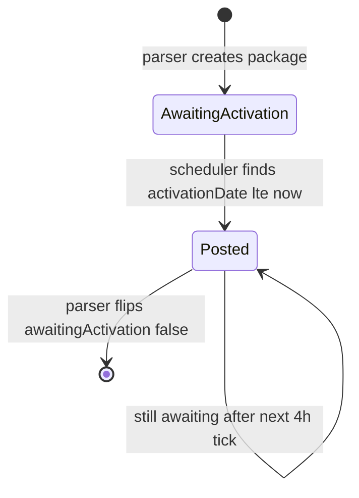
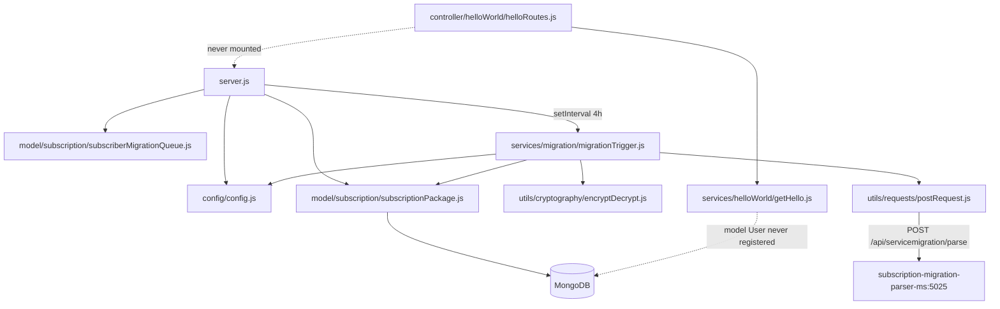

# subscription_migration_scheduler_ms

Repository: `apps/subscription_migration_scheduler_ms` — a separate git repository under `apps/` in
the control repo `kilo_inhouz_ai`. Every `file:line` below is relative to that service repo root.

## 1. Summary

A timer-driven worker. Every four hours it scans `subscribedPackages` for `subscriptionPlan`
packages whose `awaitingActivation` flag is still true and whose `activationDate` has passed, then
POSTs one encrypted payload per package to `subscription_migration_parser_ms` so that service runs
the migration. It stores nothing itself, exposes no API surface that is actually mounted, and is
the only caller that starts a migration run. It also boots a full Express app with Mongo, CORS,
helmet and hpp, but the only registered route module is never mounted, so the HTTP surface is dead
code.

## 2. Stack and commands

- Runtime: Node.js, `engines` `>=12.0.0 <17.5.0` (`package.json:5-7`). Express 4, Mongoose 7, no
  cluster module.
- Scripts (`package.json:9-12`):
  - `npm start` → `node --max-old-space-size=8192 server.js`
  - `npm test` → `echo "Error: no test specified" && exit 1` (no tests exist)
- Listens on `process.env.PORT` (`server.js:68`); the k8s service maps port 5024
  (`k8s/subscription-migration-scheduler-ms-cluster-ip-service.yml:10-11`).
- Image `inhouz/subscription_migration_scheduler_ms`, replicas `1`
  (`k8s/subscription-migration-scheduler-ms-deployment.yml:6,17`).

## 3. Entry points

| Entry point | `file:line` | How it is started |
|---|---|---|
| HTTP server listen | `server.js:68` | `npm start`; `PORT` from k8s env |
| Migration timer | `server.js:54-56` | `setInterval(..., 14400000)` — fires 4 hours after boot, then every 4 h |
| `migrationTrigger()` | `services/migration/migrationTrigger.js:7` | Called only by the timer (`server.js:55`) |
| Mongo connect | `server.js:72-83` | At boot (`server.js:36`) and 5 s after a disconnect (`server.js:44-48`) |
| Mongo disconnect retry | `server.js:42-49` | `setTimeout` 5000 ms |
| Route module (not mounted) | `controller/helloWorld/helloRoutes.js:3-5` | Defined but never `require`d by `server.js` |
| Health probe | `healthcheck.js:1-21` | Container healthcheck; calls `/healthz` on `PORT` |

The first migration run is 4 hours after each pod start. There is no run-on-boot, no cron
expression, and no manual trigger route.

## 4. Module inventory

| Name | `file:line` | Responsibility | Public API | Kind |
|---|---|---|---|---|
| Boot | `server.js:1-84` | Express setup, Mongo connection, timer, shutdown hooks | process entry | `effectful` |
| `connectMongo()` | `server.js:72` | Opens Mongoose with `maxPoolSize: 1` | internal | `effectful` |
| `shutdownFunction()` | `server.js:62-66` | Closes the Mongo connection on SIGINT/SIGTERM/uncaught | internal | `effectful` |
| Migration timer callback | `server.js:54-56` | Calls `migrationTrigger()` | inline | `effectful` (clock, database, network) |
| `migrationTrigger` | `services/migration/migrationTrigger.js:7` | Pages eligible packages, encrypts a payload, POSTs to the parser | `async ()` | `effectful` |
| `helloRoutes(app)` | `controller/helloWorld/helloRoutes.js:3` | Would register `GET /api/helloworld` | `(app)` | `effectful` |
| `getHello` | `services/helloWorld/getHello.js:4` | Returns all `User` documents | Express handler | `effectful` |
| `mongoose.model('User')` at module scope | `services/helloWorld/getHello.js:2` | Binds the model when the module is required | — | `effectful` |
| `config()` factory | `config/config.js:18-55` | Reads env and secret files, caches the result | `module.exports()` | `effectful` |
| `readSecret()` | `config/config.js:5-15` | Reads `/mnt/secrets/<name>`, falls back to env | internal | `effectful` |
| `checkLogin` | `middlewares/login/checkLogin.js:9` | Session + CSRF middleware; not mounted here | Express middleware | `effectful` |
| `moduleAccessCheck` | `middlewares/module/moduleAccessCheck.js` | Module entitlement check; not mounted | Express middleware | `effectful` |
| `subdomain` middleware | `middlewares/subdomain/` | Subdomain handling; not mounted | Express middleware | unclear, unused |
| `encryptDecrypt` | `utils/cryptography/encryptDecrypt.js:3` | RSA encrypt/decrypt of payloads | `(data, encrypt, publicEncrypt)` | `effectful` (crypto, logs) |
| `postRequest` / `getRequest` / `deleteRequest` | `utils/requests/postRequest.js:3`, `getRequest.js:3`, `deleteRequest.js:3` | `node-fetch` wrappers | `(url, ...)` | `effectful` |
| `recursiveSanitizer` | `utils/sanitizer/recursiveSanitizer.js` | Nested body sanitization; unused here | `(body, sanitizer)` | `pure` |
| `getUser` | `utils/user/getUser.js:18` | Loads user, roles and permissions; unused here | `(userId)` | `effectful` |
| 8 model modules | `model/**/*.js` | Mongoose schemas; only 2 are required (`server.js:19-20`) | `mongoose.model(...)` | `effectful` |

Six of the eight model files and four middleware files are copied from the parser repo and are
never wired into this service. `server.js:13-18` shows the user/role/company/session model
requires commented out.

## 5. Side effects

| Effect | Where | `file:line` |
|---|---|---|
| MongoDB connect | boot | `server.js:72-83` |
| MongoDB read on `subscribedPackages` | `migrationTrigger` | `migrationTrigger.js:13-30` |
| HTTP POST to the parser service | `migrationTrigger` | `migrationTrigger.js:54-58` |
| RSA encryption of each payload | `encryptDecrypt` | `migrationTrigger.js:43-52` → `utils/cryptography/encryptDecrypt.js:10` |
| Clock: `new Date().getTime()`, `moment()` | eligibility + expiry | `migrationTrigger.js:10,48` |
| Interval timer | boot | `server.js:54` |
| Filesystem read of mounted secrets | config | `config/config.js:10` |
| Environment read | config | `config/config.js:21-52` |
| Logging | `console.log` on connection and error paths | `server.js:40,43,51`; `migrationTrigger.js:28,64` |
| Cookies written | only if `checkLogin` were mounted | `middlewares/login/checkLogin.js:126-141` |

Outgoing HTTP is exactly one endpoint: `${SUBSCRIPTION_MIGRATION_PARSER_MS_URL}/api/servicemigration/parse`
(`migrationTrigger.js:55`), pointed at `subscription-migration-parser-ms-cluster-ip-service:5025`
(`k8s/subscription-migration-scheduler-ms-deployment.yml:54-55`).

## 6. State and state transitions

This service has no state machine of its own. It is a read-only observer of the package state
machine owned by `subscription_migration_parser_ms`.

| Observed state | Condition | Action |
|---|---|---|
| Eligible | `packageType:'subscriptionPlan'`, `awaitingActivation:true`, `activationDate <= now` (`migrationTrigger.js:14-19`) | Encrypt payload and POST |
| Not yet due | `activationDate > now` | Skipped by the query |
| Already started | `awaitingActivation:false` | Dropped from the result set |

The transition out of `Posted` is performed by the parser, not this service
(`parseMigrations` activates the package). The scheduler can post the same package again on the
next tick if the parser has not cleared the flag.

## 7. Data

| Env var | Collection | Schema | Key fields used here |
|---|---|---|---|
| `SUBSCRIBED_PACKAGE_MODEL` | `subscribedPackages` | `model/subscription/subscriptionPackage.js:5` | `packageType`, `awaitingActivation`, `activationDate`; projection `_id` only (`migrationTrigger.js:13-23`) |
| `SUBSCRIBER_MIGRATION_QUEUE_MODEL` | `subscriberMigrationQueue` | `model/subscription/subscriberMigrationQueue.js:6` | Model registered (`server.js:19`) but never queried here |

**Shared-collection coupling.** `subscribedPackages` is created and mutated by
`subscription_migration_parser_ms` (`setSubscribedPackages`, `migrationProgressToggle`) and read by
`subscription_ms` and `inhouz_pay_ms`. This service only reads it. `subscriberMigrationQueue` is
written by the parser and read by the parser; the scheduler registers the model without using it.

## 8. Public interfaces

| Interface | Status | Shape |
|---|---|---|
| `GET /api/helloworld` | Defined at `controller/helloWorld/helloRoutes.js:4`, **never mounted** (`server.js` has no `require` of the route module) | Would return the `User` array or `{error:{message}}` |
| `POST` to parser `/api/servicemigration/parse` | Outbound | `{encryptedPayload: string}` (`migrationTrigger.js:57`) |
| HTTP listen on `PORT` | Live but routeless | No `app.use`/`app.get` reaches `app` |

There are no events, topics, or CLI commands.

## 9. Configuration

Env var names only.

- Secrets (file under `SECRETS_PATH`, fallback env): `SESSION_SECRET`, `MONGO_URL`,
  `CLIENT_SECRET_KEY`, `CLIENT_PUBLIC_KEY` (`config/config.js:5-15,28-29,39-51`).
- `SECRETS_PATH`, `PORT`, `NODE_ENV` (`config/config.js:6`; `server.js:68`;
  `middlewares/login/checkLogin.js:129`).
- Model keys: `SUBSCRIBER_MIGRATION_QUEUE_MODEL`, `SUBSCRIBED_PACKAGE_MODEL`
  (`config/config.js:41,52`).
- Service URL: `SUBSCRIPTION_MIGRATION_PARSER_MS_URL` (`config/config.js:42-43`).
- Other keys read but unused by mounted code: `FLEX_FORM_FILE_MODEL`, `FLEX_MODULE_MODEL`,
  `FLEX_COLLECTION_MODEL`, `FORM_MODEL`, `SMPL_EMAIL`, `DATA_RULE_EXECUTION_RESULT_MODEL`,
  `USER_MODEL`, `COMPANY_MODEL`, `ROLE_MODEL`, `PERMISSION_MODEL`, `USER_ROLES_MODEL`,
  `SESSION_MODEL`, `SESSION_VALIDATOR_MODEL`, `AUTH_LOG_MODEL`, `COOKIE_DOMAIN`
  (`config/config.js:21-40`).
- Hard-coded: CORS origin `/inhouz.localhost/` (`server.js:25`); interval 14400000 ms
  (`server.js:56`); payload expiry 30 s (`migrationTrigger.js:48`); page size 1000
  (`migrationTrigger.js:10`).

## 10. Dependencies

Direct dependencies from `package.json:14-37`:

| Package | Why |
|---|---|
| `express` | Boots an app; no route is mounted |
| `mongoose` | Reads `subscribedPackages` |
| `body-parser`, `cookie-parser`, `cors`, `helmet`, `hpp` | HTTP hardening copied from the parser; unused in practice |
| `dotenv` | Local `.env` (`server.js:1`) |
| `moment` | Payload expiry (`migrationTrigger.js:48`) |
| `node-rsa` | RSA keypair for `encryptDecrypt` (`config/config.js:1,44-51`) |
| `cryptr`, `crypto-js`, `bcryptjs` | Session payload helpers; unused |
| `node-fetch` | POST to the parser |
| `lodash`, `validator`, `sanitizer`, `shortid`, `request-ip`, `@sendgrid/mail`, `connect-mongo`, `express-session` | Present but unused by live code paths |

## 11. Testing

There are no tests. `npm test` exits 1 (`package.json:10`). No test directory, no mocks. The
timer, the pagination and the un-awaited POST are untested.

## 12. Known issues and risks

1. **The only route module is never mounted** — `controller/helloWorld/helloRoutes.js:3-5` is
   never required by `server.js`. The service listens with zero routes.
2. **Health probe has no route** — `healthcheck.js:7` requests `/healthz`; nothing registers it.
   With no routes at all, the probe returns 404 every time.
3. **`mongoose.model('User')` without registration** — `services/helloWorld/getHello.js:2` would
   throw `MissingSchemaError` on require because the user model require is commented out
   (`server.js:13`). It is masked only because nothing requires the module.
4. **Un-awaited POST** — `postRequest(...)` at `migrationTrigger.js:54` is not awaited. A rejected
   fetch becomes an unhandled promise rejection; the loop never learns the call failed.
5. **Skip/limit pagination over a shrinking result set** — `migrationTrigger.js:25-26,38` pages
   with `skip` while the filter requires `awaitingActivation:true`. As the parser flips the flag,
   documents shift and rows can be skipped in the same pass.
6. **Timer starts at boot, not on a clock boundary** — `setInterval` (`server.js:54`) fires 4 h
   after start. Every restart delays due migrations by up to 4 more hours. With `replicas: 1` a
   rolling restart re-arms the timer.
7. **No concurrency guard between replicas** — if replicas are raised above 1, every replica posts
   the same package. There is no lock or lease.
8. **`maxPoolSize: 1`** — `server.js:80`.
9. **CORS hard-coded to `inhouz.localhost`** — `server.js:25`; irrelevant in practice while no
   route is mounted.
10. **Config cached for process lifetime** — `config/config.js:17-19`; a secret rotation needs a
    restart.
11. **Large page size with no projection safety** — `limit 1000` (`migrationTrigger.js:10`) and
    node started with an 8 GB heap (`package.json:11`), which suggests this loop has grown before.

No credential is embedded in source. Secrets come from `/mnt/secrets` or env only
(`config/config.js:5-15`).

## 13. Module map

## 14. Open questions

- Is the 4-hour interval intentional, or should the scheduler run on a cron boundary and run once
  at boot? Nothing in the repo states it.
- `controller/helloWorld` and `services/helloWorld` are dead in this repo. Are they a scaffold left
  behind, or is a health/debug route meant to be mounted?
- Why does `server.js:19` register the queue model when `migrationTrigger` never reads it? Is a
  cancellation/cleanup path planned?
- The brief lists `source dirs ... middlewares/subdomain`, but no middleware file in that folder is
  required anywhere. Confirm it is dead code before deleting.
- The parser checks `awaitingActivation` on the same package id but not `activationDate`. Is the
  30-second payload expiry (`migrationTrigger.js:48`) enough for a 1000-package batch, or does the
  later posts in a batch expire before the parser handles them?
