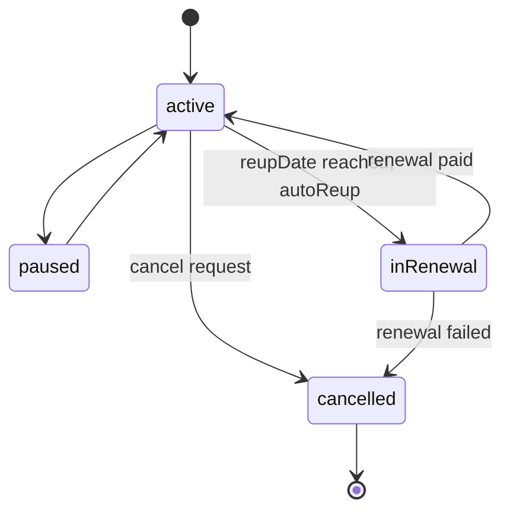
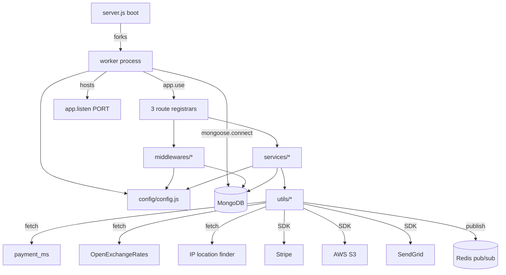

# subscription_ms

## 1. Summary

`subscription_ms` is the subscription core of the Inhouz platform. It owns subscription
services (the sellable product definition), subscribers, subscriptions, subscriber API keys,
service discounts, migration queues, and subscriber restriction lists. It also carries several
locally declared schemas for collections owned by other services (`paymentIntents`,
`paymentCharges`, `paymentMethods`, `payoutAccounts`, `customers`, `contacts`, `company`,
`User`, `roles`, `permissions`), which it reads and writes directly through Mongoose. It lives
in its own git repository at `apps/subscription_ms/` (repo id `subscription_ms`); the handover
you are reading lives in the control repository `inhouz_ai`.

## 2. Stack and commands

- Runtime: Node.js, `engines.node` `">=12.0.0 <17.5.0"` (`package.json:7-9`), CommonJS, cluster-forked Express.
- Framework: Express 4 (`package.json:25`), Mongoose 7 (`package.json:31`), Redis 4 (`package.json:34`).
- Scripts (`package.json:10-13`): `npm start` → `node server.js`; `npm test` → fails on purpose
  (`echo "Error: no test specified" && exit 1`).
- Port: `PORT` (`server.js:112`), set to `5005` by the deployment (`k8s/subscription-ms-deployment.yml:28-29`).
- Container image: `inhouz/subscription_ms` (`k8s/subscription-ms-deployment.yml:17`), replicas `1`
  (`k8s/subscription-ms-deployment.yml:6`), HPA min 1 / max 2 (`k8s/subscription-ms-hpa.yml:10-11`).
- Kubernetes service: `subscription-ms-cluster-ip-service`, ClusterIP, port `5005`
  (`k8s/subscription-ms-cluster-ip-service.yml:4,6,10`).
- Health probe: `healthcheck.js:10-14` issues `GET /healthz` against `PORT` (`healthcheck.js:7`).
  **No `/healthz` route is registered** (`server.js:80-82`) — see section 12.

## 3. Entry points

| Entry point | file:line | How it is started |
|---|---|---|
| Cluster master | `server.js:47-64` | `node server.js`; forks `os.cpus().length` workers in production, 1 otherwise (`server.js:48-51`) |
| Worker HTTP app | `server.js:66-114` | `app.listen(process.env.PORT)` (`server.js:112`) |
| Mongo connect | `server.js:117-129` | Called at boot when not connected (`server.js:84-86`) and after a disconnect (`server.js:91-98`) |
| Reconnect timer | `server.js:94-96` | 5 s `setTimeout` after a `disconnected` event |
| Subscription-service routes | `controller/subscriptionService/subscriptionServiceRoutes.js:31` | Mounted at `server.js:80` |
| Subscriber routes | `controller/subscriber/subscriberRoutes.js:12` | Mounted at `server.js:81` |
| Service-discount routes | `controller/serviceDiscount/serviceDiscountRoutes.js:14` | Mounted at `server.js:82` |
| Health probe | `healthcheck.js:1-19` | Run as a process; probes `/healthz` |
| Model registration | `server.js:13-44` | 31 `require()` calls that register every Mongoose model at boot |
| Graceful shutdown | `server.js:102-110` | `SIGINT`, `SIGTERM`, `uncaughtException` → closes the Mongo connection |

There is no cron, no job queue consumer, and no websocket handler. The only timer is the
reconnect delay at `server.js:94`.

## 4. Module inventory

Route registrars:

| Name | file:line | Owns | Public API | Kind |
|---|---|---|---|---|
| `subscriptionServiceRoutes` | `controller/subscriptionService/subscriptionServiceRoutes.js:31` | 17 subscription-service endpoints | `module.exports = (app) => void` | `effectful` (mounts handlers, reads middleware state) |
| `subscriberRoutes` | `controller/subscriber/subscriberRoutes.js:12` | 5 subscriber endpoints | `module.exports = (app) => void` | `effectful` |
| `serviceDiscountRoutes` | `controller/serviceDiscount/serviceDiscountRoutes.js:14` | 6 discount endpoints | `module.exports = (app) => void` | `effectful` |

Config and infrastructure:

| Name | file:line | Owns | Public API | Kind |
|---|---|---|---|---|
| `config()` | `config/config.js:19-109` | Cached config object; reads secrets from `SECRETS_PATH` with env fallback | `() => configObject` | `effectful` (filesystem, env, NodeRSA key parsing at `config/config.js:82-93`) |
| `readSecret()` | `config/config.js:6-16` | Reads one secret file, falls back to an env var | `(name, envFallback) => string` | `effectful` (filesystem, env) |
| `connectMongo()` | `server.js:117-129` | `mongoose.connect` with `maxPoolSize: 1` | `() => void` | `effectful` |
| `shutdownFunction()` | `server.js:106-110` | Closes the Mongo connection | `() => void` | `effectful` |
| `invalidateApiServiceApiKey()` | `utils/cacheManager/cacheInvalidationPublisher.js:28-34` | Publishes a Redis cache-invalidation message | `(apiKey) => Promise<void>` | `effectful` (Redis) |

Service handlers (all Express `(req,res)` handlers):

| Name | file:line | Owns | Kind |
|---|---|---|---|
| `createSubscriptionService` | `services/subscriptionService/createSubscriptionService.js` (required at `controller/subscriptionService/subscriptionServiceRoutes.js:9`) | Creates a sellable service | `effectful` (Mongo) |
| `cloneSubscriptionService` | required at `...Routes.js:10` | Clones a service definition | `effectful` |
| `editSubscriptionService` | required at `...Routes.js:11` | Edits a service | `effectful` |
| `deploySubscriptionService` | required at `...Routes.js:12` | Deploys a service version | `effectful` |
| `setSubscriptionServiceVersion` | required at `...Routes.js:13` | Sets a version on a service | `effectful` |
| `getSubscriptionService` | `services/subscriptionService/getSubscriptionService.js:7` | Reads one service, sanitises input, signs S3 image URLs at `:228` | `effectful` (Mongo, AWS S3) |
| `getSubscriptionServices` | required at `...Routes.js:15` | Lists services for a company | `effectful` |
| `getSubscriptionServiceVersions` | required at `...Routes.js:16` | Lists versions | `effectful` |
| `transferSubscriptions` | required at `...Routes.js:17` | Transfers subscriptions between owners | `effectful` |
| `addToMigrationQueue` | required at `...Routes.js:18` | Enqueues a tier migration | `effectful` |
| `getMigrationTiers` | required at `...Routes.js:19` | Lists migration tiers | `effectful` |
| `logSubscriptionUsage` | required at `...Routes.js:20` | Appends a usage log | `effectful` |
| `subscriptionAccessCheck` | required at `...Routes.js:21` | Runtime access decision for an API-key caller | `effectful` |
| `getSignupSubscriptionService` | `services/subscriptionService/getSignupSubscriptionService.js` (route at `...Routes.js:46`) | Public signup read of a service; S3 signing at `:291` | `effectful` |
| `manageUserRestriction` | required at `...Routes.js:24` | Writes restriction-list entries | `effectful` |
| `getUserRestrictionList` | required at `...Routes.js:27` | Reads restriction list | `effectful` |
| `fieldAvailabilityCheck` | required at `...Routes.js:8` | Slug/name uniqueness check | `effectful` (Mongo) |
| `cancelSubscription` | `services/subscriptionService/cancelSubscription.js` (required at `controller/subscriber/subscriberRoutes.js:6`) | Cancels one subscription | `effectful` |
| `getSubscribedUserInfo` | required at `...Routes.js:5` | Subscriber roster for admins | `effectful` |
| `getSubscriptionApiKey` | required at `...Routes.js:7` | Reveals the subscriber API key | `effectful` |
| `changeSubscriptionApiKey` | required at `...Routes.js:8` | Rotates the API key, then invalidates the API cache (`utils/cacheManager/cacheInvalidationPublisher.js:28`) | `effectful` |
| 6 discount handlers | `controller/serviceDiscount/serviceDiscountRoutes.js:6-11` | Create/edit/read/list/verify/usage of service discounts | `effectful` |

Middlewares:

| Name | file:line | Owns | Kind |
|---|---|---|---|
| `isLoggedIn` (`checkLogin`) | `middlewares/login/checkLogin.js` | Session + company lookup, subscription-model state | `effectful` (Mongo, clock via `moment`, `cryptr`) |
| `lightLoginCheck` | `middlewares/login/lightLoginCheck.js` | Cheaper session check | `effectful` (Mongo) |
| `subscriptionCheckLogin` | `middlewares/login/subscriptionCheckLogin.js` | Session check against `subscriptionSessions` | `effectful` |
| `checkSubscriberLogin` | `middlewares/subscription/checkSubscriberLogin.js` | Subscriber-scoped session check | `effectful` |
| `clientEncryptedLogin` | `middlewares/login/clientEncryptedLogin.js` | Decrypts client-encrypted credentials (NodeRSA) | `effectful` |
| `serverEncryptedLogin` | `middlewares/login/serverEncryptedLogin.js` | Server-side password check | `effectful` |
| `apiKeyValidation` | `middlewares/apiKey/apiKeyValidation.js` | Decrypts and validates an API key (`cryptr`, `crypto`) | `effectful` |
| `isAllowedDeveloper` | `middlewares/permissions/isAllowedDeveloper.js` | Permission gate | `effectful` (Mongo) |
| `isSubscriptionAdmin` | `middlewares/permissions/isSubscriptionAdmin.js` | Permission gate | `effectful` |
| `isSubscriptionServiceAdmin` | `middlewares/permissions/isSubscriptionServiceAdmin.js` | Permission gate | `effectful` |
| `companyAccountCheck` | `middlewares/company/companyAccountCheck.js` | Company-account gate | `effectful` |
| `singleSubdomainValidation` | `middlewares/subdomain/singleSubdomainValidation.js` | Subdomain gate | `effectful` |
| `subdomainValidator` | `middlewares/subdomain/subdomainValidator.js` | Public-subdomain resolve (`model/company/company`) | `effectful` |
| `moduleAccessCheck` | `middlewares/module/moduleAccessCheck.js` | Flex-module access gate | `effectful` |
| `resolveFunctionGeneratedSubscriberCancellation` | `middlewares/subscription/resolveFunctionGeneratedSubscriberCancellation.js` | Rewrites a function-server cancellation into a normal one | `effectful` |
| `tester` | `middlewares/login/tester.js:6` | Ad-hoc user model probe, not mounted | `effectful` (Mongo) |

Utilities:

| Name | file:line | Owns | Kind |
|---|---|---|---|
| `getExchangeRate()` | `utils/exchangeRate/getExchangeRate.js` | FX rate fetch + cache; network at `:37` | `effectful` |
| `getIpAddressLocation()` | `utils/ipAddressLocation/getIpAddressLocation.js:21` | IP geolocation fetch | `effectful` |
| `getRequest/postRequest/deleteRequest` | `utils/requests/*.js:1` | Thin `node-fetch` wrappers | `effectful` |
| `recursiveSanitizer()` | `utils/sanitizer/recursiveSanitizer.js` | Recursive string sanitisation | `pure` |
| `marketplaceTransaction` | `utils/payment/stripe/marketplaceTransaction.js:2` | Stripe call | `effectful` |
| `saveSubscriptionPaymentMethod` | `utils/payment/paymentMethod/saveSubscriptionPaymentMethod.js:44` | POSTs to `payment_ms` | `effectful` |
| `sendEmail` | `utils/email/sendEmail/sendEmail.js:6` | SendGrid send | `effectful` |
| 14 other `utils/` modules | `utils/{crm,cryptography,filter,general,moment,payment,query,queryKey,serviceDiscount,subscribedPackage,subscriber,subscriptionService,subscriptionUser,systemUser,user}/` | Domain helpers; not opened individually (budget) | mixed |

## 5. Side effects

| Effect | Where | Detail |
|---|---|---|
| MongoDB connect | `server.js:117-129` | `config.mongoUrl`, `maxPoolSize: 1` |
| MongoDB reads/writes | every `services/**` and `model/**` file | 37 collections, section 7 |
| HTTP → `payment_ms` | `utils/payment/paymentMethod/saveSubscriptionPaymentMethod.js:44` | `POST ${config.paymentMsUrl}/api/payment/stripe/addpaymentmethod`; target from `k8s/subscription-ms-deployment.yml:147` is `payment-ms-cluster-ip-service:5014` |
| HTTP → OpenExchangeRates | `utils/exchangeRate/getExchangeRate.js:37` | `GET ${base}/latest.json?app_id=…&base=…`; the API key is a query parameter |
| HTTP → IP location finder | `utils/ipAddressLocation/getIpAddressLocation.js:21` | `GET ${config.ipLocationFinderUrl}/${ip}` |
| HTTP → AWS S3 | `services/subscriptionService/getSubscriptionService.js:228`, `services/subscriptionService/getSignupSubscriptionService.js:291` | `accessKeyId` / secret from config to sign image URLs |
| Stripe SDK | `utils/payment/stripe/marketplaceTransaction.js:2` | Stripe client built from `config.stripeApiKey` |
| SendGrid | `utils/email/sendEmail/sendEmail.js:6` | `sgMail.setApiKey(config.sendGridApiKey)` |
| Redis publish | `utils/cacheManager/cacheInvalidationPublisher.js:11-26,30` | Channel `api-service:cache-invalidate`, message `{type:'apiKey', apiKey}` |
| Filesystem | `config/config.js:11` | Reads `/mnt/secrets/<name>` (override: `SECRETS_PATH`) |
| Clock | `middlewares/login/*.js` (`moment`), `server.js:94` (`setTimeout`) | Session expiry, reconnect delay |
| Randomness | `shortid` in `services/subscriber/changeSubscriptionApiKey.js:7` and `services/subscriptionService/manageUserRestriction.js:7` | Generated ids |
| Logging | `console.log` throughout, e.g. `server.js:54-63,89,92,100,113`, `utils/cacheManager/cacheInvalidationPublisher.js:15,21-25` | Plain stdout, no logger library |

## 6. State and state transitions

The subscription record is the only state machine in this service:

| From | To | Trigger | Guard |
|---|---|---|---|
| `active` | `paused` | pause request (no dedicated route here; written by `utils/subscriptionService`) | subscriber owns it, `activeSubscriber === true` |
| `active` | `cancelled` | `POST /api/subscriber/cancelsubscription` (`controller/subscriber/subscriberRoutes.js:14`) | `lightLoginCheck` passes; `subscriptionStatus` set in `services/subscriptionService/cancelSubscription.js` |
| `active` | `inRenewal` | renewal window reached | `autoReup === true` (`model/subscription/subscription.js:57`) |
| `inRenewal` | `active` | payment succeeds | `reupDate` reached, payment recorded |
| `inRenewal` | `cancelled` | renewal payment fails | `autoReup === true`, `limitReached` may flip (`model/subscription/subscription.js:100-103`) |
| `paused` | `active` | resume | none enforced in schema |

States and defaults come from the `status` enum at `model/subscription/subscription.js:184-188`:
`active` (default), `paused`, `inRenewal`, `cancelled`. Subscriber lifecycle (`active`,
`deactivationDate`) is a separate boolean flag, not a state machine
(`model/subscription/subscriber.js:55-58`).

Subscription-service state is `serviceIsActive` (`model/subscription/subscriptionService.js:31-34`)
plus `environment` (`:52-62`); there is no transition guard in the schema.

## 7. Data

Collections are bound at boot from env vars in `config/config.js`. The same database is shared by
every Inhouz microservice; the "also used by" column names the other units known to read the same
collection.

| Env var | Collection | Model file | Owned here? | Also used by |
|---|---|---|---|---|
| `SUBSCRIBER_MODEL` | `subscribers` | `model/subscription/subscriber.js:74` | yes | signup, authentication |
| `SUBSCRIPTION_MODEL` | `subscriptions` | `model/subscription/subscription.js:204` | yes | payment, metrics |
| `SUBSCRIPTION_SERVICE_MODEL` | `subscriptionServices` | `model/subscription/subscriptionService.js` | yes | signup, settings |
| `SUBSCRIBED_PACKAGE_MODEL` | `subscribedPackages` | `model/subscription/subscriptionPackage.js:148` | yes | metrics |
| `SUBSCRIPTION_USAGE_LOG` | `subscriberUsageLogs` | `model/subscription/subscriptionUsageLog.js` | yes | metrics |
| `SUBSCRIBER_ACTION_LOG_MODEL` | `subscriberActionLogs` | `model/subscription/subscriberActionLogs.js:100` | yes | metrics |
| `SUBSCRIBER_CHANGE_LOG` | `subscriberChangeLogs` | `model/subscription/subscriberChangeLog.js` | yes | metrics |
| `SUBSCRIBER_MIGRATION_QUEUE_MODEL` | `subscriberMigrationQueue` | `model/subscription/subscriberMigrationQueue.js:90` | yes | settings |
| `SERVICE_DISCOUNT_MODEL` | `serviceDiscounts` | `model/subscription/serviceDiscount.js:123` | yes | payment |
| `CHURN_TRACKER_MODEL` | `churnTracker` | `model/subscription/churnTracker.js:94` | yes | metrics |
| `SUBSCRIPTION_SESSION_MODEL` | `subscriptionSessions` | `model/session/subscriptionSession.js:86`, `model/subscription/subscriptionSession.js:86` | yes (two definitions) | authentication |
| `SUBSCRIPTION_USER_RESTRICTION_LIST_MODEL` | `subscriptionUserRestrictionList` | `model/subscription/subscriptionUserRestrictionList.js` | yes | settings |
| `SUBSCRIPTION_LINK_TOKEN_MODEL` | `subscriptionLinkTokens` | `model/subscription/subscriptionLinkTokens.js` | yes (model file not required at boot, `server.js:45`) | signup |
| `VERSION_TRACKER_MODEL` | `versionTracker` | `model/versionTracker/versionTracker.js` | yes | — |
| `USER_MODEL` | `User` | `model/user/user.js` | no | authentication |
| `USER_ROLES_MODEL` | `userRoles` | `model/user/useRoles.js:51` | no | authorization |
| `ROLE_MODEL` | `roles` | `model/rolesAndPermissions/roles.js:87` | no | authorization |
| `PERMISSION_MODEL` | `permissions` | `model/rolesAndPermissions/permissions.js:89` | no | authorization |
| `SESSION_MODEL` | `session` | `model/session/session.js:37` | no | authentication |
| `SESSION_VALIDATOR_MODEL` | `sessionValidator` | not declared in `model/` | no | authentication |
| `AUTH_LOG_MODEL` | `authenticationLogs` | not declared in `model/` | no | authentication |
| `COMPANY_MODEL` | `company` | `model/company/company.js:108` | no | settings |
| `CUSTOMERS_MODEL` | `customers` | `model/crm/customers.js:34` | no | settings |
| `CONTACTS_MODEL` | `contacts` | `model/crm/contacts.js:37` | no | settings |
| `PAYMENT_CHARGE_MODEL` | `paymentCharges` | `model/payment/paymentCharge.js:149` | no | payment |
| `PAYOUT_ACCOUNT_MODEL` | `payoutAccounts` | `model/payment/payoutAccount.js:68` | no | payment |
| `PAYMENT_METHOD_MODEL` | `paymentMethods` | `model/payment/paymentMethod.js:52` | no | payment |
| `PAYMENT_INTENT_MODEL` | `paymentIntents` | `model/payment/paymentIntent.js:58` | no | payment |
| `INHOUZ_PAYMENT_MODEL` | `inhouzPayments` | `model/payment/inhouzPayment.js:277` | no | payment |
| `INHOUZ_PAY_MRR_TRACKER_MODEL` | `inhouzPayMrrTracker` | `model/payment/inhouzPayMrrTracker.js:87` | no | metrics |
| `INHOUZ_SUBSCRIPTIONS_MODEL` | `inhouzSubscriptions` | `model/inhouzSubscription/inhouzSubscription.js:212` | no | payment |
| `EXCHANGE_RATE_CACHE_MODEL` | `exchangeRateCache` | `model/payment/exchangeRateCache.js:20` | yes | payment |
| `FLEX_API_MODEL` | `flexApi` | `model/api/flexApi.js:164` | no | settings |
| `FLEX_COLLECTION_MODEL` | `flexCollections` | read only via `config.flexCollectionModel`, no model file | no | settings |
| `INHOUZ_APP_MODEL` | `inhouzApps` | `model/appBuilder/inhouzApp.js:263` | no | settings |
| `IP_ADDRESS_LOCATION_MODEL` | `ipAddressLocations` | `model/ipAddress/ipAddressLocation.js:30` | yes | authentication |
| `QUERY_KEY_TRACKER_MODEL` | `queryKeyTracker` | `model/queryTracker/queryKeyTracker.js:23` | yes | — |
| `SYSTEM_USER_MODEL` | `systemUsers` | `model/system/systemUser.js:65` | yes | settings |

Validation rules (from the schemas read):

- `subscribers.email` must pass `validator.isEmail` (`model/subscription/subscriber.js:17-24`);
  `subscriberType` ∈ `internal|external` (`:11-16`); `companyId` and `assetOwnerCompanyId` are
  required and indexed (`:26-36`); schema is `strict:false` (`:74`), so unknown fields are stored.
- `subscriptions.subscriberEmail` must be an email (`model/subscription/subscription.js:7-14`);
  `subscriptionType` ∈ `recurring|oneTime|payAsYouGo` (`:21-25`); `environment` ∈
  `development|test|production` (`:108-112`); `assetType` ∈ `view|api` (`:132-136`);
  `status` ∈ `active|paused|inRenewal|cancelled` (`:184-188`); schema is `strict:true` (`:191-194`).
- `subscriptionServices`: `assetType` ∈ `api|view` (`model/subscription/subscriptionService.js:39-42`),
  `serviceType` ∈ `internal|external` (`:48-51`), `environment` ∈
  `development|test|production` (`:56-60`); `signupSlug` and `accountSettingsSlug` are
  lower-cased and indexed (`:24-34`).

No migrations exist in the repository. There is no schema-version field.

## 8. Public interfaces

All endpoints are `POST` unless noted. Groups below are the routes registered at
`server.js:80-82`.

**Subscription service** (`controller/subscriptionService/subscriptionServiceRoutes.js:32-49`):

| Route | Guards | Body / result |
|---|---|---|
| `/api/subscriptionservice/create` | `isLoggedIn`, `companyAccountCheck`, `subdomainCheck`, `isAllowedDeveloper` | service definition; returns created service |
| `/clone`, `/edit`, `/deploy`, `/setversion` | same four | service edit payload |
| `/getsubscription` | `lightLoginCheck`, `subdomainValidator` | `{subscriptionServiceId?, serviceName?, accountSettingsSlug?, prod?}` (`services/subscriptionService/getSubscriptionService.js:10-15`) |
| `/getsubscriptionservices` | logged-in developer | list |
| `/getconnectedsubscriptionservices` | `subscriptionCheckLogin`, `isSubscriptionServiceAdmin`, `subdomainCheck` | list |
| `/getsubscriptionserviceversions` | logged-in developer | list |
| `/transfersubscriptions` | `lightLoginCheck` | transfer payload |
| `/addtomigrationqueue` | `lightLoginCheck` | queue payload |
| `/getmigrationtiers` | logged-in subscription admin | list |
| `/logexternalserviceusage` | `apiKeyValidation`, `isSubscriptionAdmin` | usage payload |
| `/checkuseraccess` | `apiKeyValidation`, `isSubscriptionAdmin` | access decision |
| `/signup/getsubscriptionservice` | `lightLoginCheck`, `subdomainValidator` | public signup read |
| `/manageuserrestriction` | `apiKeyValidation`, `clientEncryptedLogin`, `serverEncryptedLogin`, `isLoggedIn`, `isAllowedDeveloper` | restriction payload |
| `/getuserrestrictionlist` | `isLoggedIn`, `isAllowedDeveloper` | list |
| `/fieldavailabilitycheck` | `isLoggedIn`, `isAllowedDeveloper` | field + value |

**Subscriber** (`controller/subscriber/subscriberRoutes.js:13-17`):

| Route | Guards |
|---|---|
| `/api/subscriber/getsubscribedusersinfo` | `isLoggedIn`, `isSubscriptionAdmin` |
| `/api/subscriber/cancelsubscription` | `lightLoginCheck` |
| `/api/subscriber/automatecancelsubscription` | `apiKeyValidation`, `resolveFunctionGeneratedSubscriberCancellation` |
| `/api/subscriber/getsubscriptionapikey` | `lightLoginCheck`, `isSubscriberLoggedIn` |
| `/api/subscriber/changesubscriptionapikey` | `lightLoginCheck`, `isSubscriberLoggedIn` |

**Service discount** (`controller/serviceDiscount/serviceDiscountRoutes.js:15-20`):

| Route | Method | Guards |
|---|---|---|
| `/api/servicediscount/create` | POST | `isLoggedIn`, `companyAccountCheck`, `subdomainCheck`, `isAllowedDeveloper` |
| `/api/servicediscount/edit` | POST | same |
| `/api/servicediscount/getservicediscount/:serviceDiscountId` | GET | `isLoggedIn`, `subdomainCheck`, `isAllowedDeveloper` |
| `/api/servicediscount/getservicediscounts` | POST | same |
| `/api/servicediscount/verifyservicediscount` | POST | `lightLoginCheck`, `subdomainValidator` |
| `/api/servicediscount/usage` | POST | `isLoggedIn`, `subdomainCheck`, `isAllowedDeveloper` |

Error shape: handlers return `{ error: { message } }` with HTTP 200, e.g.
`services/subscriptionService/getSubscriptionService.js:35-38`. There are no 4xx/5xx responses on
the validation paths.

Inbound callers named in the brief: `function_parser_ms` and `scheduled_task_function_parser_ms`.
Verified by usage: the cancellation rewrite path
(`middlewares/subscription/resolveFunctionGeneratedSubscriberCancellation.js`) exists specifically
for the function parser's automated cancellation. No reverse-direction call site could be verified
from this repository alone.

Outbound HTTP: `payment_ms` only (`utils/payment/paymentMethod/saveSubscriptionPaymentMethod.js:44`);
target `payment-ms-cluster-ip-service:5014` (`k8s/subscription-ms-deployment.yml:147`).

## 9. Configuration

Set by `k8s/subscription-ms-deployment.yml` and read in `config/config.js`:

`PORT`, `NODE_ENV`, `COOKIE_NAME`, `COOKIE_DOMAIN`, `INHOUZ_FROM_EMAIL`,
`SECRETS_PATH` (default `/mnt/secrets`, `config/config.js:7`), `MONGO_URL`, `SESSION_SECRET`,
`CLIENT_SECRET_KEY`, `CLIENT_PUBLIC_KEY`, `SENDGRID_API_KEY`, `STRIPE_API_KEY`,
`OPEN_EXCHANGE_RATES_API_KEY`, `OPEN_EXCHANGE_RATES_BASE_URL`, `S3_ACCESS_KEY_ID`,
`S3_SECRET_KEY`, `S3_BUCKET_NAME`, `REDIS_HOST`, `REDIS_PASSWORD`, `REDIS_DB`, `REDIS_PORT`,
`PAYMENT_MS_URL`, `IP_LOCATION_FINDER_URL`, `SUBSCRIPTION_SERVICE_CHARGE_TYPE`,
`SUBSCRIPTION_SERVICE_CHARGE_FEE`, `AUTH_LOG_MODEL`, `SESSION_MODEL`,
`SESSION_VALIDATOR_MODEL`, `USER_MODEL`, `USER_ROLES_MODEL`, `ROLE_MODEL`, `PERMISSION_MODEL`,
`COMPANY_MODEL`, `CUSTOMERS_MODEL`, `CONTACTS_MODEL`, `SUBSCRIBER_MODEL`,
`SUBSCRIPTION_MODEL`, `SUBSCRIPTION_SERVICE_MODEL`, `SUBSCRIPTION_USAGE_LOG`,
`SUBSCRIBER_CHANGE_LOG`, `SUBSCRIBER_ACTION_LOG_MODEL`, `SUBSCRIBER_MIGRATION_QUEUE_MODEL`,
`SUBSCRIPTION_LINK_TOKEN_MODEL`, `SUBSCRIBED_PACKAGE_MODEL`, `SERVICE_DISCOUNT_MODEL`,
`SUBSCRIPTION_SESSION_MODEL`, `SUBSCRIPTION_USER_RESTRICTION_LIST_MODEL`,
`SYSTEM_USER_MODEL`, `CHURN_TRACKER_MODEL`, `EXCHANGE_RATE_CACHE_MODEL`, `INHOUZ_APP_MODEL`,
`IP_ADDRESS_LOCATION_MODEL`, `INHOUZ_PAYMENT_MODEL`, `INHOUZ_PAY_MRR_TRACKER_MODEL`,
`INHOUZ_SUBSCRIPTIONS_MODEL`, `QUERY_KEY_TRACKER_MODEL`, `VERSION_TRACKER_MODEL`,
`FLEX_API_MODEL`, `FLEX_COLLECTION_MODEL`, `FLEX_MODULE_MODEL`, `FLEX_FORM_FILE_MODEL`,
`FORM_MODEL`, `DATA_RULE_EXECUTION_RESULT_MODEL`.

Names only. Secrets are read from files under `SECRETS_PATH` first, env second
(`config/config.js:6-16`).

## 10. Dependencies

| Package | Why |
|---|---|
| `express` | HTTP server and routing (`server.js:2`) |
| `mongoose` | MongoDB ODM (`server.js:3`) |
| `dotenv` | Loads `.env` in local/dev (`server.js:1`) |
| `body-parser` | JSON body, 20 MB limit (`server.js:75`) |
| `cookie-parser` | Signed cookies with `config.sessionSecret` (`server.js:78`) |
| `cors` | Origin regex `inhouz.localhost` (`server.js:67-73`) |
| `helmet` | Security headers (`server.js:77`) |
| `hpp` | HTTP parameter-pollution guard (`server.js:76`) |
| `node-rsa` | Parses RSA keys from secrets (`config/config.js:1,82-93`) |
| `cryptr` | Symmetric encrypt/decrypt of API keys and credentials (`middlewares/apiKey/apiKeyValidation.js:2`, `middlewares/login/checkLogin.js:3`) |
| `validator` | Email validation in schemas (`model/subscription/subscriber.js:4`) |
| `lodash` | Collection helpers in services/middlewares (`middlewares/login/checkLogin.js:5`) |
| `moment` | Session/renewal time math (`middlewares/login/checkLogin.js:4`) |
| `node-fetch` | Outbound HTTP (`utils/requests/getRequest.js:1`) |
| `redis` | Cache-invalidation pub/sub (`utils/cacheManager/cacheInvalidationPublisher.js:1`) |
| `aws-sdk` | S3 presigned URLs (`services/subscriptionService/getSubscriptionService.js:6`) |
| `stripe` | Marketplace transactions (`utils/payment/stripe/marketplaceTransaction.js:2`) |
| `@sendgrid/mail` | Transactional email (`utils/email/sendEmail/sendEmail.js:1`) |
| `shortid` | Generated ids (`services/subscriber/changeSubscriptionApiKey.js:7`) |
| `sanitizer` | Input sanitisation (`services/subscriptionService/getSubscriptionService.js:1`) |

Declared but not referenced in any source file: `bcryptjs`, `connect-mongo`, `crypto-js`,
`express-session`, `request-ip` (grep for each returned no source hit).

## 11. Testing

There are no tests. `package.json:11` defines `test` as
`echo "Error: no test specified" && exit 1`, and the repository has no `test/` or `__tests__`
directory. Nothing is covered. Verification is manual against a running instance and the shared
MongoDB.

## 12. Known issues and risks

- **Health endpoint is missing.** `healthcheck.js:7` probes `/healthz`, but no `/healthz` route is
  registered (`server.js:80-82`). A container health check built on this script will always fail.
- **`uncaughtException` does not exit the process.** `server.js:105` routes it to
  `shutdownFunction` (`server.js:106-110`), which only closes Mongo. The worker keeps running in an
  unknown state. In production the cluster master then keeps that worker alive
  (`server.js:53-64`).
- **Hard-coded CORS origin.** `server.js:69` allows only `origin: /inhouz.localhost/`. A production
  host is rejected by the browser regardless of deployment env.
- **Mongo pool size 1.** `server.js:125` sets `maxPoolSize: 1` per worker. With the cluster fork
  this is `1 × workers` total concurrency against the database.
- **Duplicate `subscriptionSession` model definition.** `model/session/subscriptionSession.js:86`
  and `model/subscription/subscriptionSession.js:86` both call `mongoose.model` with the same
  collection name. Only one is required at boot (`server.js:39`); the other would throw
  `OverwriteModelError` if required.
- **`subscriptionLinkTokens` model is not registered.** Its `require` is commented out at
  `server.js:45`, so `SUBSCRIPTION_LINK_TOKEN_MODEL` is read into config (`config/config.js:95`)
  but no model exists at runtime.
- **Secrets used as query parameters.** `utils/exchangeRate/getExchangeRate.js:37` puts the
  OpenExchangeRates API key in the URL, which then appears in proxy and access logs.
- **Redis credentials embedded in a URL.** `utils/cacheManager/cacheInvalidationPublisher.js:6`
  builds `redis://default:<password>@host:port`. Any error path that prints `redisUrl` leaks the
  password; the current handlers print only `e.message` (`:21-25`).
- **Encrypted service-account blob committed.** `service-account.json.enc` (2.4 KB) is in the repo
  root. It is encrypted, but its passphrase handling is not visible here.
- **Unused dependencies** add attack surface: `bcryptjs`, `connect-mongo`, `crypto-js`,
  `express-session`, `request-ip` (`package.json:16-38`).
- **`middlewares/login/tester.js:6`** registers a user model without guards and sits in the
  deployed tree, unmounted. It is dead debug code.
- **Error responses are HTTP 200.** Every validation failure returns
  `{error:{message}}` with a 200 status (e.g. `services/subscriptionService/getSubscriptionService.js:35-38`),
  so upstream callers cannot distinguish failure from success by status code.
- **No credential literals were found in source.** Secrets come from `SECRETS_PATH` files or env
  vars (`config/config.js:6-16`). The only committed secret-shaped artifact is
  `service-account.json.enc`, which is encrypted.

## 13. Module map

## 14. Open questions

- Which service owns `sessionValidator` and `authenticationLogs`? The env vars are read
  (`config/config.js:41-42`) and k8s sets them, but no model file in this repository defines them.
- What calls `/api/subscriber/cancelsubscription` from `function_parser_ms` and
  `scheduled_task_function_parser_ms`, and with which payload? The inbound direction is in the
  brief; no call site is visible from this repository.
- Is `model/subscription/subscriptionSession.js` dead, or is it meant to replace
  `model/session/subscriptionSession.js`? Both define the same collection.
- What consumes the Redis channel `api-service:cache-invalidate`? The publisher is here
  (`utils/cacheManager/cacheInvalidationPublisher.js:30`); no subscriber is in this repo.
- Who runs tier migrations? `subscriberMigrationQueue` is written here
  (`services/subscriptionService/addToMigrationQueue.js`) but no consumer exists in this repo.

Skipped, by budget and by what they are: `k8s/*.yml` beyond the service name, port, image and
replica count; `.enc` payload; `kus/`, `build_ga*.sh`, `deploy.sh`, `Dockerfile`,
`docker-compose.yml`; 30 of the 37 model files (only the three core ones plus line-level greps
were read); 14 of the 21 `utils/` modules; all `services/` bodies except
`getSubscriptionService.js`, `getSignupSubscriptionService.js`, and `cancelSubscription.js`
by name only; the `middlewares/` bodies except their requires and model registrations.
