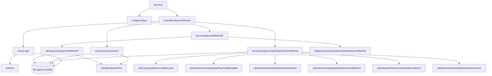

# subscription_payment_ms

## 1. Summary

Repository `subscription_payment_ms` (repo id `subscription_payment_ms` in `.kilo/repos.json`,
checkout at `apps/subscription_payment_ms`, git branch `dev`). A back-office payment-method service
for the subscription system: it lists, reads, renames and deletes the Stripe payment methods a
company has stored, adds a new Stripe card by converting a Stripe SetupIntent into a stored
`paymentMethods` record (creating a Stripe customer for the company on first use), and paginates the
company's `paymentIntents` and `paymentCharges` ledgers. Every route is admin-only
(`controller/paymentRoutes/paymentRoutes.js:12-18`). It never charges a card; it only manages the
stored instruments and reads the ledgers written by other services.

## 2. Stack and commands

- Runtime: Node.js `>=12.0.0 <17.5.0` (`package.json:5-7`); image `inhouz/subscription_payment_ms`
  (`k8s/subscription-payment-ms-deployment.yml:17`); `replicas: 1` (`:6`).
- HTTP: Express 4, body-parser, cookie-parser, cors, helmet, hpp (`server.js:2-8`).
- Data: Mongoose 7 (`package.json:31`), MongoDB through `MONGO_URL`.
- Payments: `stripe` 8.x (`package.json:36`), initialised per call from the config keys.
- Scripts: `start` = `node server.js`, `test` = `echo "Error: no test specified" && exit 1`
  (`package.json:9-12`).
- Start: `npm start`; listens on `process.env.PORT` (`server.js:88`), set to `5032` in the
  deployment (`k8s/subscription-payment-ms-deployment.yml:28-29`); ClusterIP service port `5032`
  (`k8s/subscription-payment-ms-cluster-ip-service.yml:10`).
- Scale: HPA 1–2 pods at 75% CPU (`k8s/subscription-payment-ms-hpa.yml:10-12`), VPA off
  (`k8s/subscription-payment-ms-vpa.yml:11`).

## 3. Entry points

| Entry point | Where | How |
|---|---|---|
| HTTP server | `server.js:88` | `npm start` → `node server.js` |
| Cluster master / worker fork | `server.js:26-43` | implicit; one worker outside production, one per CPU in production |
| Mongo connect + reconnect loop | `server.js:60-77`, `server.js:93-104` | worker start; reconnect after 5s |
| Shutdown | `server.js:78-86` | `SIGINT`, `SIGTERM`, `uncaughtException` |
| Route table | `controller/paymentRoutes/paymentRoutes.js:11-19` | mounted at `server.js:58` |
| Health probe script | `healthcheck.js:1-21` | standalone; requests `GET /healthz` (not implemented, §12) |

No cron, no queue consumer, no webhook endpoint. Stripe webhooks are not handled here.

## 4. Module inventory

| Module / export | file:line | Owns | Public API | Kind |
|---|---|---|---|---|
| server bootstrap | `server.js:1-104` | Express app, cluster, Mongo lifecycle, model registration | entry | effectful |
| `connectMongo()` | `server.js:93-104` | `maxPoolSize: 1` connection | internal | effectful |
| config factory | `config/config.js:18-63` | env + secret files + NodeRSA client key | `()` → config | effectful, cached module state |
| `readSecret(name, envFallback)` | `config/config.js:5-15` | secret file with env fallback | internal | effectful |
| routes registrar | `controller/paymentRoutes/paymentRoutes.js:11-19` | seven POST/GET routes | `(app)` | effectful |
| `getPaymentMethods` (service) | `services/paymentMethod/getPaymentMethods.js:5-21` | body → util | `(req,res)` | effectful (Mongo via util) |
| `getPaymentMethod` (service) | `services/paymentMethod/getPaymentMethod.js:5-31` | path param → util | `(req,res)` | effectful |
| `editPaymentMethod` | `services/paymentMethod/editPaymentMethod.js:6-96` | allow-listed `$set` on one payment method | `(req,res)` | effectful |
| `deletePaymentMethod` | `services/paymentMethod/deletePaymentMethod.js:7-126` | deletes the Mongo row, then detaches at Stripe | `(req,res)` | effectful |
| `createStripePaymentMethod` | `services/stripe/createStripePaymentMethod.js:16-411` | decrypts the client payload, validates the SetupIntent, creates customer + `paymentMethods` row | `(req,res)` | effectful |
| `getPaymentIntents` | `services/transactions/getPaymentIntents.js:11-227` | aggregation over `paymentIntents` with company and subscription-service lookups | `(req,res)` | effectful |
| `getPaymentCharges` | `services/transactions/getPaymentCharges.js:11-149` | aggregation over `paymentCharges` | `(req,res)` | effectful |
| `checkLogin` | `middlewares/login/checkLogin.js:8-81` | cookie+CSRF session check, sets `req.user` and `req.assetOwnerCompanyId` | `(req,res,next)` | effectful |
| `isAdmin` | `middlewares/login/isAdmin.js:1-26` | rejects non-admin `req.user` | `(req,res,next)` | pure (reads `req.user`) |
| `moduleAccessCheck` | `middlewares/module/moduleAccessCheck.js:7-67` | Flex module check | `(req,res,next)` | effectful; unmounted |
| `singleSubdomainValidation` | `middlewares/subdomain/singleSubdomainValidation.js:1-25` | subdomain match | `(req,res,next)` | pure read of request; unmounted |
| `recursiveSanitizer` | `utils/sanitizer/recursiveSanitizer.js:3-17` | intended input sanitization | `(element, sanitizer)` | pure intent, no-op in practice (§12) |
| `parseFilter` | `utils/filter/parseFilter.js:1-42` | maps filter keys to Mongo match objects, regex for text, raw for listed keys | `(filter, map, nonRegex, typeMap)` → filter | pure |
| `encryptDecrypt` | `utils/cryptography/encryptDecrypt.js:3-17` | RSA private-key encrypt/decrypt of the client payload | `(data, encrypt)` → string | effectful (config, crypto) |
| `getPaymentMethods` (util) | `utils/payment/paymentMethod/getPaymentMethods.js:10-139` | aggregation, `paymentMethodId` shortcut | `(query, user)` → list or one | effectful |
| `getPaymentMethodSummary` | `utils/payment/paymentMethod/getPaymentMethodSummary.js:1-35` | human label per Stripe type | `(paymentMethod)` → string | pure |
| `getPaymentMetadata` | `utils/payment/metadata/getPaymentMetadata.js:4-59` | reads `paymentMetadataCache` for the intent | `(params)` → metadata | effectful |
| `createStripeCustomer` | `utils/payment/stripe/createStripeCustomer.js:3-29` | Stripe customer create (prod on connected account, test on platform) | `(data, connectAccountId, environment)` | effectful (network) |
| `deleteStripeCustomer` | `utils/payment/stripe/deleteStripeCustomer.js:3-29` | Stripe customer delete | same signature | effectful |
| `updateStripeCustomer` | `utils/payment/stripe/updateStripeCustomer.js:3-34` | Stripe customer update | same signature | effectful |
| `getStripeSetupIntent` | `utils/payment/stripe/getStripeSetupIntent.js:3-35` | Stripe SetupIntent retrieve | `(data)` | effectful |
| `getStripePaymentMethod` | `utils/payment/stripe/getStripePaymentMethod.js:3-35` | Stripe payment method retrieve | `(data)` | effectful |
| `detachStripePaymentMethod` | `utils/payment/stripe/detachStripePaymentMethod.js:3-31` | Stripe detach | `(paymentMethodId, connectAccountId, environment)` | effectful |
| `createStripeConnectedAccount` | `utils/payment/stripe/createStripeConnectedAccount.js:5-20` | Stripe Express account create | `(data)` | effectful; unused by routes |
| `createStripeAccountLink` | `utils/payment/stripe/createStripeAccountLink.js:4-28` | Stripe account link | `(subMerchantId, payoutAccountId, pageUrl, type, linkName)` | effectful; unused |
| `createStripeConnectAccountDashboardUrl` | `utils/payment/stripe/createStripeConnectAccountDashboardUrl.js:4-19` | Stripe login link | `(subMerchantId)` | effectful; unused |
| `deleteStripeConnectedAccount` | `utils/payment/stripe/deleteStripeConnectedAccount.js:4-20` | Stripe account delete | `(id)` | effectful; unused |
| `getStripeConnectAccount` | `utils/payment/stripe/getStripeConnectAccount.js:4-20` | Stripe account retrieve | `(id)` | effectful; unused |
| `setupIntent` | `utils/payment/stripe/setupIntent.js:4-12` | Stripe SetupIntent create | `(data)` | effectful; unused |
| `getInhouzPaySecretKey` | `utils/payment/stripe/getInhouzPaySecretKey.js:5-57` | decrypts a gateway secret with Cryptr | `(params)` → key | effectful; unused |
| `getUser` | `utils/user/getUser.js` | user + roles + permission names | `(userId)` | effectful; required by `checkLogin.js:6` but never called there |
| `createEditByObject` | `utils/user/createEditByObject.js` | audit sub-document | `(user, deployDate)` | pure; unused |
| 12 Mongoose models | `server.js:13-24` | schema registration (§7) | model | reactive |

## 5. Side effects

| Effect | Where |
|---|---|
| MongoDB connect/reconnect/close | `server.js:60-77`, `:93-104`, `:82-85` |
| Mongo read/write `paymentMethods` | `services/paymentMethod/deletePaymentMethod.js:31-38,93-99`; `editPaymentMethod.js:60-75`; `createStripePaymentMethod.js:165-202,325-348,377-383` |
| Mongo read `payoutAccounts` | `services/stripe/createStripePaymentMethod.js:57-66`; `deletePaymentMethod.js:54-63` |
| Mongo read/update `company` | `createStripePaymentMethod.js:220-274` |
| Mongo aggregation `paymentCharges` | `services/transactions/getPaymentCharges.js:129-135` |
| Mongo aggregation `paymentIntents` | `services/transactions/getPaymentIntents.js:178-184` |
| Mongo read `paymentMetadataCache` | `utils/payment/metadata/getPaymentMetadata.js:26-36` |
| Mongo read `subscriptionSessions` (auth) | `middlewares/login/checkLogin.js:25-36` |
| Stripe API: customers create/delete/update | `utils/payment/stripe/createStripeCustomer.js:13,21`; `deleteStripeCustomer.js:13,21`; `updateStripeCustomer.js:14,23` |
| Stripe API: SetupIntent retrieve | `utils/payment/stripe/getStripeSetupIntent.js:13,21` |
| Stripe API: payment method retrieve/detach | `getStripePaymentMethod.js:13,21`; `detachStripePaymentMethod.js:16,24` |
| Stripe API at module load (production key) | `createStripeConnectedAccount.js:2`; `createStripeAccountLink.js:2`; `createStripeConnectAccountDashboardUrl.js:2`; `deleteStripeConnectedAccount.js:2`; `getStripeConnectAccount.js:2`; `setupIntent.js:2` |
| Filesystem secret read | `config/config.js:6-10` |
| Env read | `config/config.js:21-60`, `server.js:27,88` |
| Clock | `services/paymentMethod/editPaymentMethod.js:24`; `services/stripe/createStripePaymentMethod.js:28,54` |
| Crypto | `utils/cryptography/encryptDecrypt.js:8-10`; `middlewares/login/checkLogin.js:21-23,65` |
| Cookies and headers | `middlewares/login/checkLogin.js:10-13` |
| Logging | `server.js:33-42,65,68,76,89`; every catch block logs the full error object |

## 6. State and state transitions

The service owns no state machine of its own. The objects it mutates have these lifecycles:

**Company Stripe customer**

| From | To | Trigger | Guard |
|---|---|---|---|
| no `stripeCustomerId` | customer created, id stored | first successful `addpaymentmethod` | `company.status === 'active'` (`createStripePaymentMethod.js:221-224`); Stripe customer create returns an `id` (`:258`) |
| customer created | rolled back | `company` update fails | `deleteStripeCustomer` called (`:276-283`) |

**Payment method record**

| From | To | Trigger | Guard |
|---|---|---|---|
| none | created | `addpaymentmethod` with a `succeeded`/`processing` SetupIntent | SetupIntent status in `['succeeded','processing']` (`:112-122`) and `payment_method` present (`:124-130`) |
| old method linked to the same services | deleted | same call | another method already points at one of the `linkedSubscriptionServices` (`:192-217`) |
| created | detached at Stripe | Mongo create failed | `detachStripePaymentMethod` (`:350-369`) |
| exists | renamed/re-addressed | `editpaymentmethod` | `modifiedCount > 0` (`:77-82`) |
| exists | deleted | `deletepaymentmethod` | `deletedCount > 0` (`:101-107`); Stripe detach is fire-and-forget (`:110-114`) |

**Payment intent / charge** are read-only here; `processed`, `transactionSettled` and `disbursed` are
written by other services.

## 7. Data

| Model | file:line | Env → collection (k8s line) | Key fields and validation |
|---|---|---|---|
| PaymentMethod | `model/payment/paymentMethod.js:5-96` | `PAYMENT_METHOD_MODEL` → `paymentMethods` (`k8s/...deployment.yml:119-120`) | `paymentMethodName`, `companyId`, `paymentPlatform` enum braintree/stripe, `createdDate` required; `currencies[]`, `linkedSubscriptionServices[]`, card expiry fields, `stripePaymentMethodId` |
| PaymentIntent | `model/payment/paymentIntent.js:5-63` | `PAYMENT_INTENT_MODEL` → `paymentIntents` (`:121-122`) | `chargeType` enum inhouz account/subscription service, `companyId`, `timestamp`, `currency`, `processed` required; `subscriptionIds[]`, `userEmails[]`, `addonPackageIds[]`, `discountedAmount` |
| PaymentCharge | `model/payment/paymentCharge.js:5-77` | `PAYMENT_CHARGE_MODEL` → `paymentCharges` (`:115-116`) | `chargeType` enum of 3, `paymentSystem` enum stripe, `amount` min 0, `chargeOrigination` enum, `transactionSettled`, `disbursed` |
| PayoutAccount | `model/payment/payoutAccount.js:5-68` | `PAYOUT_ACCOUNT_MODEL` → `payoutAccounts` (`:117-118`) | `subMerchantAccountId` required, `country`, `currency`, `paymentPlatform`, `archived` |
| PaymentMetadataCache | `model/payment/paymentMetadataCache.js:5-37` | `PAYMENT_METADATA_CACHE_MODEL` → `paymentMetadataCache` (`:145-146`) | `companyId`, `intentId`, `timestamp` required, `environment` lowercased, free-form `data` |
| ExchangeRateCache | `model/payment/exchangeRateCache.js:5-20` | `EXCHANGE_RATE_CACHE_MODEL` → `exchangeRateCache` (`:133-134`) | unique `baseCurrency`, `rates` object |
| PaymentGateway | `model/payment/paymentGateway.js:5-61` | `PAYMENT_GATEWAY_MODEL` (not set in the deployment) | `name`, `companyId`, `testPublicKey`, `testSecretKey`, `createdById`, `createTimestamp`, `updateTimestamp` required. **Not required by `server.js`**, so the model is not registered at runtime |
| SubscriptionSession | `model/session/subscriptionSession.js:6-86` | `SUBSCRIPTION_SESSION_MODEL` → `subscriptionSessions` (`:123-124`) | full 2FA/session schema, identical to the copy in `subscription_settings_ms` |
| Session | `model/session/session.js:5-28` | `SESSION_MODEL` → `session` (`:85-86`) | `ipAddress`, `userId`, `beginTimeStamp`, `expirationTimestamp`; registered but unused by code |
| Company | `model/company/company.js:5-108` | `COMPANY_MODEL` → `company` (`:79-80`) | `stripeCustomerId`, `addedToStripe`, `status` enum, renewal counters |
| User / UserRoles / Role / Permission | `model/user/user.js:6-107`, `model/user/useRoles.js:6-51`, `model/rolesAndPermissions/roles.js:6-87`, `model/rolesAndPermissions/permissions.js:6-89` | `USER_MODEL` → `User`, `USER_ROLES_MODEL` → `userRoles`, `ROLE_MODEL` → `roles`, `PERMISSION_MODEL` → `permissions` (`:71-84`) | identity and RBAC, same shapes as the other services |

Shared collections inside the cluster:

| Collection | Also registered in |
|---|---|
| `paymentMethods`, `paymentIntents`, `paymentCharges`, `payoutAccounts`, `exchangeRateCache` | `apps/subscription_ms/model/payment/**`, `apps/subscription_signup_ms/model/payment/**` |
| `company`, `session`, `roles`, `permissions`, `userRoles`, `User` | `apps/subscription_ms`, `apps/subscription_settings_ms`, `apps/subscription_signup_ms`, `apps/subscription_metrics_ms`, `apps/inhouz_subscription_ms` |
| `paymentMetadataCache` | `apps/subscription_signup_ms/model/payment/paymentMetadataCache.js` |
| `paymentGateways` | written by the payout/signup flows; declared in `apps/subscription_signup_ms/model/payment/paymentGateway.js:61` but not registered here |

`paymentIntents` and `paymentCharges` are written by other services (the subscription signup/renewal
path and the payment execution path) and only read here.

## 8. Public interfaces

All routes require the same three cookies (`SUBSCR`, `refreshToken`, `deviceId`) and the
`x-csrfToken` header, then `req.user.isAdmin` (`paymentRoutes.js:12-18`).

| Method | Path | Body / params | Response |
|---|---|---|---|
| POST | `/api/subscriptionpayment/getpaymentmethods` | `{ filter?, sort?, limit?, skip? }` | `{ results: [...], total_count }` (`utils/payment/paymentMethod/getPaymentMethods.js:126-129`) |
| GET | `/api/subscriptionpayment/getpaymentmethod/:paymentMethodId` | path param | one payment method object or `{ error: { message: 'Payment method was not found.' } }` (`:115-124`) |
| POST | `/api/subscriptionpayment/stripe/editpaymentmethod` | `{ _id, paymentMethodName?, description?, line1?, line2?, city?, state?, country?, postal_code?, currencies?, linkedSubscriptionServices? }` | `{ success: true }` or `{ error }` (`services/paymentMethod/editPaymentMethod.js:77-87`) |
| POST | `/api/subscriptionpayment/stripe/addpaymentmethod` | `{ extractedPaymentMethodEncString }` → decrypted payload `{ payoutAccountId, setupIntentId, environment }` | `{ success: true }` or `{ error }` (`createStripePaymentMethod.js:392-409`) |
| POST | `/api/subscriptionpayment/getpaymentintents` | `{ filter?, sort?, limit?, skip? }` | `{ results: [...], total_count }` (`getPaymentIntents.js:215-217`) |
| POST | `/api/subscriptionpayment/getpaymentcharges` | `{ filter?, sort?, limit?, skip? }` | `{ results: [...], total_count }` (`getPaymentCharges.js:137-139`) |
| POST | `/api/subscriptionpayment/deletepaymentmethod` | `{ paymentMethodId, payoutAccountId, environment }` | `{ success: true }` or `{ error }` (`deletePaymentMethod.js:116-118`) |

Filter keys are allow-listed by the `filterMap`/`typeMap` files under `utils/payment/**/filter/`.
Text keys become case-insensitive regex matches (`utils/filter/parseFilter.js:29-32`), numeric and
boolean keys are compared directly.

No events, topics or CLI commands.

## 9. Configuration

Env var names only: `PORT`, `NODE_ENV`, `SECRETS_PATH`, `MONGO_URL`, `SESSION_SECRET`,
`CLIENT_SECRET_KEY`, `SENDGRID_API_KEY`, `SMPL_EMAIL`, `COOKIE_DOMAIN`, `COOKIE_NAME`,
`STRIPE_API_KEY`, `TEST_STRIPE_API_KEY`, `OPEN_EXCHANGE_RATES_API_KEY`,
`OPEN_EXCHANGE_RATES_BASE_URL`, `FLEX_COLLECTION_MODEL`, `FLEX_MODULE_MODEL`, `FLEX_FORM_FILE_MODEL`,
`FORM_MODEL`, `DATA_RULE_EXECUTION_RESULT_MODEL`, `USER_MODEL`, `COMPANY_MODEL`, `ROLE_MODEL`,
`PERMISSION_MODEL`, `USER_ROLES_MODEL`, `SESSION_MODEL`, `SESSION_VALIDATOR_MODEL`, `AUTH_LOG_MODEL`,
`PAYMENT_CHARGE_MODEL`, `PAYMENT_METHOD_MODEL`, `PAYMENT_INTENT_MODEL`,
`PAYMENT_METADATA_CACHE_MODEL`, `PAYMENT_GATEWAY_MODEL`, `EXCHANGE_RATE_CACHE_MODEL`,
`PAYOUT_ACCOUNT_MODEL`, `SUBSCRIPTION_SESSION_MODEL`, `SUBSCRIPTION_SERVICE_MODEL`,
`SUBSCRIPTION_MODEL`, `SUBSCRIBER_MODEL`, `INHOUZ_FROM_EMAIL`, `IP_LOCATION_FINDER_URL`,
`PAYMENT_MS_URL` (declared in the deployment, unread here).

Secret files read from `SECRETS_PATH`: `sendgridapikey`, `sessionsecret`, `mongourl`,
`clientsecretkey`, `openexchangeratesapikey`, `stripeapikey`, `teststripeapikey`
(`config/config.js:25,28,29,39,44-47,57,58`).

Deployment sets `STRIPE_API_KEY` and `TEST_STRIPE_API_KEY` from `secretKeyRef`
(`k8s/subscription-payment-ms-deployment.yml:55-64`).

## 10. Dependencies

| Dependency | Why |
|---|---|
| `express` | HTTP server (`server.js:2`) |
| `mongoose` | all persistence |
| `stripe` | customer, SetupIntent, payment-method calls (`utils/payment/stripe/*.js`) |
| `cryptr` | session cookie and gateway-secret decryption (`checkLogin.js:3`; `getInhouzPaySecretKey.js:3`) |
| `node-rsa` | client payload encryption (`config/config.js:1,52-55`) |
| `body-parser`, `cookie-parser`, `cors`, `helmet`, `hpp` | HTTP plumbing (`server.js:4-8`) |
| `validator` | email validation in schemas and in `getPaymentMethods` |
| `lodash` | `isEmpty`, `uniq`, `compact` |
| `sanitizer` | intended input sanitization |
| `moment` | card expiry timestamp (`createStripePaymentMethod.js:297-301`) |
| `dotenv` | local env loading |
| `@sendgrid/mail`, `bcryptjs`, `connect-mongo`, `express-session`, `request-ip`, `shortid`, `crypto-js` | declared, never required — dead |

## 11. Testing

No tests. `npm test` exits 1 (`package.json:10`). No test folder, fixtures or mocks. Nothing is
covered, including the Stripe conversion path, which is the riskiest code in the service. The CI
workflows only build and deploy.

## 12. Known issues and risks

1. **Aggregations join the wrong company collection.** `getPaymentCharges.js:61` and
   `getPaymentIntents.js:55` use `from: 'companies'`, but the deployment writes companies to
   `company` (`k8s/subscription-payment-ms-deployment.yml:79-80`). `assetOwnerCompanyName` is
   therefore always absent.
2. **SQL-style injection surface in filters.** Sort and type maps accept caller keys, and
   `sort` is passed straight into `$sort` (`getPaymentCharges.js:113-117`;
   `getPaymentIntents.js:162-166`). No operator whitelist is applied to the value shape.
3. **`createStripePaymentMethod` dereferences a possibly undefined object.**
   `parsedPaymentMethodObject` stays `undefined` when the encrypted string is missing, expired or
   does not decrypt (`services/stripe/createStripePaymentMethod.js:24-37`), then `:37` throws and the
   generic handler returns HTTP 200 with an error body.
4. **Missing metadata makes the flow fail opaquely.** `getPaymentMetadata` returns `{}` when the
   cache row is absent (`utils/payment/metadata/getPaymentMetadata.js:38-40`), so
   `JSON.parse(currencies)` at `createStripePaymentMethod.js:148` throws a `SyntaxError`.
5. **RSA "encryption" with a private key.** `utils/cryptography/encryptDecrypt.js:8` calls
   `encryptPrivate`, so anything holding the matching public key can read the payload; on any error
   the function returns the ciphertext unchanged (`:13-16`). The same config value is also the
   Cryptr secret elsewhere, so `CLIENT_SECRET_KEY` must simultaneously be a PEM RSA key and a
   passphrase.
6. **Delete responds before Stripe detaches.** `deletePaymentMethod.js:110-114` does not await
   `detachStripePaymentMethod`; a Stripe failure leaves an orphaned remote instrument while the API
   reports success.
7. **Rollback delete is not awaited either** in `createStripePaymentMethod.js:377-390`.
8. **Off-by-one card expiry.** `createStripePaymentMethod.js:297-301` maps a December expiry to
   `January 1` of the following year, so the computed `expirationTimestamp` is one month later than
   the printed `MM/YYYY`.
9. **Module-load Stripe client uses the production key regardless of environment.** Six utils
   create the client with `config.productionStripeApiKey` at require time
   (`utils/payment/stripe/createStripeConnectedAccount.js:2`, `deleteStripeConnectedAccount.js:2`,
   `getStripeConnectAccount.js:2`, `createStripeAccountLink.js:2`,
   `createStripeConnectAccountDashboardUrl.js:2`, `setupIntent.js:2`). They are currently unused by
   the routes, but importing them binds the production key.
10. **`recursiveSanitizer` is a no-op** (`utils/sanitizer/recursiveSanitizer.js:3-16`): primitives
    are reassigned to a local parameter and never written back; line 3 also creates an implicit
    global. Every service in this cluster that imports it inherits the same bug.
11. **`/healthz` is not implemented** (`healthcheck.js:7`) while the Dockerfile has no
    `HEALTHCHECK`.
12. **HTTP 200 for failures.** Every service returns `res.send({ error })` for validation and
    persistence failures (e.g. `editPaymentMethod.js:78-82`), so clients cannot distinguish failure
    from success by status code.
13. **Unmounted middleware reading an unset model key.** `moduleAccessCheck` uses
    `config.flexModuleModel` (`middlewares/module/moduleAccessCheck.js:29`), which the deployment
    does not set (`k8s/subscription-payment-ms-deployment.yml:67-68` sets only
    `FLEX_COLLECTION_MODEL`).
14. **`paymentGateway` model is dead.** `model/payment/paymentGateway.js` is never required by
    `server.js:13-24`, and `PAYMENT_GATEWAY_MODEL` is not in the deployment.
15. **Auth gate is `req.user.isAdmin` only.** There is no per-service or per-company ownership check
    beyond `companyId` scoping in queries (`isAdmin.js:3-9`; `getPaymentMethods.js:31`).

No credential literal was found in this repository's source.

## 13. Module map

Direction: route → auth middleware → service → util → Mongoose/Stripe. Only the service layer
writes; utils are either pure (summary, filter) or direct Stripe/Mongo adapters.

## 14. Open questions

- Is `paymentMetadataCache` written by this service or only by the signup flow? Nothing here inserts
  into it, so `addpaymentmethod` cannot succeed without another writer.
- Is `PAYMENT_GATEWAY_MODEL`/`paymentGateways` retired? The model and `getInhouzPaySecretKey` exist
  but no route reaches them.
- Who owns the client-side RSA public key that pairs with `CLIENT_SECRET_KEY`?
- Is the `companies` vs `company` collection mismatch a leftover from a rename, or are both
  collections live?
- Intended owner of `paymentMethods` writes: `subscription_ms` also declares the model and
  `saveSubscriptionPaymentMethod`; this service and that one can both create rows.
