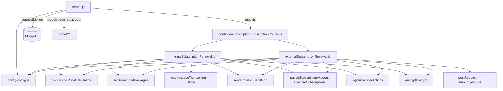

# subscription_renewal_ms

Repository: `apps/subscription_renewal_ms` — a separate git repository
(`Inhouz-Cloud-AI/subscription_renewal_ms`), not part of the control repo.

## 1. Summary

`subscription_renewal_ms` charges a customer for the next period of an existing subscription. A
caller posts an RSA-encrypted payload to one of two endpoints; the service decrypts it, re-reads the
subscriber, company, package and payment-method records from MongoDB, recalculates the price,
charges Stripe directly through `stripe.paymentIntents.create` (or forwards the charge to
`inhouz_pay_ms`), then writes the new subscription dates and an action log. The scheduled trigger
lives in `subscription_renewal_scheduler_ms`; this service only handles the HTTP call
(`services/subscription/internalSubscriptionRenewal.js:23`,
`services/subscription/externalSubscriptionRenewal.js:26`).

## 2. Stack and commands

- Node.js, `>=12.0.0 <17.5.0` (`package.json:6-8`); the image builds on `node:16.4-alpine`
  (`Dockerfile:1`).
- Express 4 (`server.js:2`), Mongoose 7 (`package.json:30`), Node cluster with one worker per CPU
  in production (`server.js:32-49`).
- Start: `npm start` → `node server.js` (`package.json:11`).
- Container start is the same command (`Dockerfile:13`).
- Port: `process.env.PORT` (`server.js:94`); the k8s service and container both use `5027`
  (`k8s/subscription-renewal-ms-cluster-ip-service.yml:10`,
  `k8s/subscription-renewal-ms-deployment.yml:26`).
- Test: `npm test` → `echo "Error: no test specified" && exit 1` (`package.json:9`). There is no
  test suite.

## 3. Entry points

| Entry point | Where | Started by |
|---|---|---|
| Express HTTP server | `server.js:94` (`app.listen(process.env.PORT)`) | `node server.js` (`package.json:11`) |
| Cluster master + worker forks | `server.js:32-49` | same process, `NODE_ENV === "production"` → `os.cpus().length` workers, otherwise 1 |
| Route registration | `server.js:64` → `controller/subscription/subscriptionRoutes.js:5` | at boot |
| Mongo connect + 5 s reconnect timer | `server.js:99-110`, retry `server.js:76-78` | connection `disconnected` event |
| Graceful shutdown | `server.js:84-92` | `SIGINT`, `SIGTERM`, `uncaughtException` |
| `POST /api/subscriptionrenewal/internal` | `controller/subscription/subscriptionRoutes.js:7` | HTTP |
| `POST /api/subscriptionrenewal/external` | `controller/subscription/subscriptionRoutes.js:8` | HTTP |
| `POST /api/subscriptionrenewal/renew` | commented out at `controller/subscription/subscriptionRoutes.js:6` | not reachable |

There is no cron or worker loop in this service. The only timer is the Mongo reconnect
(`server.js:76`).

## 4. Module inventory

| Module | Where | Owns | Public API | Kind |
|---|---|---|---|---|
| `server` | `server.js` | boot, cluster, CORS, mongo connect, route mount | none | `effectful` (network, DB, env, cluster state) |
| `config` | `config/config.js:17` | cached config object, reads secret files | `()` → config | `effectful` (filesystem, env, RSA key parse) |
| `readSecret` | `config/config.js:5` | reads `/mnt/secrets/<name>`, falls back to env | `(name, envFallback)` → string | `effectful` (filesystem, env) |
| `subscriptionRoutes` | `controller/subscription/subscriptionRoutes.js:5` | mounts the two POST routes | `(app)` | `reactive` (mutates the express app) |
| `internalSubscriptionRenewal` | `services/subscription/internalSubscriptionRenewal.js:23` | renewal of an internal subscription service (charged by this service) | `(req,res)` | `effectful` (DB, Stripe, HTTP, email, clock) |
| `externalSubscriptionRenewal` | `services/subscription/externalSubscriptionRenewal.js:26` | renewal of a package sold by another company; charge forwarded to `inhouz_pay_ms` | `(req,res)` | `effectful` |
| `subscriptionRenewal` | `services/subscription/subscriptionRenewal.js:23` | older combined renewal path with migration handling | `(req,res)` | `effectful`; **not routed** |
| `encryptDecrypt` | `utils/cryptography/encryptDecrypt.js:3` | RSA decrypt/encrypt of the request payload | `(data, encrypt=false, publicEncryt=false)` | `effectful` (private key from config); falls back to returning the input on error |
| `recursiveSanitizer` | `utils/sanitizer/recursiveSanitizer.js:19` | deep-sanitizes the request body | `{recursiveSanitizer}` | `pure` |
| `postRequest` | `utils/requests/postRequest.js:3` | JSON POST to another service | `(url, headers, data)` | `effectful` (network) |
| `getRequest`, `deleteRequest` | `utils/requests/getRequest.js:3`, `deleteRequest.js:3` | HTTP GET/DELETE helpers | `(url)` | `effectful`; **no call site** in this repo |
| `marketplaceTransaction` | `utils/payment/stripe/marketplaceTransaction.js:4` | Stripe connect charge | `(customerAccountId, paymentMethodId, amount, serviceFee, currency, paymentMethodType, stripeCustomerId)` | `effectful` (Stripe network) |
| `zeroDecimalCurrencies` | `utils/payment/stripe/zeroDecimalCurrencies.js` | currency list with no minor unit | data | `pure` |
| `sendEmail` | `utils/email/sendEmail/sendEmail.js:4` | SendGrid send | `(to, from, subject, text, html)` | `effectful` (network); send is not awaited |
| `ownerSuccessfulRenewalEmail`, `successfulRenewalEmailTemplate`, `renewalFailNoticeEmail`, `subscriptionAdminEmail` | `utils/email/subscriptions/*.js`, `utils/email/subscriptionService/subscriptionAdminEmail.js` | email bodies | template builders | `pure` (per usage; not read line by line) |
| `planPriceCalculation` | `utils/pricingCalculations/planPriceCalculation.js:1` | plan price for a period | `(params)` | `pure` |
| `addonPriceCalculation` | `utils/pricingCalculations/addonPriceCalculation.js:1` | add-on price | `(params)` | `pure` |
| `totalPingsCalculation` | `utils/apiFunctions/totalPingsCalculation.js:3` | usage/ping totals | `(params)` | `pure` |
| `timeMaps` | `utils/apiFunctions/timeMaps.js:1` | period length per billing interval | constant map | `pure` |
| `setSubscribedPackages` | `utils/subscribedPackage/setSubscribedPackages.js:6` | builds the package list written back | `(constructor=[])` | `effectful` (DB read) |
| `logSubscriberActions` | `utils/subscription/logSubscriberActions.js:5` | writes an action-log row | `(params)` | `effectful` (DB write) |
| `notifyAdminOfIssues` | `utils/subscription/notifyAdminOfIssues.js:7` | admin alert email on failure | `(params={})` | `effectful` (DB, email) |
| `pauseSubscriptionAccount` | `utils/subscription/pauseSubscriptionAccount.js:6` | pauses subscriptions after a failed charge | `(params={})` | `effectful` (DB) |
| `restoreSubscriptions` | `utils/subscription/restoreSubscriptions.js:4` | reverts subscriptions after a failed charge | `(subscriptions=[])` | `effectful` (DB) |
| `getUser` | `utils/user/getUser.js:5` | loads a user | `(userId='')` | `effectful` (DB); used only by `checkLogin` |
| `createEditByObject` | `utils/user/createEditByObject.js:1` | audit object for create/edit | `(user={}, deployDate)` | `pure` |
| `checkLogin` | `middlewares/login/checkLogin.js` | session auth middleware | express middleware | `effectful`; **not mounted anywhere** |
| `moduleAccessCheck` | `middlewares/module/moduleAccessCheck.js` | module permission middleware | express middleware | `effectful`; **not mounted anywhere** |
| `singleSubdomainValidation` | `middlewares/subdomain/singleSubdomainValidation.js` | subdomain check | express middleware | `effectful`; **not mounted anywhere** |
| Models | `model/**` | 19 mongoose schemas | `mongoose.model(...)` | `reactive` (schema registration + DB access) |

## 5. Side effects

| Effect | Where |
|---|---|
| Mongo connect, `maxPoolSize: 1` per worker | `server.js:100-108` |
| Mongo reconnect timer (5 000 ms) | `server.js:76` |
| Filesystem: read secret files under `SECRETS_PATH` (default `/mnt/secrets`) | `config/config.js:5-14` |
| Env read | `config/config.js:19-71`, `server.js:33`, `server.js:94` |
| RSA private/public key construction from secret | `config/config.js:56-63` |
| Stripe `paymentIntents.create` (real charge) | `utils/payment/stripe/marketplaceTransaction.js:12` |
| SendGrid `send` | `utils/email/sendEmail/sendEmail.js:22` |
| HTTP POST to `INHOUZ_PAY_MS_URL` + `/api/inhouzpay/payment/serversubscriptionpayment` | `services/subscription/externalSubscriptionRenewal.js:729-733`, `services/subscription/subscriptionRenewal.js:1069-1073` |
| MongoDB reads/writes | `services/subscription/*.js` (models resolved at `external:82-124`, `internal:82-88`, `renewal:60-68`, `renewal:873-874`) |
| Clock: `new Date().getTime()` payload expiry, `moment().format` | `external:44`, `internal:41`, `renewal:41` |
| Logging: `console.log` only, no logger | `server.js:39-47`, `server.js:71-83`, `external:90-867`, `internal:96-414`, `renewal:94-961` |
| Stderr-style failure logging inside helpers | `utils/requests/postRequest.js:36`, `utils/cryptography/encryptDecrypt.js:20`, `utils/email/sendEmail/sendEmail.js:27` |

No randomness, no filesystem writes, no message broker, no WebSocket, no cron.

## 6. State and state transitions

There is no in-memory state machine. The subscription lifecycle is expressed in MongoDB fields.
The renewal handler performs this sequence per subscription (guard in brackets):

| Step | Trigger | Guard | Effect |
|---|---|---|---|
| Accept | HTTP POST | body has a non-empty string `encryptedData` / `encryptedPayload` (`renewal:27-35`, `internal:24-32`, `external:27-35`) | — |
| Decrypt | — | RSA decrypt returns parseable JSON (`renewal:44-50`) | — |
| Authorise time window | — | `now <= payload.expirationTimestamp` (`renewal:49`, `internal:46`, `external:49`) | — |
| Validate payload | — | required ids present (`internal:55-70`, `external:57-70`) | 400 |
| Charge | Stripe or `inhouz_pay_ms` | payment method + payout account exist (`external:406`, `external:476`) | subscription dates advanced |
| Revert on failure | payment response error | `payResponse.success` false (`renewal:1075-1077`) | `restoreSubscriptions` / `pauseSubscriptionAccount` |
| Log | after outcome | — | row in `subscriberActionLogs` |
| Track (internal only) | end of handler | — | upsert `internalSubscriptionRenewalTracker` (`internal:88`) |

There is no idempotency key: two identical POSTs will attempt two charges.

## 7. Data

Collections are chosen by env var, so the physical name is deployment-set. Names below are the
k8s-provided values (`k8s/subscription-renewal-ms-deployment.yml`).

| Env var | Collection | Used by | Key fields / rules |
|---|---|---|---|
| `INHOUZ_SUBSCRIPTIONS_MODEL` | `inhouzSubscriptions` | all three handlers | subscription state; schema `model/inhouzSubscription/inhouzSubscription.js:5`, registered `:204` |
| `SUBSCRIPTION_SERVICE_MODEL` | `subscriptionServices` | all three | service definition and price; `model/subscription/subscriptionService.js:5`, registered `:378` |
| `SUBSCRIPTION_MODEL` | `subscriptions` | all three | active subscription, dates; `model/subscription/subscription.js:6`, registered `:217` |
| `SUBSCRIBED_PACKAGE_MODEL` | `subscribedPackages` | internal, external, renewal | package snapshot; `model/subscription/subscriptionPackage.js:6`, registered `:151` |
| `SUBSCRIBER_MODEL` | `subscribers` | all three | `model/subscription/subscriber.js:6`, registered `:73` |
| `PAYMENT_METHOD_MODEL` | `paymentMethods` | internal, external, renewal | `model/payment/paymentMethod.js:5`, registered `:96` |
| `PAYOUT_ACCOUNT_MODEL` | `payoutAccounts` | internal, external, renewal | destination Stripe account; `model/payment/payoutAccount.js:5`, registered `:68` |
| `COMPANY_MODEL` | `company` | all three | `model/company/company.js:5`, registered `:108` |
| `SUBSCRIBER_ACTION_LOG_MODEL` | `subscriberActionLogs` | all three | audit trail; `model/subscription/subscriberActionLogs.js:6`, registered `:100` |
| `INTERNAL_SUBSCRIPTION_RENEWAL_TRACKER_MODEL` | `internalSubscriptionRenewalTracker` | internal only | `companyId`, `environment`, `subscriptionServiceId`, `createdTimestamp`, `renewalIntervalDays` (default 30), `renewalDate`, `active`, `timestamps: true`, `strict: true`; compound index on all of them (`model/subscription/internalSubscriptionRenewalTracker.js:5-42`) |
| `PAYMENT_INTENT_MODEL` | `paymentIntents` | `subscriptionRenewal.js:873` only (dead route) | `model/payment/paymentIntent.js:5`, registered `:84` |
| `PAYMENT_CHARGE_MODEL` | `paymentCharges` | `subscriptionRenewal.js:874` only (dead route) | `model/payment/paymentCharge.js:5`, registered `:98` |
| `EXCHANGE_RATE_CACHE_MODEL` | `exchangeRateCache` | registered only (`server.js:23`) | `model/payment/exchangeRateCache.js:5` |
| `SUBSCRIBER_MIGRATION_QUEUE_MODEL` | `subscriberMigrationQueue` | registered in the model file only; never required by `server.js` and never queried | `model/subscription/subscriberMigrationQueue.js:88` |
| `USER_MODEL` | `User` | `checkLogin` (unmounted) | `model/user/user.js:6`, registered `:107` |
| `ROLE_MODEL`, `PERMISSION_MODEL`, `USER_ROLES_MODEL` | `roles`, `permissions`, `userRoles` | `checkLogin`/`moduleAccessCheck` (unmounted) | `model/rolesAndPermissions/*.js`, `model/user/useRoles.js` |
| `SESSION_MODEL`, `SESSION_VALIDATOR_MODEL`, `AUTH_LOG_MODEL` | `session`, `sessionValidator`, `authenticationLogs` | `checkLogin` (unmounted) | `model/session/session.js`, `config/config.js:33-35` |

Collection-sharing (the coupling a reader cannot see from this repo): every collection above except
`internalSubscriptionRenewalTracker` is a collection another `subscription_*` service also reads.
The write of `internalSubscriptionRenewalTracker` here is read back by
`subscription_renewal_scheduler_ms` when it decides which internal services are due. Treat the
schemas as a shared contract, not a local one.

No migrations exist in this repo. `setSubscribedPackages` rewrites package sub-documents in place
(`utils/subscribedPackage/setSubscribedPackages.js:6`); `subscriptionRenewal.js` mutates package rows
directly around `renewal:491` and `renewal:708`.

## 8. Public interfaces

| Interface | Request | Response |
|---|---|---|
| `POST /api/subscriptionrenewal/internal` (`controller/subscription/subscriptionRoutes.js:7`) | JSON `{ "encryptedPayload": "<RSA base64>" }`; plaintext `{ payload: { subscriptionServiceId, companyId, assetOwnerCompanyId, environment }, expirationTimestamp }` (`internal:24-70`) | 200 `res.send(...)` on success (`internal` success path); 400 `{ error: { message } }` for missing/invalid fields (`internal:32`) |
| `POST /api/subscriptionrenewal/external` (`controller/subscription/subscriptionRoutes.js:8`) | JSON `{ "encryptedPayload": "<RSA base64>" }`; plaintext `{ payload: { subscribedPackageId, companyId, assetOwnerCompanyId }, expirationTimestamp }` (`external:27-70`) | 200 on success; 400 `{ error: { message } }` (`external:35`); forwards a charge to `inhouz_pay_ms` |
| `POST /api/subscriptionrenewal/renew` | commented out (`controller/subscription/subscriptionRoutes.js:6`) | 404 |

No events, queues, CLI commands, cron or WebSocket endpoints. The `encryptedData` variant of the
body shape belongs to the unmounted `subscriptionRenewal` handler (`renewal:29`).

## 9. Configuration

Names only. Secrets are read from files first, env second (`config/config.js:5-14`).

Env vars read by the service: `PORT`, `NODE_ENV`, `SECRETS_PATH`, `MONGO_URL`, `SESSION_SECRET`,
`CLIENT_SECRET_KEY`, `CLIENT_PUBLIC_KEY`, `SENDGRID_API_KEY`, `STRIPE_API_KEY`,
`OPEN_EXCHANGE_RATES_API_KEY`, `OPEN_EXCHANGE_RATES_BASE_URL`, `COOKIE_DOMAIN`, `COOKIE_NAME`,
`INHOUZ_BASE_URL`, `INHOUZ_PAY_MS_URL`, `INHOUZ_FROM_EMAIL`, `STANDARD_EMAIL_API_URL`,
`SUBSCRIPTION_SERVICE_CHARGE_TYPE`, and every `*_MODEL` collection name listed in section 7 plus
`FLEX_FORM_FILE_MODEL`, `FLEX_MODULE_MODEL`, `FLEX_COLLECTION_MODEL`, `FORM_MODEL`,
`DATA_RULE_EXECUTION_RESULT_MODEL`.

Secret file names under `SECRETS_PATH`: `sendgridapikey`, `sessionsecret`, `mongourl`,
`clientsecretkey`, `clientpublickey`, `openexchangeratesapikey` (`config/config.js:24-47`).

Note: `STRIPE_API_KEY` is read from the environment directly (`config/config.js:65`), unlike the
other secrets, so it does not follow the mounted-secret path.

## 10. Dependencies

Direct only, from `package.json:13-37`.

| Dependency | Why |
|---|---|
| `express` | HTTP server and routing |
| `mongoose` | MongoDB models |
| `body-parser` | JSON body parse, 20 MB limit (`server.js:60`) |
| `cookie-parser` | cookie parse with `sessionSecret` (`server.js:63`) |
| `cors` | origin allow-list (`server.js:52-58`) |
| `helmet` | security headers (`server.js:62`) |
| `hpp` | parameter-pollution guard (`server.js:61`) |
| `dotenv` | `.env` load at boot (`server.js:1`) |
| `stripe` | `paymentIntents.create` for the direct charge |
| `@sendgrid/mail` | transactional email |
| `node-fetch` | HTTP client behind `postRequest` |
| `node-rsa` | decrypt the request payload; sign outbound payload |
| `cryptr` | imported by handlers and `checkLogin`; no effective use found in the handler bodies read |
| `crypto-js`, `bcryptjs`, `shortid`, `lodash`, `moment`, `validator`, `sanitizer`, `request-ip` | utility/validation; `bcryptjs`, `connect-mongo`, `express-session`, `crypto-js`, `request-ip`, `shortid` have no call site in the files read |

## 11. Testing

No tests. `npm test` in `package.json:9` is a stub that exits 1. No test framework, no fixtures,
no CI test step in this repo (`build_ga.sh`, `build_ga_prod.sh`, `deploy.sh` only build and deploy).
Nothing is covered. Verification today is manual: send an encrypted POST and inspect the DB and
Stripe dashboard.

## 12. Known issues and risks

- **A GitHub token is injected by the machine's global git config.** The repository remote itself is
  clean — `git config --get remote.origin.url` returns a plain
  `https://github.com/Inhouz-Cloud-AI/subscription_renewal_ms.git`. The token shows up in
  `git remote -v` only because `/home/node/.gitconfig` defines a
  `url.https://<token>@github.com/.insteadOf https://github.com/` rewrite. Nothing is committed and
  nothing travels with a clone, but the token reaches logs and transcripts. Rotate it and drop the
  rewrite. Value not quoted.
- **`/healthz` is never served.** `healthcheck.js:7` probes `/healthz` and the Dockerfile comment
  says it must match a `HEALTHCHECK`, but no route registers `/healthz` (`server.js:64`,
  `controller/subscription/subscriptionRoutes.js:5-9`) and the k8s deployment defines no probe. The
  health script would exit 1 against a healthy pod.
- **No authentication on either live route.** `checkLogin`, `moduleAccessCheck` and
  `singleSubdomainValidation` exist but nothing requires them (no reference outside
  `middlewares/`). The only gate is the RSA ciphertext plus `expirationTimestamp` inside it
  (`renewal:49`, `internal:46`, `external:49`). Anyone holding the public key can trigger a charge.
- **Timestamp check is a replay window, not a nonce.** A captured payload is replayable until
  `expirationTimestamp` passes; there is no idempotency key (`internal:46`, `external:49`).
- **Mail send is fire-and-forget.** `sendEmail` calls `sgMail.send(msg)` without `await`
  (`utils/email/sendEmail/sendEmail.js:22`), so a failed email is never observed by the handler.
- **Global exception handler closes Mongo.** `process.on("uncaughtException", shutdownFunction)`
  (`server.js:87`) shuts the connection and lets the process continue, leaving a half-dead worker.
- **Error logging is `console.log` only, with request paths in the message**
  (`external:90-867`, `internal:96-414`, `renewal:94-961`). No structure, no levels, no redaction.
- **Dead code carries a live charge path.** `subscriptionRenewal.js` (1 195 lines) is not routed
  (`routes:6`) but still contains a Stripe/pay-ms charge at `renewal:1069`. It drifts silently.
- **Unused models and deps.** `subscriberMigrationQueue` is never required (`server.js:13-30`);
  `openExchangeRatesBaseUrl` appears only in config (`config/config.js:48`); `getRequest` and
  `deleteRequest` have no call site.
- **CORS origin is a regex, not an allow-list**, `origin: /inhouz.localhost/`
  (`server.js:54`). It only matches local hostnames, so production browser calls are rejected by
  design, but the pattern is easy to widen by accident.
- **`maxPoolSize: 1` with one process per CPU** (`server.js:33`, `server.js:107`) caps DB
  concurrency per worker and multiplies connections by core count.
- **Deployment pulls an unpinned `:latest` in `deploy.sh`** alongside the `$SHA` tag; a rollback by
  tag is not reproducible.

## 13. Module map

## 14. Open questions

- Which caller sends `POST /api/subscriptionrenewal/external` today? The brief names only
  `subscription_renewal_scheduler_ms`; that service must choose internal vs external, and its
  selection rule is not visible from this repo.
- Is `subscriptionRenewal.js` (the unrouted handler) still reachable through a proxy or older
  caller? It is dead in the route table only.
- `SUBSCRIPTION_SERVICE_CHARGE_TYPE` and `STANDARD_EMAIL_API_URL` are configured but their effect
  was not traced beyond config.
- `utils/email/*` templates and `utils/subscription/notifyAdminOfIssues.js` were counted but not
  read line by line; the inventory rows for them are structural, not verified bodies.
- Whether `paymentIntents` / `paymentCharges` rows are written by the charge path in the mounted
  handlers, or only in the dead handler, was not traced.
