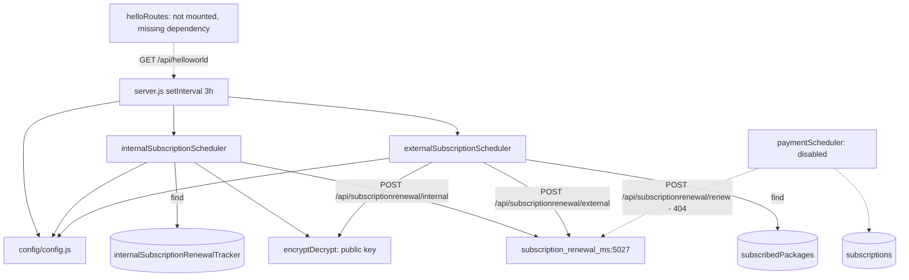

# subscription_renewal_scheduler_ms

Repository: `apps/subscription_renewal_scheduler_ms` — a separate git repository
(`Inhouz-Cloud-AI/subscription_renewal_scheduler_ms`), not part of the control repo. The
`package.json` name still says `subscription_migration_scheduler_ms` (`package.json:2`).

## 1. Summary

A timer-based poller. Every three hours it queries MongoDB for records that are due and POSTs an
RSA-encrypted payload to `subscription_renewal_ms` for each one: internal subscription-service
renewals from `internalSubscriptionRenewalTracker` (`services/payment/internalSubscriptionScheduler.js:8-30`)
and external package renewals from `subscribedPackages`
(`services/payment/externalSubscriptionScheduler.js:8-31`). It performs no charging itself and
holds no request state. Its only output is the outbound HTTP call
(`internal:57`, `external:71`).

## 2. Stack and commands

- Node.js `>=12.0.0 <17.5.0` (`package.json:4`).
- Express 4 for the HTTP shell (`server.js:2`), Mongoose 7 (`package.json:24`), single process (no
  `cluster` module, unlike `subscription_renewal_ms`).
- Start: `npm start` → `node --max-old-space-size=8192 server.js` (`package.json:9`). The 8 GB heap
  flag is set for a process whose working set is a paginated 500-row query; it is inherited, not
  derived from a measured need.
- Test: `npm test` → stub that exits 1 (`package.json:8`).
- Port: `process.env.PORT` (`server.js:85`); k8s service and container use `5026`
  (`k8s/subscription-renewal-scheduler-ms-cluster-ip-service.yml:10`,
  `k8s/subscription-renewal-scheduler-ms-deployment.yml:26`).

## 3. Entry points

| Entry point | Where | Started by |
|---|---|---|
| Express HTTP server | `server.js:85` (`app.listen(process.env.PORT)`) | `node --max-old-space-size=8192 server.js` (`package.json:9`) |
| Renewal poll loop | `server.js:80-83` — `setInterval(..., 10800000)` calling `internalSubscriptionScheduler()` and `externalSubscriptionScheduler()` | boot, then every 3 h |
| Mongo connect + 5 s reconnect timer | `server.js:86-105`, retry `server.js:54-56` | connection `disconnected` |
| Graceful shutdown | `server.js:62-71` | `SIGINT`, `SIGTERM`, `uncaughtException` |
| Model registration | `server.js:25-26` — only `internalSubscriptionRenewalTracker` and `subscriptionPackage` | at boot |
| `GET /api/helloworld` | `controller/helloWorld/helloRoutes.js:4` | **never registered** — `server.js` does not require the controller, and the route handler's dependency `services/helloWorld/getHello` does not exist in the repo |

There is **no immediate first run**: the initial `paymentScheduler()`, `internalSubscriptionScheduler()`
and `externalSubscriptionScheduler()` calls are commented out (`server.js:72-79`). The first poll
happens three hours after the pod starts. A pod that restarts more often than every three hours
never renews anything.

## 4. Module inventory

| Module | Where | Owns | Public API | Kind |
|---|---|---|---|---|
| `server` | `server.js` | Express shell, timer, mongo connect | none | `effectful` (network, DB, env, clock) |
| `config` | `config/config.js:17` | cached config, secret-file read | `()` → config | `effectful` (filesystem, env, RSA parse) |
| `readSecret` | `config/config.js:5` | `/mnt/secrets/<name>` then env fallback | `(name, envFallback)` → string | `effectful` (filesystem, env) |
| `internalSubscriptionScheduler` | `services/payment/internalSubscriptionScheduler.js:8` | page due internal trackers, sign a payload, POST per row | `()` → Promise<void> | `effectful` (DB read, RSA sign, HTTP, clock, randomness) |
| `externalSubscriptionScheduler` | `services/payment/externalSubscriptionScheduler.js:8` | page due subscribed packages, sign a payload, POST per row | `()` → Promise<void> | `effectful` (same set) |
| `paymentScheduler` | `services/payment/paymentScheduler.js:6` | groups due subscriptions and POSTs to the **removed** `/api/subscriptionrenewal/renew` route | `()` → Promise<void> | `effectful`; **not scheduled** (`server.js:72-75` commented) |
| `encryptDecrypt` | `utils/cryptography/encryptDecrypt.js:3` | RSA encrypt with the public key / decrypt with the private key | `(data, encrypt, publicEncryt)` | `effectful` (key material from config); returns the input unchanged on error |
| `postRequest` | `utils/requests/postRequest.js:3` | JSON POST, normalises `error`/`hasError` | `(url, headers, data)` | `effectful` (network) |
| `getRequest`, `deleteRequest` | `utils/requests/getRequest.js:3`, `utils/requests/deleteRequest.js:3` | HTTP helpers | `(url)` | `effectful`; no call site |
| `recursiveSanitizer` | `utils/sanitizer/recursiveSanitizer.js:19` | deep sanitizer | `{recursiveSanitizer}` | `pure`; no call site in the scheduler paths |
| `getUser`, `createEditByObject` | `utils/user/getUser.js:5`, `utils/user/createEditByObject.js:1` | user lookup, audit object | `(userId)`, `(user, deployDate)` | `effectful` / `pure`; used only by the unmounted `checkLogin` |
| `checkLogin`, `moduleAccessCheck`, `singleSubdomainValidation` | `middlewares/login/checkLogin.js`, `middlewares/module/moduleAccessCheck.js`, `middlewares/subdomain/singleSubdomainValidation.js` | auth/permission middleware | express middleware | `effectful`; **not mounted anywhere** |
| Models | `model/**` (15 schemas) | mongoose schemas | `mongoose.model(...)` | `reactive` |

## 5. Side effects

| Effect | Where |
|---|---|
| Mongo connect, `maxPoolSize: 1` | `server.js:96-104` |
| Mongo reconnect timer (5 000 ms) | `server.js:54` |
| MongoDB read: `internalSubscriptionRenewalTracker` where `active: true`, `renewalDate <= now`, paged 500 | `internal:13-30` |
| MongoDB read: `subscribedPackages` where `active: true`, `renewalDate <= now`, `subscriberCount > 0`, paged 500 | `external:13-31` |
| MongoDB read: `subscriptions` where `activeSubscriber: true`, `reupDate <= now` (unscheduled module) | `paymentScheduler:8-15` |
| HTTP POST `SUBSCRIPTION_RENEWAL_MS_URL` + `/api/subscriptionrenewal/internal` | `internal:57` |
| HTTP POST `SUBSCRIPTION_RENEWAL_MS_URL` + `/api/subscriptionrenewal/external` | `external:71` |
| HTTP POST `SUBSCRIPTION_RENEWAL_MS_URL` + `/api/subscriptionrenewal/renew` (dead target) | `paymentScheduler:53` |
| Filesystem: secret files under `SECRETS_PATH` (default `/mnt/secrets`) | `config/config.js:5-14` |
| RSA public-key encrypt of each payload | `encryptDecrypt:6-9` |
| Clock: `moment().unix() * 1000` for the due cut-off and the 30 s payload expiry | `internal:11`, `internal:51`, `external:11`, `external:65` |
| Randomness: `Math.random()` three times per payload as `queryKey` | `internal:49`, `external:63` |
| Logging: `console.log` on every query error and catch | `internal:33`, `internal:73`, `external:34`, `external:75`, `paymentScheduler:18`, `paymentScheduler:61` |
| Stdin/stdout nothing else; no filesystem writes, no broker, no WebSocket | — |

## 6. State and state transitions

The scheduler holds no in-memory state machine. Its "state" is the due-date field it queries, and
the transition it causes is written by `subscription_renewal_ms`, not here.

| From | Trigger | Guard | To |
|---|---|---|---|
| Tracker row `renewalDate <= now` | 3-hour tick (`server.js:80`) | `active: true` (`internal:15`) | a POST to `/internal`; on success the renewal service advances `renewalDate` |
| Package row `renewalDate <= now` | 3-hour tick | `active: true`, `subscriberCount > 0` (`external:14-22`) | a POST to `/external`; on success the renewal service advances `renewalDate` |

There is no local transition, no lock and no marker written here: the scheduler re-reads the same
rows on the next tick until the downstream service moves `renewalDate` past now.

## 7. Data

The scheduler only reads. Collection names are deployment-set; values from
`k8s/subscription-renewal-scheduler-ms-deployment.yml`.

| Env var | Collection | Read fields | Registered at |
|---|---|---|---|
| `INTERNAL_SUBSCRIPTION_RENEWAL_TRACKER_MODEL` | `internalSubscriptionRenewalTracker` | `companyId`, `environment`, `subscriptionServiceId`, filter on `active`, `renewalDate` | `server.js:25`, schema `model/subscription/internalSubscriptionRenewalTracker.js:5` |
| `SUBSCRIBED_PACKAGE_MODEL` | `subscribedPackages` | `_id`, `companyId`, `assetOwnerCompanyId`, filter on `active`, `renewalDate`, `subscriberCount` | `server.js:26`, schema `model/subscription/subscriptionPackage.js:6`, registered `:152` |
| `SUBSCRIPTION_MODEL` | `subscriptions` | whole document (dead module) | not required by `server.js`; schema `model/subscription/subscription.js:6` |

Shared-collection coupling:

- `internalSubscriptionRenewalTracker` is **written** by `subscription_renewal_ms`
  (`services/subscription/internalSubscriptionRenewal.js:88` in that repo) and **read** here. The
  scheduler depends on that service advancing `renewalDate`; if it does not, this loop re-sends the
  same row every 3 hours forever.
- `subscribedPackages` is read and mutated by `subscription_renewal_ms` (internal, external and
  renewal handlers) and by other subscription services. `subscriberCount` and `renewalDate` here are
  another service's fields.
- `subscriptions` has the same shared-schema dependency for the disabled `paymentScheduler`.

Nine other models exist in `model/**` (user, roles, permissions, session, company, payment method,
payout account, payment intent, payment charge, exchange rate cache, migration queue) but none is
required by `server.js:17-26`; they arrive only through `checkLogin`, which is never mounted.

No migrations.

## 8. Public interfaces

| Interface | Shape |
|---|---|
| `POST <SUBSCRIPTION_RENEWAL_MS_URL>/api/subscriptionrenewal/internal` (`internal:57`) | body `{ "encryptedPayload": "<RSA base64>" }`; plaintext `{ payload: { companyId, assetOwnerCompanyId (= companyId), environment, subscriptionServiceId, queryKey }, expirationTimestamp: now+30s }` (`internal:43-54`) |
| `POST <SUBSCRIPTION_RENEWAL_MS_URL>/api/subscriptionrenewal/external` (`external:71`) | body `{ "encryptedPayload": ... }`; plaintext `{ payload: { companyId, assetOwnerCompanyId, subscribedPackageId, queryKey }, expirationTimestamp: now+30s }` (`external:57-68`) |
| `GET /api/helloworld` | defined at `controller/helloWorld/helloRoutes.js:4` but never mounted, and its dependency `services/helloWorld/getHello` is absent from the repo |
| Outbound target in k8s | `http://subscription-renewal-ms-cluster-ip-service:5027` (`k8s/subscription-renewal-scheduler-ms-deployment.yml:54-55`) |

No inbound API, no events, no queue topics, no CLI.

## 9. Configuration

Names only.

`PORT`, `NODE_ENV`, `SECRETS_PATH`, `MONGO_URL`, `SESSION_SECRET`, `CLIENT_SECRET_KEY`,
`CLIENT_PUBLIC_KEY`, `SUBSCRIPTION_RENEWAL_MS_URL`, `INTERNAL_SUBSCRIPTION_RENEWAL_TRACKER_MODEL`,
`SUBSCRIBED_PACKAGE_MODEL`, `SUBSCRIPTION_MODEL`, `SUBSCRIBER_MIGRATION_QUEUE_MODEL`,
`SMPL_EMAIL`, `SENDGRID_API_KEY`, `OPEN_EXCHANGE_RATES_API_KEY`, `OPEN_EXCHANGE_RATES_BASE_URL`,
`COOKIE_DOMAIN`, plus the unused `FLEX_FORM_FILE_MODEL`, `FLEX_MODULE_MODEL`, `FLEX_COLLECTION_MODEL`,
`FORM_MODEL`, `DATA_RULE_EXECUTION_RESULT_MODEL`, `USER_MODEL`, `COMPANY_MODEL`, `ROLE_MODEL`,
`PERMISSION_MODEL`, `USER_ROLES_MODEL`, `SESSION_MODEL`, `SESSION_VALIDATOR_MODEL`,
`AUTH_LOG_MODEL`, `PAYMENT_CHARGE_MODEL`, `PAYOUT_ACCOUNT_MODEL`, `PAYMENT_METHOD_MODEL`,
`PAYMENT_INTENT_MODEL`, `EXCHANGE_RATE_CACHE_MODEL` (`config/config.js:20-64`).

Secret file names: `sessionsecret`, `mongourl`, `clientsecretkey`, `clientpublickey`,
`sendgridapikey`, `openexchangeratesapikey` (`config/config.js:26-46`).

Only `SUBSCRIPTION_RENEWAL_MS_URL`, the three `*_MODEL` names in section 7, `MONGO_URL`,
`SESSION_SECRET`, `CLIENT_SECRET_KEY`, `CLIENT_PUBLIC_KEY`, `NODE_ENV` and `PORT` matter to the
running loop. The rest are copied from the sibling services.

## 10. Dependencies

| Dependency | Why |
|---|---|
| `express` | HTTP shell that serves nothing (`server.js:2`) |
| `mongoose` | the three model reads |
| `moment` | due-date cut-off and payload expiry |
| `node-fetch` | HTTP client behind `postRequest` |
| `node-rsa` | public-key encrypt of each payload |
| `dotenv` | `.env` load at boot (`server.js:1`) |
| `body-parser`, `cookie-parser`, `cors`, `helmet`, `hpp` | Express middleware copied from the sibling services; no inbound request is served |
| `lodash`, `cryptr`, `moment` | inherited by the unmounted `checkLogin` / `moduleAccessCheck` |
| `bcryptjs`, `connect-mongo`, `express-session`, `crypto-js`, `request-ip`, `sanitizer`, `shortid`, `validator`, `@sendgrid/mail` | no call site in the scheduler path |

## 11. Testing

No tests. `npm test` is a stub (`package.json:8`). Nothing is covered: neither the paging
behaviour, the encryption shape, nor the downstream contract. There is no integration harness
against `subscription_renewal_ms`. Verification today is manual: watch the logs and the downstream
service's action log.

## 12. Known issues and risks

- **Infinite loop on a failed DB query.** In both schedulers the error branch sets
  `trackerCount = limit` and `continue`s **before** `skip += trackerCount`
  (`internal:32-35`, `external:33-36`). The same failing query is re-issued immediately, with the
  same `skip`, forever: a tight loop against a struggling database.
- **No first run.** All three initial calls are commented out (`server.js:72-79`), so the loop only
  starts 3 h after boot. Frequent restarts mean renewals silently never run.
- **Fire-and-forget HTTP.** `postRequest(...)` is not awaited and its result is discarded
  (`internal:57`, `external:71`). With up to 500 rows per page there is no backpressure, no retry,
  no timeout handling and no record of which rows failed. A downstream 500 is invisible here.
- **Duplicate charges if scaled.** The loop has no lock or lease and the deployment is
  `replicas: 1` (`k8s/subscription-renewal-scheduler-ms-deployment.yml:6`). Raising replicas, or
  running two clusters (the `deploy.sh` targets two GCP regions), starts two pollers on the same
  rows.
- **Re-send until the downstream write lands.** The scheduler sends and moves on. If the renewal
  service fails after charging but before advancing `renewalDate`, the row is due again in 3 h and
  is charged again. There is no idempotency key: `queryKey` is random
  (`internal:49`, `external:63`) and is used only inside the payload.
- **`while (limit === trackerCount)` pagination over a mutating filter.** Each cycle advances
  `skip` while the query excludes rows already renewed. Rows whose renewal fails stay in the filter,
  so later pages can skip rows that moved later in the ordering. Not proven either way; no test.
- **Dead route file that cannot even load.** `controller/helloWorld/helloRoutes.js:1` requires
  `../../services/helloWorld/getHello`, which does not exist. It is unreachable today only because
  `server.js` never requires it.
- **Disabled module targets a removed route.** `paymentScheduler.js:53` posts to
  `/api/subscriptionrenewal/renew`, which is commented out in `subscription_renewal_ms`
  (`controller/subscription/subscriptionRoutes.js:6` there).
- **`/healthz` is never served.** `healthcheck.js:7` probes `/healthz`; no route registers it and
  the deployment defines no probe.
- **Name drift.** `package.json:2` says `subscription_migration_scheduler_ms`; the directory, image
  and k8s objects say `subscription_renewal_scheduler_ms` (`k8s/...deployment.yml:17`).
- **8 GB heap flag** (`package.json:9`) on a paginated reader; it hides a memory problem rather
  than sizing the process.
- **A GitHub token is injected by the machine's global git config.** The repository remote itself is
  clean — `git config --get remote.origin.url` returns a plain
  `https://github.com/Inhouz-Cloud-AI/subscription_renewal_scheduler_ms.git`. The token shows up in
  `git remote -v` only because `/home/node/.gitconfig` defines a
  `url.https://<token>@github.com/.insteadOf https://github.com/` rewrite. Nothing is committed, but
  the token reaches logs and transcripts. Rotate it and drop the rewrite. Value not quoted.
- **Logging is `console.log` with raw error objects** (`internal:73`, `external:75`); a Mongo error
  can include the failing filter and document shape.
- **Env is mostly dead.** About 25 configured keys are never read by the running path (section 9),
  so the k8s ConfigMap overstates the service's dependencies.

## 13. Module map

## 14. Open questions

- Why does the loop run every 3 hours when the due cut-off is "now"? Rows due at T+1 h wait up to
  3 h. No comment or config explains the interval.
- Is `paymentScheduler` deliberately retired, or waiting on the `/renew` route to be restored? Both
  sides are commented out in two different repos.
- `queryKey` is a random string in the payload. No consumer was found in `subscription_renewal_ms`;
  its purpose is unknown.
- `SMPL_EMAIL`, `STANDARD_EMAIL_API_URL` (absent here) and the exchange-rate keys are configured but
  never used in this service. Copied config or planned work?
- Whether a second regional deployment (`deploy.sh` targets `europe-central2` and `us-central1`)
  runs this scheduler twice was not determined from the repo.
- `utils/user/getUser.js` and the middlewares were counted structurally, not read line by line.
