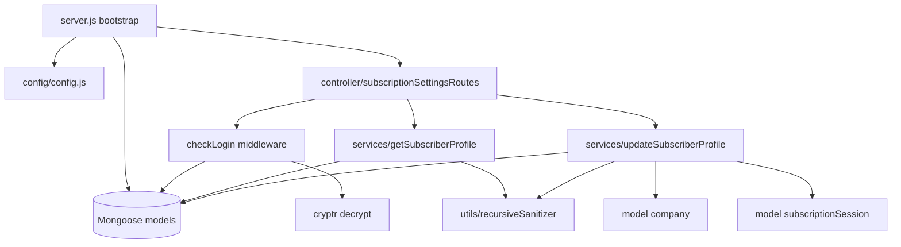

# subscription_settings_ms

## 1. Summary

Repository `subscription_settings_ms` (repo id `subscription_settings_ms` in `.kilo/repos.json`,
checkout at `apps/subscription_settings_ms`, git branch `dev`). A small Express/MongoDB service that
exposes the subscriber-facing profile screen of a subscription product: it reads a subscriber's
profile fields for an external subscription service and lets a signed-in subscriber change their own
profile. It also expires that subscriber's `subscriptionSessions` when the profile changes, and
renames the owning company when an admin changes the organisation name. All configuration comes from
process env plus a file-based secret mount (`config/config.js:4-14`).

## 2. Stack and commands

- Runtime: Node.js, `engines` `>=12.0.0 <17.5.0` (`package.json:5-7`); the Dockerfile builds on
  `node:16.4-alpine` (`Dockerfile:1`).
- HTTP: Express 4 (`package.json:25`), body-parser, cookie-parser, cors, helmet, hpp
  (`server.js:2-8`).
- Data: Mongoose 7 (`package.json:31`) against MongoDB via `MONGO_URL`.
- Scripts: `start` = `node server.js`, `test` = `echo "Error: no test specified" && exit 1`
  (`package.json:9-12`). There is no build step.
- Start: `npm start` (`package.json:11`). The process listens on `process.env.PORT`
  (`server.js:87`), which the deployment sets to `5033` (`k8s/subscription-settings-ms-deployment.yml:28-29`).
- ClusterIP: `subscription-settings-ms-cluster-ip-service` (`k8s/subscription-settings-ms-cluster-ip-service.yml:4`).
- Cluster: in production the process forks one worker per CPU, otherwise one worker
  (`server.js:25-29`).
- Images and replicas: image `inhouz/subscription_settings_ms`, `replicas: 1`
  (`k8s/subscription-settings-ms-deployment.yml:6,17`); HPA 1–2 pods at 75% CPU
  (`k8s/subscription-settings-ms-hpa.yml:10-12`); VPA in `updateMode: "Off"`
  (`k8s/subscription-settings-ms-vpa.yml:11`).

## 3. Entry points

| Entry point | Where | How it starts |
|---|---|---|
| HTTP server | `server.js:87` | `npm start` → `node server.js`; listens on `PORT` |
| Cluster master + worker fork | `server.js:25-42` | Implicit at process start |
| Mongo connection + reconnect | `server.js:59-76`, `server.js:92-104` | Called from the worker; retries 5s after disconnect |
| Graceful shutdown | `server.js:77-85` | `SIGINT`, `SIGTERM`, `uncaughtException` close the Mongo connection |
| Health probe script | `healthcheck.js:1-21` | Standalone `node healthcheck.js`; requests `GET /healthz` |
| HTTP route: update profile | `controller/subscription/subscriptionSettingsRoutes.js:6` | `POST /api/subscriptionsettings/updateprofile` |
| HTTP route: get profile | `controller/subscription/subscriptionSettingsRoutes.js:7` | `POST /api/subscriptionsettings/getsubscriberprofile` |

No cron, worker queue or message consumer exists in this repository.

## 4. Module inventory

| Module / export | file:line | Owns | Public API | Kind |
|---|---|---|---|---|
| server bootstrap | `server.js:1-104` | Express app, cluster fork, Mongo lifecycle, model registration | process entry | effectful (binds port, DB, logs) |
| `connectMongo()` | `server.js:92-104` | Opens the single Mongoose connection with `maxPoolSize: 1` | internal | effectful (network) |
| `shutdownFunction()` | `server.js:81-85` | Closes the Mongo connection | signal handler | effectful |
| config factory | `config/config.js:17-49` | Reads env and secret files into a cached object | `()` → config object | effectful (env, filesystem), cached in module state |
| `readSecret(name, envFallback)` | `config/config.js:4-14` | Reads `SECRETS_PATH/<name>`, falls back to an env var | internal | effectful (filesystem, env) |
| routes registrar | `controller/subscription/subscriptionSettingsRoutes.js:5-8` | Mounts the two POST routes | `(app)` | effectful (registers framework handlers) |
| `getSubscriberProfile` | `services/subscriptionSettings/getSubscriberProfile.js:7-145` | Validates the query, loads the deployed external service and the active subscriber, projects `signupExtraDataFields` | `(req,res)` | effectful (Mongo, logging) |
| `updateSubscriberProfile` | `services/subscriptionSettings/updateSubscriberProfile.js:7-157` | Strips protected fields, updates the subscriber, optionally renames the company, expires sessions | `(req,res)` | effectful (Mongo, logging) |
| `checkLogin` | `middlewares/login/checkLogin.js:8-80` | Cookie + CSRF validation against `subscriptionSessions`, decodes `encryptedSessionData` into `req.user` | `(req,res,next)` | effectful (Mongo, clock, crypto, cookie read) |
| `moduleAccessCheck` | `middlewares/module/moduleAccessCheck.js:7-67` | Flex module access check | `(req,res,next)` | effectful (Mongo); **not mounted** |
| `singleSubdomainValidation` | `middlewares/subdomain/singleSubdomainValidation.js:1-25` | Compares `req.subdomains[0]` with `req.user.subDomain` | `(req,res,next)` | pure read of request state + rejects; unused |
| `recursiveSanitizer` | `utils/sanitizer/recursiveSanitizer.js:3-17` | Walks an object to sanitize values | `(element, sanitizer)` → element | pure intent, but see §12 — it is a silent no-op and leaks a global |
| `createEditByObject` | `utils/user/createEditByObject.js:1-23` | Builds the `editedBy` audit sub-document | `(user, deployDate)` → object | pure |
| `getUser` | `utils/user/getUser.js:5-159` | Loads a user, their roles and permission names | `(userId)` → user + permissions | effectful (Mongo) |
| 11 Mongoose model modules | `server.js:13-23` | Schema registration only; listed in §7 | model constructor | reactive (module-level model registry) |

## 5. Side effects

| Effect | Where |
|---|---|
| MongoDB connect, reconnect, close | `server.js:59-76`, `server.js:93-103`, `server.js:82-84` |
| Mongo reads: subscription service | `services/subscriptionSettings/getSubscriberProfile.js:35-44` |
| Mongo reads: subscriber | `services/subscriptionSettings/getSubscriberProfile.js:75-88` |
| Mongo write: subscriber `$set` | `services/subscriptionSettings/updateSubscriberProfile.js:82-96` |
| Mongo write: company `companyName` | `services/subscriptionSettings/updateSubscriberProfile.js:107-123` |
| Mongo write: expire subscription sessions | `services/subscriptionSettings/updateSubscriberProfile.js:126-143` |
| Mongo read: session on every request | `middlewares/login/checkLogin.js:26-36` |
| Filesystem read of secret files | `config/config.js:5-13` |
| Env reads | `config/config.js:20-46`, `server.js:26`, `server.js:87` |
| Clock (`Date.getTime()`) for session expiry | `middlewares/login/checkLogin.js:24` |
| Crypto: Cryptr decrypt of session token, CSRF token, session payload | `middlewares/login/checkLogin.js:21-23,63` |
| Cookie read (`SUBSCR`, `refreshToken`, `deviceId`) | `middlewares/login/checkLogin.js:10-13` |
| Request header read (`x-csrfToken`) | `middlewares/login/checkLogin.js:11` |
| Logging (`console.log`/`console.error`) | `server.js:32-41,64,67,75,88`; `services/subscriptionSettings/*.js` catch blocks |
| Port bind | `server.js:87` |

No outbound HTTP client, no email, no Stripe and no queue calls exist in this repository. The
`@sendgrid/mail`, `stripe`, `express-session`/`connect-mongo` style dependencies are declared but
never required (`package.json:15-35`).

## 6. State and state transitions

The service owns no explicit state machine. Two implicit lifecycles:

**Subscriber profile edit**

| From | To | Trigger | Guard |
|---|---|---|---|
| session valid | update allowed | `POST /api/subscriptionsettings/updateprofile` | `checkLogin` passed, `req.user.companyId` string, `updatedProfile.subscriberId` present (`updateSubscriberProfile.js:13-25`) |
| update allowed | rejected | caller is `subscriberType: internal` | `updateSubscriberProfile.js:27-33` |
| update allowed | rejected | every submitted field was stripped | `utils/.../updateSubscriberProfile.js:73-79` |
| update allowed | updated | `updateOne` matched an active subscriber | `updateSubscriberProfile.js:82-96` |
| updated | sessions expired | update applied | `expirationTimestamp`/`sessionDataExpirationTimestamp` set to `0` (`updateSubscriberProfile.js:126-139`) |

**Subscription session (shared collection, written by this repo only to expire)**

| From | To | Trigger | Guard |
|---|---|---|---|
| live | expired | profile update by the same subscriber | `sessionDataExpirationTimestamp` >= now fails in `checkLogin.js:62-72` |

## 7. Data

Collections are selected by env var, so the model file and the k8s value together define the
collection name.

| Model | file:line | Env var → collection (k8s line) | Key fields and validation |
|---|---|---|---|
| Subscriber | `model/subscription/subscriber.js:6-73` | `SUBSCRIBER_MODEL` → `subscribers` (`k8s/...deployment.yml:80-81`) | `strict:false`; `subscriberType` enum internal/external, `email` email-validated and indexed, `companyId`, `assetOwnerCompanyId` required, `subscriptionIds` string array, `isAdmin`, `active`, `passwordHash` |
| Subscription | `model/subscription/subscription.js:6-213` | `SUBSCRIPTION_MODEL` → `subscriptions` (`:78-79`) | `subscriptionType` enum recurring/oneTime/payAsYouGo; `serviceType` internal/external; `reupSubscriptionRateType` enum day/week/month/year; `environment` enum development/test/production; `assetType` enum view/api; `status` enum active/paused/inRenewal/cancelled; `createdDate` required |
| SubscriptionService | `model/subscription/subscriptionService.js:5-381` | `SUBSCRIPTION_SERVICE_MODEL` → `subscriptionServices` (`:82-83`) | `serviceName`, `companyId`, `subscriptionServiceId`, `signupSlug`, `assetType`, `environment`, `version`, `createdDate`, `createdById` required; `customPaymentTiers`, `addOnPackages`, `signupExtraDataFields`, `signupRestrictions` sub-schemas; `deployed`/`activeVersion` flags |
| SubscriptionSession | `model/session/subscriptionSession.js:6-86` | `SUBSCRIPTION_SESSION_MODEL` → `subscriptionSessions` (`:76-77`) | `ipAddress`, `companyId`, `assetOwnerCompanyId`, `subscriberType`, `subscriberEmail`, `destination` enum app/backOffice, `beginTimeStamp`, `expirationTimestamp`, `csrfToken`, `deviceId`, `subscriptionServiceId`, `subscriptionServiceTierId`, `sessionDataExpirationTimestamp`, `encryptedRefreshToken` all required |
| SubscriptionSessionValidator | `model/session/subscriptionSessionValidator.js:6-82` | `SUBSCRIPTION_SESSION_VALIDATOR_MODEL` → `subscriptionSessionValidator` (`:74-75`) | 2FA state: `unprovenIpAddresses`, `approvedIpAddresses`, `twoFactorRequired`, `accountLocked`, `accountReOpenTimestamp`, `twoFactorAttempts`, `passwordChangeInProgress` |
| SubscriptionSessionAuthLog | `model/session/subscriptionSessionAuthLog.js:6-60` | `SUBSCRIPTION_SESSION_AUTH_LOG_MODEL` → `subscriptionSessionAuthLogs` (`:84-85`) | `activity` enum login/logout, `success` required and indexed, `failureDueToError`, `errorMessage` |
| User | `model/user/user.js:6-107` | `USER_MODEL` → `User` (`:56-57`) | unique `email`, unique `key`, required `passwordHash`, `companyId` indexed, `active` |
| UserRoles | `model/user/useRoles.js:6-51` | `USER_ROLES_MODEL` → `userRoles` (`:64-65`) | unique `userId`, `companyId`, `roleIdList[]` |
| Role | `model/rolesAndPermissions/roles.js:6-87` | `ROLE_MODEL` → `roles` (`:60-61`) | required `roleName`, `companyId`, `permissionIdList[]` |
| Permission | `model/rolesAndPermissions/permissions.js:6-89` | `PERMISSION_MODEL` → `permissions` (`:62-63`) | required `permissionName`, `companyId`, `signupPermission` |
| Company | `model/company/company.js:5-108` | `COMPANY_MODEL` → `company` (`:58-59`) | `companyType` enum of 8 tiers, `subDomain` lowercase, `status` enum active/cancelled/paused, renewal fail counters |

Shared collections inside this cluster (each service registers the same collection name):

| Collection | Also registered in |
|---|---|
| `subscribers`, `subscriptions`, `subscriptionServices`, `subscriptionSessions`, `subscriptionSessionValidator`, `subscriptionSessionAuthLogs`, `session`, `User`, `company`, `roles`, `permissions`, `userRoles` | `apps/subscription_ms/model/**`, `apps/subscription_metrics_ms/model/**`, `apps/subscription_payment_ms/model/**` (session/company/roles/permissions), `apps/subscription_signup_ms/model/**`, `apps/inhouz_subscription_ms/model/**` (company, session, roles, permissions, user, userRoles) |

This is the main data coupling of the cluster: the same Mongo database is shared by six services
and each one declares its own Mongoose schema for the same collection. Schema drift between the
copies is invisible at runtime.

## 8. Public interfaces

| Method | Path | Auth | Request body | Response |
|---|---|---|---|---|
| POST | `/api/subscriptionsettings/getsubscriberprofile` | `SUBSCR` + `refreshToken` + `deviceId` cookies, `x-csrfToken` header (`checkLogin.js:10-14`) | `{ email, companyId, assetOwnerCompanyId, subscriptionId, subscriptionServiceId }` (`getSubscriberProfile.js:10-13`) | `200` profile object + `editableProfile` + `signupExtraDataFields`; `400` invalid/missing; `404` service or subscriber not found; `500` read error (`:27-144`) |
| POST | `/api/subscriptionsettings/updateprofile` | same | `{ updatedProfile: { subscriberId, ... }, adminUpdate? }` (`updateSubscriberProfile.js:10-12`) | `{ success: true }`; `400` invalid; `403` internal subscriber; `404` no update; `500` unexpected (`:20-155`) |

Error shape everywhere is `{ error: { message } }`. Health: `healthcheck.js:7` requests
`GET /healthz`, but **that route is not registered** (§12).

## 9. Configuration

Env var names only. Read in `config/config.js` and `server.js`:
`SECRETS_PATH`, `NODE_ENV`, `PORT`, `MONGO_URL`, `SESSION_SECRET`, `SENDGRID_API_KEY`,
`CLIENT_SECRET_KEY`, `COOKIE_DOMAIN`, `COOKIE_NAME`, `FLEX_COLLECTION_MODEL`, `FLEX_MODULE_MODEL`,
`FLEX_FORM_FILE_MODEL`, `FORM_MODEL`, `DATA_RULE_EXECUTION_RESULT_MODEL`, `USER_MODEL`,
`COMPANY_MODEL`, `ROLE_MODEL`, `PERMISSION_MODEL`, `USER_ROLES_MODEL`, `SESSION_MODEL`,
`SESSION_VALIDATOR_MODEL`, `AUTH_LOG_MODEL`, `SUBSCRIPTION_SESSION_VALIDATOR_MODEL`,
`SUBSCRIPTION_SESSION_MODEL`, `SUBSCRIPTION_SESSION_AUTH_LOG_MODEL`, `SUBSCRIBER_MODEL`,
`SUBSCRIPTION_MODEL`, `SUBSCRIPTION_SERVICE_MODEL`.

Config keys (not env): `adminPermission` is the literal `"admin"` (`config/config.js:36`).

Secret files consumed from `SECRETS_PATH`: `sendgridapikey`, `sessionsecret`, `mongourl`,
`clientsecretkey` (`config/config.js:24,26,27,37`). The deployment also injects
`MONGO_URL`, `SESSION_SECRET`, `CLIENT_SECRET_KEY`, `SENDGRID_API_KEY` as `secretKeyRef`
(`k8s/subscription-settings-ms-deployment.yml:30-49`), so production reads the env fallback unless
the secret files are mounted.

## 10. Dependencies

| Dependency | Why it is there |
|---|---|
| `express` | HTTP server (`server.js:2`) |
| `mongoose` | MongoDB models and queries (`server.js:3`) |
| `body-parser` | JSON body, 20mb limit (`server.js:53`) |
| `cookie-parser` | Signed cookie parsing for session cookies (`server.js:56`) |
| `cors` | Cross-origin access from `inhouz.localhost` (`server.js:45-51`) |
| `helmet`, `hpp` | Security headers, HTTP parameter pollution guard (`server.js:54-55`) |
| `cryptr` | Symmetric decrypt of session cookie payloads (`middlewares/login/checkLogin.js:3,21-23`) |
| `validator` | Email validation in every schema and in the profile query |
| `lodash` | `isEmpty` checks in auth and profile paths |
| `sanitizer` | Recursive input sanitization (`utils/sanitizer/recursiveSanitizer.js:13`) |
| `dotenv` | Local env loading (`server.js:1`) |
| `crypto-js`, `request-ip`, `moment`, `bcryptjs`, `shortid`, `@sendgrid/mail`, `connect-mongo`, `express-session` | Declared but never required by any module — dead dependencies |

## 11. Testing

No tests. `npm test` is the npm placeholder that exits 1 (`package.json:10`). There is no test
directory, no fixture and no CI test step; `.github/workflows/cicd-dev.yml` and `cicd-prod.yml` only
build and deploy. The only executable check is `healthcheck.js`, which depends on a route that does
not exist.

## 12. Known issues and risks

1. **`/healthz` is not implemented.** `healthcheck.js:7` probes `/healthz` and the Dockerfile has no
   `HEALTHCHECK` (`Dockerfile:1-11`); Express never registers the path (`server.js:44-89`). Any
   liveness/readiness wiring that calls it will fail.
2. **Session expiry can over-match.** `updateSubscriberProfile.js:38` captures
   `updatedProfile.email`, then `:45-47` deletes `email` from the update. When the caller does not
   send `email`, `subscriberEmail` is `undefined`, Mongoose drops that key, and
   `updateMany` at `:127-139` expires **every** session of the company/asset-owner pair.
3. **Email can never be changed through this endpoint.** `:45-47` always deletes `email`, while the
   response advertises `editableProfile` from `getSubscriberProfile.js:132-135`.
4. **`recursiveSanitizer` does not sanitize.** It reassigns a local parameter for primitives
   (`utils/sanitizer/recursiveSanitizer.js:13`) and never writes back to the parent object or array;
   line 3 also declares an implicit global. Callers believe input is sanitized when it is not.
5. **Wrong status code on failure.** `updateSubscriberProfile.js:98-104` returns HTTP 200 with an
   `error` body when `modifiedCount` is 0.
6. **Hardcoded CORS origin.** `server.js:47` allows only `/inhouz.localhost/`; production browser
   origins are not matched.
7. **Deprecated Mongoose connect signature.** `server.js:93-103` passes `console.log(...)` as the
   third argument to `mongoose.connect`, which Mongoose 7 treats as a callback, not options.
8. **Unhandled field allow-list.** `updateSubscriberProfile` strips a fixed list of protected keys
   (`:39-71`) and then `$set`s whatever remains into a schema with `strict:false`
   (`model/subscription/subscriber.js:67-70`). Any other field can be written by the subscriber.
9. **Unmounted middleware with a missing config key.** `moduleAccessCheck` reads
   `config.flexModuleModel` (`middlewares/module/moduleAccessCheck.js:29`) which production never
   sets (`k8s/subscription-settings-ms-deployment.yml:54-85` lists only `FLEX_COLLECTION_MODEL`).
   It is not mounted, so it is dead code today.
10. **Duplicate schema source of truth.** `subscriptions`, `subscribers`, `subscriptionServices`,
    `subscriptionSessions` and `User` are separately declared in six repositories (§7). No
    migration or versioning tool keeps them aligned.
11. **Single Mongo connection pool of 1.** `server.js:100` sets `maxPoolSize: 1`; combined with the
    cluster fork this serialises all queries per worker.
12. **Debug string in a user-facing error.** `middlewares/subdomain/singleSubdomainValidation.js:14`
    returns `Failed subdomain validation xxx`.

No credential literal was found in this repository's source.

## 13. Module map

Call direction: server → routes → middleware → service → Mongoose model → MongoDB. The middleware
is the only writer of `req.user`; services read it and never re-authenticate.

## 14. Open questions

- Is `/healthz` served by an ingress or sidecar in the cluster, or is the probe dead?
- Is the profile update meant to allow email changes? The response exposes `editableProfile`
  including whatever `signupExtraDataFields` names, but the write path deletes `email`.
- Who calls this service? No caller was found by grep in the cluster; the only evidence is the
  shared session cookie contract with `subscription_ms` and `subscription_signup_ms`.
- Is `moduleAccessCheck` intended to be mounted on these routes?
- Which service is authoritative for the `subscriptionSessions` schema, given six copies?
