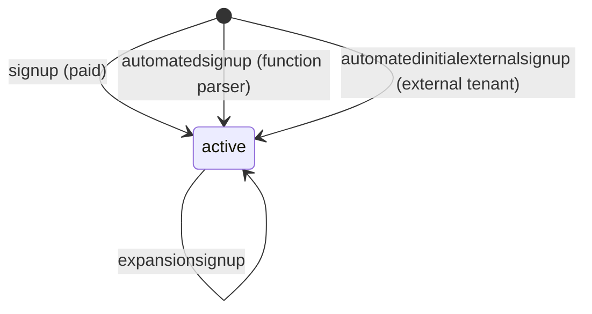
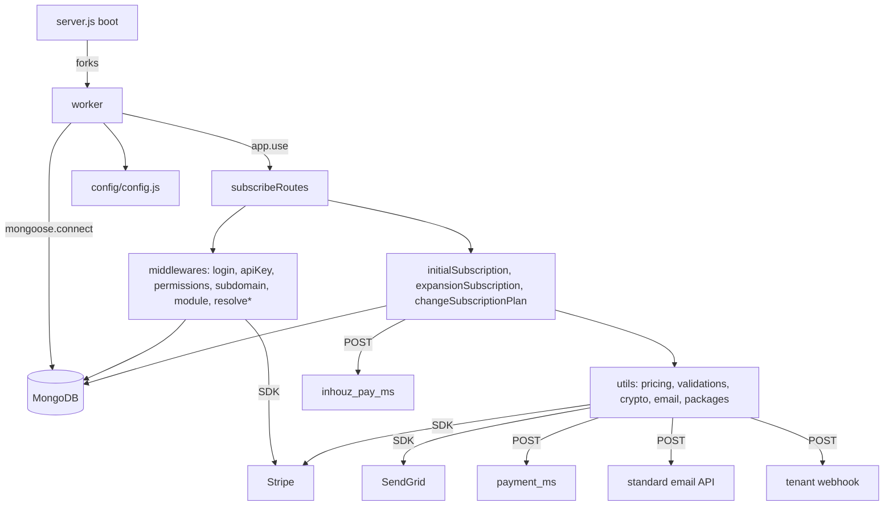

# subscription_signup_ms

## 1. Summary

`subscription_signup_ms` is the signup and plan-change path for every Inhouz subscription. It
creates subscribers, subscriptions, subscribed packages and user accounts, charges the first month
through Stripe or through `inhouz_pay_ms`, saves the payment method through `payment_ms`, sends the
receipt and breakdown emails, fires tenant webhooks, and handles plan changes and add-on
expansion. It is also the entry point the function parser uses for automated signups. It lives in
its own git repository at `apps/subscription_signup_ms/` (repo id `subscription_signup_ms`); this
handover lives in the control repository `inhouz_ai`.

## 2. Stack and commands

- Runtime: Node.js `">=12.0.0 <17.5.0"` (`package.json:7-9`), CommonJS, cluster-forked Express.
- Framework: Express 4 (`package.json:24`), Mongoose 7 (`package.json:29`), Stripe 8 (`package.json:35`).
- Scripts (`package.json:10-13`): `npm start` → `node server.js`; `npm test` → fails by design.
- Port: `PORT` (`server.js:112`), set to `5023` (`k8s/subscription-signup-ms-deployment.yml:28-29`,
  `containerPort: 5023` at `:26`).
- Image: `inhouz/subscription_signup_ms` (`k8s/subscription-signup-ms-deployment.yml:17`),
  replicas `1` (`:6`). No HPA/VPA manifest in `k8s/`.
- Kubernetes service: `subscription-signup-ms-cluster-ip-service`, ClusterIP, port `5023`
  (`k8s/subscription-signup-ms-cluster-ip-service.yml:4,6,10`).
- Health probe: `healthcheck.js:7` requests `/healthz`. **No `/healthz` route is registered**
  (`server.js:78`) — see section 12.

## 3. Entry points

| Entry point | file:line | How it is started |
|---|---|---|
| Cluster master | `server.js:47-63` | `node server.js`; forks `os.cpus().length` in production, 1 otherwise |
| Worker HTTP app | `server.js:65-114` | `app.listen(process.env.PORT)` (`server.js:112`) |
| Mongo connect | `server.js:117-129` | At boot (`server.js:84-86`) and after disconnect (`server.js:91-98`) |
| Reconnect timer | `server.js:94-96` | 5 s `setTimeout` after `disconnected` |
| Route registrar | `controller/subscribe/subscribeRoutes.js:12` | Mounted at `server.js:78` |
| Model registration | `server.js:13-44` | 32 `require()` calls |
| Health probe | `healthcheck.js:1-19` | Run as a process; probes `/healthz` |
| Shutdown | `server.js:102-110` | `SIGINT`, `SIGTERM`, `uncaughtException` → close Mongo |

No cron, no queue consumer, no websocket. The only timer is `server.js:94`.

## 4. Module inventory

| Name | file:line | Owns | Public API | Kind |
|---|---|---|---|---|
| `subscribeRoutes` | `controller/subscribe/subscribeRoutes.js:12` | 6 signup/plan endpoints | `(app) => void` | `effectful` |
| `initialSubscription` | `services/subscribe/initialSubscription.js:48` | Decrypts the signup payload, creates subscriber/subscription/packages, charges, emails, fires webhook (1110 lines) | `(req,res) => Promise<void>` | `effectful` (Mongo, Stripe, HTTP, SendGrid, clock, crypto) |
| `expansionSubscription` | `services/subscribe/expansionSubscription.js:1` | Add-on package expansion, charges via `inhouz_pay_ms` (962 lines) | `(req,res) => Promise<void>` | `effectful` |
| `changeSubscriptionPlan` | `services/subscribe/changeSubscriptionPlan.js:1` | Upgrade/downgrade, proration, refunds (2060 lines) | `(req,res) => Promise<void>` | `effectful` |
| `resolvePaidSignup` | `middlewares/subscription/resolvePaidSignup.js:9` | Verifies the Stripe setup intent and payment method, resolves the gateway | `(req,res,next)` | `effectful` (Mongo, Stripe) |
| `resolveFunctionGeneratedSignup` | `middlewares/subscription/resolveFunctionGeneratedSignup.js:1` | Builds a signup payload from a function-parser call | `(req,res,next)` | `effectful` (Mongo) |
| `resolveAutomatedInitialExternalSignup` | `middlewares/subscription/resolveAutomatedInitialExternalSignup.js:1` | Builds an external tenant signup payload, resolves tax rule and payout account, Stripe at `:294-336` | `(req,res,next)` | `effectful` (Mongo, Stripe) |
| `subscriptionWebhookFunction` | `utils/subscriptionService/subscriptionWebhookFunction.js:3` | POSTs a tenant event to a caller-supplied `webhookUrl` | `(params) => {success}\|{error}` | `effectful` (network, clock); the POST is **not awaited** (`:29-33`) |
| `updateSubscriberCount` | `utils/subscriptionService/updateSubscriberCount.js` | Increments/decrements `subscriberCount` | `(params) => Promise` | `effectful` (Mongo) |
| `amountDueAtSignup` | `utils/pricingCalculations/amountDueAtSignup.js` | Pricing computation for the first charge | `(params) => object` | `pure` |
| `validateSubscriptionRestrictions` | `utils/systemValidations/validateSubscriptionRestrictions.js` | Plan/seat restriction checks | `(params) => object` | `pure` |
| `validateCompany` | `utils/systemValidations/validateCompany.js` | Company eligibility check | `(params) => object` | `pure` |
| `generateWebAppUrl` | `utils/domainGenerator/generateWebAppUrl.js` | Builds the tenant URL from the base domain | `(params) => string` | `pure` |
| `encryptDecrypt` | `utils/cryptography/encryptDecrypt.js:3` | RSA encrypt/decrypt with the client key pair | `(data, encrypt?, publicEncrypt?) => string` | `effectful` (reads config keys, logs on error) |
| `getInhouzPaySecretKey` | `utils/payment/stripe/getInhouzPaySecretKey.js:4` | Decrypts a per-company Stripe secret with `sessionSecret_companyId_env` | `(params) => {stripeSecretKey}\|{error}` | `effectful` (reads config, crypto) |
| `marketplaceTransaction` | `utils/payment/stripe/marketplaceTransaction.js:22-41` | Stripe PaymentIntent create, live or test key | `(params) => Promise` | `effectful` |
| `setupIntent` / `createStripeCustomer` / `deleteStripeCustomer` / `detachStripePaymentMethod` / `attachCustomerToPaymentMethod` / `refundStripePayment` / `getPaymentMethodSummary` | `utils/payment/stripe/*.js` | Stripe object lifecycle | functions returning Stripe responses | `effectful` |
| `saveSubscriptionPaymentMethod` | `utils/payment/paymentMethod/saveSubscriptionPaymentMethod.js:61-62` | POSTs the method to `payment_ms` | `(params) => Promise` | `effectful` |
| `sendEmail` | `utils/email/sendEmail/sendEmail.js` | SendGrid send | `(msg) => void` | `effectful` |
| Email templates | `utils/email/{subscriber,subscriptionService,subscriptions}/*.js` | Receipt, breakdown, notification, migration-breakdown builders | build message objects | `pure` (builders); `sendSubscriptionBreakdownEmail.js:85-86` and `sendMigrationBreakdownEmail.js:65-66` POST to `STANDARD_EMAIL_API_URL` and are `effectful` |
| `getSubscriptionUser` | `utils/subscriptionUser/getSubscriptionUser.js` | Resolves subscriber + user + role | `(params) => object` | `effectful` (Mongo) |
| `setSubscribedPackages` | `utils/subscribedPackage/setSubscribedPackages.js:83-151` | Package date/limit computation and write | `(params) => Promise` | `effectful` |
| `isLoggedIn` (`checkLogin`) | `middlewares/login/checkLogin.js:24,105` | Session + company + permissions | `(req,res,next)` | `effectful` |
| `lightLoginCheck` | `middlewares/login/lightLoginCheck.js:20,81` | Cheap session check | `(req,res,next)` | `effectful` |
| `subscriptionCheckLogin` | `middlewares/login/subscriptionCheckLogin.js:26` | Subscriber-session check | `(req,res,next)` | `effectful` |
| `apiKeyValidation` | `middlewares/apiKey/apiKeyValidation.js:2` | Decrypts and validates the API key | `(req,res,next)` | `effectful` |
| `isSubscriptionAdmin` | `middlewares/permissions/isSubscriptionAdmin.js` | Permission gate | `(req,res,next)` | `reactive` (reads `req.user`) |
| `moduleAccessCheck` | `middlewares/module/moduleAccessCheck.js:29` | Flex-module gate | `(req,res,next)` | `effectful` |
| `subdomainValidator` | `middlewares/subdomain/subdomainValidator.js:16` | Company by subdomain | `(req,res,next)` | `effectful` |
| `tester` | `middlewares/login/tester.js:6` | Debug user-model probe, not mounted | — | `effectful` |
| `config()` / `readSecret()` | `config/config.js:19-110` / `:6-16` | Cached config; secrets from files then env | `() => config` / `(name, fallback) => string` | `effectful` |

`utils/` has 17 subfolders (`apiFunctions`, `cryptography`, `domainGenerator`, `email`,
`ipAddressLocation`, `payment`, `pricingCalculations`, `query`, `requests`, `sanitizer`,
`subscribeFunctions`, `subscribedPackage`, `subscriptionService`, `subscriptionUser`,
`systemUser`, `systemValidations`, `user`). 12 of them were not opened individually (budget); the
ones named above were read or verified by grep.

## 5. Side effects

| Effect | Where | Detail |
|---|---|---|
| MongoDB | `server.js:117-129` plus every service | 40 collections declared, section 7 |
| HTTP → `payment_ms` | `utils/payment/paymentMethod/saveSubscriptionPaymentMethod.js:61-62` | `POST ${config.paymentMsUrl}/api/payment/stripe/addsubscriptionpaymentmethod`; target `payment-ms-cluster-ip-service:5014` (`k8s/subscription-signup-ms-deployment.yml:147`) |
| HTTP → `inhouz_pay_ms` | `services/subscribe/initialSubscription.js:900-901`, `services/subscribe/expansionSubscription.js:810-811`, `services/subscribe/changeSubscriptionPlan.js:1712` | `/api/inhouzpay/stripe/finalizestripeuipayment` and `/api/inhouzpay/payment/serversubscriptionpayment`; target `inhouz-pay-ms-cluster-ip-service:5058` (`k8s/subscription-signup-ms-deployment.yml:181`) |
| HTTP → standard email API | `utils/email/subscriber/sendSubscriptionBreakdownEmail.js:85-86`, `utils/email/subscriptions/sendMigrationBreakdownEmail.js:65-66` | `POST config.standardEmailApiUrl` |
| HTTP → tenant webhook | `utils/subscriptionService/subscriptionWebhookFunction.js:29-33` | `POST webhookUrl` with the caller's payload; not awaited |
| HTTP → IP location finder | `utils/ipAddressLocation/getIpAddressLocation.js` | `node-fetch` |
| Stripe SDK | `utils/payment/stripe/*.js`, `middlewares/subscription/resolvePaidSignup.js:229-328`, `middlewares/subscription/resolveAutomatedInitialExternalSignup.js:294-336` | Live key `config.stripeApiKey`, test key `config.testStripeApiKey` |
| SendGrid | `utils/email/sendEmail/sendEmail.js` | `sgMail.send` |
| Filesystem | `config/config.js:11` | Reads `/mnt/secrets/<name>` |
| Clock | `services/subscribe/initialSubscription.js:66`, `subscriptionWebhookFunction.js:18`, `server.js:94` | Expiry checks, webhook timestamp, reconnect delay |
| Randomness | `shortid` in `services/subscribe/initialSubscription.js:8` and `changeSubscriptionPlan.js:8` | Generated subscriber/package ids |
| Logging | `console.log` in every catch, e.g. `utils/subscriptionService/subscriptionWebhookFunction.js:37`, `utils/cryptography/encryptDecrypt.js:19`, `server.js:56-62,88,92,100,113` | Plain stdout; `encryptDecrypt` logs the raw error object |

## 6. State and state transitions

Signup creates the subscription in one of three access shapes, then plan change moves it. The
service has no route that cancels.

| From | To | Trigger | Guard |
|---|---|---|---|
| (none) | `active` | `POST /api/subscribe/signup` (`controller/subscribe/subscribeRoutes.js:13`) | `lightLoginCheck`, `resolvePaidSignup` (a paid signup must carry a valid `encryptedPaymentData` — `resolvePaidSignup.js:10-40`) |
| (none) | `active` | `POST /api/subscribe/automatedsignup` (`routes.js:15`) | `apiKeyValidation`, `resolveFunctionGeneratedSignup` |
| (none) | `active` | `POST /api/subscribe/automatedinitialexternalsignup` (`routes.js:14`) | `apiKeyValidation`, `resolveAutomatedInitialExternalSignup` |
| `active` | `active` (new tier/packages) | `POST /api/subscribe/changeplan` (`routes.js:18`) | `lightLoginCheck`; proration and refund computed in `changeSubscriptionPlan.js` |
| `active` | `active` (add-on packages) | `POST /api/subscribe/expansionsignup` (`routes.js:16`) | `subscriptionCheckLogin`, `isSubscriptionAdmin` |
| `active` | `active` (add-on packages) | `POST /api/subscribe/automatedexternalsignup` (`routes.js:17`) | `apiKeyValidation`, `isSubscriptionAdmin` |

The subscription status enum is the same four-value set as `subscription_ms`
(`model/subscription/subscription.js`), and the signup path only ever writes `active`. Package
state is `active` plus `contractExpirationTimestamp`
(`utils/subscribedPackage/setSubscribedPackages.js:83,98`).

## 7. Data

| Env var | Collection | Model file | Owned here? | Also used by |
|---|---|---|---|---|
| `SUBSCRIBER_MODEL` | `subscribers` | `model/subscription/subscriber.js:76` | yes | subscription_ms, authentication |
| `SUBSCRIPTION_MODEL` | `subscriptions` | `model/subscription/subscription.js:237` | yes | subscription_ms, payment, metrics |
| `SUBSCRIBED_PACKAGE_MODEL` | `subscribedPackages` | `model/subscription/subscriptionPackage.js:147` | yes | metrics |
| `SUBSCRIPTION_SERVICE_MODEL` | `subscriptionServices` | `model/subscription/subscriptionService.js` | yes | subscription_ms, settings |
| `SUBSCRIPTION_USAGE_LOG` | `subscriberUsageLogs` | `model/subscription/subscriptionUsageLog.js` | yes | metrics |
| `SUBSCRIBER_ACTION_LOG_MODEL` | `subscriberActionLogs` | `model/subscription/subscriberActionLogs.js:100` | yes | metrics |
| `SUBSCRIBER_CHANGE_LOG` | `subscriberChangeLogs` | `model/subscription/subscriberChangeLog.js` | yes | metrics |
| `SUBSCRIBER_MIGRATION_QUEUE_MODEL` | `subscriberMigrationQueue` | `model/subscription/subscriberMigrationQueue.js:90` | yes | settings |
| `SERVICE_DISCOUNT_MODEL` | `serviceDiscounts` | `model/subscription/serviceDiscount.js:123` | yes | payment |
| `CHURN_TRACKER_MODEL` | `churnTracker` | `model/subscription/churnTracker.js:70` | yes | metrics |
| `INTERNAL_SUBSCRIPTION_RENEWAL_TRACKER_MODEL` | `internalSubscriptionRenewalTracker` | `model/subscription/internalSubscriptionRenewalTracker.js:46` | yes | metrics |
| `SUBSCRIPTION_USER_RESTRICTION_LIST_MODEL` | `subscriptionUserRestrictionList` | `model/subscription/subscriptionUserRestrictionList.js` | yes | settings |
| `VERSION_TRACKER_MODEL` | `versionTracker` | `model/versionTracker/versionTracker.js` | yes | — |
| `QUERY_KEY_TRACKER_MODEL` | `queryKeyTracker` | `model/queryTracker/queryKeyTracker.js:23` | yes | — |
| `PAYMENT_METADATA_CACHE_MODEL` | `paymentMetadataCache` | `model/payment/paymentMetadataCache.js:30` | yes | payment |
| `PAYMENT_GATEWAY_MODEL` | `paymentGateways` | `model/payment/paymentGateway.js:61` | yes | payment |
| `PAYMENT_TAX_RULE_MODEL` | `paymentTaxRules` | `model/payment/paymentTaxRules.js:56` | yes | payment |
| `EXCHANGE_RATE_CACHE_MODEL` | `exchangeRateCache` | `model/payment/exchangeRateCache.js:20` | yes | payment |
| `USER_MODEL` | `User` | `model/user/user.js:127` | no | authentication |
| `USER_ROLES_MODEL` | `userRoles` | `model/user/useRoles.js:51` | no | authorization |
| `ROLE_MODEL` | `roles` | `model/rolesAndPermissions/roles.js:87` | no | authorization |
| `PERMISSION_MODEL` | `permissions` | `model/rolesAndPermissions/permissions.js:89` | no | authorization |
| `SESSION_MODEL` | `session` | `model/session/session.js:37` | no | authentication |
| `SUBSCRIPTION_SESSION_MODEL` | `subscriptionSessions` | `model/session/subscriptionSession.js:86` | no | authentication |
| `SESSION_VALIDATOR_MODEL` | `sessionValidator` | no model file | no | authentication |
| `AUTH_LOG_MODEL` | `authenticationLogs` | no model file | no | authentication |
| `COMPANY_MODEL` | `company` | `model/company/company.js:108` | no | settings |
| `CUSTOMERS_MODEL` | `customers` | `model/crm/customers.js:34` | no | settings |
| `CONTACTS_MODEL` | `contacts` | `model/crm/contacts.js:37` | no | settings |
| `PAYMENT_CHARGE_MODEL` | `paymentCharges` | `model/payment/paymentCharge.js:142` | no | payment |
| `PAYMENT_INTENT_MODEL` | `paymentIntents` | `model/payment/paymentIntent.js:84` | no | payment |
| `PAYMENT_METHOD_MODEL` | `paymentMethods` | `model/payment/paymentMethod.js:91` | no | payment |
| `PAYOUT_ACCOUNT_MODEL` | `payoutAccounts` | `model/payment/payoutAccount.js:68` | no | payment |
| `INHOUZ_PAYMENT_MODEL` | `inhouzPayments` | `model/payment/inhouzPayment.js:288` | no | payment |
| `INHOUZ_PAY_MRR_TRACKER_MODEL` | `inhouzPayMrrTracker` | `model/payment/inhouzPayMrrTracker.js:83` | no | metrics |
| `INHOUZ_SUBSCRIPTIONS_MODEL` | `inhouzSubscriptions` | `model/inhouzSubscription/inhouzSubscription.js:204` | no | inhouz_subscription_ms |
| `INHOUZ_APP_MODEL` | `inhouzApps` | `model/appBuilder/inhouzApp.js:295` | no | settings |
| `FLEX_API_MODEL` | `flexApi` | `model/api/flexApi.js:164` | no | settings |
| `FLEX_COLLECTION_MODEL` | `flexCollections` | config only, no model file | no | settings |
| `IP_ADDRESS_LOCATION_MODEL` | `ipAddressLocations` | `model/ipAddress/ipAddressLocation.js:30` | yes | authentication |
| `SYSTEM_USER_MODEL` | `systemUsers` | `model/system/systemUser.js:65` | yes | settings |

Validation rules:

- `subscribers`: `email` required, lower-cased, trimmed, must pass `validator.isEmail`
  (`model/subscription/subscriber.js:17-25`); `subscriberType` ∈ `internal|external` (`:11-16`).
- `subscriptions`: same schema family as `subscription_ms` (`model/subscription/subscription.js:237`).
- `paymentGateways`: `liveSecretKey` and `testSecretKey` are stored in the collection
  (`model/payment/paymentGateway.js:19-30`); `testPublicKey`/`testSecretKey` are required,
  `gatewayType` ∈ `stripe` (`:15-17`). The secrets are decrypted by
  `utils/payment/stripe/getInhouzPaySecretKey.js:25-36` using a key built from `sessionSecret`,
  `companyId` and the environment suffix. See section 12.
- `paymentMetadataCache`: `companyId`, `intentId`, `timestamp` required
  (`model/payment/paymentMetadataCache.js:6-18`).
- `internalSubscriptionRenewalTracker`: `companyId`, `environment`, `subscriptionServiceId`,
  `renewalDate` required; `renewalIntervalDays` defaults 30
  (`model/subscription/internalSubscriptionRenewalTracker.js:6-34`).

No migrations exist in the repository.

## 8. Public interfaces

`controller/subscribe/subscribeRoutes.js:12-19`. Every route is `POST`.

| Route | Guards | Request | Response |
|---|---|---|---|
| `/api/subscribe/signup` | `lightLoginCheck`, `resolvePaidSignup` | `{encryptedData, serverEncrypted?, encryptedPaymentData?}` (`services/subscribe/initialSubscription.js:51-54`, `middlewares/subscription/resolvePaidSignup.js:12-15`) | new subscriber + subscription + packages |
| `/api/subscribe/automatedinitialexternalsignup` | `apiKeyValidation`, `resolveAutomatedInitialExternalSignup` | external tenant signup payload | same |
| `/api/subscribe/automatedsignup` | `apiKeyValidation`, `resolveFunctionGeneratedSignup` | function-parser signup payload | same |
| `/api/subscribe/expansionsignup` | `subscriptionCheckLogin`, `isSubscriptionAdmin` | add-on package selection | updated packages |
| `/api/subscribe/automatedexternalsignup` | `apiKeyValidation`, `isSubscriptionAdmin` | external add-on payload | updated packages |
| `/api/subscribe/changeplan` | `lightLoginCheck` | new tier + proration data | updated subscription, receipt |

Payload encryption: `encryptedData`/`encryptedPaymentData` is either Cryptr-encrypted with
`sessionSecret` (when `serverEncrypted` is true, `services/subscribe/initialSubscription.js:68-70`)
or RSA-decrypted with the client key pair (`utils/cryptography/encryptDecrypt.js:15`). Both carry
an `expirationTimestamp` that must be in the future (`services/subscribe/initialSubscription.js:71-74`).

Inbound callers named in the brief: `function_parser_ms` and `scheduled_task_function_parser_ms`.
The evidence in this repository is the API-key-guarded `/automatedsignup` route and the
`resolveFunctionGeneratedSignup` middleware, which builds a payload from a function call. No
reverse call site can be verified from here.

Outbound: `payment_ms`, `inhouz_pay_ms`, the standard email API, and a caller-supplied webhook
(section 5). No other Inhouz service is called over HTTP: `INHOUZ_APP_MS_URL` is used only to
build a URL string in an email (`utils/email/subscriber/successfulSubscriptionTemplate.js:23`),
not to make a request.

## 9. Configuration

Read in `config/config.js`: `INHOUZ_API_DOMAIN` (`:22`), `INHOUZ_APP_DOMAIN` (`:23`),
`FLEX_FORM_FILE_MODEL` (`:24`), `FLEX_MODULE_MODEL` (`:25`), `FLEX_COLLECTION_MODEL` (`:26`),
`FORM_MODEL` (`:27`), `SENDGRID_API_KEY` (`:28`), `INHOUZ_FROM_EMAIL` (`:29`),
`DATA_RULE_EXECUTION_RESULT_MODEL` (`:30`), `SESSION_SECRET` (`:31`), `MONGO_URL` (`:32`),
`USER_MODEL` (`:33`), `COMPANY_MODEL` (`:34`), `ROLE_MODEL` (`:35`), `PERMISSION_MODEL` (`:36`),
`USER_ROLES_MODEL` (`:37`), `SESSION_MODEL` (`:38`), `SESSION_VALIDATOR_MODEL` (`:39`),
`AUTH_LOG_MODEL` (`:40`), `CLIENT_SECRET_KEY` (`:41`), `COOKIE_DOMAIN` (`:43`),
`SUBSCRIBER_MODEL` (`:44`), `SUBSCRIPTION_SERVICE_MODEL` (`:45`), `SUBSCRIPTION_USAGE_LOG`
(`:46`), `VERSION_TRACKER_MODEL` (`:47`), `SUBSCRIBER_CHANGE_LOG` (`:48`), `FLEX_API_MODEL`
(`:49`), `SUBSCRIBER_ACTION_LOG_MODEL` (`:50`), `SUBSCRIBER_MIGRATION_QUEUE_MODEL` (`:51`),
`SERVICE_DISCOUNT_MODEL` (`:56`), `CUSTOMERS_MODEL` (`:57`), `CONTACTS_MODEL` (`:58`),
`PAYMENT_CHARGE_MODEL` (`:59`), `PAYOUT_ACCOUNT_MODEL` (`:60`), `PAYMENT_METHOD_MODEL` (`:61`),
`PAYMENT_INTENT_MODEL` (`:62`), `SUBSCRIPTION_SERVICE_CHARGE_TYPE` (`:63`), `STRIPE_API_KEY`
(`:64`), `TEST_STRIPE_API_KEY` (`:65`), `OPEN_EXCHANGE_RATES_API_KEY` (`:67-70`),
`OPEN_EXCHANGE_RATES_BASE_URL` (`:70`), `SUBSCRIPTION_SERVICE_CHARGE_FEE` (`:71`),
`PAYMENT_MS_URL` (`:72`), `CHURN_TRACKER_MODEL` (`:73`), `EXCHANGE_RATE_CACHE_MODEL` (`:74`),
`SUBSCRIPTION_MODEL` (`:75`), `INHOUZ_APP_MODEL` (`:76`), `IP_ADDRESS_LOCATION_MODEL` (`:77`),
`IP_LOCATION_FINDER_URL` (`:78`), `SUBSCRIBED_PACKAGE_MODEL` (`:79`), `CLIENT_PUBLIC_KEY`
(`:90`), `INHOUZ_SUBSCRIPTIONS_MODEL` (`:92`), `INHOUZ_APP_MS_URL` (`:93`),
`SUBSCRIPTION_SESSION_MODEL` (`:94`), `PAYMENT_GATEWAY_MODEL` (`:95`), `INHOUZ_BASE_URL` (`:96`),
`PAYMENT_TAX_RULE_MODEL` (`:97`), `PAYMENT_METADATA_CACHE_MODEL` (`:98`),
`QUERY_KEY_TRACKER_MODEL` (`:99`), `INTERNAL_SUBSCRIPTION_RENEWAL_TRACKER_MODEL` (`:101`),
`INHOUZ_PAY_MRR_TRACKER_MODEL` (`:102`), `INHOUZ_PAYMENT_MODEL` (`:103`),
`SUBSCRIPTION_USER_RESTRICTION_LIST_MODEL` (`:105`), `STANDARD_EMAIL_API_URL` (`:106`),
`SYSTEM_USER_MODEL` (`:107`), `INHOUZ_PAY_MS_URL` (`:108`).

Also read at runtime: `PORT` (`server.js:112`, `healthcheck.js:6`), `NODE_ENV`
(`middlewares/login/checkLogin.js:131`), `SECRETS_PATH` (`config/config.js:7`).

Set in k8s but read by no source file: `COOKIE_NAME`
(`k8s/subscription-signup-ms-deployment.yml:74`).

Names only. Secrets come from files under `SECRETS_PATH` first, env second (`config/config.js:6-16`).

## 10. Dependencies

| Package | Why |
|---|---|
| `express` | HTTP server (`server.js:2`) |
| `mongoose` | ODM (`server.js:3`) |
| `dotenv` | `.env` loading (`server.js:1`) |
| `body-parser` | JSON body, 20 MB (`server.js:74`) |
| `cookie-parser` | Signed cookies (`server.js:77`) |
| `cors` | Origin regex `inhouz.localhost` (`server.js:68-72`) |
| `helmet` | Security headers (`server.js:76`) |
| `hpp` | Parameter-pollution guard (`server.js:75`) |
| `node-rsa` | RSA key pair parsing (`config/config.js:1,83-93`) |
| `cryptr` | Decrypts client and payment payloads (`middlewares/apiKey/apiKeyValidation.js:2`, `services/subscribe/initialSubscription.js:10`) |
| `bcryptjs` | Hashes external user passwords (`utils/subscribeFunctions/externalUserSignup.js:5`, `utils/subscribeFunctions/externalExpansionUserSignup.js:5`) |
| `stripe` | Setup intents, payment intents, customers, refunds (`utils/payment/stripe/*.js`) |
| `@sendgrid/mail` | Receipt and notification email (`utils/email/sendEmail/sendEmail.js`) |
| `node-fetch` | Outbound HTTP (`utils/requests/postRequest.js:1`) |
| `moment` | Date/proration arithmetic (`middlewares/login/checkLogin.js:4`) |
| `lodash` | `isEmpty` and collection helpers (`services/subscribe/initialSubscription.js:5`) |
| `sanitizer` | Input sanitisation (`middlewares/module/moduleAccessCheck.js:2`) |
| `validator` | Email validation (`model/subscription/subscriber.js:4`) |
| `shortid` | Generated ids (`services/subscribe/initialSubscription.js:8`) |

Declared but unused (no source reference): `connect-mongo`, `crypto-js`, `express-session`,
`request-ip` (`package.json:16-40`).

## 11. Testing

There are no tests. `package.json:11` defines `test` as
`echo "Error: no test specified" && exit 1`. No `test/`, `__tests__/` or `*.test.js` file exists.
Nothing is covered. The pure helpers (`utils/pricingCalculations/amountDueAtSignup.js`,
`utils/systemValidations/*`, `utils/domainGenerator/generateWebAppUrl.js`) are the only cheap
test targets, and none are tested.

## 12. Known issues and risks

- **Health endpoint missing.** `healthcheck.js:7` probes `/healthz`; no such route is registered
  (`server.js:78`).
- **`uncaughtException` does not exit.** `server.js:105-110` closes Mongo only; the worker keeps
  running and the master never replaces it (`server.js:47-63`).
- **Per-company Stripe secrets live in MongoDB, keyed by the session secret.**
  `model/payment/paymentGateway.js:19-30` stores `liveSecretKey` and `testSecretKey`, decrypted by
  `utils/payment/stripe/getInhouzPaySecretKey.js:25-36` with a Cryptr key built from
  `config.sessionSecret`, `companyId` and a fixed suffix. A leak of `SESSION_SECRET` plus database
  read access exposes every tenant's Stripe secret. The same secret signs cookies
  (`server.js:77`) and decrypts signup payloads (`services/subscribe/initialSubscription.js:68-70`).
- **Silent Stripe/email/webhook failures.** `utils/subscriptionService/subscriptionWebhookFunction.js:29-33`
  fires `postRequest` without awaiting it, and `utils/email/sendEmail/sendEmail.js` calls
  `sgMail.send` the same way. A failed notification or webhook is never retried or surfaced.
- **`encryptDecrypt` returns the ciphertext on failure.** `utils/cryptography/encryptDecrypt.js:20`
  returns the input when decryption throws, so a caller that only checks truthiness treats an
  undecryptable payload as valid data. `JSON.parse` is the only thing that stops it
  (`services/subscribe/initialSubscription.js:72`), and that throws inside a `try` that returns a
  generic 400.
- **Hard-coded CORS origin.** `server.js:68` allows only `origin: /inhouz.localhost/`.
- **Mongo pool size 1 per worker** (`server.js:125`).
- **Duplicate model file with a space in its name.** `model/subscription/subscriptionPackage copy.js:122`
  registers the same collection as `model/subscription/subscriptionPackage.js:147`. It is not
  required at boot (`server.js:26`), so it is dead code that would throw `OverwriteModelError` if
  ever required.
- **`middlewares/login/tester.js:6`** is dead debug code inside the deployed tree.
- **Six routes, three payload-decryption schemes.** Cryptr with `SESSION_SECRET`, RSA with the
  client key pair, and API-key encryption all coexist (`services/subscribe/initialSubscription.js:68-70`,
  `utils/cryptography/encryptDecrypt.js:15-16`, `middlewares/apiKey/apiKeyValidation.js:2`). Each
  is a separate trust boundary and none is documented in the route table.
- **Dead env key.** `COOKIE_NAME` is set in k8s and read by no source file
  (`k8s/subscription-signup-ms-deployment.yml:74`).
- **Unused dependencies** add attack surface: `connect-mongo`, `crypto-js`, `express-session`,
  `request-ip` (`package.json:16-40`).
- **Encrypted service-account blob committed.** `service-account.json.enc` is in the repo root.
- **No credential literal found in source.** A scan for `sk_live`, `sk_test`, `SG.` and
  key-shaped string literals returned nothing. All secrets come from `SECRETS_PATH` files or env
  (`config/config.js:6-16`).

## 13. Module map

## 14. Open questions

- Which caller sends `/api/subscribe/signup` versus `/api/subscribe/automatedsignup`? The brief
  names `function_parser_ms` and `scheduled_task_function_parser_ms`; the repository only shows the
  API-key guard, not the caller.
- Why are there two decryption paths (`serverEncrypted` Cryptr vs RSA `encryptDecrypt`) on the same
  `encryptedData` field? Which client uses which?
- Who provisions `paymentGateways` rows and encrypts their secrets? No writer exists in this
  repository; it is read only (`utils/payment/stripe/getInhouzPaySecretKey.js`).
- Is `model/subscription/subscriptionPackage copy.js` accidentally committed, and can it be
  deleted? Nothing requires it.
- What consumes `paymentMetadataCache` and `internalSubscriptionRenewalTracker`? Both are written
  here and no reader is in this repository. `subscription_metrics_ms` is the likely consumer.
- Does `INHOUZ_APP_MS_URL` ever become a real outbound call? Today it only builds an email link
  (`utils/email/subscriber/successfulSubscriptionTemplate.js:23`).

Skipped, by budget: the bodies of `initialSubscription.js` (1110 lines), `expansionSubscription.js`
(962 lines) and `changeSubscriptionPlan.js` (2060 lines) — read only by targeted grep; `k8s/*.yml`
beyond name/port/image/replicas and the URLs; 26 of 40 model files (14 read or grepped);
12 of 17 `utils/` subfolders; `Dockerfile`, `deploy.sh`, `build_ga*.sh`, `docker-compose.yml`,
`kus/`; and `service-account.json.enc` (present in the repo root, encrypted, not opened).
