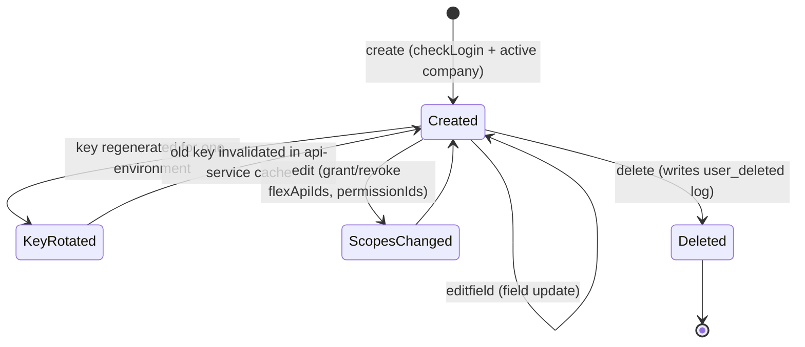
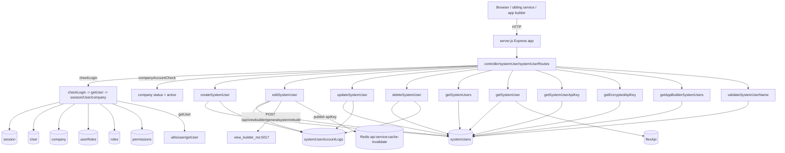

# system_users_ms

## 1. Summary

`system_users_ms` manages machine ("system") users for a company: the identities that hold the API
keys other services present when they call a company's Inhouz app. It creates, edits, deletes and
lists system users, generates and rotates per-environment API keys, grants them flex-API and
permission scopes, records every change in an account log, and hands an encrypted key back to a
caller that proves possession of a valid encrypted payload. It is a small service: one route file,
twelve handler modules, ten routes. It reads the `session`, `company`, `User`, `roles`,
`permissions` and `userRoles` collections that `authentication_ms` owns, so its authentication is
the same cookie + CSRF-token scheme, re-implemented locally. It lives in its own git repository at
`apps/system_users_ms/` (repo id `system_users_ms`), not in the control repo; every path here is
relative to that repository root. The npm package name is `system_user_ms` (singular), while the
directory and the k8s service use `system-user`/`system_users`.

## 2. Stack and commands

Node.js. `package.json:5-7` pins `engines.node` to `>=12.0.0 <17.5.0`; the image is
`node:16.4-alpine` (`Dockerfile:1`) and runs `npm run start` (`Dockerfile:11`).

`package.json:9-11` declares only:

- `start` → `node server.js`
- `test` → `echo "Error: no test specified" && exit 1`

No build, no lint, no lockfile committed, no test framework.

Port: `server.js:86` listens on `process.env.PORT`. The k8s Service
`system-user-ms-cluster-ip-service` is ClusterIP on `5022` → targetPort `5022`
(`k8s/system-user-ms-cluster-ip-service.yml:4-11`); the Deployment runs
`inhouz/system_user_ms` with `replicas: 1` (`k8s/system-user-ms-deployment.yml:6,17`).

Verification command: none. `npm test` is the placeholder that exits 1.

## 3. Entry points

| Entry point | Where | How it is started |
|---|---|---|
| HTTP bootstrap | `server.js:42-89` | `node server.js` (`package.json:10`) / `npm run start` (`Dockerfile:11`) |
| Cluster fork loop | `server.js:24-41` | Master process; `os.cpus().length` workers in production, `1` otherwise (`:25`) |
| Express assembly | `server.js:43-56` | Per worker |
| Route registration | `server.js:56` | `require("./controller/systemUser/systemUserRoutes")(app)` |
| `app.listen` | `server.js:86` | End of the worker branch |
| Mongo connect / retry | `server.js:91-103`, called at `:59`, retried at `:67-71` | Module load; 5 s retry after a disconnect |
| Shutdown | `server.js:76-84` | `SIGINT`, `SIGTERM`, `uncaughtException` → close Mongo only |
| Model registration | `server.js:13-22` | Nine model modules required at load |
| Redis publisher | `utils/cacheManager/cacheInvalidationPublisher.js:11-26` | Connects on **require** (module import side effect), not on boot callback |
| Health probe | `healthcheck.js:1-21` | Standalone script, not referenced by `package.json` or the `Dockerfile`; probes `GET /healthz` (`:7`), which no route registers |
| Cron / job / migration | none | Only timer is the reconnect `setTimeout` (`server.js:68`) |

## 4. Module inventory

| Module | `file:line` | Owns | Public API | Kind |
|---|---|---|---|---|
| server bootstrap | `server.js:1-103` | Cluster, middleware stack, Mongo lifecycle | process entry | effectful |
| config loader | `config/config.js:18-56` | Cached config + RSA key pair | `module.exports() -> object` | effectful (FS, env) |
| route table | `controller/systemUser/systemUserRoutes.js:14-25` | All 10 routes | `module.exports(app)` | reactive |
| `createSystemUser` | `services/systemUser/createSystemUser.js:1-…` | Creates the system user, generates keys per environment, writes the log | `(req,res)` | effectful |
| `editSystemUser` | `services/systemUser/editSystemUser.js:7-…` | Field edits; rotates a key, publishes cache invalidation, calls view-builder | `(req,res)` | effectful |
| `updateSystemUser` | `services/systemUser/updateSystemUser.js:7-…` | Grants/revokes flex-API ids and permission ids; diffs with `isEqual` | `(req,res)` | effectful |
| `deleteSystemUser` | `services/systemUser/deleteSystemUser.js:8-…` | Deletes the user, logs `user_deleted` | `(req,res)` | effectful |
| `getSystemUsers` | `services/systemUser/getSystemUsers.js:11-…` | Aggregation with `filter`/`sort`/`skip`/`limit` | `(req,res)` | effectful |
| `getSystemUser` | `services/systemUser/getSystemUser.js:6-…` | One user plus its flex-API docs; strips `productionEncryptedApiKey` (`:43-44`) | `(req,res)` | effectful |
| `getSystemUserApiKey` | `services/systemUser/getSystemUserApiKey.js:8-…` | Returns dev/test/production keys; production gated by a permission (`:51-52`) | `(req,res)` | effectful |
| `getEncryptedApiKey` | `services/systemUser/getEncryptedApiKey.js:9-124` | Payload-authenticated key retrieval; re-encrypts the key in the response | `(req,res)` | effectful |
| `getAppBuilderSystemUsers` | `services/systemUser/getAppBuilderSystemUsers.js:1-…` | App-builder-facing list, **no auth middleware** (`systemUserRoutes.js:24`) | `(req,res)` | effectful |
| `validateSystemUserName` | `services/systemUser/validateSystemUserName.js:6-…` | Uniqueness/format check for the user name | `(req,res)` | effectful |
| `checkLogin` | `middlewares/login/checkLogin.js:9-153` | Session cookie/token + CSRF check, sliding expiry, `req.user`/`req.company`, response cookies | `(req,res,next)` | effectful |
| `companyAccountCheck` | `middlewares/company/companyAccountCheck.js:1-26` | Company `status === 'active'` | `(req,res,next)` | pure decision |
| `getUser` | `utils/user/getUser.js:5-…` | User + userRoles + role + permissions (`:19,45,85,119`) | `(userId) -> object` | effectful |
| `getApiKey` | `utils/systemUser/getApiKey.js:4-…` | Decrypts a stored key | function | effectful (crypto) |
| `environmentList` | `utils/systemUser/environmentList.js:2` | `development`, `test`, `production` | constant | pure |
| `invalidateApiServiceApiKey` | `utils/cacheManager/cacheInvalidationPublisher.js:28-34` | Publishes `{type:'apiKey', apiKey}` on `api-service:cache-invalidate` | `(apiKey) -> Promise` | effectful (Redis, network) |
| HTTP helpers | `utils/requests/{get,post,delete}Request.js:1` | `node-fetch` wrappers | function | effectful |
| sanitizer | `utils/sanitizer/recursiveSanitizer.js` | Recursive body sanitization | pure |
| crypto helper | `utils/cryptography/encryptDecrypt.js` | Symmetric encrypt/decrypt for client payloads | effectful (key material) |

## 5. Side effects

**MongoDB**
- Connect `server.js:92-102` (`maxPoolSize: 1`, `:99`); retry `server.js:68`.
- Session read + slide: `middlewares/login/checkLogin.js:25-28`, `:83-92`.
- Company read: `checkLogin.js:106-109`.
- System user create: `services/systemUser/createSystemUser.js:60`.
- System user update: `editSystemUser.js:153,200`; `updateSystemUser.js` (same collection).
- System user delete: `deleteSystemUser.js:53`.
- Account log writes: `createSystemUser.js:143`, `deleteSystemUser.js:75`,
  `editSystemUser.js:177`, `updateSystemUser.js:80`.
- Flex-API projection: `getSystemUser.js:56` (`flexApi` collection).
- Identity + permission load: `utils/user/getUser.js:19,45,85,119`.

**Redis**
- Client created and `connect()`ed at module load
  (`utils/cacheManager/cacheInvalidationPublisher.js:11-26`).
- Publish on key rotation: `editSystemUser.js:78` →
  `cacheInvalidationPublisher.js:30`, channel `api-service:cache-invalidate` (`:4`).
- Host/port/db from `redishost`/`REDIS_HOST`, `REDIS_PORT`, `REDIS_DB`
  (`config/config.js:23-26`).

**Outbound HTTP**
- View-builder: `POST ${VIEW_BUILDER_URL}/api/viewbuilder/generalsystemrebuild`
  (`services/systemUser/editSystemUser.js:242-243`), targeting
  `view-builder-ms-cluster-ip-service:5017` (`k8s/system-user-ms-deployment.yml:77`).

**Crypto**
- `cryptr` with `SESSION_SECRET` for cookies (`checkLogin.js:20`), for stored API keys
  (`createSystemUser.js:102-104`), and for the encrypted-payload endpoint
  (`getEncryptedApiKey.js:27-32`).
- `encryptDecrypt` for the client-side `x-java` CSRF cookie (`checkLogin.js:127`) and payloads
  (`getEncryptedApiKey.js:31,107`).
- `node-rsa` client key pair parsed at config build (`config/config.js:40-51`).

**Filesystem / env**
- Secret files under `SECRETS_PATH` (default `/mnt/secrets`): `config/config.js:5-15`; names
  `sessionsecret`, `mongourl`, `redishost`, `redispassword`, `clientsecretkey`, `clientpublickey`
  (`:21-48`).

**Clock**: `new Date().getTime()` (`checkLogin.js:23`, `getEncryptedApiKey.js:26,35,168`),
`moment().add(60,'minutes')` (`checkLogin.js:82`).

**Logging**: `console.log` for cluster events, Mongo events, Redis connect/reconnect errors and
handler catch blocks (`server.js:31,39,63,66,74,87`; `cacheInvalidationPublisher.js:15,21-25,32`;
`getEncryptedApiKey.js:73,116`).

## 6. State and state transitions

No explicit status field. The observable states are the existence of the system-user document and
its per-environment key slots.

| State | Meaning | Evidence |
|---|---|---|
| `created` | document exists with `companyId`, `userName`, `createdById`, `createdDate` | `model/system/systemUser.js:7-55` |
| key set per environment | `developmentEncryptedApiKey`, `testEncryptedApiKey`, `productionEncryptedApiKey` are optional strings | `model/system/systemUser.js:36-44` |
| key rotated | old key replaced, old key published to Redis for cache eviction | `editSystemUser.js:70-78` |
| scopes granted/revoked | `flexApiIds[]`, `permissionIds[]` replaced; log entry written | `updateSystemUser.js`; `model/system/systemUser.js:31-32` |
| `deleted` | document removed, `systemUserAccountLogs` keeps `user_deleted` | `deleteSystemUser.js:53,75-83` |

Account log transitions are enumerated by the schema enum
(`model/system/systemUserAccountLogs.js:18-23`): `user_created`, `user_deleted`,
`api_key_changed`, `api_access_granted`, `api_access_removed`, `permission_granted`,
`permission_removed`.

Session state is not owned here; it is read from the shared `session` collection and slid forward
on every call (`checkLogin.js:82-92`), exactly as in `authentication_ms`.

## 7. Data

Collection name = env value, because every model registers
`mongoose.model(config.xModel, schema, config.xModel)` (`model/system/systemUser.js:68`).

| Model var | Collection (per brief) | Schema | Key fields / rules |
|---|---|---|---|
| `SYSTEM_USER_MODEL` | `systemUsers` | `model/system/systemUser.js:6-60` | `companyId` req, `userName` req, `email` optional but `validator.isEmail` when present, `flexApiIds[]`, `permissionIds[]`, three `*EncryptedApiKey` strings, `createdDate` req, `createdById` req; `strict: true`; compound index `:62-66` |
| `SYSTEM_USER_ACCOUNT_LOG_MODEL` | `systemUserAccountLogs` | `model/system/systemUserAccountLogs.js:6-39` | `companyId`, `systemUserId`, `actionType` (enum, `:18-23`), `permissionIds[]`, `flexApiIds[]`, `createdDate`, `createdById`; `strict: true` |
| `SESSION_MODEL` | `session` | `model/session/session.js:5-26` | read-only here: `_id`, `userId`, `csrfToken`, `expirationTimestamp` |
| `COMPANY_MODEL` | `company` | `model/company/company.js:5-…` | `companyName`, `companyType`, `status` (read at `checkLogin.js:106-122`) |
| `USER_MODEL` | `User` | `model/user/user.js:6-…` | the human user behind the session |
| `ROLE_MODEL` | `roles` | `model/rolesAndPermissions/roles.js:6-…` | used to resolve permissions |
| `PERMISSION_MODEL` | `permissions` | `model/rolesAndPermissions/permissions.js:6-…` | permission names; `admin` hard-coded (`config/config.js:33`) |
| `USER_ROLES_MODEL` | `userRoles` | `model/user/useRoles.js:6-…` | user → role join |
| `FLEX_API_MODEL` | `flexApi` | `model/api/flexApi.js:6-…` | the APIs a system user may call; projected in `getSystemUser.js:56` |

**Shared collections.** `session`, `company`, `User`, `roles`, `permissions`, `userRoles` are
written by `authentication_ms`; this service only reads them except for the sliding session expiry
update (`checkLogin.js:83-92`). `systemUsers` / `systemUserAccountLogs` are owned here and read by
the API-key validation middleware of every service that accepts `X-SE-API-KEY`
(`utils/systemUser/getApiKey.js`). Any service configured with the same `SYSTEM_USER_MODEL` value
shares these documents.

## 8. Public interfaces

| Method | Path | Middleware | File:line |
|---|---|---|---|
| POST | `/api/systemuser/create` | checkLogin + companyAccountCheck | `controller/systemUser/systemUserRoutes.js:15` |
| POST | `/api/systemuser/editfield` | checkLogin + companyAccountCheck | `:16` |
| POST | `/api/systemuser/edit` | checkLogin + companyAccountCheck | `:17` |
| POST | `/api/systemuser/getsystemusers` | checkLogin + companyAccountCheck | `:18` |
| GET | `/api/systemuser/getsystemuser/:systemUserId` | checkLogin only | `:19` |
| POST | `/api/systemuser/delete` | checkLogin only | `:20` |
| POST | `/api/systemuser/validateusername` | checkLogin only | `:21` |
| POST | `/api/systemuser/getapikey` | checkLogin + companyAccountCheck | `:22` |
| POST | `/api/systemuser/getencryptedapikey` | **none** (payload is the credential) | `:23` |
| POST | `/api/systemuser/getappbuildersystemusers` | **none** | `:24` |

There is no `isAdmin` and no subdomain check anywhere. Company scoping is done in the queries with
`req.user.companyId` (e.g. `getSystemUserApiKey.js:29`, `getEncryptedApiKey.js:69-70`), not by a
middleware.

Shapes:

- `create`: body carries `userName`, `email?`, `flexApiIds?`, `permissionIds?` and an environment
  key payload; success `{success:true}` (`createSystemUser.js:175`); failures
  `{error:{message}}`.
- `edit` (`updateSystemUser`): body carries the `_id` plus scope arrays; success
  `{success:true}` (`updateSystemUser.js:155`).
- `editfield` (`editSystemUser`): body carries `_id` and the field set; success
  `{success:true, encryptedPayload}` (`editSystemUser.js:234-248`).
- `getsystemusers`: body `{filter, sort, skip, limit}` (`getSystemUsers.js:14-15`); the
  aggregation applies `$sort`, `$skip`, `$limit` only when non-empty (`:155-168`).
- `getsystemuser/:systemUserId` → the document with `productionEncryptedApiKey` removed
  (`getSystemUser.js:43-44`) plus the resolved flex-API docs (`:56`).
- `getapikey`: body `{_id}`; returns `{developmentApiKey, testApiKey, productionApiKey}`
  (`getSystemUserApiKey.js:53-57`); production is replaced by the string
  `'Not authorized to view production key'` unless `req.user.permissions` contains
  `READ_SYSTEM_USER_PRODUCTION_KEY_PERMISSION` (`:51-52`).
- `getencryptedapikey`: body `{encryptedPayload, serverEncrypted}`; the payload must decrypt and
  contain `{systemUserId, environment, companyId}` with `expirationTimestamp` in the future
  (`getEncryptedApiKey.js:26-65`); response `{encryptedResponse}` (`:105,113`).
- `getappbuildersystemusers`: body-based list for the app builder; unauthenticated
  (`systemUserRoutes.js:24`).

Cross-service contract: the routes are published under `/api/systemuser` on the cluster ingress
(`authentication_ms/k8s/inhouz-ingress-service.yml`), which maps that prefix to
`system-user-ms-cluster-ip-service:5022`.

## 9. Configuration

Names only:

`SECRETS_PATH` (`config/config.js:6`), `SESSION_SECRET` (`:21`), `MONGO_URL` (`:22`),
`REDIS_HOST` (`:23`), `REDIS_PASSWORD` (`:24`), `REDIS_DB` (`:25`), `REDIS_PORT` (`:26`),
`USER_MODEL` (`:27`), `COMPANY_MODEL` (`:28`), `ROLE_MODEL` (`:29`), `PERMISSION_MODEL` (`:30`),
`USER_ROLES_MODEL` (`:31`), `SESSION_MODEL` (`:32`, repeated `:52`), `CLIENT_SECRET_KEY` (`:34`),
`COOKIE_DOMAIN` (`:35`), `SYSTEM_USER_MODEL` (`:36`),
`SYSTEM_USER_ACCOUNT_LOG_MODEL` (`:37`), `FLEX_API_MODEL` (`:38`), `VIEW_BUILDER_URL` (`:39`),
`CLIENT_PUBLIC_KEY` (`:47`), `READ_SYSTEM_USER_PRODUCTION_KEY_PERMISSION` (`:54`);
`PORT` (`server.js:86`, `healthcheck.js:6`), `NODE_ENV` (`server.js:25`, `checkLogin.js:131`).

Secret file names under `SECRETS_PATH`: `sessionsecret`, `mongourl`, `redishost`,
`redispassword`, `clientsecretkey`, `clientpublickey` (`config/config.js:21-48`).

Injected by the Deployment but never read in this repo: `COOKIE_NAME`
(`k8s/system-user-ms-deployment.yml:50`).

## 10. Dependencies

| Package | Why |
|---|---|
| `express` | HTTP routing |
| `mongoose` | Models and all persistence |
| `body-parser` | JSON bodies, 20 MB limit (`server.js:52`) |
| `cookie-parser` | Signed cookies (`server.js:55`) |
| `cors` | Frontend origin (`server.js:44-50`) |
| `helmet`, `hpp` | Header hardening and parameter-pollution guard (`server.js:53-54`) |
| `redis` | Cache-invalidation pub/sub (`cacheInvalidationPublisher.js:1`) |
| `cryptr` | AES for session cookie and stored API keys |
| `node-rsa` | Client key pair (`config/config.js:40-51`) |
| `crypto-js` | Declared; not found in the modules read |
| `node-fetch` | Outbound HTTP (`utils/requests/*.js:1`) |
| `moment` | Session expiry arithmetic |
| `lodash` | `isEmpty`, `isEqual`, `uniq` |
| `validator` | Email validation in the system-user and other schemas |
| `sanitizer` | Recursive body sanitization |
| `request-ip` | Declared; login path uses `CF-Connecting-IP`/`requestIp` only in `authentication_ms`; not found here |
| `shortid` | Declared; not found in the modules read |
| `bcryptjs` | Declared; not found in the modules read |
| `@sendgrid/mail` | Declared; not found in the modules read |
| `express-session`, `connect-mongo` | Declared; sessions are hand-rolled in `checkLogin.js` |
| `dotenv` | `.env` loading (`server.js:1`) |

## 11. Testing

No tests. `package.json:9` is the failing placeholder, there is no test directory, and
`.travis.yml` deploys without running anything. Coverage is zero.

## 12. Known issues and risks

1. **Two routes have no authentication at all.**
   `POST /api/systemuser/getencryptedapikey` (`systemUserRoutes.js:23`) trusts an encrypted payload
   as the credential, and `POST /api/systemuser/getappbuildersystemusers`
   (`systemUserRoutes.js:24`) has neither `checkLogin` nor any payload check. The second one leaks
   system-user records to any caller that can reach the service.
2. **Delete, validate and single-get skip the company-active check.**
   `delete`, `validateusername` and `getsystemuser/:id` have `checkLogin` only
   (`systemUserRoutes.js:19-21`), unlike every other route which adds `companyAccountCheck`. A
   suspended company can still delete system users and read one user.
3. **API keys are double-encrypted on write, single-decrypted on read.**
   `createSystemUser.js:102-104` stores `cryptr(cryptr(JSON))`; `getSystemUserApiKey.js:48-49`
   decrypts once, so `developmentApiKey`/`testApiKey` are returned as ciphertext strings rather
   than a plaintext key. Either the client is expected to decrypt again (undocumented) or the
   endpoint returns the wrong value.
4. **Redis config is never injected.** `config.js:23-26` needs `REDIS_HOST`/`REDIS_PORT`/
   `REDIS_DB`, but the Deployment sets only `PORT` plus the model/session vars
   (`k8s/system-user-ms-deployment.yml:28-76`). `redisUrl` therefore builds from empty values
   (`cacheInvalidationPublisher.js:6`) and the publisher fails on connect (caught and logged at
   `:24-26`). Key rotations then never evict the API-service cache.
5. **The "model" config key is duplicated.** `sessionModel` is assigned twice
   (`config/config.js:32` and `:52`); harmless but a sign the file is drifting.
6. **`editSystemUser` publishes the still-encrypted key to Redis.** `:77-78` decrypts the stored
   value once and passes that to `invalidateApiServiceApiKey`, which is the same nesting problem
   as issue 3. Whether the subscriber compares encrypted or plaintext keys is unknown (§14).
7. **Auth failures return HTTP 200.** `checkLogin.js:14-19,41-46,65-70,74-79,98-103` and
   `systemUserRoutes.js` handlers use `res.send({error})`. Only `companyAccountCheck`
   (`:10,20`) and parts of `getEncryptedApiKey` (`:19,41,60,90`) set a status code.
8. **`checkLogin` throws on a missing CSRF header.** `checkLogin.js:22` decrypts
   `req.header('x-csrfToken')` without a guard; the throw lands in the catch at `:146`, returning
   the generic "authorization process" error instead of "Not Authorized".
9. **`company` may be null and is still spread.** `checkLogin.js:116` does `company._id` after a
   `.catch(() => ({}))`, and `:122` spreads a possibly-undefined object into `req.user`.
10. **No admin check on create/edit/delete.** Any authenticated company member can mint a system
    user with any `permissionIds` and read every other system user's dev/test keys
    (`systemUserRoutes.js:15-18,22`).
11. **`healthcheck.js` probes a route that does not exist.** `/healthz`
    (`healthcheck.js:7`) is not registered (`server.js:56`), and the `Dockerfile` declares no
    `HEALTHCHECK`.
12. **`strict: true` plus arrays of strings means scope changes are all-or-nothing.** There is no
    per-scope add/remove endpoint; `updateSystemUser` replaces the arrays.
13. **`uncaughtException` only closes Mongo** (`server.js:79-84`); the process keeps running in an
    unknown state.
14. **Cluster mode + `maxPoolSize: 1`** (`server.js:25,99`) multiplies Mongo connections by CPU
    cores per pod.
15. **No lockfile**, and no `package-lock.json` is committed.

No credential was found in the source files read. Secrets come from `SECRETS_PATH` or env
(`config/config.js:5-15`).

## 13. Module map

## 14. Open questions

- **Is the double encryption intentional?** `createSystemUser.js:102-104` encrypts twice and
  `getSystemUserApiKey.js:48-49` decrypts once. If clients are meant to decrypt the returned
  string, that contract is not written down anywhere in this repository.
- **What does the Redis subscriber compare?** `editSystemUser.js:78` publishes the result of one
  decryption. The subscriber lives in another repository (the `api-service`), so the expected key
  format cannot be confirmed here.
- **`getappbuildersystemusers` access model.** It has no middleware. Whether the app builder
  authenticates it at the ingress, or whether it is intentionally public, could not be determined.
- **Which services call these routes.** The brief names `function_parser_ms` and
  `scheduled_task_function_parser_ms` as callers; that inbound edge is not visible from this repo.
- **`READ_SYSTEM_USER_PRODUCTION_KEY_PERMISSION` semantics.** It is a permission *name* read from
  env (`config/config.js:54`); the actual permission document and role assignment live in the
  `permissions` / `userRoles` collections shared with `authentication_ms`.
- **Skipped on purpose:** `service-account.json.enc` (encrypted Travis GCP credential, not
  decrypted), `kus/`, `build_ga*.sh`, `deploy.sh` (deploy tooling), the `utils/filter` helpers, and
  the body of `getAppBuilderSystemUsers` beyond its query shape. `utils/` was sampled rather than
  read in full, so a helper-level effect may be missing from §5.
