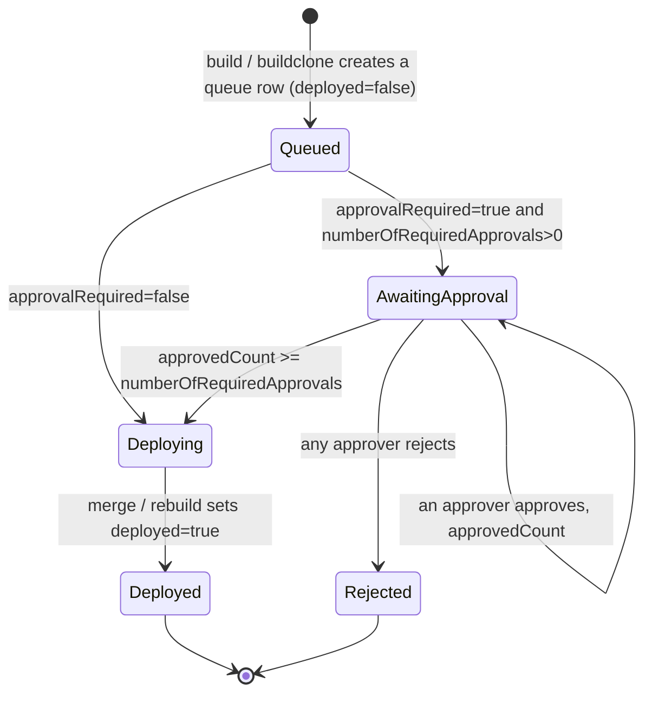
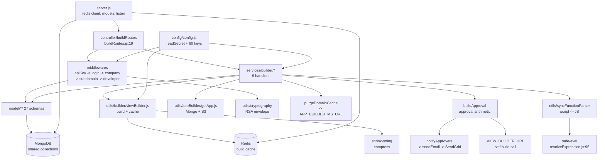

# view_builder_ms

Repository: `apps/view_builder_ms` (repo id `view_builder_ms`, from `.kilo/repos.json`). All
`file:line` citations below are relative to that repository root.

## 1. Summary

The build and deployment service for Inhouz applications. An editor saves an app; this service
turns that app definition into a deployable web build. It reads the app, its pages, elements,
functions and styles from MongoDB, resolves user access, sanitises and compresses the result,
caches it in Redis, and enqueues a deployment record with an optional multi-approver gate. It also
serves the build reports and the deployment queue back to the console, calls the app-builder
service to purge Cloudflare and domain caches, and sends approval and deployment email.

It is a large service: 27 Mongoose models, 9 POST endpoints, 7 middleware modules and about 200
files under `utils/`, most of which implement a script-to-JavaScript transpiler for user-authored
app logic.

## 2. Stack and commands

| Item | Value | Evidence |
|---|---|---|
| Runtime | Node.js, container `node:18-alpine` | `Dockerfile:1` |
| Declared engine range | `>=18.0.0 <19.0.0` | `package.json:6` |
| Start command | `node --max-old-space-size=8192 server.js` | `package.json:11` |
| Test command | none — placeholder that exits 1 | `package.json:10` |
| Container entry | `npm run start` | `Dockerfile:11` |
| Port | `process.env.PORT`; k8s sets `5017` | `server.js:117`, `k8s/view-builder-ms-deployment.yml:28-29` |
| Container port | `5017` | `k8s/view-builder-ms-deployment.yml:26` |
| ClusterIP service | `view-builder-ms-cluster-ip-service` | `k8s/view-builder-ms-cluster-ip-service.yml:4` |
| Resources | limits 10Gi / 2 CPU, requests 5Gi / 1 CPU | `k8s/view-builder-ms-deployment.yml:19-23` |
| Replicas | `1`, HPA `1`–`5` at 70 % CPU / 75 % memory | `k8s/view-builder-ms-deployment.yml:6`, `k8s/view-builder-ms-hpa.yml:10-11`, `:18`, `:24` |

There is no dev script, no lint script and no build script. Run it with `PORT`, `MONGO_URL`,
`REDIS_HOST`/`REDIS_PORT`/`REDIS_PASSWORD` and the collection-name env vars set, or mount the
secret files the config expects (§9).

## 3. Entry points

| Entry point | Where | How it starts |
|---|---|---|
| Process | `server.js:1` | `npm run start` → `node server.js` |
| Express app + HTTP server | `server.js:73-80`, `server.js:117` | `app.listen(process.env.PORT)` |
| Route registration | `server.js:86` → `controller/buildRoutes/buildRoutes.js:19-29` | called with the app at boot |
| Redis client | `server.js:16-31` | created at module load, exported as `module.exports.redisClient` |
| 27 model registrations | `server.js:33-59` | `require` side effects |
| Mongo connect + retry | `server.js:88-90`, `server.js:95-102`, `server.js:122-134` | at boot; retried 5 s after a disconnect |
| Shutdown | `server.js:106-115` | `SIGINT`, `SIGTERM`, `uncaughtException` |
| Health-check client | `healthcheck.js:1-21` | separate process, GETs `/healthz` |

Nine routes, all `POST`, all registered in `controller/buildRoutes/buildRoutes.js:20-28`:

| Route | Middleware chain | Handler |
|---|---|---|
| `/api/viewbuilder/build` | `apiKeyValidation`, `clientEncryptedLogin`, `serverEncryptedLogin`, `serverUserLogin`, `isLoggedIn`, `companyAccountCheck`, `subdomainCheck`, `isAllowedDeveloper` | `services/builder/buildView.js:15` |
| `/api/viewbuilder/buildclone` | **none** | `services/builder/buildViewClone.js:15` |
| `/api/viewbuilder/getqueueddeployment` | `isLoggedIn`, `companyAccountCheck`, `subdomainCheck`, `isAllowedDeveloper` | `services/builder/getQueuedDeployment.js:7` |
| `/api/viewbuilder/buildapproval` | same four | `services/builder/buildApproval.js:10` |
| `/api/viewbuilder/systemrebuild` | same four | `services/builder/systemRebuild.js:15` |
| `/api/viewbuilder/getbuildreports` | same four | `services/builder/getBuildReports.js:7` |
| `/api/viewbuilder/mergebuild` | same four | `services/builder/mergeBuild.js:12` |
| `/api/viewbuilder/generalsystemrebuild` | same four | `services/builder/generalSystemRebuild.js:10` |
| `/api/viewbuilder/getappbuild` | **none** | `services/builder/getBuild.js:8` |

There is no `GET` route, no `app.get('/healthz')`, and no catch-all (`buildRoutes.js:20-28`).
`healthcheck.js:7` therefore probes a 404. See §12.

## 4. Module inventory

Grouped by folder. Every row is a module that owns behaviour; the ~150 transpiler leaf parsers
under `utils/syncFunctionParser/` are summarised as one row rather than listed one by one.

| Name | Where | Owns | Public API | Kind |
|---|---|---|---|---|
| `server.js` bootstrap | `server.js:1-134` | config, redis client, model registration, express, listen | exports `redisClient` | `effectful` |
| `config` factory | `config/config.js:18-101` | 60+ config keys, two RSA key objects, three fixed app-type lists | `() => config` | `effectful` — filesystem, env |
| `readSecret` | `config/config.js:6-16` | `/mnt/secrets/<name>` read with env fallback | `(name, envFallback) => string` | `effectful` |
| `buildRoutes` | `controller/buildRoutes/buildRoutes.js:19-29` | route table and middleware order | `(app) => void` | `effectful` — mutates the express app |
| `buildView` | `services/builder/buildView.js:15` | main build: sanitise, resolve access, build, compress, cache, enqueue | `async (req, res)` | `effectful` — Mongo, Redis, send |
| `buildViewClone` | `services/builder/buildViewClone.js:15` | same build path for a cloned app, no middleware | `async (req, res)` | `effectful` |
| `buildApproval` | `services/builder/buildApproval.js:10` | approve or reject a queued deployment, then trigger the build | `async (req, res)` | `effectful` |
| `getQueuedDeployment` | `services/builder/getQueuedDeployment.js:7` | list queued deployments for an app+company | `async (req, res)` | `effectful` — Mongo read |
| `systemRebuild` | `services/builder/systemRebuild.js:15` | rebuild one app as a system user | `async (req, res)` | `effectful` |
| `generalSystemRebuild` | `services/builder/generalSystemRebuild.js:10` | rebuild many apps in a loop | `async (req, res)` | `effectful` |
| `getBuildReports` | `services/builder/getBuildReports.js:7` | read build reports and report logs | `async (req, res)` | `effectful` — Mongo read |
| `mergeBuild` | `services/builder/mergeBuild.js:12` | merge a queued build into the live app | `async (req, res)` | `effectful` |
| `getBuild` | `services/builder/getBuild.js:8` | read one build record | `async (req, res)` | `effectful` — Mongo read |
| `viewBuilder` | `utils/builder/viewBuilder.js` | the actual document-to-build transformation and Redis cache writes | `async (params) => buildResult` | `effectful` — Redis at `:1047`, `:1131`, `:1424`, `:1442`, `:1480`, `:1526` |
| `viewBuilderClone` | `utils/builder/viewBuilderClone.js` | the clone variant of the same transformation | same shape | `effectful` |
| `calculateUserAccess` | `utils/builder/access/calculateUserAccess.js` | resolves the caller's build permissions | `(user, app) => access` | `pure` |
| `pageBuilder` | `utils/builder/pageBuilder.js` | assembles page output | `(...) => page` | `pure` |
| `getParentElementHeirarchy` | `utils/builder/getParentElementHeirarchy.js` | ancestor chain for an element | `(elements, id) => array` | `pure` |
| `generateManifestJson` | `utils/builder/pwa/generateManifestJson.js` | PWA manifest for the build | `(app) => object` | `pure` |
| `shrinkInhouzApp` | `utils/builder/shrinkBuild/shrinkInhouzApp.js` | reduces the app object before compression | `(app) => app` | `pure` |
| `compress` / `decompress` (from `shrink-string`) | used at `buildView.js:7`, `viewBuilder.js` | build payload compression | library | `pure` |
| `recursiveSanitizer` | `utils/sanitizer/recursiveSanitizer.js` | sanitises request bodies before use | `(element, sanitizer) => element` | `pure` by intent — see §12 for the defect |
| `encryptDecrypt` | `utils/cryptography/encryptDecrypt.js` | RSA encrypt/decrypt of ids and tokens | `(data, encrypt) => string` | `effectful` — key from config, logs on failure |
| `refreshEncryptedApiKey` | `utils/apiKeyFunctions/refreshEncryptedApiKey.js` | re-issues the encrypted API key | `(...) => string` | `effectful` — clock |
| `purgeDomainCache` | `utils/appBuilder/purgeDomainCache.js` | POST to the app-builder Cloudflare purge endpoint | `async (domain) => response` | `effectful` — network |
| `webComponentDomainCachePurge` | `utils/appBuilder/webComponentDomainCachePurge.js` | the same for web components | `async (domain) => response` | `effectful` |
| `getApp` | `utils/appBuilder/getApp.js` | loads an app, optionally from S3 | `async (appId) => app` | `effectful` — Mongo, S3 at `:223` |
| `getRequest` / `postRequest` / `deleteRequest` | `utils/requests/*.js` | thin `node-fetch` wrappers | `async (url, ...) => response` | `effectful` — network |
| `sendEmail` | `utils/email/sendEmail/sendEmail.js:1-6` | SendGrid send | `async (msg) => void` | `effectful` |
| `deploymentNotification` | `utils/email/deploymentEmails/deploymentNotification.js:89` | deployment email via the standard email API | `async (...) => void` | `effectful` — network |
| `approvalRequestEmailTemplate` | `utils/email/approvalRequest/approvalRequestEmailTemplate.js` | HTML body builder | `(data) => string` | `pure` |
| `notifyApprovers` | `utils/builder/approval/notifyApprovers.js` | finds approvers and sends the request mail | `async (queue) => void` | `effectful` — Mongo, network |
| `getAppData` | `utils/builder/approval/getAppData.js` | loads the app payload for a build | `async (appId) => data` | `effectful` |
| `dotNotationMapper` / `dotNotationObjectUpdate` | `utils/data/*.js` | dot-path read and immutable update | `(obj, path) => value` / `(obj, path, v) => obj` | `pure` |
| `stringifyLargeObject` | `utils/data/stringifyLargeObject.js` | safe stringify of deep objects | `(obj) => string` | `pure` |
| style helpers (11 files) | `utils/styles/*.js` | CSS-in-object to style-string conversion, shadows, filters, transitions, nesting | `(...) => string` | `pure` |
| element helpers (4 files) | `utils/element/*.js` | attribute-function extraction, recursive id assignment | `(...) => value` | `pure` |
| page/meta helpers (5 files) | `utils/page/*.js` | meta tags, dynamic meta, meta fields | `(...) => string` | `pure` |
| font helper | `utils/font/deconstructFontReferenceTree.js` | font reference flattening | `(tree) => array` | `pure` |
| environment-variable parser | `utils/environmentVariable/parseEnvironmentVariables.js` | resolves env placeholders in app data | `(...) => value` | `pure` |
| `validateQueryKey` | `utils/query/validateQueryKey.js` | validates the query key against the tracker | `async (key) => boolean` | `effectful` — Mongo |
| app-data dependency extractors (3 files) | `utils/appDataDependencies/*.js` | which elements/functions an app depends on | `(...) => array` | `pure` |
| function extractors (5 files) | `utils/function/*.js` | collect function definitions, queries, references | `(...) => array` | `pure` |
| sync-function parser (≈150 files) | `utils/syncFunctionParser/**` | transpiles the user's no-code script blocks into JavaScript | `parse(...) => {code, ...}` | mixed — mostly `pure`; the network, S3, Redis, DB and crypto leaf parsers are `effectful` because they emit runtime calls rather than execute them |
| `resolveExpression` | `utils/syncFunctionParser/simpleScript/expressionParser/resolveExpression.js:9-104` | evaluates an expression, `script` input goes through `safeEval` at `:96` | `(scriptObject, ...) => value` | `effectful` — executes generated code |
| user helpers | `utils/user/getUser.js`, `getUsersByPermission.js`, `createEditByObject.js` | user, roles, permissions lookup and edit stamps | `async (userId) => user` | `effectful` / `pure` |
| `getSystemUser` | `utils/systemUser/getSystemUser.js` | system-user lookup for server-to-server calls | `async (...) => user` | `effectful` |
| `getSubscriptionUser` | `utils/subscriptionUser/getSubscriptionUser.js` | subscription-user lookup | `async (...) => user` | `effectful` |
| `isLoggedIn` | `middlewares/login/checkLogin.js` | session validation, attaches the user | `async (req,res,next)` | `effectful` — Mongo at `:27`, `:109` |
| `clientEncryptedLogin` / `serverEncryptedLogin` | `middlewares/login/*.js` | decrypt client and server login envelopes | `async (req,res,next)` | `effectful` |
| `apiKeyValidation` | `middlewares/apiKey/apiKeyValidation.js:8-145` | validates `X-SE-API-KEY` / `X-CE-API-KEY` | `async (req,res,next)` | `effectful` — Mongo, crypto |
| `companyAccountCheck` | `middlewares/company/companyAccountCheck.js` | company ownership check | `async (req,res,next)` | `effectful` |
| `subdomainCheck` | `middlewares/subdomain/singleSubdomainValidation.js` | single-subdomain scoping | `async (req,res,next)` | `effectful` |
| `isAllowedDeveloper` | `middlewares/permissions/isAllowedDeveloper.js` | developer permission gate | `async (req,res,next)` | `effectful` |
| `serverUserLogin` | `middlewares/serverUserAccess/serverUserLogin.js` | system-user login for internal calls | `async (req,res,next)` | `effectful` |
| `moduleAccessCheck` | `middlewares/module/moduleAccessCheck.js` | flex-module access gate | `async (req,res,next)` | `effectful` — Mongo at `:29` |
| 27 model modules | `model/**` | schemas and collection binding | `mongoose.model(...)` | `reactive` |

## 5. Side effects

### Database (MongoDB)

| Effect | Where |
|---|---|
| Connect, `maxPoolSize: 1` | `server.js:122-134` |
| Model registration, 27 collections | `server.js:33-59` |
| Session and company reads on login | `middlewares/login/checkLogin.js:27`, `:109` |
| Module and company reads on access checks | `middlewares/module/moduleAccessCheck.js:29`, `middlewares/serverUserAccess/serverUserLogin.js:50` |
| App, element, page, function, style reads | `services/builder/buildView.js`, `utils/builder/viewBuilder.js`, `utils/appBuilder/getApp.js` |
| Deployment queue upsert / approval update | `services/builder/buildApproval.js:159`, `:174`, `:183`, `:251-252` |
| Deployment queue read | `services/builder/getQueuedDeployment.js:55` |
| Build report read/write | `services/builder/getBuildReports.js`, `services/builder/generalSystemRebuild.js:50` |
| Query-key tracker read | `utils/query/validateQueryKey.js` |

### Redis

| Effect | Where |
|---|---|
| Client created (v3 API) | `server.js:16-24` |
| Exported for other modules | `server.js:31` |
| Build cache write (`setAsync`) | `utils/builder/viewBuilder.js:1047`, `:1131`, `:1424`, `:1480`, `:1526` |
| Cache invalidate (`del`) | `utils/builder/viewBuilder.js:1053`, `:1056`, `:1134`, `:1442`, `:1469`, `:1541` |

### Network egress

| Target | Where |
|---|---|
| `APP_BUILDER_MS_URL` — Cloudflare domain cache purge | `utils/appBuilder/purgeDomainCache.js:26` |
| `VIEW_BUILDER_URL` — self-call to `/api/viewbuilder/build` | `services/builder/generalSystemRebuild.js:194`, `services/builder/buildApproval.js:275` |
| `STANDARD_EMAIL_API_URL` — deployment notification | `utils/email/deploymentEmails/deploymentNotification.js:89` |
| SendGrid | `utils/email/sendEmail/sendEmail.js:6` |
| AWS S3 — build artifact read | `utils/appBuilder/getApp.js:4`, `:223` |
| Arbitrary URLs from a parsed function's network step | `utils/syncFunctionParser/functionTypeParser/networkRequestParser.js`, `remoteNetworkRequestParser.js` |

### Other

| Effect | Where |
|---|---|
| Filesystem secret read | `config/config.js:11` |
| Env reads | `config/config.js:22-99`, `server.js:117`, `healthcheck.js:6` |
| Clock | `services/builder/buildView.js:26`, `buildApproval.js`, `utils/apiKeyFunctions/refreshEncryptedApiKey.js` |
| Code execution | `utils/syncFunctionParser/simpleScript/expressionParser/resolveExpression.js:96` |
| Logging (console) | `server.js:93`, `:96`, `:104`, `:111`, `:118`, `:132`, plus `console.log` in most services and middlewares |
| Reconnect timer | `server.js:98-101` |

## 6. State and state transitions

The persisted state machine is the deployment queue record (`model/appBuilder/appDeploymentQueue.js`).
There is no status enum; the state is derived from `deployed`, `approvalRequired`, `approvedCount`
and `numberOfRequiredApprovals` (`:26-40`).

| From | To | Trigger | Guard | Evidence |
|---|---|---|---|---|
| absent | Queued | `POST /api/viewbuilder/build` or `/buildclone` | valid `appId`, decryptable `encryptedCompanyId`, non-empty `environment` | `services/builder/buildView.js:27-56` |
| Queued | AwaitingApproval | approval config on the app | `approvalRequired` true and `numberOfRequiredApprovals > 0` | `model/appBuilder/appDeploymentQueue.js:30-40` |
| AwaitingApproval | AwaitingApproval | `POST /api/viewbuilder/buildapproval` with an approval | the approver is not already in `approvals` | `services/builder/buildApproval.js:152-174` |
| AwaitingApproval | Deploying | approval | `approvedCount >= numberOfRequiredApprovals` | `services/builder/buildApproval.js:251-252` |
| AwaitingApproval | Rejected | approval with a rejection | a rejection is recorded | `services/builder/buildApproval.js:183` |
| Deploying | Deployed | `mergebuild` or `systemrebuild` | handler's own checks | `services/builder/systemRebuild.js:69` |

Scheduled deployment is a second axis, not a state: `isScheduledDeployment` plus
`scheduledTimestamp`, `launchDateTime` and `launchTimezone`
(`model/appBuilder/appDeploymentQueue.js:15-23`). Nothing in this service fires on that timestamp;
the schedule is executed elsewhere. That is an open question in §14.

## 7. Data

27 collections, every name taken from an env var and passed to `mongoose.model(name, schema, name)`,
so the collection name is whatever the deployment sets. The k8s manifest sets the values listed
below.

| Model | Collection (k8s value) | Key fields and rules | Registration |
|---|---|---|---|
| `user` | `User` | user identity; password hash removed before responses | `model/user/user.js:107` |
| `useRoles` | `userRoles` | `userId`, `companyId`, `roleIdList` | `model/user/useRoles.js:51` |
| `roles` | `roles` | `companyId`, `permissionIdList` | `model/rolesAndPermissions/roles.js:87` |
| `permissions` | `permissions` | `permissionName`, `companyId` | `model/rolesAndPermissions/permissions.js:89` |
| `company` | `company` | company account | `model/company/company.js:108` |
| `session` | `session` | session records | `model/session/session.js:28` |
| `inhouzApp` | `inhouzApps` | the app definition: pages, variations, deployment config | `model/appBuilder/inhouzApp.js:308` |
| `appElements` | `appElements` | element tree | `model/appBuilder/appElements.js:187` |
| `appPage` | `appPages` | pages | `model/appBuilder/appPage.js:181` |
| `abTests` | `abTests` | A/B test definitions | `model/appBuilder/abTests.js:94` |
| `appBuildReport` | `appBuildReport` | one report per build | `model/appBuilder/appBuildReport.js:75` |
| `appBuildReportLog` | `appBuildReportLog` | per-step build log | `model/appBuilder/appBuildReportLog.js:64` |
| `appBuild` | `appBuilds` | build artefact record | `model/appBuilder/appBuild.js:58` |
| `appPageBuild` | `appPageBuilds` | per-page build output | `model/appBuilder/appPageBuild.js:64` |
| `appDeploymentQueue` | `appDeploymentQueue` | the state machine in §6 | `model/appBuilder/appDeploymentQueue.js:112` |
| `appDeploymentQueueLog` | `appDeploymentQueueLogs` | queue audit log | `model/appBuilder/appDeploymentQueueLog.js:110` |
| `inhouzAppCommit` | `inhouzAppCommits` | commit history for an app | `model/appBuilder/inhouzAppCommit.js` |
| `deployedApiEndpoints` | `deployedApiEndpoints` | deployed API routes | `model/api/deployedEndpoints.js:90` |
| `function` | `functions` | user functions | `model/functions/function.js:254` |
| `deployedFunction` | `deployedFunctions` | deployed function artefacts | `model/functions/deployedFunction.js:95` |
| `systemUser` | `systemUsers` | internal system accounts | `model/systemUser/systemUser.js:65` |
| `inhouzSubscription` | `inhouzSubscriptions` | app-level subscription link | `model/inhouzSubscription/inhouzSubscription.js:208` |
| `subscriber` | `subscribers` | subscriber account | `model/subscription/subscriber.js:68` |
| `subscription` | `subscriptions` | subscription record | `model/subscription/subscription.js:210` |
| `subscriptionService` | `subscriptionServices` | service catalogue | `model/subscription/subscriptionService.js` |
| `queryKeyTracker` | `queryKeyTracker` | issued query keys | `model/queryTracker/queryKeyTracker.js:23` |
| `redisCacheKeyTracker` | `redisCacheKeyTracker` | which Redis keys a build owns | `model/redis/redisCacheKeyTracker.js` |

### `appDeploymentQueue` validation rules

| Field | Rule | Line |
|---|---|---|
| `companyId` | String, required | `:7-10` |
| `appId` | String, required | `:11-14` |
| `isScheduledDeployment` | Boolean, default `false` | `:15-18` |
| `scheduledTimestamp` | Number, optional | `:19-21` |
| `activeVersionMap` | free-form object | `:25` |
| `deployed` | Boolean, default `false` | `:26-29` |
| `approvalRequired` | Boolean, default `false` | `:30-33` |
| `approvedCount` | Number, default `0` | `:37-40` |
| `approvals[].email` | must pass `validator.isEmail` | `:41-50` |
| `approvals[].createdDate` | Number, required | `:53-57` |
| `rejections[].email` | must pass `validator.isEmail` | `:60-68` |
| `rejections[].createdDate` | Number, required | `:72-75` |
| `environment` | enum `development`, `test`, `production`, default `development` | `:95-99` |
| whole schema | `strict: true`, `useNestedStrict: true`, `timestamps: true` | `:100-104` |
| index | `appId, companyId, isScheduledDeployment, deployed, scheduledTimestamp` | `:106-110` |

### Shared collections

These are the data couplings a reader cannot infer from this repository alone. Each collection is
also owned by another Inhouz service that wrote it first:

| Collection | Written by this service | Also used by |
|---|---|---|
| `inhouzApps`, `appElements`, `appPages`, `abTests` | read; build writes derived copies | the app-builder service authors them (`APP_BUILDER_MS_URL` at `config/config.js:51`) |
| `User`, `userRoles`, `roles`, `permissions`, `company`, `session` | read only | the authentication/subscription services |
| `subscribers`, `subscriptions`, `subscriptionServices`, `inhouzSubscriptions` | read only | `inhouz_subscription_ms` and the subscription family |
| `functions`, `deployedFunctions`, `deployedApiEndpoints` | read, and write deployed copies | `functions_ms` |
| `systemUsers` | read only | `system_users_ms` |
| `queryKeyTracker`, `redisCacheKeyTracker` | write | this service only, but they describe Redis keys shared across the fleet |

## 8. Public interfaces

All nine routes are `POST`, `Content-Type: application/json`, and all respond with a JSON body with
no envelope convention: success is `{success:true}` (`buildView.js:281`, `buildApproval.js:280`) and
failure is `{error:{message}}` (`buildView.js:36`). A few handlers return a bare object
(`getQueuedDeployment.js:75` returns `{results}`, `buildView.js:296` returns the app data map).

| Route | Request shape | Response shape | Handler line |
|---|---|---|---|
| `/api/viewbuilder/build` | `{appId, encryptedCompanyId, environment, systemGenerated?, existingDeployment?, isScheduledDeployment?, scheduledTimestamp?, forceLaunch?, launchDateTime?, launchTimezone?, systemForcedBuildEncryptedText?, commitMessage?}` | build result or `{success:true}` | `services/builder/buildView.js:16-30`, `:281` |
| `/api/viewbuilder/buildclone` | the same body | the same | `services/builder/buildViewClone.js:15-29` |
| `/api/viewbuilder/getqueueddeployment` | app and company identifiers | `{results:[queue rows]}` | `services/builder/getQueuedDeployment.js:55`, `:75` |
| `/api/viewbuilder/buildapproval` | approval or rejection payload: `{email, comment?, versionMap?}` | `{success:true}` or error | `services/builder/buildApproval.js:251-288` |
| `/api/viewbuilder/systemrebuild` | app identifier | build result | `services/builder/systemRebuild.js` |
| `/api/viewbuilder/getbuildreports` | app identifier | report list | `services/builder/getBuildReports.js` |
| `/api/viewbuilder/mergebuild` | queue identifier | merge result | `services/builder/mergeBuild.js` |
| `/api/viewbuilder/generalsystemrebuild` | app or batch identifier | batch result | `services/builder/generalSystemRebuild.js` |
| `/api/viewbuilder/getappbuild` | build identifier | `{success:true}` or the build | `services/builder/getBuild.js` |

Request headers the middleware reads: `X-SE-API-KEY` and `X-CE-API-KEY`
(`middlewares/apiKey/apiKeyValidation.js:13`). The first is decrypted with `cryptr` and the session
secret, the second with the RSA `encryptDecrypt` (`:19-23`). Both must carry
`{expirationTimestamp, payload}` (`:26-31`).

Status codes in use: `401` for bad credentials (`apiKeyValidation.js:34`, `:90`, `:115`), `400` for
a bad envelope (`:51`), `403` for a permission or company mismatch (`buildView.js:107`, `:146`;
`buildApproval.js:52`, `:64`), `500` for internal failures (`apiKeyValidation.js:61`, `:102`,
`:124`, `:139`). Everything else is `200` with an `{error}` body — the service does not use 4xx for
validation failures on the build routes.

There are no queue topics, no cron jobs and no event handlers. The `setTimeout` at `server.js:98`
is the Mongo reconnect delay, and the two at
`utils/syncFunctionParser/functionTypeParser/setTimeoutParser.js:40`, `:71` are emitted into
generated code, not executed here.

## 9. Configuration

Names only. Secrets are read from files under `SECRETS_PATH/<name>` first, then the env var
(`config/config.js:6-16`).

| Group | Names | Read at |
|---|---|---|
| Secrets (file first) | `SESSION_SECRET`, `MONGO_URL`, `CLIENT_SECRET_KEY`, `CLIENT_PUBLIC_KEY`, `SENDGRID_API_KEY`, `REDIS_HOST`, `REDIS_PASSWORD`, `S3_ACCESS_KEY_ID`, `S3_SECRET_KEY`, `S3_BUCKET_NAME` | `config/config.js:26`, `:30-31`, `:42`, `:55-56`, `:74-85`, `:93-95` |
| Paths and URLs | `SECRETS_PATH`, `APP_BUILDER_MS_URL`, `APP_BASE_URL`, `VIEW_BUILDER_URL`, `INHOUZ_API_DOMAIN`, `INTERNAL_HOST_DOMAIN`, `MEDIA_PROXY_URL`, `STANDARD_EMAIL_API_URL` | `config/config.js:7`, `:43`, `:51`, `:61`, `:67`, `:69`, `:87`, `:98` |
| Mail identity | `INHOUZ_FROM_EMAIL`, `SMPL_EMAIL` | `config/config.js:27-28` |
| Redis | `REDIS_HOST`, `REDIS_PASSWORD`, `REDIS_PORT`, `REDIS_DB` | `config/config.js:55-58` |
| Permissions | `UI_DEVELOPER_PERMISSION`, `ADMIN_DEVELOPER_PERMISSION`, `APP_PRODUCTION_DEPLOYMENT_PERMISSION` | `config/config.js:45-48` |
| Process | `PORT`, `NODE_ENV`, `COOKIE_DOMAIN`, `COOKIE_NAME` | `server.js:117`, `middlewares/login/checkLogin.js:134`, `config/config.js:44` |
| Collection names (27) | `USER_MODEL`, `USER_ROLES_MODEL`, `ROLE_MODEL`, `PERMISSION_MODEL`, `COMPANY_MODEL`, `SESSION_MODEL`, `SESSION_VALIDATOR_MODEL`, `AUTH_LOG_MODEL`, `INHOUZ_APP_MODEL`, `APP_ELEMENT_MODEL`, `APP_PAGE_MODEL`, `AB_TESTS_MODEL`, `APP_BUILD_MODEL`, `APP_BUILD_REPORT_MODEL`, `APP_BUILD_REPORT_LOG_MODEL`, `APP_PAGE_BUILD_MODEL`, `APP_DEPLOYMENT_QUEUE_MODEL`, `APP_DEPLOYMENT_QUEUE_LOG_MODEL`, `INHOUZ_APP_COMMIT_MODEL`, `DEPLOYED_API_ENDPOINTS_MODEL`, `FUNCTION_MODEL`, `DEPLOYED_FUNCTION_MODEL`, `SYSTEM_USER_MODEL`, `INHOUZ_SUBSCRIPTIONS_MODEL`, `SUBSCRIBER_MODEL`, `SUBSCRIPTION_MODEL`, `SUBSCRIPTION_SERVICE_MODEL`, `QUERY_KEY_TRACKER_MODEL`, `REDIS_CACHE_KEY_TRACKER_MODEL`, `FLEX_FORM_FILE_MODEL`, `FLEX_MODULE_MODEL`, `FLEX_COLLECTION_MODEL`, `FORM_MODEL`, `DATA_RULE_EXECUTION_RESULT_MODEL`, `APP_BUILDER_EXTERNAL_ACCESS_MODEL` | `config/config.js:22-25`, `:29`, `:32-41`, `:49-54`, `:59-70`, `:86-97` |

Six collection env vars are read by `config.js` but no checked-in model uses them:
`FLEX_FORM_FILE_MODEL`, `FLEX_MODULE_MODEL`, `FLEX_COLLECTION_MODEL`, `FORM_MODEL`,
`DATA_RULE_EXECUTION_RESULT_MODEL`, `APP_BUILDER_EXTERNAL_ACCESS_MODEL`. `flexModuleModel` is
consumed at `middlewares/module/moduleAccessCheck.js:29`; the rest are unused in this repository.

Three literals are compiled in, not configurable: `deployableApps`, `domainApps` and
`commitAppTypes` (`config/config.js:71-73`), plus `adminPermission: "admin"` (`:40`).

## 10. Dependencies

From `package.json:15-46`.

| Dependency | Why | Where it is used |
|---|---|---|
| `express` | HTTP server | `server.js:2` |
| `mongoose` | 27 models | `server.js:3` |
| `redis` (v3.1.2) | build cache; promisified with bluebird | `server.js:13-14` |
| `bluebird` | `promisifyAll(redis)` gives the `setAsync` API used throughout | `server.js:12`, `utils/builder/viewBuilder.js:10` |
| `body-parser`, `cookie-parser`, `cors`, `helmet`, `hpp` | HTTP middleware | `server.js:4-8` |
| `dotenv` | local env loading | `server.js:1` |
| `node-rsa` | the RSA envelope for ids and API keys | `config/config.js:1` |
| `cryptr` | symmetric encrypt of `X-SE-API-KEY` | `middlewares/apiKey/apiKeyValidation.js:2`, `middlewares/login/checkLogin.js:3` |
| `validator` | email validation in the queue schemas | `model/appBuilder/appDeploymentQueue.js:4`, `appDeploymentQueueLog.js:4` |
| `sanitizer` | request-body sanitisation | `middlewares/module/moduleAccessCheck.js:2`, `services/builder/buildApproval.js:1` |
| `lodash` | collection helpers in middleware and services | `middlewares/login/checkLogin.js:5` |
| `moment`, `moment-timezone` | time formatting in approval and generated scripts | `services/builder/buildApproval.js:7`, `utils/syncFunctionParser/.../variableNoCustomParamParser.js:4` |
| `immutability-helper` | dot-path immutable updates | `utils/data/dotNotationObjectUpdate.js:1` |
| `safe-eval` | evaluates user `script` expressions | `utils/syncFunctionParser/simpleScript/expressionParser/resolveExpression.js:4` |
| `shrink-string` | compresses the build payload before Redis and Mongo | `services/builder/buildView.js:7` |
| `object-sizeof` | size accounting for the build cache | `services/builder/buildView.js:13` |
| `node-fetch` (pinned 2.6.1) | outbound HTTP wrapper | `utils/requests/*.js` |
| `@sendgrid/mail` | approval and deployment email | `utils/email/sendEmail/sendEmail.js:1` |
| `aws-sdk` | S3 reads for build artefacts | `utils/appBuilder/getApp.js:4` |
| `bcryptjs`, `connect-mongo`, `crypto-js`, `express-session`, `request-ip`, `shortid` | no `require` reachable from `server.js`; session handling lives in the session collection, not express-session | not used |

`form-data`, `js-base64` and `os`/`cluster` appear in the tree but not in `package.json`'s
dependency list at the versions the file reads, so they resolve transitively. `form-data` is
required directly at `utils/syncFunctionParser/functionTypeParser/networkRequestParser.js:3`; a
transitive-only dependency that is directly required is a deployment risk if the tree changes.

## 11. Testing

None. `package.json:10` is the placeholder that exits 1. There is no test directory, no test
runner dependency, and no fixture. Everything in this file is read from code.

The untested surfaces that matter most: the transpiler under `utils/syncFunctionParser/**` (about
150 files with no test), the approval arithmetic at `services/builder/buildApproval.js:251-252`,
and the build cache in `utils/builder/viewBuilder.js:1047-1541`.

## 12. Known issues and risks

1. **`/api/viewbuilder/buildclone` has no middleware.** `buildRoutes.js:21` registers it with no
   `apiKeyValidation`, no login, no company check and no developer check, while `build` has eight
   (`buildRoutes.js:20`). The handler decrypts `encryptedCompanyId` itself
   (`buildViewClone.js:15-40`) but performs no permission check, so any caller who can reach the
   cluster IP can enqueue a build for any company. This is the highest-severity finding in this
   file.
2. **Missing API key passes the API-key check.** `apiKeyValidation.js:13-16` calls `next()` when
   neither `X-SE-API-KEY` nor `X-CE-API-KEY` is present, so the key is optional. The route is only
   protected by whatever later middleware runs.
3. **`apiKeyValidation` is not defensive on `JSON.parse`.** `JSON.parse(decryptedKey)` at
   `apiKeyValidation.js:27` runs outside a try for malformed content; the outer `catch` at `:137`
   returns a 500 rather than a 401, so a malformed key is indistinguishable from a server fault.
4. **`safeEval` executes transpiled user script.** `resolveExpression.js:96` runs the user's
   `script` text in the service process with `moment` and two data objects in scope. `safe-eval`
   restricts the global object but is not a sandbox against resource exhaustion or a prototype
   walk. A build from a malicious app runs arbitrary code inside a pod that holds
   `MONGO_URL`, `S3_SECRET_KEY` and `CLIENT_SECRET_KEY`.
5. **The health check can never pass.** `healthcheck.js:7` GETs `/healthz`; no such route exists
   (`buildRoutes.js:20-28`), so Express returns 404 and `healthcheck.js:12` exits 1.
6. **`recursiveSanitizer` does not sanitize.** It assigns the sanitized value to a local variable
   without writing it back to the parent, and the array branch calls itself without the
   `sanitizer` argument. Every handler that trusts it — `buildView.js:18`, `buildViewClone.js:17`
   and the rest — passes the raw body through.
7. **`maxPoolSize: 1` on a 10Gi pod.** `server.js:130` serialises all Mongo traffic per pod while
   the HPA scales to 5 (`k8s/view-builder-ms-hpa.yml:11`). A build that holds the connection
   blocks every other request on the pod.
8. **Mongo connect callback is the third argument.** `server.js:132` passes
   `console.log("Connected to Database")` as the callback, which evaluates immediately rather than
   on connect, so the log always prints. Mongoose 7 does not use that argument as a callback.
9. **`app.listen` is not wrapped.** `server.js:117` starts listening before Mongo reports
   connected (`:88-90`). A request that arrives in the gap hits a connection in state 2 and fails
   with a Mongoose buffering timeout.
10. **`uncaughtException` is wired to a shutdown that does not exit.** `server.js:109-115` closes
    Mongo and returns, leaving the process alive in an undefined state. Node's guidance is to exit
    after `uncaughtException`; here a half-broken pod keeps accepting traffic.
11. **CORS is an unanchored regex.** `origin: /inhouz.localhost/` (`server.js:76`) matches any
    origin containing that substring, with `credentials: true` (`:77`). `inhouz.localhost.attacker.example`
    is accepted with credentials.
12. **`getappbuild` is unauthenticated.** `buildRoutes.js:28` registers it with no middleware and
    the handler reads a build record by an id from the body (`services/builder/getBuild.js:8`), so
    build metadata is readable by any in-cluster caller.
13. **A checked-in duplicate file.** `utils/function/recursiveFunctionExtractor copy.js` is a
    committed copy with a space in its name. Which one is imported is not obvious, and a fix to one
    can silently miss the other.
14. **`service-account.json.enc` is committed** at the repo root. It is encrypted; its plaintext and
    the key that decrypts it are not described in this repository. Recorded, not opened.
15. **No credential found embedded in a source file.** Every secret goes through
    `readSecret` (`config/config.js:6-16`) or a `secretKeyRef` in the deployment. A pattern scan for
    AWS key ids, PEM blocks, SendGrid/Stripe key shapes and literal `password`/`apiKey` assignments
    returned nothing.

## 13. Module map

## 14. Open questions

- Who calls this service? The mechanical brief lists `flex_api_ms`, `functions_ms`,
  `inhouz_sign_ms`, `pdf_generator_ms`, `scheduled_launch_ms` and `system_users_ms` as callers, but
  that was inferred from the source tree, not from this repository. Nothing here proves or
  disproves it. `VIEW_BUILDER_URL` is used for a self-call at `generalSystemRebuild.js:194` and
  `buildApproval.js:275`, so at least the service calls itself over the ClusterIP.
- Who executes `scheduledTimestamp` deployments? The queue stores the schedule
  (`appDeploymentQueue.js:15-23`) but no timer in this service reads it. A scheduler elsewhere owns
  that, and it is not named in this repository.
- Is `buildclone` intentionally unauthenticated, or a copied route line that lost its middleware?
  The absence is recorded in §12 as a risk either way.
- `utils/function/recursiveFunctionExtractor copy.js` — is it dead, or is the copy the one in use?
  A grep for its import path would settle it; the file name with a space makes the import easy to
  miss.
- `NODE_ENV` is read at `middlewares/login/checkLogin.js:134` to branch login behaviour. What the
  non-production branch does is a behavioural difference per environment that this document does
  not resolve.
- Skipped, and why: `kus/**` duplicates `k8s/**` (same image, one replica, port 5017); the
  `.github/workflows/*.yml`, `build_ga.sh`, `build_ga_prod.sh`, `deploy.sh`, `.travis.yml`,
  `.dockerignore`, `.gitignore` are release plumbing; `service-account.json.enc` is an encrypted
  blob and was not decrypted; the ~150 transpiler leaf files under `utils/syncFunctionParser/` were
  read only by directory and by the entry points listed in §4, because listing each parser adds no
  contract a reader needs; `utils/styles/*` and `utils/page/*` were read by name only.
