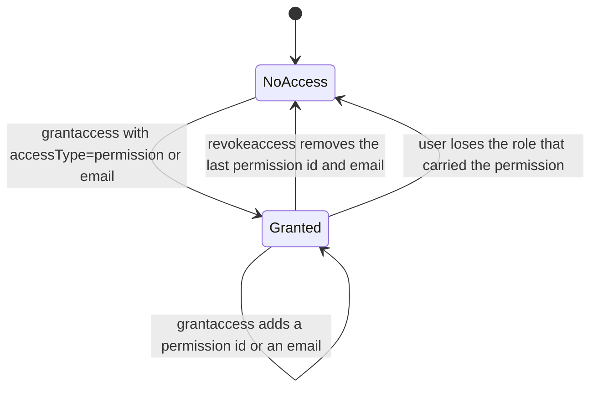
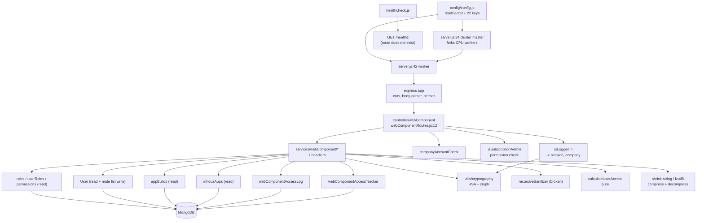

# webcomponent_ms

Repository: `apps/webcomponent_ms` (repo id `webcomponent_ms`, from `.kilo/repos.json`). All
`file:line` citations below are relative to that repository root.

## 1. Summary

The access-control and delivery service for Inhouz web components. A web component is an app of
type `webComponent` that a company embeds on its own site. This service decides who inside a
company may use a component, either by role permission or by an explicit email allow-list, records
every grant and revoke in an append-only log, and serves the compiled component bundle to a browser
by `companyId`/`appId`/`environment`. It also stores a per-user list of muted components. It does
not build components; it reads the build that `view_builder_ms` produced from the shared
`appBuilds` collection.

## 2. Stack and commands

| Item | Value | Evidence |
|---|---|---|
| Runtime | Node.js, container `node:16.4-alpine` | `Dockerfile:1` |
| Declared engine range | `>=12.0.0 <17.5.0` | `package.json:6` |
| Start command | `node server.js` (no heap flag) | `package.json:11` |
| Test command | none — placeholder that exits 1 | `package.json:10` |
| Container entry | `npm run start` | `Dockerfile:11` |
| Port | `process.env.PORT`; k8s sets `5039` | `server.js:86`, `k8s/webcomponent-ms-deployment.yml:17` |
| Container port | `5039` | `k8s/webcomponent-ms-deployment.yml:26` |
| ClusterIP service | `webcomponent-ms-cluster-ip-service` | `k8s/webcomponent-ms-cluster-ip-service.yml:4` |
| Resources | limits 5Gi / 1.5 CPU, requests 300Mi / 0.1 CPU | `k8s/webcomponent-ms-deployment.yml:19-23` |
| Replicas | `1`, HPA `1`–`2` | `k8s/webcomponent-ms-deployment.yml:6`, `k8s/webcomponent-ms-hpa.yml:10-11` |
| Process model | `cluster` forks `os.cpus().length` workers in production, `1` otherwise | `server.js:24-28` |

Run it with `PORT`, `MONGO_URL`, `SESSION_SECRET`, `CLIENT_SECRET_KEY` and the collection-name env
vars set, or mount the secret files the config expects (§9).

## 3. Entry points

| Entry point | Where | How it starts |
|---|---|---|
| Cluster master | `server.js:24-41` | the entry process forks workers and re-forks any that exit |
| Worker process | `server.js:42-89` | builds the express app, connects Mongo, listens |
| Express app + HTTP server | `server.js:43-56`, `server.js:86` | `app.listen(process.env.PORT)` |
| Route registration | `server.js:56` → `controller/webComponent/webComponentRoutes.js:12-20` | called with the app at boot |
| 10 model registrations | `server.js:13-22` | `require` side effects |
| Mongo connect + retry | `server.js:58-60`, `server.js:65-72`, `server.js:91-103` | at worker boot; retried 5 s after a disconnect |
| Shutdown | `server.js:76-84` | `SIGINT`, `SIGTERM`, `uncaughtException` |
| Health-check client | `healthcheck.js:1-21` | separate process, GETs `/healthz` |

Seven routes, registered in `controller/webComponent/webComponentRoutes.js:13-19`:

| Method | Route | Middleware chain | Handler |
|---|---|---|---|
| POST | `/api/webcomponent/grantaccess` | `isLoggedIn`, `companyAccountCheck`, `isSubscriptionAdmin` | `services/webComponent/grantAccess.js:8` |
| POST | `/api/webcomponent/revokeaccess` | `isLoggedIn`, `isSubscriptionAdmin` | `services/webComponent/revokeAccess.js:8` |
| POST | `/api/webcomponent/getaccesstracker` | `isLoggedIn`, `isSubscriptionAdmin` | `services/webComponent/getWebComponentAccessTracker.js` |
| GET | `/api/webcomponent/getmywebcomponents` | `isLoggedIn` | `services/webComponent/getWebComponents.js` |
| GET | `/api/webcomponent/getwebcomponent/:companyId/:appId/:environment/:lzutf8Encrypted` | **none** | `services/webComponent/getDeployedWebComponent.js:9` |
| GET | `/api/webcomponent/getdeployedwebcomponents` | `isLoggedIn`, `companyAccountCheck` | `services/webComponent/getDeployedWebComponents.js` |
| POST | `/api/webcomponent/updatewebcomponentconfig` | `isLoggedIn`, `companyAccountCheck` | `services/webComponent/updateWebComponentConfig.js:6` |

No `GET /healthz` exists, so `healthcheck.js:7` probes a 404. See §12.

## 4. Module inventory

| Name | Where | Owns | Public API | Kind |
|---|---|---|---|---|
| `server.js` master branch | `server.js:24-41` | cluster forking and worker re-fork | process lifecycle | `effectful` |
| `server.js` worker branch | `server.js:42-89` | express app, middleware, routes, Mongo, listen | process lifecycle | `effectful` |
| `connectMongo` | `server.js:91-103` | one `mongoose.connect` with `maxPoolSize: 1` | `() => void` | `effectful` |
| `config` factory | `config/config.js:18-50` | 22 config keys, one RSA key object | `() => config` | `effectful` — filesystem, env |
| `readSecret` | `config/config.js:5-15` | `/mnt/secrets/<name>` with env fallback | `(name, envFallback) => string` | `effectful` |
| `webComponentRoutes` | `controller/webComponent/webComponentRoutes.js:12-20` | the seven-route table and middleware order | `(app) => void` | `effectful` — mutates the app |
| `grantAccess` | `services/webComponent/grantAccess.js:8` | resolve users by permission or email, upsert the tracker, append a log, update accounts | `async (req, res)` | `effectful` — Mongo read/write, clock |
| `revokeAccess` | `services/webComponent/revokeAccess.js:8` | the inverse of grant, with the same log | `async (req, res)` | `effectful` |
| `getWebComponentAccessTracker` | `services/webComponent/getWebComponentAccessTracker.js` | read the tracker rows for an app | `async (req, res)` | `effectful` — Mongo read (`:60`) |
| `getWebComponents` | `services/webComponent/getWebComponents.js` | list the components visible to the caller | `async (req, res)` | `effectful` — Mongo read (`:6`) |
| `getDeployedWebComponent` | `services/webComponent/getDeployedWebComponent.js:9` | read one build, decompress, strip maps, re-compress, return | `async (req, res)` | `effectful` — Mongo read, CPU |
| `getDeployedWebComponents` | `services/webComponent/getDeployedWebComponents.js` | the same for a list of builds | `async (req, res)` | `effectful` — Mongo read (`:15`) |
| `updateWebComponentConfig` | `services/webComponent/updateWebComponentConfig.js:6` | overwrite the caller's `subscribedWebComponents` mute list | `async (req, res)` | `effectful` — Mongo write |
| `isLoggedIn` | `middlewares/login/checkLogin.js` | session validation, attaches `req.user` | `async (req,res,next)` | `effectful` — Mongo (`:24`), clock, `NODE_ENV` branch (`:130`) |
| `companyAccountCheck` | `middlewares/company/companyAccountCheck.js` | caller's company matches the request | `async (req,res,next)` | `effectful` |
| `isSubscriptionAdmin` | `middlewares/permissions/isSubscriptionAdmin.js:3-24` | requires the `subscriptionAdmin` permission on `req.user` | `(req,res,next)` | `reactive` — reads request state only |
| `moduleAccessCheck` | `middlewares/module/moduleAccessCheck.js` | flex-module access gate | `async (req,res,next)` | `effectful` — Mongo (`:29`) |
| `singleSubdomainValidation` | `middlewares/subdomain/singleSubdomainValidation.js` | single-subdomain scoping | `async (req,res,next)` | `effectful` |
| `calculateUserAccess` | `utils/appBuilder/access/calculateUserAccess.js:1` | read/write access decision from app settings and user permissions | `(app, user, accessType) => accessMap` | `pure` |
| `encryptDecrypt` | `utils/cryptography/encryptDecrypt.js` | RSA decrypt of the grant/revoke envelope | `(data, encrypt) => string` | `effectful` — key from config, logs on failure |
| `recursiveSanitizer` | `utils/sanitizer/recursiveSanitizer.js:3-17` | sanitises request bodies and params | `(element, sanitizer) => element` | `pure` by intent — see §12 for the defect |
| `getUser` | `utils/user/getUser.js` | user, roles and permissions lookup | `async (userId) => user` | `effectful` — four Mongo reads (`:19`, `:45`, `:85`, `:119`) |
| `createEditByObject` | `utils/user/createEditByObject.js` | builds the edit-stamp object | `(user, date) => object` | `pure` |
| 10 model modules | `model/**` | schemas and collection binding | `mongoose.model(...)` | `reactive` |

## 5. Side effects

| Effect | Where |
|---|---|
| MongoDB connect, one pool of 1 per worker | `server.js:91-103` |
| Model registration, 10 collections | `server.js:13-22` |
| Session read on every authenticated route | `middlewares/login/checkLogin.js:24` |
| Company read on login | `middlewares/login/checkLogin.js:105` |
| App read on grant | `services/webComponent/grantAccess.js:72` |
| App read on revoke | `services/webComponent/revokeAccess.js` (`findOne` before `:100`) |
| Tracker upsert on grant, at least three call sites | `services/webComponent/grantAccess.js:131`, `:186`, `:219`, `:261`, `:330`, `:375` |
| Tracker upsert on revoke | `services/webComponent/revokeAccess.js:142`, `:244` |
| Access-log insert | `services/webComponent/grantAccess.js:418`, `revokeAccess.js` (same shape) |
| User-account update after a grant | `services/webComponent/grantAccess.js:438` |
| User mute-list write | `services/webComponent/updateWebComponentConfig.js:11-27` |
| Build read for delivery | `services/webComponent/getDeployedWebComponent.js:34-44` |
| Build read, plural | `services/webComponent/getDeployedWebComponents.js:15` |
| Tracker read | `services/webComponent/getWebComponentAccessTracker.js:60` |
| Filesystem secret read | `config/config.js:10` |
| Env reads | `config/config.js:6`, `:21-43`, `server.js:25`, `server.js:86`, `healthcheck.js:6` |
| Clock | `services/webComponent/grantAccess.js:59`, `revokeAccess.js` (same), `middlewares/login/checkLogin.js:4` (moment) |
| Randomness | none |
| Logging (console) | `server.js:31-39`, `:63`, `:66`, `:74`, `:87`, `:101`, plus `console.log` in every service and middleware error path |
| Reconnect timer | `server.js:68-71` |
| CPU work | `LZUTF8.compress` / `shrink-string` on every delivery (`getDeployedWebComponent.js:76`, `:80`) |
| HTTP egress | none |

The service makes **no outbound HTTP calls**. Its only network peers are MongoDB and the clients
that call the seven routes.

## 6. State and state transitions

Two persisted state machines. Both are small.

### Component access, per `(companyId, appId)`

| From | To | Trigger | Guard | Evidence |
|---|---|---|---|---|
| NoAccess | Granted | `POST /api/webcomponent/grantaccess` with a valid RSA envelope | envelope decrypts, `expirationTimestamp` not passed, `companyId`/`accessType`/`appId` present | `grantAccess.js:18-58` |
| NoAccess | Granted | same | the app's `companyId` equals `req.user.companyId` | `grantAccess.js:100-102` returns 401 otherwise |
| NoAccess | Granted | same | caller holds `subscriptionAdmin` | `webComponentRoutes.js:13`, `isSubscriptionAdmin.js:8` |
| Granted | Granted | `grantaccess` again | permission ids are string-filtered before the upsert | `grantAccess.js:243-254` |
| Granted | NoAccess | `POST /api/webcomponent/revokeaccess` | same company check | `revokeAccess.js:100-101` |

The tracker row is the state (`model/webComponent/webComponentAccessTracker.js:5-22`): one row per
app carrying `permissionIds[]` and `emailList[]`. There is no per-user row, so "access" is derived
by looking up whether the user's role permissions intersect `permissionIds`, or whether the user's
email is in `emailList`. That derivation is what `getWebComponentAccessTracker` and
`getWebComponents` do.

### Access log

Append-only. `action` is one of two values, and `accessType` is one of two
(`model/webComponent/webComponentAccessLog.js:18-27`). One row per grant or revoke, with a
millisecond `timestamp` (`:28-31`). Nothing updates or deletes a log row.

## 7. Data

Ten schemas. The seven app-wide collections are owned elsewhere; this service reads them and owns
two.

| Model | Collection (k8s value) | Key fields and rules | Registration | Owner |
|---|---|---|---|---|
| `user` | `User` | identity; `subscribedWebComponents[{appId, muted}]` is written by this service | `model/user/user.js:137` | auth services; this service writes one field |
| `userRoles` | `userRoles` | `userId`, `companyId`, `roleIdList` | `model/user/userRoles.js:51` | auth services |
| `roles` | `roles` | `companyId`, `permissionIdList` | `model/rolesAndPermissions/roles.js:87` | auth services |
| `permissions` | `permissions` | `permissionName`, `companyId` | `model/rolesAndPermissions/permissions.js:89` | auth services |
| `company` | `company` | company account | `model/company/company.js:108` | auth services |
| `session` | `session` | session records | `model/session/session.js:28` | auth services |
| `inhouzApp` | `inhouzApps` | the app and component definition | `model/appBuilder/inhouzApp.js:262` | the app-builder service |
| `appBuild` | `appBuilds` | the compiled build, `buildData` compressed | `model/appBuilder/appBuild.js:51` | `view_builder_ms` |
| `webComponentAccessTracker` | `webComponentAccessTracker` | the grant state in §6 | `model/webComponent/webComponentAccessTracker.js:24` | **this service** |
| `webComponentAccessLog` | `webComponentAccessLogs` | the audit log in §6 | `model/webComponent/webComponentAccessLog.js:38` | **this service** |

### `webComponentAccessTracker` validation

| Field | Rule | Line |
|---|---|---|
| `appId` | String, required | `:6-9` |
| `companyId` | String, required | `:10-13` |
| `permissionIds` | [String] | `:14` |
| `emailList` | [String] | `:15` |
| `editDate` | Number | `:16` |
| `lastUpdatedById` | String; set to `req.user.companyId`, not a user id | `:17`, `grantAccess.js:142`, `:272` |
| schema options | `timestamps: true`, `strict: true`, `useNestedStrict: true` | `:18-22` |

There is no index declared on this schema. Every grant and revoke does a `findOne`/`updateOne` by
`appId` and `companyId`, so those two fields are an unindexed scan once the collection grows.

### `webComponentAccessLog` validation

| Field | Rule | Line |
|---|---|---|
| `companyId` | String, required | `:6-9` |
| `appId` | String, required | `:10-13` |
| `userId` | String, required | `:14-17` |
| `accessType` | String, required, enum `permission` \| `email` | `:18-22` |
| `action` | String, required, enum `access_granted` \| `access_revocked` | `:23-27` |
| `timestamp` | Number, required | `:28-31` |
| schema options | `timestamps: true`, `strict: true`, `useNestedStrict: true` | `:32-36` |

The enum value is spelled `access_revocked` (double `c`). That is a schema identifier and every
reader must match the typo exactly. There is no index here either, so an audit query by app and
date is a collection scan.

### Coupling

`appBuilds` is the hard coupling with `view_builder_ms`: this service assumes the document has
`companyId`, `appId`, `appType`, `environment` and a `buildData` string that `shrink-string` can
decompress (`getDeployedWebComponent.js:34-39`, `:66`). It reads `parsedObj.deploymentTimestamp`
out of the decompressed payload (`:87`), so the build schema is a contract this service depends on
and does not define.

`inhouzApps` is the coupling with the app-builder service: `grantAccess.js:72` and
`revokeAccess.js:99-100` read it only to confirm the app belongs to the caller's company.

## 8. Public interfaces

All routes are JSON. Two response conventions coexist: `{error:{message}}` for failures and the raw
object for successes.

| Route | Request | Response | Status codes |
|---|---|---|---|
| `POST /api/webcomponent/grantaccess` | `{encryptedData: string}` — RSA-decrypted to `{companyId, accessType, emailList[], appId, permissionIds[]}` | `{complete:true}` (`grantAccess.js:409`) | 400 bad envelope or missing fields (`:19`, `:36`, `:56`, `:124`, `:254`), 401 wrong company (`:102`), 404 app not found (`:92`), 500 Mongo (`:84`, `:158`, `:202`, `:288`, `:310`, `:346`, `:391`) |
| `POST /api/webcomponent/revokeaccess` | same envelope shape | `{complete:true}` equivalent | 400, 401, 404, 500 — same pattern (`revokeAccess.js`) |
| `POST /api/webcomponent/getaccesstracker` | app identifier | tracker rows | 400, 500 |
| `GET /api/webcomponent/getmywebcomponents` | none beyond the session | the caller's components | 200 |
| `GET /api/webcomponent/getwebcomponent/:companyId/:appId/:environment/:lzutf8Encrypted` | path params only | the full build document spread plus a re-compressed `buildData` and `deploymentTimestamp` (`getDeployedWebComponent.js:84-88`) | 400 missing param (`:25`), 404 (`:47`), 500 (`:55`, `:91`) |
| `GET /api/webcomponent/getdeployedwebcomponents` | app or company filter | list of builds | 200, 500 |
| `POST /api/webcomponent/updatewebcomponentconfig` | `{webComponents:[{appId, muted}]}` | `{success:true}` equivalent (`updateWebComponentConfig.js:40`) | 200, 500 (`:33`, `:45`) |

The delivery route is the public surface. `lzutf8Encrypted` is compared as the literal string
`'true'` (`getDeployedWebComponent.js:32`); any other value selects `shrink-string` compression. The
response is `{...build}` with `pageElementMap` and `pageFunctionMap` removed before re-compression
(`:68-73`), so those two maps are never delivered.

There are no queue topics, no cron, no websocket and no CLI command. The `setTimeout` at
`server.js:68` is the Mongo reconnect delay.

## 9. Configuration

Names only. Secrets are read from files under `SECRETS_PATH/<name>` first, then the env var
(`config/config.js:5-15`).

| Group | Names | Read at |
|---|---|---|
| Secrets (file first) | `SESSION_SECRET`, `MONGO_URL`, `CLIENT_SECRET_KEY`, `SENDGRID_API_KEY` | `config/config.js:24`, `:26-27`, `:38`, `:44-47` |
| Collection names in use | `USER_MODEL`, `USER_ROLES_MODEL`, `ROLE_MODEL`, `PERMISSION_MODEL`, `COMPANY_MODEL`, `SESSION_MODEL`, `SESSION_VALIDATOR_MODEL`, `AUTH_LOG_MODEL`, `INHOUZ_APP_MODEL`, `APP_BUILD_MODEL`, `WEB_COMPONENT_ACCESS_LOG_MODEL`, `WEB_COMPONENT_ACCESS_TRACKER` | `config/config.js:28-43` |
| Collection names read but unused | `FLEX_MODULE_MODEL`, `FLEX_COLLECTION_MODEL`, `FORM_MODEL`, `DATA_RULE_EXECUTION_RESULT_MODEL` | `config/config.js:21-25` |
| Path and process | `SECRETS_PATH`, `PORT`, `NODE_ENV`, `COOKIE_DOMAIN` | `config/config.js:6`, `:39`, `server.js:25`, `server.js:86` |

`FLEX_MODULE_MODEL` is consumed by `middlewares/module/moduleAccessCheck.js:29`, but that middleware
is not mounted on any route (§12). The other three unused collection keys have no consumer at all.
`SENDGRID_API_KEY` is loaded into `config.sendGridApiKey` (`:24`) but no file in this repository
requires `@sendgrid/mail` or reads that key.

Two permission names are compiled in, not configurable: `adminPermission: "admin"` and
`subscriptionAdminPermission: "subscriptionAdmin"` (`config/config.js:36-37`).

## 10. Dependencies

From `package.json:15-39`.

| Dependency | Why | Where it is used |
|---|---|---|
| `express` | HTTP server | `server.js:2` |
| `mongoose` | 10 models and `maxPoolSize: 1` connection | `server.js:3` |
| `body-parser`, `cookie-parser`, `cors`, `helmet`, `hpp` | HTTP middleware | `server.js:4-8` |
| `dotenv` | local env loading | `server.js:1` |
| `node-rsa` | the RSA envelope on grant and revoke | `config/config.js:1`, `utils/cryptography/encryptDecrypt.js` |
| `cryptr` | session-cookie encryption in login | `middlewares/login/checkLogin.js:3` |
| `lzutf8` | alternative compression on the delivery route | `services/webComponent/getDeployedWebComponent.js:7`, `:76` |
| `shrink-string` | default compression on delivery | `getDeployedWebComponent.js:4`, `getDeployedWebComponents.js:4` |
| `sanitizer` | request sanitisation | `middlewares/module/moduleAccessCheck.js:2`, `getDeployedWebComponent.js:6` |
| `validator` | field validation in the app and permission schemas | `model/appBuilder/inhouzApp.js:4`, `model/rolesAndPermissions/permissions.js:3` |
| `lodash` | collection helpers in login and module checks | `middlewares/login/checkLogin.js:5` |
| `moment` | session expiry arithmetic | `middlewares/login/checkLogin.js:4` |
| `bcryptjs`, `@sendgrid/mail`, `connect-mongo`, `crypto-js`, `express-session`, `request-ip`, `shortid` | no `require` reachable from `server.js` | not used |

Seven of twenty-three direct dependencies are unused. `@sendgrid/mail` and `express-session` are the
most misleading: the service sends no mail and stores sessions in the `session` collection rather
than in express-session.

## 11. Testing

None. `package.json:10` is the placeholder that exits 1. There is no test directory, no runner and
no fixture. Every behaviour in this file is read from code.

The highest-value first tests would be the company guard at `grantAccess.js:100` and
`revokeAccess.js:100`, the permission-to-user resolution loop (`grantAccess.js:295-391`), and the
delivery path's decompress and strip logic (`getDeployedWebComponent.js:66-88`).

## 12. Known issues and risks

1. **The delivery route is unauthenticated and un-scoped.**
   `getwebcomponent/:companyId/:appId/:environment/:lzutf8Encrypted` has no middleware
   (`webComponentRoutes.js:17`), and the handler returns the whole build document for any triple
   (`getDeployedWebComponent.js:34-44`, `:84-88`). Anyone who can reach the service and guess a
   `companyId` and `appId` reads that build. It does not consult `webComponentAccessTracker` at all,
   so the access model in §6 is not enforced on the path that actually ships code to a browser.
   Either the tracker is enforced elsewhere, or grant and revoke only affect the console list.
2. **The health check can never pass.** `healthcheck.js:7` GETs `/healthz`; no such route exists
   (`webComponentRoutes.js:13-19`), so Express returns 404 and `healthcheck.js:12` exits 1.
3. **`recursiveSanitizer` does not sanitize.** It writes the sanitized value into a local variable
   (`utils/sanitizer/recursiveSanitizer.js:13`) without assigning it back to the parent, and the
   array branch recurses without the `sanitizer` argument (`:10`), which throws on the first array
   element. `getDeployedWebComponent.js:11`, `grantAccess.js:10`, `revokeAccess.js:10` and
   `updateWebComponentConfig.js:8` all rely on it.
4. **`isSubscriptionAdmin` denies with HTTP 200.** `isSubscriptionAdmin.js:12-16` returns a normal
   `res.send` with an `{error}` body. A client that checks only the status code treats a denial as
   success, and a metric that counts 4xx/5xx never sees the refusal.
5. **`revokeaccess` is missing `companyAccountCheck`.** `webComponentRoutes.js:14` omits the
   middleware that `grantaccess` has (`:13`). The handler does its own check at
   `revokeAccess.js:100-101`, so this is a defence-in-depth loss rather than an open hole, but the
   two routes should not differ.
6. **`moduleAccessCheck` and `singleSubdomainValidation` are mounted nowhere.**
   `webComponentRoutes.js:13-19` uses only `isLoggedIn`, `companyAccountCheck` and
   `isSubscriptionAdmin`. Two of the five middleware modules in the repository are dead on the
   routing table, and `FLEX_MODULE_MODEL` exists only for the dead one.
7. **`lastUpdatedById` is written with a company id.** `grantAccess.js:142`, `:272` and
   `revokeAccess.js:142`, `:244` set it to `req.user['companyId']`. The field name says "user id",
   so any audit that reads it as a user reference is wrong.
8. **The audit log has no index and is append-only forever.** `webComponentAccessLog.js:32-36`
   declares no index and nothing prunes the collection. Every grant and revoke adds a row.
9. **The tracker has no index either.** `webComponentAccessTracker.js:18-22` declares no index
   while grant, revoke and both read services filter on `appId`/`companyId`.
10. **`cluster` forks per CPU and each worker opens its own Mongo pool.**
    `server.js:25-28` forks `os.cpus().length` workers in production, and every worker runs
    `connectMongo` with `maxPoolSize: 1` (`server.js:99`). With the HPA ceiling of 2 pods
    (`k8s/webcomponent-ms-hpa.yml:11`), the real connection count is `2 × CPUs`, and the request
    rate is multiplied by the same factor. Any in-process counter, including the delivery cache
    this service does not have, would be per-worker.
11. **`mongoose.connect`'s third argument is a log expression, not a callback.**
    `server.js:101` passes `console.log("Connected to Database")`, which runs immediately on every
    connect attempt, including failures. Mongoose 7 does not treat that argument as a callback.
12. **`uncaughtException` is wired to a shutdown that does not exit.** `server.js:79-84` closes
    Mongo and returns. In a clustered process the worker stays alive in an undefined state, so the
    `cluster.on("exit")` re-fork never fires.
13. **CORS is an unanchored regex with credentials.** `origin: /inhouz.localhost/` and
    `credentials: true` (`server.js:46-47`) accepts any origin containing that substring.
14. **`JSON.parse` on decrypted or decompressed input is unguarded in places.**
    `grantAccess.js:28` and `revokeAccess.js:28` parse the RSA envelope, and
    `getDeployedWebComponent.js:67` parses the stored build. A malformed value from either source
    throws into the surrounding `catch` and becomes a generic 500 with the error only in
    `console.log` (`grantAccess.js:150`, `getDeployedWebComponent.js:90`).
15. **`service-account.json.enc` is committed** at the repo root. It is encrypted; its plaintext and
    the decrypting key are not described in this repository. Recorded, not opened.
16. **No credential found embedded in a source file.** Secrets go through `readSecret`
    (`config/config.js:5-15`) or a `secretKeyRef` in the deployment. A pattern scan for AWS key
    ids, PEM blocks, SendGrid/Stripe key shapes and literal `password`/`apiKey` assignments
    returned nothing.

## 13. Module map

## 14. Open questions

- Where is component access actually enforced? The delivery route
  (`webComponentRoutes.js:17`) never reads `webComponentAccessTracker`, so either the browser or
  another service filters the result, or grant/revoke only drive the console list. Nothing in this
  repository answers it.
- Who calls this service? The mechanical brief reports no callers and no outbound HTTP, which
  matches the source: there is no `node-fetch`, `axios` or `http.request` call. But the console
  must call it from somewhere; that caller is not in this repository.
- Is `lastUpdatedById` deliberately a company id (`grantAccess.js:142`) or a copy-paste of the
  `lastUpdatedById` convention used in other services with a different meaning?
- Which compression does the browser expect? The route switches on the literal string `'true'`
  (`getDeployedWebComponent.js:32`), and the response does not say which one it used. A client that
  guesses wrong fails to parse `buildData`.
- Is the `access_revocked` spelling (`webComponentAccessLog.js:26`) in use in any reporting query
  outside this repository? If a consumer queries `access_revoked`, it silently returns nothing.
- Skipped, and why: `kus/**` duplicates `k8s/**` (same image, one replica, port 5039);
  `.github/workflows/*.yml`, `build_ga.sh`, `build_ga_prod.sh`, `deploy.sh`, `.travis.yml`,
  `docker-compose.yml`, `.dockerignore`, `.gitignore` are release and local-dev plumbing;
  `service-account.json.enc` is an encrypted blob and was not decrypted; the eight model files other
  than the two owned by this service were read only for their registration line and collection name,
  because their full schemas belong to the services that own them.
