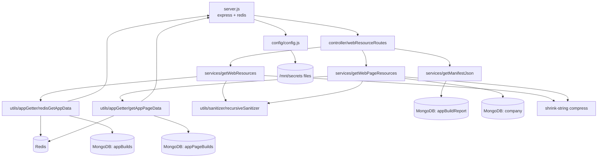

# website_resource_ms

## 1. Summary

Read-only resource delivery service for the Inhouz website builder. It returns the compiled
`appElementsMap` / `appFunctionMap` / `pageMap` payload that the browser runtime needs to render a
customer's web app, either for a whole app variation or for one page slug, plus the app's
`manifest.json`. Data comes from Redis when a key is present and from the MongoDB build
collections otherwise; responses are compressed with `shrink-string`. All three routes are public
GETs — no session middleware is mounted. The service lives in its own repository at
`/workspaces/kilo_inhouz_ai/apps/website_resource_ms/` (repository id `website_resource_ms`), not in
the control repo.

## 2. Stack and commands

- Runtime: Node.js, image `node:16.4-alpine` (`Dockerfile:1`); `engines` pins
  `>=12.0.0 <17.5.0` (`package.json:4`).
- Framework: Express 4 (`package.json:23`), Mongoose 7 (`package.json:30`), Redis client 3.1.2
  (`package.json:33`) promisified with Bluebird (`package.json:16`, `server.js:14`).
- Scripts: `start` = `node server.js` (`package.json:9`); `test` is the npm placeholder that exits 1
  (`package.json:8`).
- Start: `npm start` (`Dockerfile:12`), or `node server.js` (`server.js:1` loads `.env` first).
- Port: `PORT`, `5056` in the deployment (`kus/base/website-resource-ms-deployment.yml:42-43`) and in
  the ClusterIP service (`kus/base/website-resource-ms-cluster-ip-service.yml:10-11`). The app listens
  on `process.env.PORT` (`server.js:84`).
- k8s service name: `website-resource-ms-cluster-ip-service`
  (`kus/base/website-resource-ms-cluster-ip-service.yml:4`).
- k8s deployment: `website-resource-ms-deployment`, image `inhouz/website_resource_ms`,
  replicas `1` (`kus/base/website-resource-ms-deployment.yml:4,6,26`).
- Cluster mode is commented out (`server.js:10-11,34-46`), so one process per pod regardless of
  `NODE_ENV`.
- Health probe: `healthcheck.js:7` calls `GET /healthz`; no such route exists — see §12.

## 3. Entry points

| Entry point | Location | How it starts |
|---|---|---|
| HTTP server | `server.js:47,84-86` | `app.listen(process.env.PORT)` |
| Redis client | `server.js:16-25` | created at module load, exported as `server.redisClient` (`server.js:25`) |
| Route registration | `controller/webResourceRoutes/webResourceRoutes.js:5-9` | called from `server.js:54` |
| GET `/api/websiteresource/getwebsiteresources/:companyId/:appId/:variationId/:environment` | `webResourceRoutes.js:6` | handler `services/webapp/getWebResources.js:11` |
| GET `/api/websiteresource/getwebsitepageresources/:companyId/:appId/:slug?` | `webResourceRoutes.js:7` | handler `services/webapp/getWebPageResources.js:9` |
| GET `/api/websiteresource/manifestjson/:appId` | `webResourceRoutes.js:8` | handler `services/webapp/getManifestJson.js:5` |
| Mongo reconnect loop | `server.js:62-69` | on `disconnected`, retries after 5 s |
| Health probe script | `healthcheck.js:1-24` | Dockerfile `HEALTHCHECK` reference only; no `HEALTHCHECK` line in this `Dockerfile` |

No middleware is mounted on any route: `checkLogin`, `subscriptionCheckLogin`, `isAdmin`,
`isSubscriptionAdmin`, `isAccountOwner`, `moduleAccessCheck` and `singleSubdomainValidation` are all
present in `middlewares/` and none is required by `controller/webResourceRoutes/webResourceRoutes.js`
or any service module. There is no cron, no queue consumer and no websocket handler. `server.js:65`
is a reconnect timer, not a scheduled job.

## 4. Module inventory

| Module | Location | Owns | Public API | Kind |
|---|---|---|---|---|
| `server` | `server.js:1-101` | Express app, Redis client, Mongo connect, shutdown | exports `redisClient` (`server.js:25`) | `effectful` (also holds process-wide connection state) |
| `connectMongo` | `server.js:89-101` | Mongoose connection, `maxPoolSize: 1` | internal | `effectful` |
| `config` | `config/config.js:17-42` | env + secret-file config, RSA private key, Redis options, collection names | `config()` → cached object | `effectful` (reads env and filesystem, caches in `cachedConfig`, `config.js:16,18`) |
| `readSecret` | `config/config.js:5-14` | reads `/mnt/secrets/<name>` with env fallback | internal | `effectful` |
| `webResourceRoutes` | `controller/webResourceRoutes/webResourceRoutes.js:5-9` | the three GET routes | `(app) => void` | `effectful` (registers handlers) |
| `getWebResources` | `services/webapp/getWebResources.js:11-108` | full app-variation payload | `(req, res) => Promise<void>` | `effectful` |
| `getWebPageResources` | `services/webapp/getWebPageResources.js:9-159` | single page payload, company status gate | `(req, res) => Promise<void>` | `effectful` |
| `getManifestJson` | `services/webapp/getManifestJson.js:5-65` | returns the stored `manifestJson` | `(req, res) => Promise<void>` | `effectful` |
| `redisGetAppData` | `utils/appGetter/redisGetAppData.js:6-66` | Redis-first, Mongo-fallback lookup of a build by app/variation/company/environment | `({redisId, appId, variationId, companyId, environment}) => Promise<{appData, comp} | {redisNotFound} | {error}>` | `effectful` |
| `getAppPageData` | `utils/appGetter/getAppPageData.js:6-72` | Redis-first, Mongo-fallback lookup of a page build, with a 404-page fallback | `({domain, domainUrl, slug}) => Promise<{appData, comp, isRedisApp} | {appNotFound} | {error}>` | `effectful` |
| `postRequest` | `utils/requests/postRequest.js:3-40` | generic JSON POST via `node-fetch` | `(url, headers, data) => Promise<json>` | `effectful` — **dead code**, no module requires it |
| `recursiveSanitizer` | `utils/sanitizer/recursiveSanitizer.js` | deep sanitizing of `req.params` | exported helpers | `pure` (read at signature level only) |
| `encryptDecrypt` | `utils/cryptography/encryptDecrypt.js:3` | RSA encrypt/decrypt with `CLIENT_SECRET_KEY` | `(data, encrypt=false) => string` | `effectful` (holds a key, logs on failure) |
| `getUser`, `createEditByObject` | `utils/user/getUser.js:19`, `utils/user/createEditByObject.js:1` | user + RBAC loader, audit stamps | see files | `effectful` / `pure` — both unused by the live routes |
| `inhouzApp` model | `model/appBuilder/inhouzApp.js:143` | app definition | Mongoose model | `effectful` |
| `abTests` model | `model/appBuilder/abTests.js:94` | A/B test records | Mongoose model | `effectful` |
| `appBuild` model | `model/appBuilder/appBuild.js:39` | compiled app-variation bundle (`buildData`) | Mongoose model | `effectful` |
| `appBuildReport` model | `model/appBuilder/appBuildReport.js:75` | deploy report incl. `manifestJson` | Mongoose model | `effectful` |
| `appPageBuild` model | `model/appBuilder/appPageBuild.js:64` | compiled page bundle, `is404Page` flag | Mongoose model | `effectful` |
| `appVisitLog` model | `model/appBuilder/appVisitLog.js:56` | visit log — **broken and unrequired** | Mongoose model | `effectful` |
| `company` model | `model/company/company.js:108` | tenant record | Mongoose model | `effectful` |

## 5. Side effects

**Redis (outbound network)**
- Client created with `host`/`password`/`port` from config, optional `db`: `server.js:16-24`.
- `redisClient.getAsync(redisId)`: `utils/appGetter/redisGetAppData.js:15`.
- `redisClient.getAsync(domainUrl)`: `utils/appGetter/getAppPageData.js:14`.
- Failures are swallowed and fall through to Mongo (`redisGetAppData.js:16-19`,
  `getAppPageData.js:15-17`). There is no write, no TTL management and no cache fill anywhere in this
  repository — the service is a cache reader only.

**MongoDB (reads only)**
- `appBuild.findOne` by app/variation/company/environment: `redisGetAppData.js:31-36`.
- `appPageBuild.findOne` by domain + page slug: `getAppPageData.js:27-30`.
- `appPageBuild.findOne` fallback by `is404Page: true`: `getAppPageData.js:38-41`.
- `appBuildReport.findOne` projecting `manifestJson`: `getManifestJson.js:20-27`.
- `company.findOne` projecting `status`, `companyType`, `subDomain`: `getWebPageResources.js:64-74`.
- Connection: `server.js:90-100`. Nothing in this service performs a write.

**Filesystem**
- Secret files under `/mnt/secrets`, overridable by `SECRETS_PATH` (`config.js:6-10`).

**Clock**
- `new Date().getTime()` to compare the `CVMD` cookie expiry (`getWebPageResources.js:31,51`).

**Randomness**
- `Math.random()` in the `ECAL` cookie payload (`getWebResources.js:84`). Not a security value; it is
  only a cache-buster.

**Cookies written (response side effects)**
- `ECAL` — encrypted `{enableCachedAppLoading, random}` with `httpOnly: false`, `secure: false`, and
  `domain` taken from the `Host` request header: `getWebResources.js:82-91`.
- `CVMD` — read only, never written here (`getWebPageResources.js:30`).

**Logging (console only)**
- `getWebResources.js:101`; `getWebPageResources.js:77,152`; `getManifestJson.js:29,58`;
  `redisGetAppData.js:17,60`; `getAppPageData.js:16,33,44,67`; `server.js:60,63,71,78,85,99`;
  `postRequest.js:36` (dead); `healthcheck.js:12,19`.

**Not present:** no outbound HTTP. `node-fetch` is a dependency and `utils/requests/postRequest.js:1`
wraps it, but no module requires `postRequest`, so no service call is made. The `FUNCTION_MS_URL`,
`PAYMENT_MS_URL`, `SCHEDULED_TASK_MS_URL` and `*_MS_URL` env vars in the manifest are never read by
this code.

## 6. State and state transitions

No state machine and no status field is written. The only stateful behaviour is a cache-first read
path and one gate:

| Step | Trigger | Guard | Result |
|---|---|---|---|
| `cacheHit` | GET with a Redis key that exists | `typeof comp === 'string'` (`redisGetAppData.js:20-23`, `getAppPageData.js:18`) | decompressed `appData` returned |
| `cacheMiss` | key absent or Redis throws | fall through (`redisGetAppData.js:29-57`) | Mongo lookup |
| `mongoHit` | document with `_id` and `buildData` | `build && build['_id']` (`redisGetAppData.js:42-53`, `getAppPageData.js:49-60`) | decompressed `appData` |
| `notFoundPage` | page slug missing | falls back to `is404Page: true` (`getAppPageData.js:37-47`) | 404 page bundle served with HTTP 200 |
| `companyActive` | `getWebPageResources` | `company.status === 'active'` (`getWebPageResources.js:97-103`) | request continues |
| `companyInactive` | — | status not `active` | 403, unless a valid `CVMD` cookie already asserted `active` (`getWebPageResources.js:50-58`) |
| `companyMissing` | — | `!company` | 404 (`getWebPageResources.js:81-87`) |

The company gate is skippable: a client that presents a `CVMD` cookie it can obtain from any earlier
response, with `companyStatus: 'active'` and a future `expirationTimestamp`, bypasses the database
check entirely (`getWebPageResources.js:32-60`). See §12.

## 7. Data

Collections are named by env vars and passed as the third argument to `mongoose.model`, so the
physical name is deployment configuration.

| Model | Registration | Collection (from k8s env) | Key fields and rules |
|---|---|---|---|
| AppBuild | `model/appBuilder/appBuild.js:39` | `APP_BUILD_MODEL` (`appBuilds`) | `appId`, `variationId`, `companyId` required; `buildData` (compressed string); `hostedExternally` Boolean; `domain`; `sizeBytes`; `createdById`; compound index on `appId, variationId, companyId, domain` (`appBuild.js:35-36`); `timestamps`, `strict` |
| AppPageBuild | `model/appBuilder/appPageBuild.js:64` | `APP_PAGE_BUILD_MODEL` (`appPageBuilds`) | `appId`, `appType`, `environment`, `pageId`, `pageSlug`, `variationId`, `companyId`, `buildData`, `domain`, `isRootPage`, `notFoundPageId`, `redisKey`, `systemUserIds`, `deployedEndpointIds`, `pageFunctionIds`; compound index on `appId, variationId, companyId, domain, environment, appType, pageId, pageSlug` (`appPageBuild.js:58-61`) |
| AppBuildReport | `model/appBuilder/appBuildReport.js:75` | `APP_BUILD_REPORT_MODEL` (`appBuildReport`) | `appId`, `companyId`, `domain`, `customDomains[]`, `deployDate`, `abTestId`, `variationBuildReport[]`, `compressedAppVariationDataMap`, `...RedisKey`, `isRedisApp`, `redisCacheKeys[]`, `manifestJson` (object), plus index on `appId, companyId, domain, hostedExternally, deployDate, buildSizeBytes, appType, environment` (`appBuildReport.js:68-72`) |
| AbTests | `model/appBuilder/abTests.js:94` | `AB_TESTS_MODEL` (`abTests`) | A/B test definition — not read by any live route |
| InhouzApp | `model/appBuilder/inhouzApp.js:143` | `INHOUZ_APP_MODEL` (`inhouzApps`) | app definition — registered at boot (`server.js:27`) but not queried by any live route |
| Company | `model/company/company.js:108` | `COMPANY_MODEL` (`company`) — no explicit collection arg, so Mongoose pluralizes | `companyName`, `companyType`, `subDomain`, `status` (read at `getWebPageResources.js:64-74`), `stripeCustomerId`, many `default*StorageServiceId` fields |
| AppVisitLog | `model/appBuilder/appVisitLog.js:56` | **undefined** — `config.appVisitLogModel` does not exist in `config.js:19-40` | broken at require time; also never required by `server.js:27-32` |

Migrations: none. No schema versioning, no data backfill scripts.

**Shared collections.** `appBuilds`, `appPageBuilds` and `appBuildReport` are written by the app
build/deploy pipeline, which is not in this repository. `company` is written by the account and
subscription services. This service only reads them; the shape of `buildData` (a `shrink-string`
compressed JSON blob with `appElementsMap`, `appFunctionMap`, `parsedPageMap`/`page`, `appInFocus`,
`deploymentTimestamp`) is the contract with the builder that produced it, and it is not validated
here beyond `JSON.parse` (`getWebResources.js:54`, `getWebPageResources.js:129`).

## 8. Public interfaces

All three are unauthenticated GETs with no request body. Path parameters are sanitized with
`recursiveSanitizer` before use (`getWebResources.js:13`, `getWebPageResources.js:11`).

| Route | Request | Response |
|---|---|---|
| `GET /api/websiteresource/getwebsiteresources/:companyId/:appId/:variationId/:environment` | path params only; optional `redisId` is read from `req.params` but is **not** in the path (`getWebResources.js:18-21`) | 200 `{compressedResources, enableCachedAppLoading, appId, deploymentTimestamp}` (`getWebResources.js:94-99`); 400 missing metadata (`:33-38`); 404 no cache/Mongo data (`:46-62`); 500 (`:102-106`) |
| `GET /api/websiteresource/getwebsitepageresources/:companyId/:appId/:slug?` | `slug` optional | 200 `{compressedResources, domain, pathname, domainUrl, slug}` (`getWebPageResources.js:144-150`); 400 (`:23-28`); 403 inactive account (`:97-103`); 404 account or app not found (`:81-87`, `:121-127`); 500 (`:90-95`, `:113-119`, `:152-157`) |
| `GET /api/websiteresource/manifestjson/:appId` | path param | 200 the raw `manifestJson` object, or `{}` when absent (`getManifestJson.js:53,56`); 400 (`:12-17`); 404 no report (`:33-39`); 500 (`:41-47`) |

`compressedResources` is a `shrink-string` compressed string of the JSON payload
(`getWebResources.js:72-78`, `getWebPageResources.js:135-142`); the browser decompresses it.

Cookies: `ECAL` (set, `getWebResources.js:87-91`), `CVMD` (read, `getWebPageResources.js:30`).

No events, no topics, no CLI commands, no POST surface.

## 9. Configuration

Names only.

- Server: `PORT`, `NODE_ENV` (read only by `checkLogin.js:139`, a middleware that is never mounted).
- Secrets, file first then env (`config.js:5-14`): `MONGO_URL`, `SESSION_SECRET`, `CLIENT_SECRET_KEY`,
  `REDIS_HOST`, `REDIS_PASSWORD`. File names are `mongourl`, `sessionsecret`, `clientsecretkey`,
  `redishost`, `redispassword` (`config.js:20-31`).
- Redis: `REDIS_DB`, `REDIS_PORT` (`config.js:32-33`); `REDIS_PORT` is set to `19829` in the base
  manifest (`kus/base/website-resource-ms-deployment.yml:63-64`).
- Collections: `AB_TESTS_MODEL`, `APP_BUILD_REPORT_MODEL`, `APP_BUILD_MODEL`, `INHOUZ_APP_MODEL`,
  `COMPANY_MODEL`, `APP_PAGE_BUILD_MODEL` (`config.js:34-39`).
- Misc: `SECRETS_PATH`, `COOKIE_DOMAIN`, `SMPL_EMAIL` (`config.js:6,21,25`).
- Hard-coded: `adminPermission = "admin"` (`config.js:23`), CORS is fully open via `cors()` with no
  options (`server.js:48`), 20 MB JSON body limit (`server.js:50`), 5 s Mongo reconnect
  (`server.js:67`).
- Set in the manifest but never read by this code: every `*_MS_URL`, `FUNCTION_MODEL`,
  `PAYMENT_*`, `SUBSCRIPTION_*`, `SUBSCRIBER_*`, `INHOUZ_SUBSCRIPTIONS_MODEL`, `SCHEMA_MODEL`,
  `QUERY_MODEL`, `SYSTEM_USER_MODEL`, `COOKIE_NAME` and the rest of the shared template block
  (`kus/base/website-resource-ms-deployment.yml:64-180`). Only 13 names are read
  (`config.js:20-39`).

## 10. Dependencies

Direct only (`package.json:13-38`).

| Package | Why |
|---|---|
| `express` | HTTP server and routing |
| `mongoose` | read-only MongoDB access |
| `redis` + `bluebird` | Redis client, promisified to `getAsync` (`server.js:12-14`) |
| `shrink-string` | compress the response payload, decompress stored build data |
| `body-parser` | JSON body parsing (no route consumes a body) |
| `cookie-parser` | `CVMD` cookie parsing |
| `cors` | browser access; configured wide open (`server.js:48`) |
| `helmet`, `hpp` | header hardening, parameter-pollution guard |
| `cryptr` | AES encryption of the `ECAL` cookie and decryption of `CVMD` |
| `node-rsa` | RSA keypair in config (`config.js:26-29`) |
| `lodash` | `isEmpty` in `getManifestJson.js:3,51` |
| `moment` | used only by the unmounted `checkLogin` middleware |
| `sanitizer` | parameter sanitizing |
| `validator` | model-level validation |
| `lzutf8` | required in `getWebResources.js:8` but never used |
| `node-fetch` | only in the dead `utils/requests/postRequest.js:1` |
| `dotenv` | loads `.env` locally |
| `crypto-js`, `bcryptjs` | no live use in this repo |
| `express-session`, `request-ip`, `shortid` | installed, unused |

## 11. Testing

There are no tests. `npm test` is the placeholder that exits 1 (`package.json:8`). No test
directory, no fixtures, no CI test step in the repository. Zero coverage of the Redis/Mongo
fallback, the 404-page fallback, the company-status gate, the cookie paths, or the three response
shapes.

## 12. Known issues and risks

1. **Every route is unauthenticated.** `webResourceRoutes.js:6-8` mounts no middleware, and none of
   the six middlewares in `middlewares/` is required outside its own folder. Any caller can read any
   tenant's compiled app bundle and any app's `manifest.json` by guessing ids.
2. **The Redis lookup never hits.** `getWebResources.js:18` reads `redisId` from `req.params`, but the
   route has no `redisId` parameter (`webResourceRoutes.js:6`), so `redisId` is always `''` and
   `getAsync('')` misses (`redisGetAppData.js:15-20`). Only the page route can hit Redis, and only
   via the `domainUrl` key (`getAppPageData.js:14,106`).
3. **Nothing in this repository writes Redis.** The cache is read-only here; a miss always becomes a
   Mongo query, and there is no repopulation, so the fallback is the normal path.
4. **Health probe can never pass.** `healthcheck.js:7` requests `GET /healthz`; no such route is
   registered (`server.js:54`), so the probe always exits 1.
5. **Cookie `domain` comes from the request `Host` header.** `getWebResources.js:81,90` passes
   `req.header('host')` as the cookie domain with `secure: false` and `httpOnly: false`. A caller who
   controls `Host` can set a cookie for a domain of their choosing.
6. **The company-status gate is bypassable via a client-supplied cookie.**
   `getWebPageResources.js:32-60` trusts `CVMD` if `expirationTimestamp` is in the future and
   `companyStatus === 'active'`; the cookie is `Cryptr`-encrypted with `SESSION_SECRET`, so any client
   that has a valid cookie from one active company can keep replaying it, and the DB check is skipped
   entirely.
7. **`CVMD` decryption failure becomes a 500, not a 400.** `cryptr.decrypt` throws on a malformed
   cookie (`getWebPageResources.js:34`), and the surrounding `catch` returns 500
   (`getWebPageResources.js:152-157`); the `!parsedViewMetaData` guard at `:35` is unreachable.
8. **A 404 page is served with HTTP 200.** `getAppPageData.js:37-47` falls back to the `is404Page`
   document and `getWebPageResources.js:144` returns 200, so crawlers index the error page.
9. **CORS is fully open.** `cors()` with no options (`server.js:48`) reflects any origin, on public
   read endpoints that also set cookies.
10. **Unvalidated `JSON.parse` of stored payloads.** `getWebResources.js:54` and
    `getWebPageResources.js:129` parse `buildData` with no schema check; a corrupt or malicious build
    document makes the endpoint throw into the 500 path.
11. **`appVisitLog` cannot be loaded.** `model/appBuilder/appVisitLog.js:56` asks for
    `config.appVisitLogModel`, which `config/config.js` never defines, so `mongoose.model(undefined,
    …)` would throw. It is saved only because `server.js:27-32` does not require the file; any future
    `require` breaks boot.
12. **`uncaughtException` does not exit.** `server.js:76-82` logs and closes Mongo but keeps the
    process alive in an undefined state.
13. **Collection env vars are unguarded.** `mongoose.model(config.X)` with an unset env var throws at
    boot (`server.js:27-32`), and the manifest supplies them from a shared template, so a missing var
    crashes the pod rather than failing one route.
14. **Dead code that implies a network it does not use.** `utils/requests/postRequest.js:1-40` plus the
    `*_MS_URL` env block suggest service-to-service calls that do not happen; `lzutf8`
    (`getWebResources.js:8`) is likewise unused.
15. **No embedded credential was found in the source.** `service-account.json.enc` at the repo root is
    an encrypted artifact and is not read by any module here.

## 13. Module map

`redisGetAppData` and `getAppPageData` import `redisClient` from `../../server` (`:4`), so the request
path depends on the server module's export (`server.js:25`).

## 14. Open questions

- **Who writes Redis keys, and with what expiry?** Nothing in this repo writes or expunges them, so
  the TTL policy lives in the build/deploy service.
- **What is the `redisId` contract?** `getWebResources` reads it from path params that do not exist.
  Either the route lost a `:redisId` segment or the parameter should come from the document
  (`appBuild` has no `redisKey` field; `appPageBuild` and `appBuildReport` do).
- **Which service writes `buildData`, and is the compressed shape versioned?** Not determinable from
  this checkout; the payload contract exists only as the destructuring at `getWebResources.js:64-68`.
- **Is `CVMD` ever set by this service?** It is only read; the writer must be another service or the
  web tier.
- **Is the app intentionally public?** No auth middleware is mounted, yet a full auth stack
  (`checkLogin`, `subscriptionCheckLogin`, `isAdmin`, `isAccountOwner`) ships in the repo. Either the
  gateway enforces auth in front of this service or the endpoints are exposed.
- **Why does the manifest carry ~70 env vars when the code reads 13?** Likely a shared deployment
  template.
- **Skipped:** `k8s/` (legacy duplicate of `kus/`), `kus/*/hpa.yml`, `vpa.yml`, `namespace.yml`,
  `secret-provider-class.yml` (scaling and namespace only), `.github/workflows/*`, `.travis.yml`,
  `build_ga*.sh`, `deploy.sh`, `docker-compose.yml` (build and deploy plumbing);
  `middlewares/*` — read only to prove they are not mounted; `model/appBuilder/inhouzApp.js`,
  `model/appBuilder/abTests.js`, `model/company/company.js` beyond their field lists;
  `utils/user/getUser.js`, `utils/user/createEditByObject.js`, `utils/cryptography/encryptDecrypt.js`,
  `utils/sanitizer/recursiveSanitizer.js` at signature level only, since no live route calls them.
