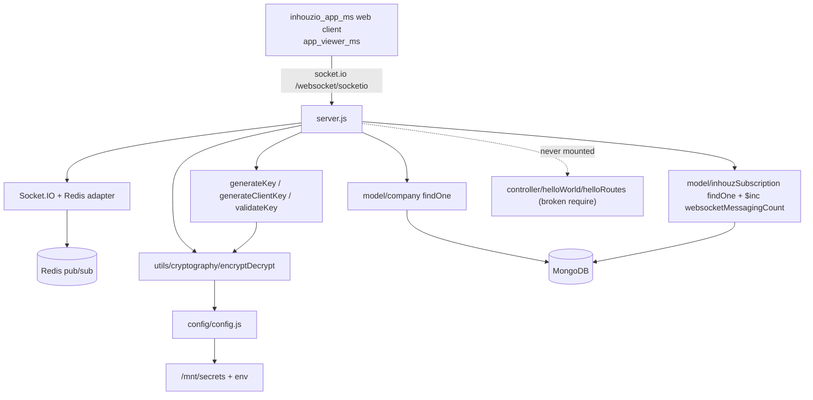

# websocket_ms

## 1. Summary

`websocket_ms` is the platform's Socket.IO server for multi-tenant real-time messaging. A client opens a socket at path `/websocket/socketio`, registers with an encrypted payload carrying a `companyId`, is checked against `company` (must exist, must not be `freelancer`, must be `active`) and `inhouzSubscriptions` (`websocketAddonEnabled`), and receives a short-lived RSA key. With that key the client joins or leaves rooms named `<channel>_<companyId>` and broadcasts `real_time_message` to them. Each broadcast increments the subscription's `websocketMessagingCount`. It lives in its own git repository at `apps/websocket_ms/`. k8s: service `websocket-ms-cluster-ip-service` on port `5079` (`k8s/websocket-ms-cluster-ip-service.yml:10`), image `inhouz/websocket_ms`, 1 replica (`k8s/websocket-ms-deployment.yml:6`, `:17`).

## 2. Stack and commands

- Runtime: Node.js; `package.json` declares no `engines` field.
- Package manager: npm.
- Start: **no `start` script exists** (`package.json:6-8` lists only `test`). The process entry is therefore `node server.js` by convention, but that command is not declared. `Dockerfile:11` runs `npm run start`, which fails against the current `package.json`.
- Test: `npm test` → `echo "Error: no test specified" && exit 1` (`package.json:7`).
- Port: `process.env.PORT` (`server.js:584`); k8s exposes `5079` (`k8s/websocket-ms-cluster-ip-service.yml:10`).
- Redis: URL built from `REDIS_HOST`, `REDIS_PASSWORD` (via config) and `REDIS_PORT` (`server.js:17-21`).

## 3. Entry points

| Entry | Where | How it starts |
|---|---|---|
| HTTP + Socket.IO server | `server.js:11-12`, `server.js:584` | `node server.js` → `server.listen(process.env.PORT)` |
| Socket.IO setup | `server.js:23-36` | Path `/websocket/socketio`, `allowEIO3: true`, 100 MB max buffer |
| Redis adapter connect | `server.js:37-39` | `Promise.all([pubClient.connect(), subClient.connect()])` then `io.adapter(createAdapter(...))` |
| Socket connection handler | `server.js:81` | `io.on("connection", …)` |
| Mongo connection | `server.js:588-600` | `connectMongo()` from `server.js:57`, and again on disconnect (`server.js:63-67`) |
| Mongoose model registration | `server.js:41-42`, `server.js:77-80` | Requires `company` and `inhouzSubscription` models, then `mongoose.model(...)` |
| `GET /api/helloworld` | `controller/helloWorld/helloRoutes.js:4` | **Not registered.** `server.js` never requires `helloRoutes`; its dependency `../../services/helloWorld/getHello` and the `services/` directory do not exist |
| Health probe | `healthcheck.js:8` | Separate script requesting `GET /healthz`; no `/healthz` route exists |

Socket events handled: `register_connection` (`server.js:83`), `room_join_event` (`:286`), `room_leave_event` (`:352`), `real_time_message` (`:418`), `disconnect_socket` (`:497`).

## 4. Module inventory

| Module / function | `file:line` | Responsibility | Public API | Kind |
|---|---|---|---|---|
| Express app + HTTP server | `server.js:11-12` | Creates the HTTP server, no routes |
| Socket.IO server + Redis adapter | `server.js:21-39` | Pub/sub adapter so all replicas share rooms | — | `effectful` (Redis network, module state) |
| `register_connection` handler | `server.js:83-284` | Decrypt payload, validate company + subscription add-on, issue key | socket event | `effectful` (crypto, DB, clock, logging) |
| `room_join_event` handler | `server.js:286-350` | Validate key, join `<channel>_<companyId>` rooms | socket event | `effectful` (crypto, socket state) |
| `room_leave_event` handler | `server.js:352-416` | Validate key, leave rooms | socket event | `effectful` |
| `real_time_message` handler | `server.js:418-495` | Validate key, broadcast to rooms, increment usage counter | socket event | `effectful` (socket broadcast, DB) |
| `disconnect_socket` handler | `server.js:497-511` | Emit `disconnect_client` and disconnect | socket event | `effectful` |
| `generateKey(data)` | `server.js:514-531` | Builds the wrapped key: 5-minute envelope, 24-hour inner client key | internal | `effectful` (crypto, clock) |
| `generateClientKey(data)` | `server.js:533-549` | Builds the `external`-origin client key and expiry | internal | `effectful` (crypto, clock) |
| `validateKey(params)` | `server.js:551-575` | Decrypts key, checks `socketId`, `companyId`, expiry | internal | `effectful` (crypto, clock, logging) |
| `shutdownFunction(e)` | `server.js:577-582` | Closes Mongo on signals | process signals | `effectful` |
| `connectMongo()` | `server.js:588-600` | Mongoose connection, `maxPoolSize: 1` | internal | `effectful` |
| `encryptDecrypt(data, encrypt, publicEncryt, publicDecrypt)` | `utils/cryptography/encryptDecrypt.js:3` | RSA private/public encrypt/decrypt | exported function | `effectful` (crypto, config, logging) |
| `config()` / `readSecret()` | `config/config.js:16-67`, `:5-15` | Env + `/mnt/secrets` reads, cached | returns config | `effectful` |
| `company` model | `model/company/company.js:5-108` | Company schema | Mongoose model | `effectful` |
| `inhouzSubscription` model | `model/inhouzSubscription/inhouzSubscription.js:5-295` | Subscription schema, including `websocketAddonEnabled` | Mongoose model | `effectful` |
| `user`, `useRoles`, `roles`, `permissions`, `session` models | `model/user/user.js:138`, `model/user/useRoles.js:51`, `model/rolesAndPermissions/roles.js:87`, `model/rolesAndPermissions/permissions.js:89`, `model/session/session.js:28` | Registered but not used by the socket handlers | Mongoose models | `effectful` |
| `checkLogin`, `moduleAccessCheck`, `singleSubdomainValidation` | `middlewares/login/checkLogin.js`, `middlewares/module/moduleAccessCheck.js`, `middlewares/subdomain/singleSubdomainValidation.js` | HTTP middleware, **never mounted** | — | `effectful` |

## 5. Side effects

| Effect | System | `file:line` |
|---|---|---|
| Read secret files | Filesystem `SECRETS_PATH` (default `/mnt/secrets`) for `sendgridapikey`, `sessionsecret`, `mongourl`, `redishost`, `redispassword`, `clientsecretkey`, `clientpublickey` | `config/config.js:5-14,24,27,29,30,44,48` |
| Read env vars | Process environment | `config/config.js:21-36`; `server.js:17` |
| Connect to Redis (pub + sub) | `config.redisHost` / `REDIS_PORT` / password | `server.js:21-22,37` |
| Attach Redis adapter | Pub/sub for socket rooms | `server.js:38` |
| Connect to MongoDB | `config.mongoUrl` | `server.js:589` |
| Read company | MongoDB `company` `findOne({_id})` | `server.js:145-154` |
| Read subscription | MongoDB `inhouzSubscriptions` `findOne({companyId, active:true})` | `server.js:204-212` |
| Increment message count | MongoDB `inhouzSubscriptions` `$inc websocketMessagingCount` per channel per message | `server.js:474-486` |
| Broadcast to room | Socket.IO / Redis fan-out | `server.js:464-472` |
| Socket join / leave | In-memory socket room state | `server.js:333`, `server.js:399` |
| Emit responses | Socket.IO to the calling socket | `server.js:92,115,131,165,185,218,236,279,289,312,337,355,378,403,499` |
| RSA operations | Local crypto | `utils/cryptography/encryptDecrypt.js:8-13` |
| Clock | Wall clock for 5-min key, 24-h client key, payload expiry | `server.js:109,518,523,535,559` |
| Logging | stdout `console.log` | `server.js:61,64,70,156,213,484,570`; `utils/cryptography/encryptDecrypt.js:17` |
| Close Mongo on signal | MongoDB | `server.js:579-581` |

No outbound HTTP call to another Inhouz service; no third-party API despite `SENDGRID_API_KEY`, `STRIPE_API_KEY` and payment model env names in the deployment.

## 6. State and state transitions

Per-socket connection state:

| State | Entry trigger | Allowed transitions | Guard |
|---|---|---|---|
| Connected (unregistered) | TCP + Socket.IO handshake (`server.js:81`) | → Registered, or → Closed | — |
| Registered | `register_connection` with valid key | → Joined rooms, → Closed | company exists, `companyType !== "freelancer"`, `status === "active"`, subscription `websocketAddonEnabled` true (`server.js:181-283`) |
| Registered but no key issued | `register_connection` with valid company + subscription but `websocketAddonEnabled` falsy | none | Handler falls through without emitting or disconnecting (`server.js:253-283`) |
| Room member | `room_join_event` with valid `clientKey` | message send, leave, close | key `socketId` + `companyId` match, expiry in future (`server.js:556-559`) |
| Closed | invalid registration, invalid key, `disconnect_socket`, client drop | — | `socket.disconnect()` |

Room key is `<channel>_<companyId>` (`server.js:333,399,464`), which is the tenant isolation boundary. The key itself is a two-layer encrypted envelope: outer 5-minute payload wrapping an inner 24-hour `clientKey` (`server.js:514-531`).

## 7. Data

| Collection (env var) | Fields read/written here | `file:line` |
|---|---|---|
| `company` (`COMPANY_MODEL`) | `_id`, `status`, `companyType` | `server.js:145-152`; schema `model/company/company.js:5-108` |
| `inhouzSubscriptions` (`INHOUZ_SUBSCRIPTIONS_MODEL`) | `companyId`, `active`, `websocketAddonEnabled`, `$inc websocketMessagingCount` | `server.js:204-211,474-483`; schema `model/inhouzSubscription/inhouzSubscription.js:5-295` |

The service reads no other collection. Two models it registers are also used by the middleware files that are never mounted.

Shared-collection coupling not visible from this repo: the same `company` and `inhouzSubscriptions` collections are read across the subscription, payment and auth services, so a field rename in either breaks this service's register path. The deployment also provisions model-name env vars for `appBuilderSocketTracker`, `appBuilderSocketQuietModeTracker`, `authenticationLogs`, `churnTracker`, `customers`, `exchangeRateCache`, `flexApi`, `flexCollections`, `inhouzApps`, `ipAddressLocations`, `paymentCharges`, `paymentIntents`, `paymentMethods`, `payoutAccounts`, `permissions`, `roles`, `session`, `sessionValidator`, `subscribedPackages`, `subscriberActionLogs`, `subscriberMigrationQueue`, `subscribers`, `subscriptions`, `subscriptionServices`, `subscriptionSessions`, `User`, `userRoles`, `versionTracker` (`k8s/websocket-ms-deployment.yml`), which this code never uses.

## 8. Public interfaces

Socket.IO endpoint: `ws(s)://<host>:5079/websocket/socketio` (`server.js:24`), `allowEIO3` enabled (`server.js:35`), 100 MB `maxHttpBufferSize` (`server.js:34`), all origins allowed with credentials (`server.js:25-33`).

Client → server events:

| Event | Payload | Response event |
|---|---|---|
| `register_connection` | `{ origin?: "external", wsConnectionKey?: string, encryptedPayload?: string }` | `register_response` with `{ key }` or `{ key, clientKey, clientKeyExpirationTimestamp }` for `external`, or `{ error: { success: false, message } }` |
| `room_join_event` | `{ clientKey, companyId, channels: string[] }` | `room_join_success { message: { channels } }` or `disconnect_client` |
| `room_leave_event` | `{ clientKey, companyId, channels: string[] }` | `room_leave_success { message: { channels } }` or `disconnect_client` |
| `real_time_message` | `{ clientKey, companyId, message, channels: string[] }` | Broadcast `real_time_message { channel, message }`; on error `disconnect_client` |
| `disconnect_socket` | `{ companyId }` | `disconnect_client { data: { success: true } }` then disconnect |

Decrypted registration payload shape: `{ payload: { companyId }, expirationTimestamp }` (`server.js:108-110,128`). There is no HTTP route, queue topic or CLI command.

Verified callers of the socket path: `apps/inhouzio_app_ms/client/src/components/customComponents/appBuilder/appBuilder.js` and `apps/app_viewer_ms/src/common/components/customComponents/appViewer/appViewer.js`.

## 9. Configuration

Env var names read by this repo: `SECRETS_PATH`, `PORT`, `REDIS_PORT`, `FLEX_FORM_FILE_MODEL`, `FLEX_MODULE_MODEL`, `FLEX_COLLECTION_MODEL`, `FORM_MODEL`, `SENDGRID_API_KEY`, `SMPL_EMAIL`, `DATA_RULE_EXECUTION_RESULT_MODEL`, `SESSION_SECRET`, `MONGO_URL`, `REDIS_HOST`, `REDIS_PASSWORD`, `USER_MODEL`, `COMPANY_MODEL`, `INHOUZ_SUBSCRIPTIONS_MODEL`, `ROLE_MODEL`, `PERMISSION_MODEL`, `USER_ROLES_MODEL`, `SESSION_MODEL`, `SESSION_VALIDATOR_MODEL`, `AUTH_LOG_MODEL`, `CLIENT_SECRET_KEY`, `CLIENT_PUBLIC_KEY`, `COOKIE_DOMAIN` (`config/config.js:6,19-57`; `server.js:17`).

Secret-file names under `SECRETS_PATH`: `sendgridapikey`, `sessionsecret`, `mongourl`, `redishost`, `redispassword`, `clientsecretkey`, `clientpublickey` (`config/config.js:24,27,29,30,44,48`).

k8s also sets, unused by this code: `APP_BUILDER_SOCKET_TRACKER_MODEL`, `APP_BUILDER_SOCKET_QUIET_MODE_TRACKER_MODEL`, `AUTH_LOG_MODEL`, `CHURN_TRACKER_MODEL`, `CONTACTS_MODEL`, `CUSTOMERS_MODEL`, `EXCHANGE_RATE_CACHE_MODEL`, `FLEX_API_MODEL`, `INHOUZ_APP_MODEL`, `INHOUZ_FROM_EMAIL`, `IP_ADDRESS_LOCATION_MODEL`, `IP_LOCATION_FINDER_URL`, `NODE_ENV`, `OPEN_EXCHANGE_RATES_API_KEY`, `OPEN_EXCHANGE_RATES_BASE_URL`, `PAYMENT_*`, `PAYMENT_MS_URL`, `SERVICE_DISCOUNT_MODEL`, `STRIPE_API_KEY`, `SUBSCRIBED_PACKAGE_MODEL`, `SUBSCRIBER_*`, `SUBSCRIPTION_*` (`k8s/websocket-ms-deployment.yml`).

## 10. Dependencies

| Package | Why |
|---|---|
| `socket.io` | The websocket server |
| `@socket.io/redis-adapter`, `redis` | Cross-replica room fan-out via Redis pub/sub (`server.js:16-22,38`) |
| `socket.io-redis` | Older adapter kept in `package.json`; not required by `server.js` |
| `express`, `http` | HTTP server that Socket.IO attaches to (`server.js:2,10,12`) |
| `body-parser`, `cookie-parser`, `cors`, `helmet`, `hpp` | Express middleware stack (`server.js:50-54`); no HTTP routes use them |
| `mongoose` | MongoDB models |
| `node-rsa` | Encrypt/decrypt keys (`config/config.js:1`) |
| `moment` | Key expiry timestamps |
| `dotenv` | Local `.env` loading |
| `fs`, `path` | Secret file reads |
| `@sendgrid/mail`, `bcryptjs`, `connect-mongo`, `crypto-js`, `cryptr`, `express-session`, `lodash`, `node-fetch`, `sanitizer`, `validator`, `shortid`, `request-ip` | Template leftovers, not used by the live path |

## 11. Testing

No tests. `npm test` fails by design (`package.json:7`); no test framework, no test folder, no CI workflow in the repo. There is no socket-level integration test, and the Redis adapter path (multi-replica room delivery) is unverified by any test.

## 12. Known issues and risks

- **`npm run start` is broken.** `Dockerfile:11` runs `npm run start`, but `package.json:6-8` declares no `start` script.
- **Unauthenticated sockets stay connected.** When `websocketAddonEnabled` is falsy the handler emits nothing and does not disconnect (`server.js:253-283`), leaving a connected socket without a key.
- **Undefined variable on the error path.** `real_time_message` emits `{ error: { rooms, … } }` but `rooms` is not defined in that scope (`server.js:429`), so a missing-key message throws a ReferenceError instead of replying.
- **All origins allowed with credentials.** `cors.origin` calls back `true` for every origin (`server.js:26-30`); the HTTP `cors()` is also unrestricted (`server.js:53`).
- **`config.redisDB` is always undefined.** `server.js:18-19` appends a DB index when present, but `config/config.js` never defines `redisDB`.
- **Decrypt fails open.** `encryptDecrypt` returns its input on error (`utils/cryptography/encryptDecrypt.js:15-18`); `register_connection` relies on the subsequent `JSON.parse` throwing to reject it (`server.js:108`).
- **`register_connection` has no try/catch** around `JSON.parse`/DB calls (`server.js:83-284`); a malformed payload becomes an unhandled promise rejection.
- **Room names are client-supplied**, only type-checked as strings (`server.js:329-335,395-401,461-464`); the tenant suffix prevents cross-tenant joins, but any client can create arbitrary room names inside its own tenant.
- **Usage counter is fire-and-forget and per channel**: one message to three channels increments three times (`server.js:474-486`).
- **Health endpoint missing.** `healthcheck.js:8` probes `/healthz`; no route is registered, and the Dockerfile declares no `HEALTHCHECK`.
- **Dead controller code.** `controller/helloWorld/helloRoutes.js:4` requires a missing `services/helloWorld/getHello` and is never mounted.
- **Secrets cached for process lifetime** (`config/config.js:16-18`); rotation needs a restart.
- **`maxHttpBufferSize: 100000000`** (100 MB) per message (`server.js:34`) allows large memory spikes per socket.

No credential literal is embedded in the source; all secrets come from `/mnt/secrets` or env (`config/config.js:5-14`).

## 13. Module map

## 14. Open questions

- Which service signs and issues the 24-hour `clientKey` for the `external` origin is not visible here; this repo both generates and validates it, so the contract with the external caller is undocumented.
- Whether `websocketAddonEnabled` is the only entitlement gate, or whether plan-level checks exist elsewhere, cannot be determined from this repo.
- The k8s deployment references `appBuilderSocketTracker` and `appBuilderSocketQuietModeTracker` collections, but no code in this repo writes them; another service or a removed feature owns them.
- No `start` script exists, so the intended production command is inferred from `Dockerfile:11` and `main` in `package.json`, not stated.
- `socket.io-redis` is installed but unused; whether it is a deliberate fallback is unknown.

Skipped: `build_ga*.sh`, `deploy.sh`, `docker-compose.yml`, `kus/`, `k8s/*-hpa.yml`, `k8s/*-vpa.yml`, the unused `middlewares/` and `utils/user/` trees, and `model/*` schemas beyond the fields this service reads. They carry deployment configuration or unrelated template code.
