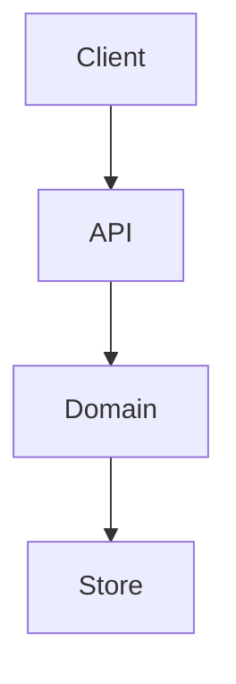

# ARCHITECTURE — <Project name>

## 1. Domain

- **Problem space:** <what problem this solves>
- **Core entities:** <list>
- **Ubiquitous language:** <term → definition>
- **Bounded contexts:** <context name → responsibility → owner>

## 2. System shape

## 3. Layers and boundaries

| Layer | May depend on | Must not depend on |
|---|---|---|
| <layer> | <lower layers> | <higher layers> |

## 4. Key decisions

| # | Decision | Context | Consequence |
|---|---|---|---|
| ADR-001 | <decision> | <why now> | <trade-off accepted> |

## 5. Cross-cutting concerns

- **Harness workspace lifecycle:** required default; project-local optional permits assigned
  nonprotected checkout edits/commits, retaining secrets/protected commits. All lanes/findings
  reuse original repo-specific paths. Assigned scopes may cross layers only explicitly.
- **Human integration:** handoff prints every repository diff and batch lifecycle commands.
  Merge preflights all sources/targets except live board metadata; multi-repo completion is
  non-atomic. Preserve partial state; specialist resolves existing conflicts, human completes
  and retries. Merged requires all surfaces; merged cleanup is automatic. Discard needs explicit
  loss approval and remains confined to selected mapped linked worktrees/feature branches.
- **Authenticated QA:** existing capture script accepts ignored local storage-state/approved
  env-backed navigation. Explicit authorization for destructive actions; no bypass or secrets
  in CLI/commits/evidence. See UI-UX and QA skill; evidence/accessibility requirements stay intact.

- **Error handling:** <policy>
- **Logging:** <policy>
- **Auth:** <policy>
- **Configuration:** <source of truth>
- **Data flow:** <request → processing → persistence>
- **Concurrency:** <model, locks, idempotency>

## 6. Roadmap

| Horizon | Item | Reason |
|---|---|---|
| **Now** | | |
| **Next** | | |
| **Later** | | |
